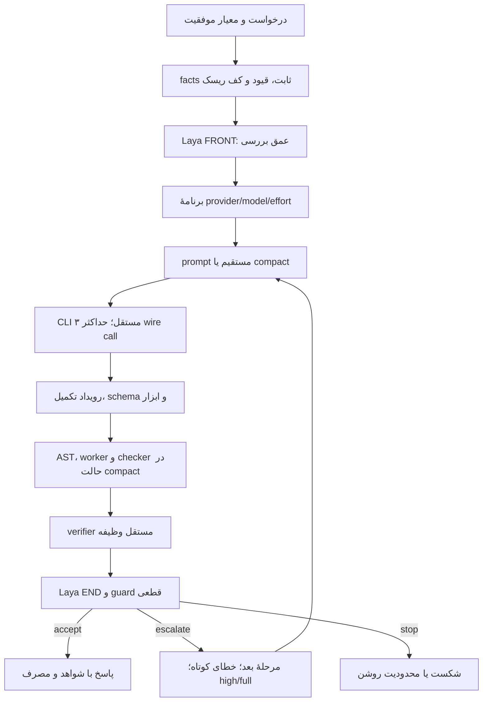

# مشخصات دقیق FLux v1 برای اسکیل Codex + GapCode

تاریخ نسخه: ۲۰۲۶-۱۰-۰۶. این سند مشخصات اجرای اسکیل است؛ وضعیت مدل‌ها از آزمون همان روز می‌آید. اسکیل در سطح عامل کار می‌کند و اتصال را با helperهای واقعی انجام می‌دهد. این بسته سرویس production Flux را تغییر نمی‌دهد.

## ۱. اصل الگوریتم و تغییر نسبت به نسخهٔ Codex

اصل Senior ثابت است: یک مدل اقتصادی با تلاش کم، اجرای/بررسی محلی، سپس ارتقای محدود. مدل قوی فقط وقتی فراخوانی می‌شود که بررسی شکست بخورد یا Laya پس از بررسیِ موفق درخواست تلاش قوی‌تر کند. این سیاست با GOAT و تابع هزینهٔ احتمالاتی آن متفاوت است؛ این نسخه router آموزش‌دیده یا هزینهٔ موردانتظار مدل‌های GapCode ندارد.

تغییرهای اسکیل چندارائه‌دهنده:

1. endpoint با زوج `(provider,model)` شناخته می‌شود؛ یک نام مدل در دو provider دو مسیر مستقل است.
2. adapter هر دو CLI واقعی Codex و GapCode را اجرا می‌کند.
3. کاتالوگ به‌تنهایی eligibility نمی‌سازد؛ ping، قرارداد خروجی و برنامهٔ محلی جدا بررسی می‌شوند.
4. فقط یک حصار کامل JSON می‌تواند بدون تغییر محتوا unwrap شود؛ این کار برای Fable مشاهده و آزموده شد.
5. FRONT فقط عمق بررسی می‌پرسد. در benchmark قبلی Laya مدل و effort هم پیشنهاد می‌داد، ولی Senior آنها را بر انتخاب اولیه اعمال نمی‌کرد. کاهش این پرسش‌ها، تغییر مشخص نسخهٔ اسکیل است و صرفه‌جویی آن جدا benchmark نشده.
6. مرجع مدل‌ها قیمت کیف پول GapCode ندارد؛ ترتیب اقتصادیِ تمام خانواده‌ها از نام Flash، Luna یا Sonnet استنتاج نمی‌شود.

## ۲. جریان اجرا



مسیر مستقیم از بررسی برنامهٔ پارامتری عبور نمی‌کند؛ verifier آن متناسب با پاسخ مستقیم، تابع یا patch است. جدول بالا مسیر compact را نمایش می‌دهد.

## ۳. ورودی و حالت درخواست

عامل پیش از فراخوانی این اطلاعات را مشخص می‌کند:

```json
{
  "request_id": "شناسهٔ یکتا",
  "task": "متن درخواست و تمام قیدهای اجباری",
  "family": "arithmetic | finite_count | scheduling | direct | code",
  "facts": {},
  "risk_floor": "low | medium | high",
  "output_contract": "نوع و schema خروجی",
  "verification_plan": "معیار مستقل موفقیت و محدودیت پوشش",
  "provider_plan": [],
  "max_wire_calls": 3,
  "timeout_s": 90
}
```

family و risk_floor ویژگی‌های قرارداد/تفسیر عامل‌اند، نه labelهایی که به‌تنهایی اثبات صحت متن باشند. یک دستور با قید خارج از schema شناخته‌شده نباید به قالبی برود که آن قید را نمی‌بیند. پاسخ مرجع، seed خصوصی آزمون، کد oracle یا خروجی یک مدل دیگر در prompt مدل حل‌کننده قرار نمی‌گیرند.

facts در تمام تلاش‌ها ثابت است؛ hash آن را می‌توان در رسید درخواست ثبت کرد. خطای کوتاه، provider، effort و قالب مجاز قابل‌تغییرند؛ دادهٔ مسئله، معیار کیفیت و تعریف خروجی نباید برای عبور از تست تغییر کنند.

## ۴. قرارداد compact و نمونهٔ فاکتور

داده فقط یک بار در FACTS به مدل داده می‌شود. دادهٔ نمونه:

```json
{
  "lines": [
    {"qty": 3, "unit_cents": 1299, "discount_percent": 17},
    {"qty": 2, "unit_cents": 701, "discount_percent": 5}
  ],
  "shipping": 475,
  "tax_percent": 8.25
}
```

قرارداد: هر سطر پس از تخفیف با HALF UP به سنت صحیح گرد می‌شود؛ سپس subtotal جمع می‌شود. مالیات درصد subtotal است و HALF UP می‌شود. حمل مالیات ندارد؛ total جمع subtotal، tax و shipping است.

قالب خروجی مدل:

```json
{
  "refs": ["lines", "shipping", "tax_percent"],
  "code": "def solve(facts): ...\ndef check(answer, facts): ..."
}
```

refs باید دقیقاً کلیدهای **سطح اول** facts باشد. qty و unit_cents کلیدهای داخل lines هستند و نباید در refs اضافه شوند. این جزئیات اهمیت عملی دارد: نمونهٔ Luna در آزمون افزودن کلیدهای تو در تو را انجام داد و به همین علت رد شد.

solve، پاسخ JSON خواسته‌شده را می‌سازد. check، پاسخ را با داده و derivation دیگری می‌سنجد. گراف متنیِ مدل حذف می‌شود؛ در خانوادهٔ شناخته‌شده، قیدها از قرارداد محلی می‌آیند. refs و گراف محلی اثبات استفادهٔ معنایی از همهٔ داده‌ها نیستند.

نمونهٔ دستور مناسب برای مدل:

```text
Use only TASK and FACTS. Return only JSON with refs and code.
refs must equal exactly the top-level FACTS keys, no duplicates or nested keys.
Define solve(facts) returning the requested JSON object.
Define check(answer,facts) returning bool by an independent derivation.
Do not call solve from check or return a constant success.
Read data from facts; do not embed the dataset in the generated code.
No explanatory graph. Use exact arithmetic and the worker allowlist.
Finish solve and check together within 4 seconds.
```

این متن نمونهٔ اجرایی است؛ باید قیدهای واقعی TASK نیز کامل همراه آن باشد. تغییر wording پس از آزمون را با benchmark قبلی یکسان معرفی نکن.

## ۵. انتخاب provider و مدل

مرجع پیکربندی `models.json` دارد: enabled، compact_qualified، supported_efforts، tested_efforts، منشأ آزمون و قیمت نامعلوم. اجازهٔ خروجی مستقیم با اثبات قرارداد compact یکی نیست.

پروفایل پیش‌فرض mixed:

| مرحله | endpoint | effort | بررسی |
|---|---|---|---|
| صفر | codex/gpt-6-luna | low | Laya + کف ریسک |
| یک | gapcode/gpt-6.1-sol | high | full |
| دو | gapcode/gpt-6-astra | high | full |

این پیش‌فرض GapCode را در مسیر ارتقا وارد می‌کند و ترتیب مدل‌های Senior قبلی را حفظ می‌کند. انتخاب provider مربوط به استفاده از دو اتصال است؛ از آن ادعای کمترین هزینهٔ کیف پول نمی‌شود. اگر کاربر provider یا مدل مشخصی بخواهد، برنامه مطابق آن و قابلیت واقعی endpoint ساخته می‌شود.

پروفایل codex-only همان سه مدل را در Codex به کار می‌گیرد. در gapcode-preferred برای پاسخ مستقیم، Luna قابل‌استفاده است؛ برای compact در snapshot فعلی فقط Sol، Astra و Fable تست برنامه را پاس کرده‌اند. آغاز با Sol یا Fable باید در گزارش «مدل شروع تغییرکرده» و «قیمت نامعلوم» ثبت شود؛ این همان آزمون اولیهٔ Luna-first نیست.

Fable، Opus، Sonnet، Qwen، Kimi یا GLM را فقط بر اساس نام در ردیف قوی‌تر/ارزان‌تر قرار نده. دادهٔ کالیبراسیون هزینه/دقت مستقل و متنوع برای آن ترتیب موجود نیست. مدل‌های direct-only با انتخاب صریح می‌توانند برای پاسخ مستقیم استفاده شوند؛ آنها در compact خودکار نمی‌آیند.

اگر provider خطا داد، همان مدل روی provider دیگرِ فعال ممکن است انتخاب شود. این failover است، نه ارتقای توان استدلال. آن wire call نیز یک فرصت مصرف می‌کند. برنامهٔ سه‌فرصتی ممکن است پس از failover جا برای تمام سه مدل نداشته باشد؛ حد تلاش را بی‌صدا افزایش نده.

## ۶. Laya واقعی

helper `laya_decision.py` از `laya.load(checkpoint, subfolder='multilingual', device='cuda', backend='eager')` و `predict_long` استفاده می‌کند. FRONT انتخاب light/medium/full است؛ END انتخاب accept/escalate/stop.

Laya را یک بار در فرایند orchestration بارگذاری کن. اجرای مستقل CLI آن برای هر تصمیم، وزن‌ها را دوباره بارگذاری می‌کند و هزینهٔ زمان دارد؛ این روش صرفاً برای عیب‌یابی یک تصمیم مناسب است.

محیط تأییدشدهٔ موجود در این دستگاه: Laya 0.3.28، transformers 4.57.6، torch 2.6.0+cu124، CUDA روی RTX 3060 Laptop. checkpoint چندزبانهٔ مشترک آزمایش Flux با revision `7b928d828b7b0e022f929d9bd2e44165aa270148` و SHA256 وزن `9d628fd971b700382ac6f65920a86f149777b2e748e0c955fb3b19695aa8f204` است. اسکیل وزن ۶۴۴ مگابایتی را داخل بسته کپی نمی‌کند.

ورودی FRONT شامل درخواست، facts ضروری و کف ریسک است. END شامل درخواست، candidate، provider_completed، نتیجهٔ verifier و remaining_attempts است. رویدادهای خروجی، latency و dropped/truncated fields ثبت می‌شوند. حذف داده یا سؤال لازم خطا است. احتمالات Laya توزیع گزینه‌ها هستند و احتمال صحت مدل نیستند. وزن‌ها برای این کار fine-tune نشده‌اند.

## ۷. گیت قطعی و سقف تلاش

```python
def final_action(choice, passed, attempt):
    if not passed:
        return "escalate" if attempt < 2 else "stop"
    if choice == "escalate" and attempt < 2:
        return "escalate"
    return "accept"
```

failed شامل شکست تکمیل provider، ابزار غیرمجاز، schema، worker، checker و معیار مستقل است. accept خام Laya بر failed غالب نیست. stop خام Laya بعد از پاسخ بررسی‌شده نیز پاسخ درست را حذف نمی‌کند. Laya درخواست ارتقای پاسخ پاس‌شده را می‌تواند اعمال کند، اگر فرصت باقی باشد.

بعد از ارتقای کیفی، effort=high و verify=full است. اگر high در endpoint انتخاب‌شده پشتیبانی نمی‌شود، effort مجاز و معادلِ ثبت‌شده انتخاب شود و تفاوت گزارش شود؛ عدد effort را برای خانوادهٔ دیگری حدس نزن. سقف سه wire call، شامل شکست اتصال، timeout و خطای قرارداد است.

بازخورد کوتاه است: نوع خطا و قید نقض‌شده، حداکثر ۲۴۰ کاراکتر. متن کامل برنامهٔ شکست‌خورده، reasoning و گراف قبلی در prompt بعد تکرار نمی‌شوند. در benchmark پاسخ‌های نهایی جدا full-audit می‌شوند؛ false_accept باید از fail معمولی جدا ثبت شود.

## ۸. adapter CLI و اعتبارسنجی تکمیل

`call_model.py` برای هر endpoint native binary را پیدا می‌کند، prompt را از stdin می‌فرستد و JSONL را می‌خواند. config عمومی خوانده/نوشته نمی‌شود؛ ورود همچنان از profile اصلی CLI انجام می‌شود. متغیرهای موروثی API key/base URL مربوط به OpenAI/Codex پاک می‌شوند تا مسیر پرداخت بی‌صدا عوض نشود. مقدار credential در اسکیل یا سند ثبت نمی‌شود.

تنظیم هر process: ephemeral، ignore-user-config، read-only، approval never، مدل و effort صریح، instructions کوتاه، personality none، project_doc_max_bytes صفر، web_search disabled، shell/apps/memories/multi_agent/skill_search disabled و skip_host_skill_discovery. این حالت برای solver مستقل و بدون ابزار است؛ عامل عمومی repository همان قابلیت‌ها را با آن حفظ نمی‌کند.

در مسیر GapCode، request_max_retries و stream_max_retries ارائه‌دهنده به صفر تنظیم می‌شود. نتیجهٔ تست helper موفق، پذیرش config را نشان می‌دهد؛ کنترل retry سمت upstream را اثبات نمی‌کند. در probes اولیه، DeepSeek با 402 پنج retry داخلی CLI داشت؛ آن رفتار در گزارش پنهان نشده است.

موفقیت انتقال: رویداد واقعی `turn.completed` + exit_code=0 + نبود timeout. ابزارها با رویداد item برای command_execution، mcp_tool_call، web_search و file_change بررسی می‌شوند. موفقیت انتقال بدون صحت schema یا verifier، موفقیت وظیفه نیست.

نام server-side مدل به‌صورت مستقل تأیید نشده؛ receipt فقط provider/model/effort درخواست‌شده و پاسخ سرویس را نشان می‌دهد. مدل هم‌نام در GapCode و Codex، هزینه و کانتکست یکسانِ اثبات‌شده ندارد.

## ۹. normalization، AST و worker

parser تنها JSON کامل یا یک حصار کامل ```json / ``` با همان JSON را قبول می‌کند. متن قبل/بعد، چند JSON، کلید تکراری و مقدار غیرمتناهی رد می‌شوند. Qwen در نمونهٔ compact حصار Python داد؛ آن را با parser حدسی به قرارداد JSON تبدیل نکردیم.

AST: solve(facts)، check(answer,facts)، خواندن آرگومان‌ها، refs بدون تکرار و برابر کلیدهای سطح اول، نبود فراخوانی مستقیم solve در check، نبود checker ثابت. این شروط استقلال معنایی را اثبات نمی‌کنند؛ helper مشترک یا خطای مشترک ممکن است باقی بماند.

worker در subprocess `-I -S` با allowlist builtin/import و timeout پنج ثانیه اجرا می‌شود. ماژول‌های محاسباتی مانند math، fractions، itertools، functools، collections، heapq، bisect و decimal مجازند. کلاس، نام خصوصی، IO، introspection و dynamic evaluation در کد مدل رد می‌شوند. builtinهای خارج از allowlist، مثل bin و type، می‌توانند موجب شکست شوند.

جواب به encoding دقیق منتقل و در helper decoded می‌شود. helper بسته‌بندی‌شده برای مقادیر صحیح و ساختارهای mapping/sequence/string/bool آماده است؛ fraction یا decimal با denominator غیر از یک رد می‌شود. برای مسئلهٔ اعشاری باید قرارداد/decoder مناسب جدا طراحی شود.

این worker sandbox کامل OS و حد سخت RAM نیست. در آزمون ورودی کنترل‌شده داشتیم؛ ادعای اجرای امنِ هر کد نامطمئن از آن نتیجه نمی‌شود. ارزیاب مستقل بیرون از کد مدل باقی می‌ماند. مقدار `independent_verifier_pass=null` در helper به این معنی است که آن مرحله هنوز اجرا نشده.

## ۱۰. مرجع بررسی مستقل

برای فاکتور، Decimal و HALF UP بیرون از برنامهٔ تولیدی؛ برای شمارش محدود، enumeration مرجع؛ برای زمان‌بندی کوچک، feasibility و کمینهٔ واقعی همهٔ ترتیب‌ها؛ برای کد، تست مستقلِ ورودی عادی/مرزی، عدم تغییر ورودی و قرارداد خروجی. برای patch، تست‌های مربوط به رفتار خواسته‌شده و بررسی diff مناسب‌اند.

oracle همهٔ وظایف عمومی در دسترس نیست. عامل باید معیار قابل‌بررسی، پوشش و شکاف باقی‌مانده را مشخص کند؛ رأی دو مدل یا خودگزارش checker را اثبات رسمی ننامد. سطح light نمی‌تواند قید اجباری یا معیار ضروری پذیرش را حذف کند. تست تمام benchmarkها full و برابر است.

## ۱۱. بودجه و حافظه

در benchmark Senior v2 قبلی، admit_context بودجهٔ محلی ورودی ۸۰۰۰، رزرو خروجی ۴۰۰۰ و فرض پنجرهٔ ۲۴۰۰۰ را اعمال کرد. این شمارش، کانتکست پنهان CLI را شامل نمی‌شد. helper اتصال اسکیل خودش این admission را پیاده نمی‌کند؛ عامل/سامانهٔ میزبان باید شمارش دقیقِ tokenizer مربوط را پیش از فراخوانی انجام دهد.

برای درخواست مستقل، حافظهٔ پروژه وارد prompt نمی‌شود. برای درخواست پروژه‌محور، شواهد مرتبط و کامل با provenance انتخاب شوند؛ دادهٔ ضروری برای کوچک‌شدن pack حذف نشود. در آزمون‌های این افزونه RAG فعال و اندازه‌گیری نشده است. اندازهٔ فایل MD یا pack، مصرف واقعی ارائه‌دهنده نیست.

## ۱۲. رسید و حسابداری

receipt شامل prompt و command دقیق، endpoint درخواست‌شده، UTC، تکمیل، exit، timeout، latency، text، raw_events، stderr، تعداد ابزار و usage است. برای فراخوانی تازه receipt تازه لازم است؛ helper فایل موجود را بازنویسی/replay نمی‌کند. رسید ممکن است متن ورودی کاربر را داشته باشد؛ هنگام اشتراک‌گذاری فقط artifact متناسب با درخواست را بده.

```text
provider_total_tokens = input_tokens + output_tokens
cached_input_tokens ⊆ input_tokens
reasoning_output_tokens ⊆ output_tokens
```

usage ناموجود نامعلوم است، نه صفر. timeout می‌تواند هزینهٔ ثبت‌نشده داشته باشد. هزینهٔ واقعی GapCode-wallet در این ابزار مشاهده نشده و actual_billing_usd=null است. تعرفهٔ فرضی API برای مدل GPT را به فاکتور کیف پول GapCode تعمیم نده.

فرایند عامل اصلی که اسکیل را هماهنگ می‌کند نیز توکن مصرف می‌کند؛ دفتر child-CLI آن هزینه را نمی‌گیرد. تصمیم محلی Laya output تولیدی ندارد، اما encoder، GPU، زمان بارگذاری و برق رایگانِ اندازه‌گیری‌شده نیستند. هزینهٔ کل یک سامانه فقط با افزودن همهٔ این اجزا قابل‌مقایسه است.

## ۱۳. اجرای helperها

مسیرها نمونهٔ همین دستگاه هستند؛ در محیط دیگر مسیر پوشهٔ اسکیل و checkpoint را جایگزین کن. credential جابه‌جا نکن.

```powershell
$skillRoot = 'C:/Users/xio/.codex/skills/flux-v1'
$py = 'D:/project/Alacrity/Flux/experiments/flux_laya_policy_20261006/.venv/Scripts/python.exe'
& $py -X utf8 "$skillRoot/scripts/call_model.py" `
  --provider gapcode --model gpt-6.1-sol --effort high `
  --contract compact --prompt-file ./prompt.txt --receipt ./run-001.json
```

برای validate، ابتدا text رسید را با normalize به JSON دادهٔ کاندید تبدیل و جدا ذخیره کن؛ candidate.json خود receipt نیست.

```powershell
& $py -X utf8 "$skillRoot/scripts/validate_program.py" `
  --candidate ./candidate.json --facts ./facts.json
```

برای یک تصمیم Laya:

```powershell
& $py -X utf8 "$skillRoot/scripts/laya_decision.py" `
  --checkpoint 'D:/project/Alacrity/Flux/experiments/flux_laya_policy_20261006/checkpoint' `
  --state ./state.json --phase front --receipt ./laya-front.json
```

برای orchestration از import `predict()` و `guard()` در فرایندی با agent بارگذاری‌شده استفاده کن؛ فراخوانی CLI تک‌تصمیمی بالا وزن را برای هر دستور دوباره بارگذاری می‌کند. مراحل تهیهٔ verifier، ساخت plan و تصمیمِ اعمال‌شده توسط عامل انجام می‌شوند؛ helperها اجرای کامل همهٔ خانواده‌ها را خودکار نمی‌کنند.

## ۱۴. وضعیت شواهد و بازتولید

آزمون قبلی Senior v2، در چهار مسیر اصلی روی ۱۲ ورودی تازه و شش اجرای فرعی بود؛ Senior v2 آنجا ۱۲/۱۲ درست با صفر ارتقا و ۱۱۱۵۹۹ توکن داشت. این نتیجهٔ Codex و قرارداد قبلی است. هیچ ادعای ۹۲٫۹٪ کاهش هزینه برای ترکیب GapCode از آن منتقل نمی‌شود.

افزونهٔ حاضر کاتالوگ تازهٔ native GapCode، ping واقعی هر مدلِ آن، یک برنامهٔ فاکتور برای هر مدل پاسخ‌گو و سه ورودی محلی برای همان برنامه را آزمود. مدل‌های qualified با این آزمون، در همهٔ خانواده‌های وظیفه یا effortها benchmark نشده‌اند. [model-tests.fa.md](model-tests.fa.md) نتیجهٔ دقیق، شکست‌ها و تست کامل Laya/adapter/worker را دارد.

آثار خام در `D:/project/Alacrity/Flux/experiments/senior_v2_gapcode_20261006` نگه‌داری شده‌اند: catalog، availability، compatibility، receipts، laya_receipts، آزمون helperها، آزمون یکپارچه و manifest hash. baselineهای منجمد Flux تغییر نکرده‌اند.

این اسکیل در محدودهٔ درخواست کاربر عمل می‌کند. اسکیل اجازهٔ ارسال پیام بیرونی، انتشار، خرید/شارژ حساب یا اقدام خارج از هدف کاربر نمی‌سازد. مدل‌ها و quota ممکن است تغییر کنند؛ هنگام drift، شکست یا به‌کارگیری روی حساب دیگر، تست کوتاه تازه با رسید تازه انجام و registry با شاهد به‌روزرسانی شود.

## ۱۵. منابع

- [راهنمای رسمی GapCode](https://aigap.app/gapcode): CLI، حساب و جدا بودن کیف پول GapCode از API.
- [راهنمای رسمی برنامه‌نویسی GapGPT](https://aigap.app/programming): دسترسی به چند خانواده و لزوم مقایسهٔ واقعی کیفیت/مصرف.
- [مستندات config رسمی Codex](https://learn.chatgpt.com/docs/config-file/config-reference): تنظیمات process؛ سازگاری fork GapCode علاوه بر مستندات با probe سنجیده شد.
- baseline دقیق: `experiments/flux_laya_v2_repeat_20261006/ALGORITHM.fa.md` و `results.json` در پروژهٔ Flux.
