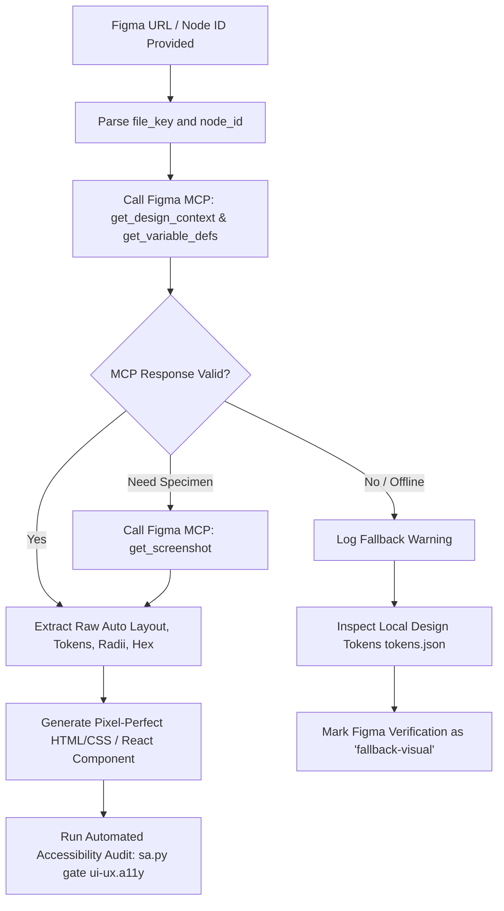

# Figma MCP Integration: Pixel-Perfect Raw Data Extraction

## Tool Contract

| Contract Element | Specification |
|---|---|
| **Pre-requisite** | Figma MCP server active in the environment with sanctioned endpoints (`get_design_context`, `get_metadata`, `get_variable_defs`, `get_screenshot` available), and a valid Figma file key / node URL with access permissions. |
| **Input** | Target `file_key`, canonical `node_id` (converted from URL format `123-456` to `123:456`), and optional parameters. |
| **Expected Outcome** | Complete raw design context extracted directly (Auto Layout modes, spacing, paddings, sizing constraints, corner radii, fills, variable alias bindings, and vector SVGs) without screenshot approximation. |
| **Failure Condition** | Figma MCP server offline or unauthenticated (`FIGMA_ACCESS_TOKEN` invalid), HTTP 404 / node not found, rate limits, or network failure. Must report error and prompt for valid credentials or fallback to code-based spec. |

---

When the project references a Figma design file, node URL, or design deliverable, the AI **MUST explicitly query the Figma Model Context Protocol (MCP) Server** to extract raw design properties directly.

> **CRITICAL ARCHITECTURAL DIRECTIVE:**
> **The AI is strictly forbidden from attempting to call undocumented Figma API commands.**
> All Figma integrations must utilize only the 4 sanctioned MCP endpoints documented below.
> **NEVER rely on visual image estimation or screenshot approximations.**
> Screenshot-based estimation introduces hallucinated padding, rounding errors, inaccurate hex colors, and broken responsive behaviors. The Figma MCP Server provides the single source of truth for raw geometry, tokens, and Auto Layout parameters.

---

## 1. Sanctioned Figma MCP Tool Endpoints

The AI is restricted strictly to these 4 official MCP tool endpoints:

1. **`get_design_context`**:
   - *Purpose*: Extracts raw AST element tree, Auto Layout parameters (flex direction, wrap, item spacing), paddings, fills, strokes, corner radii, and typographic properties for target `node_id`.
   - *Usage*: Main endpoint for extracting component layout and geometry.

2. **`get_metadata`**:
   - *Purpose*: Retrieves high-level file metadata, component sets, frame hierarchies, and document page lists.
   - *Usage*: Initial file inspection and multi-screen discovery.

3. **`get_variable_defs`**:
   - *Purpose*: Extracts native Figma Variables (Color palettes, Spacing scales, Radii, Modes: Light/Dark) and resolves `VARIABLE_ALIAS` bindings directly to semantic design tokens.
   - *Usage*: Token architecture generation (`tokens.json`).

4. **`get_screenshot`**:
   - *Purpose*: Generates an authoritative rendered image snapshot of a specific frame or component for visual verification and layout comparison.
   - *Usage*: Validating rendered layout fidelity against code implementation.

### Canonical Extraction Sequence
1. Parse URL: Extract `file_key` and convert `node-id=123-456` into `123:456`.
2. Metadata & Variables: Call `get_metadata` and `get_variable_defs` to resolve global tokens.
3. Design Context: Call `get_design_context(file_key, node_id)` to extract Auto Layout and styles.
4. Visual Specimen: Call `get_screenshot(file_key, node_id)` if visual verification is needed.

---

## 2. Deterministic Mapping: Figma AST to Production Code

Map raw AST properties directly into production CSS Flexbox, Grid, and Design Tokens:

### A. Auto Layout to CSS Layout Mapping

| Figma AST Property | Property Value | Target CSS Implementation |
|---|---|---|
| `layoutMode` | `"HORIZONTAL"` | `display: flex; flex-direction: row;` |
| `layoutMode` | `"VERTICAL"` | `display: flex; flex-direction: column;` |
| `layoutWrap` | `"WRAP"` | `flex-wrap: wrap;` |
| `layoutWrap` | `"NO_WRAP"` | `flex-wrap: nowrap;` |
| `itemSpacing` | `N` (number) | `gap: Npx;` (or semantic spacing token `var(--space-*)`) |
| `paddingTop`, `paddingRight`, `paddingBottom`, `paddingLeft` | `T, R, B, L` | `padding: Tpx Rpx Bpx Lpx;` |
| `primaryAxisAlignItems` | `"MIN"` | `justify-content: flex-start;` |
| `primaryAxisAlignItems` | `"CENTER"` | `justify-content: center;` |
| `primaryAxisAlignItems` | `"MAX"` | `justify-content: flex-end;` |
| `primaryAxisAlignItems` | `"SPACE_BETWEEN"` | `justify-content: space-between;` |
| `counterAxisAlignItems` | `"MIN"` | `align-items: flex-start;` |
| `counterAxisAlignItems` | `"CENTER"` | `align-items: center;` |
| `counterAxisAlignItems` | `"MAX"` | `align-items: flex-end;` |
| `counterAxisAlignItems` | `"BASELINE"` | `align-items: baseline;` |
| `layoutSizingHorizontal` | `"FIXED"` | `width: ${absoluteBoundingBox.width}px;` |
| `layoutSizingHorizontal` | `"HUG"` | `width: fit-content;` |
| `layoutSizingHorizontal` | `"FILL"` | `flex: 1 1 0%; align-self: stretch; width: 100%;` |
| `layoutSizingVertical` | `"FIXED"` | `height: ${absoluteBoundingBox.height}px;` |
| `layoutSizingVertical` | `"HUG"` | `height: fit-content;` |
| `layoutSizingVertical` | `"FILL"` | `flex: 1 1 0%; align-self: stretch; height: 100%;` |

### B. Colors, Fills, and Design Tokens

1. **Extract Raw RGBA**:
   Figma stores color channels normalized from `0.0` to `1.0`. Convert accurately:
   ```javascript
   const r = Math.round(fills[0].color.r * 255);
   const g = Math.round(fills[0].color.g * 255);
   const b = Math.round(fills[0].color.b * 255);
   const a = fills[0].opacity !== undefined ? fills[0].opacity : (fills[0].color.a ?? 1.0);
   // Format as exact Hex: #RRGGBB or #RRGGBBAA
   ```
2. **Variable Aliases**:
   When `boundVariables.fills` contains a `VARIABLE_ALIAS`, resolve the variable ID using `get_variables`. Output the semantic CSS variable (e.g., `var(--color-interactive-primary)`).
3. **Linear & Radial Gradients**:
   Read `gradientStops` array containing `position` and normalized `color` objects. Render as standard CSS `linear-gradient(...)`.

### C. Strokes, Borders, and Radii

- **Border Width & Color**:
  Read `strokeWeight` and `strokes[0].color`. Set `border: ${strokeWeight}px solid ${hexColor};`.
- **Stroke Alignment**:
  - `strokeAlign: "INSIDE"` -> Default CSS box model `box-sizing: border-box;`
  - `strokeAlign: "OUTSIDE"` -> `outline` or pseudo-element boundary
- **Corner Radii**:
  - Uniform: `cornerRadius` -> `border-radius: ${cornerRadius}px;`
  - Independent: `rectangleCornerRadii: [tl, tr, br, bl]` -> `border-radius: ${tl}px ${tr}px ${br}px ${bl}px;`

### D. Effects & Shadows

Inspect the `effects` array for active layers (`visible !== false`):
- **Drop Shadow**:
  `type: "DROP_SHADOW"` -> Extract `offset.x`, `offset.y`, `radius` (blur), `spread`, and `color`.
  CSS: `box-shadow: ${offset.x}px ${offset.y}px ${radius}px ${spread}px rgba(r, g, b, a);`
- **Inner Shadow**:
  `type: "INNER_SHADOW"` -> CSS: `box-shadow: inset ${offset.x}px ${offset.y}px ${radius}px ${spread}px rgba(r, g, b, a);`
- **Background Blur**:
  `type: "BACKGROUND_BLUR"` -> CSS: `backdrop-filter: blur(${radius}px); -webkit-backdrop-filter: blur(${radius}px);`

### E. Typography

Extract text styling from the node's `style` object:
- `fontFamily`: Exact font family with standard fallback chain (e.g. `'Inter', -apple-system, BlinkMacSystemFont, sans-serif`).
- `fontWeight`: Exact numeric weight (`400`, `500`, `600`, `700`).
- `fontSize`: Set `font-size: ${fontSize}px;` or relative `rem`.
- `lineHeightPx`: Calculate unitless line-height ratio: `(lineHeightPx / fontSize).toFixed(3)`.
- `letterSpacing`: Convert to `px` or `em`: `letter-spacing: ${letterSpacing}px;`.
- `textCase`: `"UPPER"` -> `text-transform: uppercase;`, `"LOWER"` -> `text-transform: lowercase;`.

---

## 3. Operational Workflow



---

## 4. Fallback Protocol (Strictly Bounded)

If the Figma MCP Server is unavailable, unauthenticated, or the network is offline:
1. Use the project's own tokens (its `tokens.json`, CSS variables or Tailwind theme). Never use files from this skill's `fixtures/` directory: they are test data.
2. If only static image assets exist, proceed with caution and mark the inspection status in the quality checklist as `fallback-visual`.
3. Never invent arbitrary dimensions: constrain layouts to 4px/8px standard grid increments.
