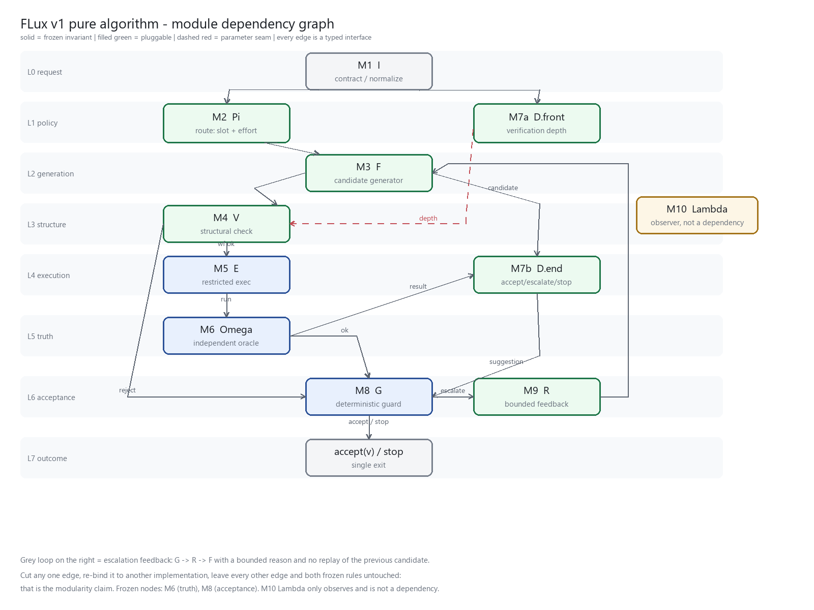
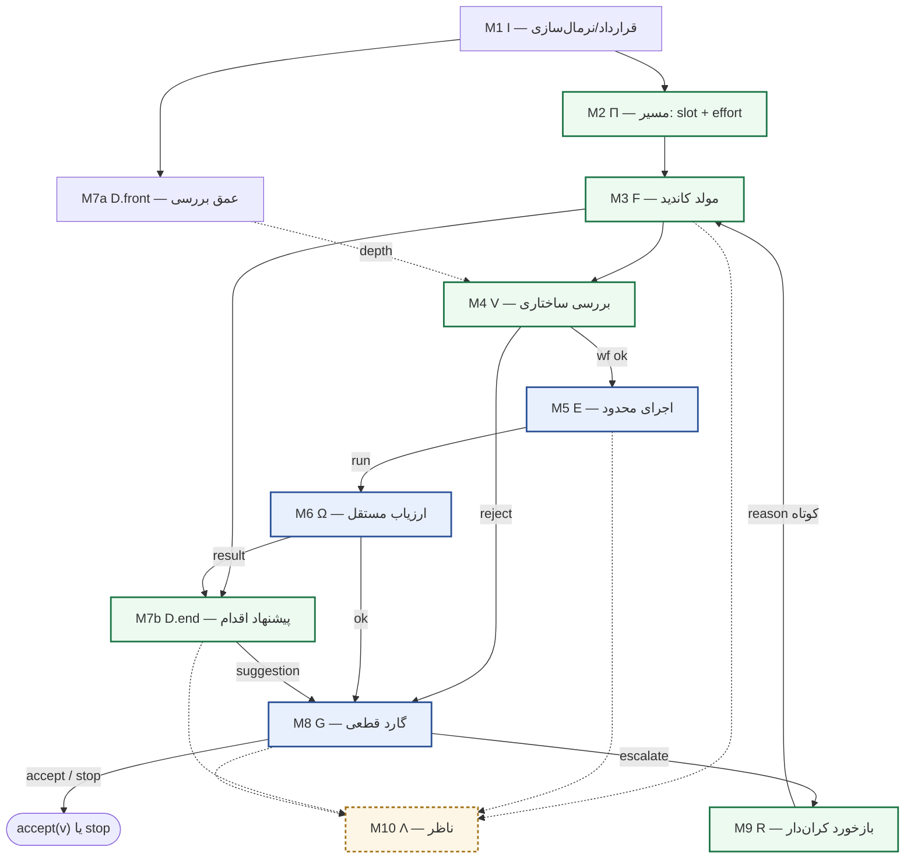
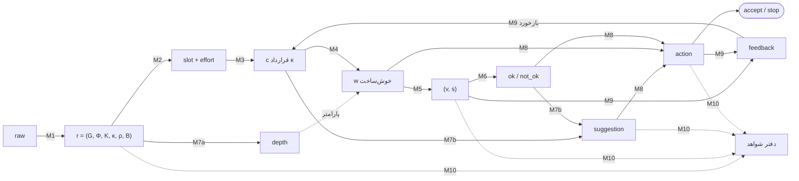
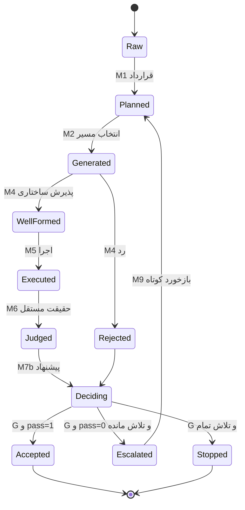
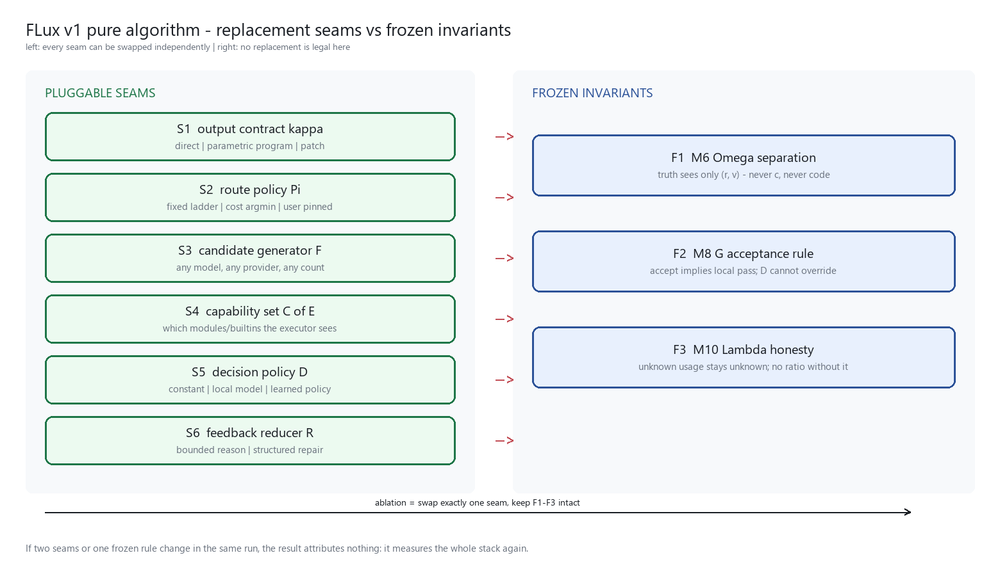
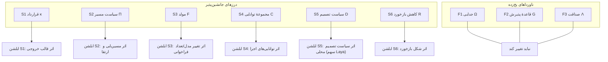

# نمای گرافی الگوریتم خالص FLux v1 — ماژولاریتی چگونه در گراف دیده می‌شود

پیوست گرافی سند [06-flux-v1-pure-algorithm.fa.md](06-flux-v1-pure-algorithm.fa.md) · تاریخ: ۲۰۲۶-۱۰-۰۶

> این سند همان بخش‌بندی ماژولار را در قالب گراف بازگو می‌کند. برچسب‌های تصویرهای PNG لاتین‌اند چون کتابخانهٔ رسم این محیط `libraqm` ندارد و فارسی در تصویر جدا/برعکس می‌شود؛ متن و گراف‌های mermaid فارسی‌اند.

---

## ۱. گراف وابستگی ماژول‌ها (هستهٔ بحث)





**لایه‌بندی گراف (از بالا به پایین):**

| لایه | گره‌ها | نقش گرافی |
|---|---|---|
| L0 | `M1 I` | تنها گرهٔ با درجهٔ ورودی صفر در ناحیهٔ داده — تمام مسیر از یک نقطه منشأ می‌گیرد |
| L1 | `M2 Π`, `M7a D.front` | دو شاخهٔ سیاست؛ یکی مصرف را شکل می‌دهد، دیگری عمق بررسی را |
| L2 | `M3 F` | تک‌گرهٔ تماس با دنیای بیرون (تنها منبع نامعین‌بودن) |
| L3–L5 | `M4 V` → `M5 E` → `M6 Ω` | زنجیرهٔ سختِ «شکل → اجرا → حقیقت» |
| L6 | `M8 G`, `M9 R` | تنها ناحیهٔ تصمیم؛ تنها مسیر به خروجی |
| L7 | `accept(v) / stop` | تنها چاه (sink) الگوریتم |

---

## ۲. چیزهایی که فقط از روی گراف می‌توان خواند

| # | خاصیت گرافی | ترجمهٔ الگوریتمی |
|---|---|---|
| ۱ | خروجی `OUT` **درجهٔ ورودی ۱** دارد و فقط از `M8 G` | «تنها مرجع پذیرش» بودن گارد، یک خاصیت ساختاری است، نه یک قرارداد نوشتاری (ناوردای P1) |
| ۲ | **هیچ یالی از `M3 F` به `M6 Ω`** وجود ندارد؛ ورودی `Ω` فقط از `M5 E` است و فقط *مقدار رمزگشایی‌شده* را حمل می‌کند | جدایی ارزیاب (P5) در گراف به‌صورت «نبود یال کاندید→حقیقت» بیان می‌شود |
| ۳ | تنها **دور** گراف `M3 F → M4 V → M8 G → M9 R → M3 F` است | پایان‌مندی (P2) فقط با کران‌گذاری روی همین دور معنا دارد؛ هر دور دیگری در طراحی، یک باگ است |
| ۴ | گره‌های `M6 Ω`, `M8 G` با یال ورودی/خروجی محدود و **بدون یال به `M3 F`** | ماژول‌های یخ‌زده دقیقاً همان‌هایی‌اند که به مولد وابسته نیستند |
| ۵ | `M7a` و `M7b` دو گرهٔ جدا هستند، نه یک گره | سیاست تصمیم دو نقش متفاوت دارد: پارامترکردن بررسی، و پیشنهاد اقدام؛ ادغام‌شان همان اشتباهی است که «تصمیم محلی» را به «مرجع صحت» تبدیل می‌کند |
| ۶ | `M10 Λ` یال ورودی دارد ولی یال خروجی ندارد | ناظر است، نه وابستگی: حذفش رفتار را تغییر نمی‌دهد، فقط توانِ ادعا را می‌برد |

**درجهٔ گره‌ها = سطح قرارداد ماژول:** هر یال یک واسط است. هرچه درجهٔ یک گره کمتر، قراردادش باریک‌تر و جانشین‌پذیری‌اش ارزان‌تر. `M6 Ω` با ورودی تک‌یالی، جانشین‌پذیرترین گرهٔ *سخت* است؛ `M3 F` با چند یال خروجی، گران‌ترین گره برای تعویض.

---

## ۳. گراف جریان داده: «ماژولار بودن = بریدن روی یال‌ها»



هر یال یک **آرتیفکت با نوع مشخص** است؛ ماژول‌ها همان گره‌هایی‌اند که یال‌ها را تولید می‌کنند. پس:

- **جانشین‌پذیری** = بریدن یک یال و وصل‌کردنش به پیاده‌سازی دیگر با همان نوع.
- **شکست انتزاع** = نیاز به دیدن *داخل* یک ماژول برای تعریف یال؛ در آن حالت، گراف دروغ می‌گوید.

---

## ۴. گراف کنترل: ماشین حالت گارد



| گذار | شرط | نتیجه |
|---|---|---|
| `Judged → Deciding` | همیشه | ورود نتیجهٔ `Ω` به تصمیم |
| `Deciding → Accepted` | `pass = 1` | خروج با مقدار + شواهد |
| `Deciding → Escalated` | `pass = 0` **یا** پیشنهاد `escalate` با تلاش باقی‌مانده | یک دور دیگر روی دورِ `F → V → G → R → F` |
| `Deciding → Stopped` | تلاش تمام | خروج با شکست و شواهد |

نکتهٔ ساختاری: هیچ گذاری از `Deciding` به `Accepted` وجود ندارد که `pass = 1` را چک نکند؛ این همان P1 است که در گراف به‌صورت **نبود یال** دیده می‌شود.

---

## ۵. گراف ابلشن: کدام یال را ببریم تا چه چیزی اندازه‌گیری شود





| ابلشن | یال/گرهٔ بریده‌شده | کمیت قابل‌انتساب | خطای رایج |
|---|---|---|---|
| `S5` | یال `M7a`+`M7b` با `D ≡ accept` | سهم رفتار تصمیم محلی در تعداد فراخوانی | نتیجه‌گیری «تصمیم محلی بی‌اثر است» از یک مجموعهٔ تسک قراردادی |
| `S2` | یال‌های `M2` با نردبان تک‌پله | سهم ارتقا در نجات شکست | نرخ شکست پایین، تفکیک را ناتوان می‌کند |
| `S1` | نوع یال `c` (پاسخ مستقیم به‌جای برنامه) | اثر قالب + بررسی | قالب و مسیر اجرا هم‌زمان عوض می‌شوند |
| `S4` | مجموعهٔ توانایی `C` | اثر محیط اجرا | تغییر محیط بدون تغییر قالب، سهم را جابه‌جا می‌کند |
| `F1` | **ممنوع** | — | حذف `Ω` تنها برای اندازه‌گیری `false_accept` مجاز است، نه برای انتشار |
| `F2` | **ممنوع** | — | هر تغییری در گارد، تعریف «پذیرش» را عوض می‌کند و مقایسه را بی‌معنا |
| `F3` | **ممنوع** | — | حذف `Λ` ادعای هزینه را بی‌پشتوانه می‌کند |

---

## ۶. شش قاعدهٔ خواندن این گراف‌ها

1. **هر یال یک قرارداد است.** اگر برای تعریف یک یال باید داخل ماژول را دید، یال بد تعریف شده است.
2. **گره‌های یخ‌زده همان‌هایی‌اند که به مولد وابسته نیستند** (`Ω`, `G`). هر یال تازه به این دو، خطرناک است.
3. **تنها دور مجاز، دور ارتقا است** و باید از گارد بگذرد؛ بودجه روی همین دور تعریف می‌شود.
4. **ناورداها را در گراف بجوی، نه در متن:** P1 = نبود یال به `OUT` جز از `G`؛ P5 = نبود یال از `F` به `Ω`.
5. **ناظر، وابستگی نیست.** یال‌های `Λ` یک‌طرفه‌اند و هرگز وارد منطق نمی‌شوند.
6. **هر ابلشن فقط یک یال.** اگر دو یال هم‌زمان بریده شوند، گراف دیگر یک آزمایش نیست، یک پیکربندی تازه است.

---

## ۷. متن گرافی (برای محیط‌هایی که mermaid رسم نمی‌کنند)

```text
                         ┌──────────────────────┐
                         │  M1 I   contract     │  L0
                         └───┬──────────────┬───┘
                    ┌────────┘              └────────┐
        ┌───────────▼──────────┐          ┌───────────▼──────────┐   L1
        │ M2 Π   slot+effort   │          │ M7a D.front  depth   │
        └───────────┬──────────┘          └───────────┬──────────┘
                    │                                 │ (depth, پارامتر)
        ┌───────────▼──────────┐                      │             L2
        │ M3 F   generator     │──────────────────────┼────────┐
        └───┬──────────────┬───┘                      │        │
            │              │                          │        │
   ┌────────▼─────────┐    │                    ┌─────▼────────▼─────┐  L3/L4
   │ M4 V  structure  │    │                    │ M7b D.end          │
   └───┬──────────┬───┘    │                    └─────────┬──────────┘
       │ wf ok    │ reject │                              │ suggestion
   ┌───▼──────────▼───┐    │                              │
   │ M5 E  restricted │    │                              │         L4
   └───┬──────────────┘    │                              │
   ┌───▼──────────────┐    │                              │         L5
   │ M6 Ω  oracle     │────┼────── ok ────────────────────┤
   └──────────────────┘    │                              │
                           │        ┌─────────────────────▼──┐      L6
                           └───────▶│ M8 G  deterministic    │
                                    └───┬────────────────┬───┘
                             escalate   │                │ accept / stop   L7
                                    ┌───▼────┐      ┌────▼─────┐
                                    │ M9 R   │      │  OUT     │
                                    └───┬────┘      └──────────┘
                                        └── بازخورد کوتاه ──▶ M3 F

  M10 Λ در گوشه، فقط ناظر: یال ورودی دارد، یال خروجی ندارد.
```

---

## ۸. خلاصه در یک جمله

بخش‌بندی ماژولار این الگوریتم را می‌توان کاملاً گرافی خواند: **یک دور کران‌دار روی زنجیرهٔ «تولید → بررسی → اجرا → حقیقت → تصمیم → بازخورد»، با یک چاهِ تک‌یالی (گارد)، و با دو گرهٔ یخ‌زده که هیچ یالی از مولد به آن‌ها نمی‌رسد.** هر ادعای جانشین‌پذیری = یک یال که می‌توان برید؛ هر ادعای صحت = یک یال که نباید وجود داشته باشد.
