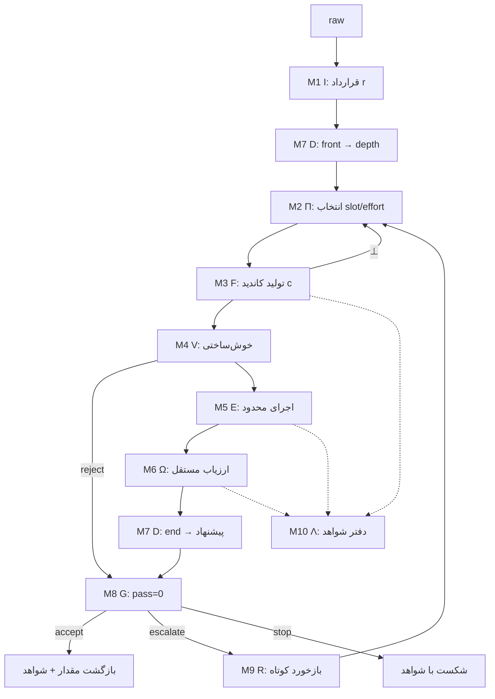

# الگوریتم خالص FLux v1 — مشخصات ماژولار و بی‌ابزار

شماره: ۰۶ · تاریخ: ۲۰۲۶-۱۰-۰۶ · وضعیت: مشخصات الگوریتم (نه گزارش اجرا)

> **قاعدهٔ خواندن این سند:** هیچ نام مدل، provider، CLI، حساب، چک‌پوینت یا سخت‌افزاری در بخش‌های ۱ تا ۱۰ normative نیست. هر وابستگی بیرونی به یک **تابع با دامنه و برد صریح** تبدیل شده است. نام‌های واقعی فقط یک‌جا، در «پیوست الف» و صرفاً برای ردیابی، می‌آیند و هیچ‌کدام بخشی از الگوریتم نیستند.
>
> **نمای گرافی همین بخش‌بندی:** [06-flux-v1-module-graphs.fa.md](06-flux-v1-module-graphs.fa.md) — گراف وابستگی، گراف جریان داده، ماشین حالت گارد و گراف ابلشن.

---

## ۰. قواعد انتزاع (چه چیزی حذف شد و چه چیزی حفظ شد)

| حذف‌شده از الگوریتم | نقش انتزاعی جانشین |
|---|---|
| نام و نسخهٔ مدل‌ها، خانوادهٔ ارائه‌دهنده، حساب و کیف پول | `slot` — یک شناسهٔ مبهم از فضای `𝕊` بدون معنای بیرونی |
| واسط CLI، پرچم‌های اجرا، محیط فرایند، مهلت شبکه | `F(slot, x) → c \| ⊥` — یک تابع مولد با مصرف شمارش‌پذیر |
| چک‌پوینت مدل محلی، GPU، حافظه، batch | `D(phase, s) → choice` — یک تابع تصمیم محلی بدون حالت پنهان |
| رسید، هش فایل، بازهٔ اطمینان آماری | `Λ` — دفتر شواهد (ماژول جانبی، خارج از هستهٔ الگوریتم) |
| جعبه‌شنی سیستم‌عامل، allowlist، timeout فرایند | `E` — هستهٔ ارزیابی با **مجموعهٔ توانایی κ** به‌عنوان پارامتر |

**حفظ‌شده (جان الگوریتم):** ترتیب و تعداد تلاش‌ها، قرارداد خروجی، تفکیک «بررسی محلی» از «ارزیاب مستقل»، گارد قطعی پذیرش، و قواعد نشت‌ناپذیری اطلاعات.

**اصل طراحی:** هر ماژول باید بدون دانستن «چه کسی آن را اجرا می‌کند» قابل تعریف باشد. اگر توصیف یک ماژول به نام یک محصول وابسته شد، آن ماژول درست انتزاع نشده است.

---

## ۱. مدل صوری

درخواست:

```text
r = (G, Φ, K, κ, ρ, B)
G : هدف (خروجی مطلوب)
Φ : facts — دادهٔ مسئله، تغییرناپذیر در طول اجرا
K : قیود اجباری (شامل قواعد گردکردن/شمارش/بهینگی و قرارداد دامنه)
κ : نوع قرارداد خروجی (مثلاً «برنامهٔ پارامتری» یا «پاسخ مستقیم»)
ρ : کف ریسک ∈ {low, medium, high}
B : بودجه = (N_max حداکثر فراخوانی، T_max مهلت هر فراخوانی)
```

فضای کاندید و محمول‌ها:

```text
c ∈ ℂ ∪ {⊥}                      ⊥ = شکست ارائه‌دهنده یا عدم تکمیل
wf(c) ∈ {0,1}                     خوش‌ساخت بودن ساختاری نسبت به κ
E(c)  ∈ {(v, s), error}           اجرا؛ s ∈ {⊤,⊥,?} خودبررسی برنامه
ok(r, v) ∈ {0,1}                  درستی مستقل مقدار v نسبت به r
action ∈ {accept, escalate, stop}
```

دو تعریف که همهٔ گزارش‌دهی بر آن‌ها سوار است:

```text
accepted(r)      ⇔ action = accept
false_accept(r)  ⇔ accepted(r) ∧ ¬ok(r, v)          ← تنها معیار خطر
```

---

## ۲. بخش‌بندی ماژولار

ده ماژول؛ هشت ماژول هسته و دو ماژول جانبی. هر ماژول با امضا، پیش‌شرط، پس‌شرط و **آنچه تضمین نمی‌کند** تعریف می‌شود.

### M1 — قراردادساز و نرمال‌ساز ورودی (`I`)

```text
I : raw → r
```
- **پیش‌شرط:** درخواست خام؛ ممکن است ناقص یا مبهم باشد.
- **پس‌شرط:** `r` با `G, Φ, K, κ, ρ, B` صریح؛ `Φ` یک‌بار تثبیت و در ادامهٔ اجرا تغییرناپذیر.
- **شکست:** فقدان دادهٔ لازم ⇒ توقف با اعلام صریح (نه حدس زدن).
- **تضمین نمی‌کند:** کامل بودن `K` نسبت به متن اصلی. انتخاب `κ` یک تصمیم مهندسی است، نه اثبات پوشش قیود.

### M2 — سیاست مسیر (`Π`)

```text
Π : (r, k) → (slot_k, effort_k)        k = شمارهٔ تلاش، از ۰
```
- **پیش‌شرط:** فضای `𝕊` و سطوح effort مجاز از پیش معلوم؛ `slot` باید «واجد شرایط κ» باشد.
- **پس‌شرط:** برای هر `k < N_max` یک زوج معتبر؛ دنبالهٔ `slot` یکنواخت از نظر توان (هر ارتقا ≥ تلاش قبل).
- **شکست:** نبود نامزد واجد شرایط ⇒ کاهش κ یا اعلام ناتوانی.
- **تضمین نمی‌کند:** بهینگی هزینه. `Π` شکل مصرف را تعیین می‌کند، نه درستی.

### M3 — مولد کاندید (`F`)

```text
F : (slot, x, κ) → c | ⊥        x = (G, Φ, K, feedback)
```
- **پیش‌شرط:** `x` شامل هیچ اطلاعات مرجعی (`ok`، پاسخ درست، یا کد ارزیاب) نباشد.
- **پس‌شرط:** یک کاندید کامل یا `⊥`؛ مصرف به `Λ` گزارش می‌شود؛ **هر فراخوانی یکتا** (نقشهٔ `(r,k) ↦ c` تابعی است؛ تکرار همان فراخوانی ممنوع).
- **شکست:** `⊥` ⇒ ورود به مسیر جانشین از `Π` یا توقف، مطابق گارد.
- **تضمین نمی‌کند:** درستی، تمامیت، یا هویت مدلِ خدمت‌دهنده. خروجی `F` یک **ادعا** است، نه شاهد.

### M4 — اعتبارسنج ساختاری (`V`)

```text
V : (c, Φ, κ) → (accept | reject(reason), normalized)
```
- **پیش‌شرط:** `c ≠ ⊥`.
- **پس‌شرط:** برای κ پارامتری: ارجاع‌ها دقیقاً برابر کلیدهای سطح اول `Φ`، امضاهای `solve(Φ)` و `check(v, Φ)` صحیح، آرگومان‌ها واقعاً مصرف‌شده، checker ثابت نباشد و `solve` را فراخوانی نکند.
- **شکست:** هر نقض ⇒ `reject(reason)` بدون اجرا.
- **تضمین نمی‌کند:** درستی معنایی. `V` فقط شکل و سازگاری را می‌سنجد؛ برنامهٔ خوش‌ساخت می‌تواند غلط باشد.

### M5 — هستهٔ ارزیابی محدود (`E`)

```text
E : (normalized, κ, Φ) → (v, s) | error        s ∈ {⊤, ⊥, ?}
```
- **پیش‌شرط:** κ و مجموعهٔ توانایی `C` (ماژول‌ها/توابع مجاز، ممنوعیت‌ها، سقف زمان و حافظه) به‌عنوان پارامتر.
- **پس‌شرط:** اجرا در محیطی که فقط `C` را می‌بیند؛ مقدار `v` در دامنهٔ κ رمزگذاری می‌شود (برای دامنهٔ عددی صحیح: نمایش کسری دقیق با مخرج ۱ — هیچ تقریب اعشاری‌ای مسیر پذیرش را باز نمی‌کند).
- **شکست:** خطای اجرا، تخطی از توانایی، اتمام زمان ⇒ `error` ⇔ `s = ⊥`.
- **تضمین نمی‌کند:** درستی. `s = ⊤` یعنی «برنامهٔ خودِ مدل با برنامهٔ خودِ مدل موافق است»؛ دو خطای هم‌ریشه می‌توانند `s = ⊤` بدهند.

### M6 — ارزیاب مستقل (`Ω`)

```text
Ω : (r, v) → ok | not_ok(reason)
```
- **پیش‌شرط (ناوردای جدایی):** `Ω` نباید از `c`، از کد تولیدشده، یا از `s` تغذیه شود؛ فقط `(r, v)`.
- **پس‌شرط:** تصمیم درستی بر اساس یک بازمحاسبهٔ مستقل (برای خانواده‌های دارای مرجع دقیق) یا معیار قابل‌بررسی اعلام‌شده.
- **شکست:** نبود مرجع ⇒ اعلام «بررسی‌نشده»، نه «درست».
- **تضمین نمی‌کند:** پوشش خانواده‌های بدون مرجع. بدون `Ω`، مفهوم `false_accept` تعریف‌نشده است.

### M7 — سیاست تصمیم (`D`) — تنها شکاف تصمیم الگوریتم

```text
D : (phase, state) → choice
phase = front : choice ∈ {light, medium, full}            عمق بررسی
phase = end   : choice ∈ {accept, escalate, stop}         پیشنهاد اقدام
state = مشاهدهٔ فاز (بدون پاسخ مرجع و بدون کد ارزیاب)
```
- **پیش‌شرط:** `state` فقط شامل هدف، facts، ریسک، کاندید، نتیجهٔ `E`/`Ω` و تلاش‌های باقی‌مانده باشد.
- **پس‌شرط:** یک انتخاب از مجموعهٔ متناهی؛ اختیاراً یک امتیاز/توزیع که **نباید** احتمال کالیبره‌شدهٔ درستی تلقی شود.
- **شکست:** انتخاب نامعتبر ⇒ بازگشت به پیش‌فرض ثابت.
- **تضمین نمی‌کند:** هیچ. `D` هیچ تضمین صحتی نمی‌دهد و اجازهٔ دور زدن گارد را ندارد.

### M8 — گارد پذیرش (`G`)

```text
G : (pass ∈ {0,1}, D_end, k, K) → action
```
```text
if pass = 0:  action ← (k < K-1) ? escalate : stop
else:         action ← (D_end = escalate ∧ k < K-1) ? escalate : accept
```
- **پس‌شرط:** `action = accept ⇒ pass = 1`. تنها مرجع پذیرش در کل الگوریتم.
- **تضمین نمی‌کند:** درستی `pass`. اگر `E` یا `Ω` اشتباه کنند، گارد همان اشتباه را مؤدبانه منتقل می‌کند.

### M9 — کاهش‌دهندهٔ بازخورد (`R`)

```text
R : (reason, c) → feedback
```
- **پس‌شرط:** فقط دلیل کوتاه و کران‌دار منتقل می‌شود؛ **کاندید قبلی بازفرستاده نمی‌شود**؛ `Φ` و `K` بدون تغییر می‌مانند.
- **تضمین نمی‌کند:** کفایت بازخورد برای ترمیم. بازخورد گزینشی می‌تواند مدل را به سمت ترمیم کورکورانه ببرد.

### M10 — دفتر شواهد (`Λ`) — جانبی

```text
Λ : record(attempt, slot, effort, usage, timings, decisions, hashes)
```
- **نقش:** تنها منبع ادعای عددی. بدون `Λ` الگوریتم کار می‌کند ولی هیچ ادعای هزینه/کیفیت قابل دفاع نیست.
- **قاعده:** مصرف نامعلوم «صفر» نیست و «نامعلوم» می‌ماند؛ اگر هر فراخوانی مؤثر در مقایسه مصرف نامعلوم داشته باشد، نسبت کاهش اعلام **نمی‌شود**.

---

## ۳. ترکیب ماژول‌ها



شبه‌کد خالص (بدون هیچ اشارهٔ ابزاری):

```text
SOLVE(raw):
    r ← I(raw)
    depth ← max(ρ(r), D(front, state₀(r)))
    feedback ← ε
    for k = 0 … N_max-1:
        (slot, effort) ← Π(r, k)
        c ← F(slot, effort, (r, feedback))
        if c = ⊥:
            Λ.record(k, slot, failure)
            (pass, reason) ← (0, "incomplete")
        else:
            w ← V(c, Φ, κ)
            if w = reject(reason):
                (pass, v) ← (0, reason)
            else:
                (v, s) ← E(w, C, Φ)
                pass ← (s = ⊤) ∧ Ω(r, v)
                reason ← Ω.reason if not pass else ε
        suggest ← D(end, state(r, c, pass, k))
        action  ← G(pass, suggest, k, N_max)
        Λ.record(k, slot, effort, usage, v, pass, suggest, action)
        if action = accept: return (v, evidence=Λ)
        if action = stop:   return failure(reason, evidence=Λ)
        feedback ← R(reason, c)
    return failure("budget exhausted", evidence=Λ)
```

---

## ۴. ناورداها (قابل بررسی در هر پیاده‌سازی)

| # | ناوردا | صورت‌بندی | پیامد نقض |
|---|---|---|---|
| P1 | سلامت پذیرش | `action = accept ⇒ pass = 1` | پذیرش غلط؛ `false_accept` بی‌معنا می‌شود |
| P2 | پایان‌مندی | تعداد فراخوانی‌ها ≤ `N_max` | حلقهٔ بی‌پایان/هزینهٔ نامحدود |
| P3 | یکنواختی تلاش | `effort_k` و توان `slot_k` نزولی نیستند | تلاش ضعیف‌تر پس از شکست ⇒ اتلاف بودجه |
| P4 | عدم تکرار | `(r, k) ↦ c` تابعی است | آلودگی آماری و «آزمون» ساختگی |
| P5 | جدایی ارزیاب | `Ω` فقط `(r, v)` می‌بیند | نشت مرجع به مولد یا وابستگی متقابل ⇒ اثبات دوری |
| P6 | بی‌طرفی گارد نسبت به `D` | `G` هرگز `pass=0` را با پیشنهاد `accept` تأیید نمی‌کند | تصمیم محلی به مرجع صحت تبدیل می‌شود |
| P7 | تثبیت ورودی | `Φ` و `K` در تمام تلاش‌ها یکسان | «موفقیت» با تغییر مسئله |
| P8 | صداقت مصرف | مصرف نامعلوم ≠ ۰؛ کاهش فقط با مصرف کامل اعلام می‌شود | ادعای صرفه‌جویی بی‌پایه |

---

## ۵. `D` به‌عنوان شکاف تصمیم: سه پیاده‌سازی و اثرشان

`D` عمداً از گارد و از ارزیاب جدا است. سه جانشین، سه رفتار، یک الگوریتم:

| جانشین `D` | `front` | `end` | اثر روی رفتار | اثر روی صحت پذیرفته‌ها |
|---|---|---|---|---|
| **ثابت-محافظه‌کار** | `full` | `accept` | حداقل فراخوانی؛ فقط شکست بررسی باعث ارتقا می‌شود | هیچ (P1 دست‌نخورده) |
| **ثابت-جسور** | `light` | `escalate` | مصرف تا سقف `N_max` حتی روی پاسخ درست | هیچ، اما هزینهٔ بیشینه |
| **سیاست هزینه** | از ρ | مقایسهٔ هزینهٔ انتظاری تلاش بعدی با سود انتظاری | تعداد فراخوانی نزدیک به بهینهٔ مدل هزینه | هیچ؛ ولی کیفیت مدل هزینه، صحت را تعیین نمی‌کند |

نکتهٔ کلیدی: **`D` هیچ‌گاه شرط پذیرش نیست.** جای درست `D` «کاهش هزینهٔ انتظاری با حفظ P1» است، نه «تصمیم دربارهٔ درستی». هر امتیاز یا احتمال خروجی `D` باید به‌عنوان یک اولویت‌بندی ثبت شود، نه احتمال کالیبره‌شدهٔ درستی.

هزینهٔ محلی `D` (اگر مدل‌محور باشد) در بودجهٔ ارائه‌دهنده جمع **نمی‌شود**؛ دو حساب جدا لازم است: «مصرف منطقی الگوریتم» و «مصرف منبع تصمیم».

---

## ۶. صداقت ماژولار: هر ماژول چه چیزی را اثبات می‌کند و چه چیزی را نه

| ماژول | اثبات می‌کند | اثبات نمی‌کند |
|---|---|---|
| `I` | صراحت قرارداد و تثبیت داده | پوشش کامل قیود متن اصلی |
| `Π` | انتخاب مجاز و یکنواخت مسیر | بهینگی هزینه یا کفایت توان مسیر |
| `F` | تولید یک کاندید کامل و شمارش‌شده | درستی، هویت خدمت‌دهنده، تمامیت |
| `V` | سازگاری شکل با κ | درستی معنایی |
| `E` | اجرای محاسبه در محدودهٔ توانایی `C` و توافق `solve` و `check` | استقلال checker از solve در معنای آماری؛ نبود خطای مشترک |
| `Ω` | درستی نسبت به یک مرجع مستقل، در دامنهٔ تعریف‌شده | پوشش خانواده‌های بدون مرجع |
| `D` | هیچ | هیچ؛ فقط اولویت‌بندی هزینه |
| `G` | «پذیرش بدون پاس بررسی» رخ نمی‌دهد | درستی پاس بررسی |
| `R` | کران‌داری بازخورد و عدم بازفرست کاندید | کفایت بازخورد |
| `Λ` | قابل‌رهگیری بودن ادعا | تعمیم‌پذیری فراتر از نمونه |

---

## ۷. طرح ابلشن ماژولار (تا سهم هر جزء اندازه‌گیری‌شدنی شود)

| آبلیشن | تغییر | کمیت قابل‌انتساب | خطر تفسیر نادرست |
|---|---|---|---|
| حذف `D` | `D ≡ accept` ثابت | سهم رفتار تصمیم محلی در تعداد فراخوانی/هزینه | «بی‌اثر بودن `D`» روی این مجموعهٔ تسک، اثبات بی‌اثری کلی نیست |
| حذف ارتقا | `N_max = 1` | سهم ارتقا در نجات شکست‌ها | با نرخ شکست پایین، تفکیک‌نشدنی است |
| حذف `E`+`V` | κ := پاسخ مستقیم | اثر «برنامهٔ پارامتری + بررسی» در برابر پاسخ خام | قالب و مسیر اجرا هم‌زمان عوض می‌شوند |
| حذف `Ω` | پذیرش بر پایهٔ `E` | نرخ `false_accept` و ارزش ارزیاب مستقل | ارزیاب مستقل عمداً خطرناک است؛ فقط برای اندازه‌گیری |
| هم‌سان‌سازی اسکافولد | ثابت‌کردن قالب prompt و توانایی‌های محیط در همهٔ بازوها | سهم واقعی خودِ الگوریتم در برابر سربار محیط | بدون این کار، «صرفه‌جویی» به سربار محیط نسبت داده می‌شود |
| حذف `Λ` | بدون سنجش | هیچ چیز | ادعای هزینه بی‌پشتوانه می‌شود |

**قاعدهٔ طلایی ابلشن:** هر آبلیشن باید **یک** ماژول را تغییر دهد. اگر قالب prompt، توانایی محیط و سیاست مسیر هم‌زمان عوض شوند، نتیجه فقط «ترکیب کل» را می‌سنجد، نه سهم اجزا.

---

## ۸. تحلیل هزینهٔ خالص (بدون قیمت، بدون ارائه‌دهنده)

```text
p_k  = P( تلاش k رد شود )        برآورد از تاریخ اجرا، نه پیش‌بینی کالیبره‌شده
E[N] = 1 + p₀ + p₀p₁ + … + Π p_i        N ≤ N_max
هزینهٔ کل = Σ_k ( overhead(κ, slot_k) + tokens(x_k) )
```

دو اهرم مستقل کاهش هزینه:

1. **کاهش `E[N]`** — از راه `Π` بهتر و کاهش نرخ رد. نکتهٔ مهم: **مثبت کاذب بررسی محلی** (رد کردن پاسخِ درست) `E[N]` را بالا می‌برد، در حالی که دقت نهایی تغییری نمی‌کند؛ این اتلاف کاملاً پنهان است و فقط با تفکیک «رد به‌خاطر غلط» از «رد به‌خاطر ناسازگاری ابزار» دیده می‌شود.
2. **کاهش `overhead(κ, slot)`** — از راه قرارداد خروجی کوتاه‌تر و مجموعهٔ توانایی کوچک‌تر. این سربار در هر فراخوانی ثابت است و در فراخوانی‌های متعدد ضرب می‌شود؛ در برخی پیکربندی‌ها از خودِ پاسخ بزرگ‌تر است و باید جداگانه اندازه‌گیری شود.

---

## ۹. مرزهای اعتبار الگوریتم

- **دامنه:** فقط درخواست‌هایی که `Ω` برایشان قابل تعریف است، یا معیار قابل‌بررسی اعلام‌شده دارند. بدون مرجع، الگوریتم «بررسی‌شده» تولید نمی‌کند؛ فقط «بررسی‌نشده» را برچسب می‌زند.
- **نوع ورودی:** درخواست با نوع و قرارداد مشخص. انتخاب κ برای متن طبیعیِ نامشخص بخش حل‌نشدهٔ مسئله است.
- **`D`:** آموزش‌ندیده و بدون کالیبراسیون؛ ارزش آن فرضیه است، نه یافته.
- **`Π`:** نردبان یا سیاست دستی؛ هیچ ادعای بهینگی ریاضی از آن نتیجه نمی‌شود.
- **بازگشت‌پذیری:** الگوریتم برای «مشاهده‌پذیری» طراحی شده، نه برای «تضمین سرعت»؛ سربار راه‌اندازی منبع تصمیم می‌تواند در درخواست‌های تک، کل سود را ببرد.

---

## پیوست الف — نگاشت به پیاده‌سازی واقعی (غیرمتعارف، صرفاً برای ردیابی)

| ماژول خالص | پیاده‌سازی دیده‌شده | نکته |
|---|---|---|
| `I`, `V`, `E`, `D` | اسکریپت‌های اسکیل نصب‌شدهٔ `flux-v1` (`validate_program`, `compact_worker`, `laya_decision`) | `D` = مدل محلی واقعی روی CUDA |
| `Π` | نردبان سه‌پله‌ای ثابت در هارنس آزمون | نه `argmin` هزینه |
| `F` | آداپتور CLI دو provider (حساب اشتراکی + کیف پول) | دو صورت‌حساب در یک ستون توکن |
| `Ω` | oracle مستقل تسک‌ها (Decimal / شمارش کامل / جایگشت) | منبع `false_accept` |
| `Λ` | رسیدها + `results.json` + هش‌ها | مصرف نامعلوم = نامعلوم |
| پیاده‌سازی جایگزین `Π` | مسیریاب هزینهٔ آزمایش داخل مخزن (احتمال هموارشدهٔ Beta + `argmin` هزینهٔ انتظاری) | الگوریتم **دیگری** است و در FLux v1 استفاده نشده |

## پیوست ب — تفاوت با نسخهٔ پیاده‌شده در سه جمله

1. در نسخهٔ پیاده‌شده، فاز `front` عملاً بی‌اثر بود: تنها خروجی‌اش (عمق بررسی) با کف ریسک بازنویسی می‌شد.
2. در نسخهٔ پیاده‌شده، `Π` یک فهرست ثابت است؛ جای `argmin` هزینه خالی است.
3. در نسخهٔ پیاده‌شده، `G` تنها یک‌بار و درست وارد عمل شد: رد شدن پاسخ درست، به‌دلیل ناسازگاری checker خودِ مدل — نمونهٔ دقیق «مثبت کاذب بررسی محلی» که در بند ۸ توضیح داده شد.
