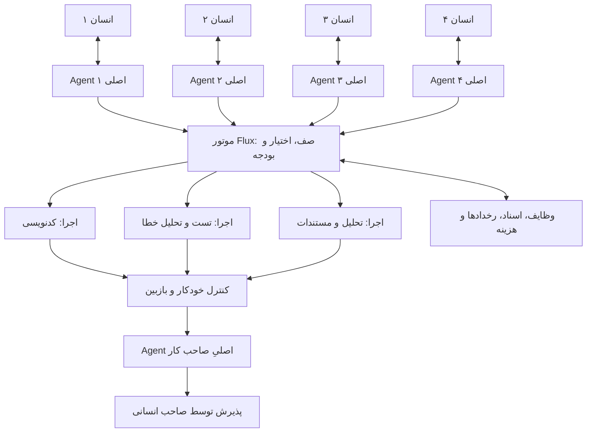
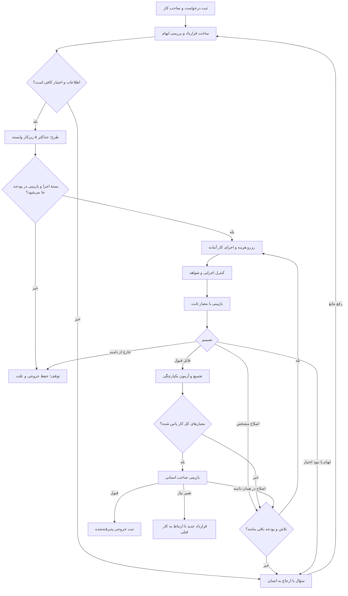

# Flux: معماری همکاری انسان و Agent

> سابقهٔ طراحی ۰٫۱ — ساختار، مدل‌ها و فرض چهار Agent هم‌سطح در این سند منسوخ شده‌اند. مرجع فعلی: [معماری سلسله‌مراتبی ۰٫۲](hierarchy.fa.md). قواعد عمومی این سند نیز در صورت تعارض تابع نسخهٔ ۰٫۲ هستند.

نسخهٔ پیشنهادی ۰٫۱ — ۶ سپتامبر ۲۰۲۶

## ۱. تصمیم اصلی

Flux یک سیستم تحویل کار با مسئولیت انسانی است: چهار نفر، چهار Agent اصلی با هویت و حافظهٔ جدا، یک مجموعهٔ مشترک از نقش‌های اجرایی، و یک موتور نرم‌افزاری برای کنترل صف، دسترسی و بودجه.

Agent اصلی کار را می‌فهمد، طرح می‌دهد و خروجی‌ها را جمع می‌کند. موتور Flux تعیین می‌کند کدام اقدام واقعاً مجاز است و آیا هنوز بودجه دارد. پیشنهاد مدل به‌تنهایی مجوز انجام کار نیست.

این طراحی از ترکیب الگوهای تقسیم کار توسط هماهنگ‌کننده و بازبینی تکرارشونده استفاده می‌کند. این دو الگو در [راهنمای معماری Agentهای Anthropic](https://www.anthropic.com/engineering/building-effective-agents) توضیح داده شده‌اند. حدود، اعداد و سیاست‌های این سند پیشنهاد اختصاصی پایلوت Flux هستند.

## ۲. فرض‌های ثبت‌شده

- تعداد افراد: ۴ نفر، تأییدشده توسط کاربر.
- نوع شرکت: برنامه‌نویسی؛ تخصص، فناوری پروژه‌ها و نقش دقیق افراد هنوز مشخص نیست.
- بودجه: ۵۰ دلار اعتبار توکن برای یک پایلوت؛ ماهانه بودن آن مشخص نشده است.
- قیمت و نام مدل‌ها: دادهٔ کاربر، با فرض دلار به‌ازای یک میلیون توکن ورودی/خروجی؛ هنوز با ارائه‌دهنده تطبیق داده نشده‌اند.
- هر چهار نفر Agent اصلی دارند، حتی اگر چند نفر عنوان شغلی یکسان داشته باشند.
- ابتدا یک پروژه و وظایف کوچک تا متوسط وارد پایلوت می‌شوند.
- مخزن در شروع خالی بود؛ فناوری پیشنهادی، استنتاج از کد موجود نیست.
- محتوای سایت Alacrity با ابزار وب قابل دریافت نبود؛ ادعایی دربارهٔ مشتریان، فناوری‌ها یا خدمات دقیق آن مبنای طراحی قرار نگرفته است.

## ۳. ساختار سازمانی



چهار Agent اصلی لزوماً چهار مدل یا چهار پردازش همیشه روشن نیستند. هرکدام یک پروفایل، حدود اختیار و حافظهٔ متعلق به صاحب خود دارند؛ هنگام رخداد، مدل فراخوانی می‌شود. نقش‌های اجرایی نیز هنگام نیاز نمونه‌سازی می‌شوند و در نسخهٔ اول حداکثر دو اجرا هم‌زمان فعال است.

CEO سیاست کلی، ترتیب پروژه‌ها و سقف هزینه را تعیین می‌کند؛ لازم نیست هر خروجی کوچک را بررسی کند. یک نفر از همان چهار نفر «مسئول پایلوت» و یک نفر «مسئول فنی» می‌شود؛ این‌ها مسئولیت‌اند و استخدام تازه نمی‌خواهند. صاحب هر کار مسئول پذیرش همان کار است و می‌تواند بازبینی تخصصی را به همکار واگذار کند.

تعارض اولویت میان افراد از طریق صف و مسئول پایلوت حل می‌شود. Agent هیچ فردی نمی‌تواند مالک، بودجه یا اولویت کار فرد دیگر را بدون اختیار ثبت‌شده تغییر دهد.

## ۴. نقش‌ها و انتخاب اولیهٔ مدل

| نقش | وظیفه و خروجی | نامزد اولیه | شرط استفاده |
|---|---|---|---|
| دریافت و دسته‌بندی | استخراج هدف، نوع کار و ابهام‌ها | Gemma ارائه‌شده یا Luna | قواعد ساده ابتدا با کد؛ مدل فقط برای متن مبهم |
| Agent اصلی | قرارداد کار، وابستگی‌ها، طرح و جمع‌بندی | Terra؛ ارتقا به Sol | برای تصمیم پیچیده؛ کار تکراری از قالب تأییدشده استفاده کند |
| مجری معمولی | تغییر محدود کد، پیش‌نویس تست یا سند | Luna؛ Qwen به‌عنوان نامزد مقایسه | فقط پس از ارزیابی روی کار واقعی شرکت |
| مجری کار دشوار | اصلاح چندفایلی در محدودهٔ مشخص | Terra | پس از تشخیص پیچیدگی یا یک شکست قابل تشخیص |
| بازبین کد | بررسی diff، شواهد و معیارهای پذیرش | Sol | مکالمهٔ مستقل از مجری؛ بدون اختیار تغییر معیارها |
| خلاصه‌ساز | گزارش کوتاه همراه پیوند به شواهد | Luna یا قالب نرم‌افزاری | بدون فراخوانی اضافی اگر دادهٔ ساخت‌یافته کافی باشد |
| موتور هماهنگی | صف، بودجه، وضعیت، دسترسی و ثبت رخداد | کد معمولی | مدل نیست |

این جدول ادعای برتری کیفی مدل‌ها نیست؛ یک چیدمان قابل آزمایش با قیمت‌های داده‌شده است. در پایلوت هم‌زمان همهٔ مدل‌های فهرست را فعال نمی‌کنیم. مدل‌های پرهزینه فعلاً نامزد پیش‌فرض نیستند. قیمت پایین‌تر بدون نرخ قبولی مناسب، صرفه‌جویی ایجاد نمی‌کند.

قبل از فعال‌کردن هر نامزد، adapter باید شناسهٔ واقعی API، ابزارخوانی، قالب JSON، محدودیت ورودی/خروجی، تعرفهٔ توکن استدلال، گزارش usage و خطاها را آزمایش و ثبت کند. مدل ناسازگار از مسیر نیازمند آن قابلیت حذف می‌شود. دسترسی حساب Codex به یک نام مدل، اثبات دسترسی API شرکت به همان نام نیست.

بازبینی مستقل با یک مدل دیگر نیز تضمین درستی نیست. تست اجرایی، بررسی نتیجه و قضاوت انسانی مکمل آن هستند؛ این ترکیب با دسته‌بندی ارزیابی‌های کدی، مدلی و انسانی در [راهنمای ارزیابی Agentها](https://www.anthropic.com/engineering/demystifying-evals-for-ai-agents) هم‌راستا است.

## ۵. قرارداد کار

هر درخواست قبل از اجرا به یک رکورد تبدیل می‌شود. قرارداد باید برای صاحب کار قابل خواندن باشد و فقط در ابهام مؤثر نیاز به سؤال دارد.

| فیلد | معنای دقیق |
|---|---|
| task_id, root_id, parent_id | هویت کار و ارتباط با کار اصلی |
| owner_id, reviewer_id | صاحب انسانی و بازبین مسئول |
| project_id, repository, base_revision | محدودهٔ پروژه و نسخهٔ مبنا |
| objective, scope, out_of_scope | نتیجهٔ موردنیاز و مرز تغییرات |
| acceptance_criteria | شروط قابل بررسی و نسخهٔ ثابت آن‌ها |
| dependencies | شناسهٔ کارهایی که باید زودتر پذیرفته شوند |
| risk, complexity, data_class | خطر اثر، دشواری و نوع داده، به‌صورت جداگانه |
| allowed_tools, allowed_paths, allowed_destinations | دسترسی قابل اعمال توسط موتور |
| budget_cap, active_time_cap, deadline | حد هزینه، زمان اجرای فعال و موعد |
| context_refs | پیوند به منابع مجاز با نسخه و منشأ |
| model_route, policy_version | مسیر مدل و نسخهٔ سیاست استفاده‌شده |
| attempts, call_count, spent, reserved | شمارنده‌ها و حساب هزینه |
| artifact_ref, checks, decision_reason | خروجی قابل مشاهده، شواهد و دلیل کوتاه تصمیم |
| approval | شخص، زمان، نوع اقدام و hash نسخهٔ تأییدشده |

مثال: «اصلاح خطای اعتبارسنجی شماره تماس در فرم ثبت‌نام» یک کار مناسب است. «کل محصول را بهتر کن» ابتدا باید به خروجی‌های قابل بررسی تبدیل شود. مستندات، کد و پیام مشتری دادهٔ ورودی‌اند؛ نمی‌توانند خودشان حدود اختیار یا قرارداد کار را تغییر دهند.

## ۶. مسیر اجرای کار



### الگوریتم اجرایی

1. رویداد دریافت می‌شود؛ شناسهٔ تکراری کنار گذاشته می‌شود. احراز هویت و مالکیت پیش از دریافت زمینه انجام می‌شود.
2. قرارداد با کمک Agent اصلی یا قالب آماده ساخته می‌شود. ابهام مؤثر در صحت، اختیار یا خروجی به انسان بازگردانده می‌شود؛ جزئیات اجرایی معمول را Agent حل می‌کند.
3. موتور خطر را از ابزار، مسیر و نوع اقدام محاسبه می‌کند. پیشنهاد مدل می‌تواند خطر را بالاتر ببرد؛ پایین‌آوردن محدودیت قطعی ابزار مجاز نیست.
4. اگر کار کوچک و قالب‌دار است مستقیم وارد اجرای یک مجری می‌شود. در غیر این صورت Agent اصلی حداکثر پنج زیرکار در یک گراف بدون دور می‌سازد. موتور وابستگی‌ها و حدود را اعتبارسنجی می‌کند.
5. برای هر زیرکار آماده، نامزدهای ناسازگار با قابلیت، دسترسی داده، مهلت یا بودجه حذف می‌شوند. از میان نامزدهای ارزیابی‌شده، کمترین هزینهٔ موردانتظار برای خروجی پذیرفته‌شده انتخاب می‌شود.
6. پیش از هر فراخوانی، حداکثر هزینهٔ قابل صورتحساب آن با ورودی و سقف خروجی adapter محاسبه و اتمی رزرو می‌شود. هزینهٔ بررسی لازم هم در بودجهٔ کار نگه داشته می‌شود. اگر کران قابل اتکا نداریم، فراخوانی خودکار فعال نمی‌شود.
7. اجرا در محیط جدا انجام می‌شود؛ خروجی شامل artifact، خلاصهٔ تغییر، نتیجهٔ ابزار و مشکلات حل‌نشده است. تفسیر نتیجهٔ موفقیت‌آمیز توسط خود مجری کافی نیست.
8. کنترل‌های لازم متناسب با کار اجرا می‌شوند. برای کد، تست مرتبط، نوع‌سنجی یا build لازم؛ برای سند، تطبیق با منابع و پوشش خواسته‌ها. تست جدید فقط وقتی برای رفتار تغییرکرده معنی‌دار است.
9. بازبین قرارداد ثابت و خروجی را بررسی می‌کند. ایراد قابل اصلاح باید شاهد، محل و معیار نقض‌شده داشته باشد. اختلاف سلیقهٔ بدون معیار، مجوز حلقهٔ تکرار نیست.
10. حداکثر سه تلاش تولید برای هر زیرکار داریم: اجرای اول و دو اصلاح. حداکثر یک بار ارتقای مدل. دو بار تکرار همان ایراد بدون پیشرفت، ارجاع زودهنگام ایجاد می‌کند.
11. پس از پذیرش زیرکارها، یکپارچگی کل خروجی بررسی می‌شود. قبولی تک‌تک قطعه‌ها لزوماً قبولی کل نیست. ترمیم یکپارچگی نیز از شمارنده و بودجهٔ همان root کم می‌شود؛ شمارندهٔ تازه نمی‌سازد.
12. در پایلوت، صاحب انسانی خروجی نهایی را می‌پذیرد. merge، deploy یا ارسال بیرونی اقدام جدا با مجوز مربوط به همان artifact است.
13. هزینهٔ واقعی با رزرو تسویه، نتیجه ثبت و فقط دانش تأییدشده وارد حافظهٔ پایدار می‌شود. شکست‌ها و زمان انسانی نیز در گزارش باقی می‌مانند.

```text
on_event(event):
    if duplicate(event.id): return previous_result
    task = load_and_authorize(event)
    if task.is_terminal: return current_state
    validate_contract_and_policy(task)
    plan = bounded_plan_or_approved_template(task)
    validate_acyclic_plan(plan, max_children=5, max_depth=1)

    while ready_work_exists(plan):
        if limits_reached(task): pause_with_evidence(task); break
        leaf = fair_queue.next_ready_item(plan)
        route = cheapest_qualified_route(leaf, observed_results)
        package = estimate_execution_and_required_review(route, leaf)
        if not reserve_atomically(package, task, campaign, day):
            pause_budget(task); break
        result = execute_with_policy_checks(leaf, route)
        evidence = run_required_checks(result, frozen_contract)
        decision = review(evidence, frozen_contract)
        settle_usage_and_append_event(result)
        transition_or_bounded_repair(leaf, decision)

    if all_required_children_ready_for_acceptance(plan):
        verify_integrated_artifact_against_root_contract()
        request_owner_acceptance_for_exact_artifact()
```

این شبه‌کد توصیف رفتار موردنیاز است و اجرای فعلی نرم‌افزار نیست. در پیاده‌سازی، وضعیت و شمارنده‌ها باید تراکنشی ثبت شوند و با راه‌اندازی مجدد از بین نروند.

## ۷. معنای Accept، Reject و Escalate

| تصمیم | نتیجه |
|---|---|
| ACCEPT_CANDIDATE | شروط خودکار پاس شده، ایراد مسدودکننده وجود ندارد؛ آمادهٔ پذیرش انسانی |
| REVISE | ایراد مشخص در همان دامنه؛ اصلاح در تلاش و بودجهٔ باقی‌مانده |
| ESCALATE | نیازمند تصمیم انسانی، اطلاعات، اختیار یا تخصص بیشتر |
| REJECT | درخواست خارج از دامنه/سیاست؛ علت ثبت و اجرا بسته می‌شود |
| ACCEPTED | صاحب انسانی نسخهٔ خروجی را پذیرفته است |

قاعدهٔ قبولی کد: تمام معیارهای ضروری + تمام کنترل‌های لازم + نبود ایراد مسدودکنندهٔ حل‌نشده. نمرهٔ اعتماد ادعایی مدل جای این شروط را نمی‌گیرد. کنترل اجرا‌نشده «نامعلوم» است، نه «پاس‌شده». معیار پذیرش فقط با تغییر قرارداد توسط انسان اصلاح می‌شود؛ مدل نمی‌تواند برای قبولی، تست مرجع را ضعیف یا حذف کند.

وضعیت‌های پایدار: `NEW → NEEDS_INPUT / PLANNED → QUEUED → RUNNING → VERIFYING → IN_REVIEW → AWAITING_HUMAN → ACCEPTED`.

شاخه‌های دیگر: `REWORK` به صف همان تلاش‌ها برمی‌گردد؛ `BLOCKED` مانع فنی/وابستگی دارد؛ `PAUSED_BUDGET` یا `PAUSED_LIMIT` منتظر رفع محدودیت است؛ `REJECTED`، `FAILED` و `CANCELLED` بسته‌اند. کار بسته دوباره با رویداد قدیمی اجرا نمی‌شود. درخواست جدید، شناسهٔ جدید و ارتباط به کار قبلی دارد.

انتظار انسان حلقهٔ مدل را روشن نگه نمی‌دارد. پس از ۲۴ ساعت یک یادآوری داخلی و پس از ۷۲ ساعت توقف پیگیری خودکار پیشنهاد می‌شود. مهلت فعال ۲۰ دقیقه‌ای، زمان انتظار انسان را شامل نمی‌شود؛ تمام زمان‌های رفت‌وبرگشت جدا ثبت می‌شوند.

## ۸. تخصیص مدل و صف

قواعد اولیهٔ مسیریابی: خلاصه/سند کوچک → مدل اقتصادی؛ تغییر محدود با تست موجود → مجری اقتصادی + بازبین قوی؛ تغییر چندفایلی یا وابستگی مبهم → Agent اصلی و مجری قوی‌تر؛ تغییر حساس مثل مجوز کاربران → بازبینی تخصصی انسان، حتی اگر تغییر یک خط باشد.

بعد از دادهٔ پایلوت:

`هزینهٔ مسیر به‌ازای خروجی پذیرفته‌شده = هزینهٔ همهٔ اجراهای آن مسیر، شامل شکست‌ها ÷ تعداد خروجی‌های پذیرفته‌شده`

این نسبت به تفکیک نوع وظیفه مقایسه می‌شود، همراه زمان انسانی و خطای بعد از قبولی. اگر نمونه کم یا قبولی صفر است، نسبت قابل اتکا نیست و مسیر خودکار تازه انتخاب نمی‌شود. خوداظهاری confidence مدل دادهٔ عملکرد نیست.

صف بین چهار صاحب کار گردش منصفانه دارد؛ کار با وابستگی حل‌نشده اجرا نمی‌شود. فوریت ثبت‌شده و موعد می‌توانند ترتیب را تغییر دهند؛ Agentها نمی‌توانند همهٔ کارها را فوری نام‌گذاری کنند. حداکثر دو اجرا در کل پایلوت، نه دو اجرا برای هر انسان. تغییر هم‌زمان روی فایل مشترک سری می‌شود یا در شاخه‌های جدا با یکپارچه‌سازی کنترل‌شده انجام می‌شود.

## ۹. اختیار و محیط اجرا

| سطح | نمونه | رفتار اولیه |
|---|---|---|
| A0 | خواندن منابع مجاز، تهیهٔ پیش‌نویس | خودکار در محدودهٔ پروژه |
| A1 | ویرایش در شاخهٔ کاری و اجرای تست مجاز | خودکار در محیط جدا؛ ثبت diff و شواهد |
| A2 | merge، deploy، تغییر دادهٔ عملیاتی، ارسال به مشتری | نیازمند اختیار ثبت‌شده برای همان اقدام و خروجی |

تصویب بودجه یا درخواست کلی توسعه، جای تعیین دسترسی عملیاتی سیستم آینده را نمی‌گیرد. در پایلوت اتصالات بیرونی ابتدا خروجی پیش‌نویس می‌سازند. مجوز عملیاتی باید به artifact hash، مقصد، اقدام و مدت اعتبار متصل باشد؛ اگر خروجی بعد از تأیید عوض شد، آن مجوز مصرف نمی‌شود.

کلید API سمت سرور نگه داشته می‌شود و به prompt، فایل مخزن یا خروجی ابزار وارد نمی‌شود. worker نباید env میزبان یا کلیدها را به ارث ببرد. دسترسی شبکه و مسیرها محدود به ابزارهای تعریف‌شده است. جداکردن شاخهٔ Git به‌تنهایی sandbox امنیتی نیست؛ کد و تست نامطمئن باید در container/محیط محدود با منابع و شبکهٔ کنترل‌شده اجرا شود.

## ۱۰. حافظه و داده

- حافظهٔ فردی: ترجیح گزارش و زمینهٔ متعلق به همان فرد؛ مشترک‌بودن مدل به معنای اشتراک داده نیست.
- حافظهٔ پروژه: قراردادها، استانداردهای کد، معماری تأییدشده و منابع پروژه با کنترل دسترسی.
- حافظهٔ هر کار: ورودی، ابزارها، نسخهٔ مبنا، خروجی‌ها و وضعیت موقت.
- دفتر رخداد: چه کسی، چه کاری، چه زمانی، با چه مدل/سیاستی و چه هزینه‌ای؛ دلیل کوتاه و شواهد کافی است و به افشای استدلال پنهان مدل نیاز ندارد.

هر قطعهٔ حافظه منشأ، نسخه، زمان و سطح دسترسی دارد. فیلتر دسترسی پیش از ارسال به مدل انجام می‌شود. خروجی خام Agent به‌عنوان حقیقت دائمی ذخیره نمی‌شود؛ پیشنهاد دانش ابتدا به artifact پذیرفته‌شده متصل می‌شود. خلاصه باید به اصل سند پیوند دهد تا اطلاعات در خلاصه‌های پیاپی گم نشود.

در MVP بازیابی متنی و اسناد نسخه‌دار کافی است. پایگاه برداری و embedding تنها در صورت مشکل واقعی بازیابی اضافه می‌شوند و هزینهٔ جدا دارند. تاریخچهٔ کامل شرکت در هر فراخوانی ارسال نمی‌شود.

## ۱۱. اجزای فنی MVP

پیشنهاد برای مخزن خالی: یک برنامهٔ TypeScript با رابط وب ساده، موتور worker و پایگاه SQLite روی یک میزبان موجود، با adapter مستقل ارائه‌دهندگان. این انتخاب پیشنهادی است؛ اگر پروژه‌های شرکت فناوری دیگری دارند، همان فناوری اولویت دارد. نسخه و کتابخانه‌ها هنگام پیاده‌سازی انتخاب و تثبیت می‌شوند.

| جزء | مسئولیت |
|---|---|
| رابط اعضا | ثبت کار، دیدن صف/خروجی/هزینه، قبول، اصلاح و توقف |
| Task service | مالکیت، قرارداد نسخه‌دار و وضعیت‌ها |
| Orchestrator | اجرای گراف، شمارنده‌ها، توقف و ادامه |
| Policy engine | کنترل ابزار، مقصد، داده و سطح اختیار |
| Router و Provider adapters | نگاشت مدل، قابلیت‌ها، نرخ و خطاهای API |
| Budget ledger | رزرو اتمی، تسویهٔ usage و تفکیک evaluation/operation/reserve |
| Job queue | اجرای پایدار با lease، مهلت و حذف رخداد تکراری |
| Tool runner | محیط جدا، ابزارهای محدود، محدودیت زمان و منابع |
| Review service | اجرای کنترل‌ها، ثبت نقد و اتصال قبولی به artifact |
| Artifact store | diff، اسناد، logهای پالایش‌شده و نسخه‌ها |
| گزارش‌گیری | خروجی پذیرفته‌شده، هزینه، زمان انسان، شکست و خطای برگشتی |

جدول‌های اصلی: `users`, `projects`, `memberships`, `agent_profiles`, `tasks`, `task_dependencies`, `runs`, `tool_calls`, `artifacts`, `reviews`, `approvals`, `budget_reservations`, `usage_ledger`, `events`, `knowledge_refs`.

مسیرهای API پیشنهادی: `POST /tasks`، `GET /tasks/:id`، `POST /tasks/:id/accept`، `/revise`، `/cancel`، `GET /events` و `GET /usage`. تمام تغییرات به actor و نسخهٔ رکورد متصل‌اند. نام مسیرها قرارداد طراحی است، endpoint موجود نیست.

درگاه مدل باید سقف context و output را پیش از ارسال بررسی کند، خروجی ساخت‌یافته را اعتبارسنجی کند و usage و request ID را ثبت کند. ناسازگاری JSON فقط با همان سقف فراخوانی‌ها اصلاح می‌شود. اگر مدل جایگزین محدودیت داده یا قابلیت ابزار را ندارد، fallback مجاز نیست.

## ۱۲. قطع ارتباط، تکرار و هزینه

سقف اولیه: ۵۰ دلار کل، ۵ دلار ارزیابی، ۳۵ دلار عملیات و ۱۰ دلار ذخیرهٔ قفل‌شده؛ سقف روزانه ۵ دلار. سقف هر root ساده ۰٫۱۵، کدنویسی کوچک ۰٫۷۵، پیچیده ۴ دلار است و زیرکارها از همین مبلغ مصرف می‌کنند.

رزروها باید در یک تراکنش روی سهم روز، فاز، root و کل ثبت شوند؛ در غیر این صورت دو worker می‌توانند هم‌زمان بودجه را رد کنند. در عمل هر کران بر اساس قیمت تأییدشده، سقف billable tokens و هزینهٔ ابزار تنظیم می‌شود. cap سمت ارائه‌دهنده، اگر واقعاً موجود و enforceable باشد، مکمل این کنترل است؛ سقف پولی مطلق بدون شناخت صورتحساب قابل تضمین نیست.

در timeout بعد از ارسال، فراخوانی ممکن است هزینه داشته باشد. رزرو تا روشن‌شدن usage آزاد نمی‌شود و retry رایگان فرض نمی‌شود. حداکثر دو retry انتقالی فقط برای خطای گذرا با backoff و در سقف کلی ۳۲ فراخوانی root مجاز است. درخواست ناشناخته ابتدا با شناسهٔ ارائه‌دهنده بررسی می‌شود؛ اگر قابل تعیین نبود، هزینهٔ رزروشده حفظ و کار متوقف می‌شود. اقدامات بیرونی بدون idempotency یا بررسی نتیجه، خودکار تکرار نمی‌شوند.

بعد از crash، lease منقضی بازیابی می‌شود؛ اقدام دارای اثر بیرونی قبل از اجرای دوباره reconciliation می‌خواهد. توقف کار مانع شروع ابزار بعدی می‌شود، ولی هزینهٔ فراخوانی قبلاً ارسال‌شده ممکن است برقرار بماند.

## ۱۳. به‌روزرسانی و refresh

وضعیت با رخداد تغییر می‌کند: کار جدید، پایان ابزار، نتیجهٔ تست، نظر انسان و usage. رابط می‌تواند با SSE به‌روز شود؛ برای تازه‌شدن صفحه نیازی به فراخوانی مدل نیست. وضعیت بیکار هزینهٔ توکن ایجاد نمی‌کند.

در شروع هر کار، نسخهٔ فعلی منابع لازم بررسی می‌شود. تغییر قرارداد، کد مبنا یا مجوز، خروجی وابسته را نیازمند بررسی دوباره می‌کند. هر هفتهٔ فعال پایلوت، قیمت/قابلیت مدل و نتایج ارزیابی بازبینی می‌شوند؛ مدل یا prompt به‌صورت خودکار در میانهٔ کار عوض نمی‌شود. نامزد تازه روی نمونه‌های ثابت امتحان و سپس به‌صورت نسخه‌دار فعال می‌شود.

## ۱۴. معیار آماده‌بودن برای اجرا

- قرارداد کار، وضعیت‌ها، مالکیت و گراف بدون دور در حالت mock قابل نمایش باشند.
- موتور درخواست ابزار خارج از مجوز را مستقل از متن مدل رد کند.
- سقف بودجه در دو اجرای هم‌زمان، timeout و restart حفظ شود.
- شکست تست مانع ACCEPT_CANDIDATE شود و نبود شواهد به‌اشتباه قبولی نگیرد.
- Agent پس از سه تلاش یا تکرار بدون پیشرفت متوقف شود.
- یکپارچگی خروجی روی revision مشخص بررسی و پذیرش به همان خروجی متصل شود.
- هیچ مدل تأییدنشده از نظر قابلیت یا تعرفه به حساب واقعی وصل نشود.
- سنجه‌ها شکست، هزینهٔ retry و زمان انسان را حذف نکنند.

چک‌های فوق برای پیاده‌سازی آینده‌اند. این تحویل فقط طرح، تنظیمات پیشنهادی و محاسبهٔ آفلاین بودجه را فراهم می‌کند.
