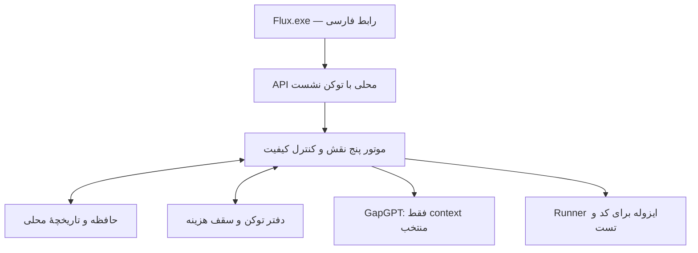

# Flux Desktop — نرم‌افزار ویندوز با مدیریت توکن و حافظهٔ محلی

> سابقهٔ محصول گسترده‌تر. طبق درخواست جدید، تحویل فعلی فقط [دموی شخصی پنج Agent](personal-demo.fa.md) است؛ این سند دامنهٔ اجباری دمو نیست.

نسخهٔ طراحی ۰٫۵ — ۶ سپتامبر ۲۰۲۶. وضعیت: طراحی؛ هنوز برنامهٔ قابل نصب ساخته نشده است.

## تصمیم تأییدشدهٔ کاربر

«روی ویندوز خودم، با رابط کامل و حافظهٔ محلی». سه نیاز اصلی: مدیریت توکن، دقت بالا و حافظه. این درخواست جدید محدودیت «بدون پنل» در پیوست اولیه را برای محصول لغو می‌کند. [طراحی موتور](mvp-design.fa.md) زیرساخت محصول است؛ API/CLI به‌تنهایی تحویل قابل قبول نیست. [بک‌لاگ](mvp-tasks.fa.md) شامل موتور و محصول دسکتاپ است.

Flux برنامه‌ای با پنجرهٔ مستقل، پروژه‌ها و تسک‌ها، حافظهٔ قابل مدیریت، گزارش هزینه و صفحهٔ بررسی نتیجه است. کاربر از فرم و گفت‌وگوی مرتبط با همان Task استفاده می‌کند؛ نوشتن JSON یا کار با ترمینال مسیر عادی استفاده نیست. هر اجرا همچنان صاحب و project_id و معیار پذیرش دارد.

## ۱. تجربهٔ استفاده

1. برنامه باز می‌شود؛ پروژهٔ قبلی و کارهای نیمه‌تمام بازیابی می‌شوند.
2. کاربر پروژه می‌سازد: نام، هدف، پوشهٔ مجاز، قواعد و بودجه. فایل/یادداشت مرتبط را به حافظه اضافه می‌کند.
3. «تسک جدید» را می‌زند؛ هدف را می‌نویسد، معیار پذیرش و خروجی را مشخص می‌کند. فرم نمونه و قالب آماده دارد. اگر برای تبدیل متن به قرارداد از مدل کمک بگیرد، هزینهٔ آن از همین root و سهم Head حساب می‌شود؛ گفت‌وگوی آماده‌سازی رایگان فرض نمی‌شود.
4. قبل از اجرا، سقف هزینه، برآورد دارای عدم قطعیت، دادهٔ منتخب از حافظه و مدل‌های پیشنهادی را می‌بیند. هر مورد غیرضروری را می‌تواند از context حذف کند.
5. حین اجرا، مرحلهٔ فعلی، زیرکارها، هزینهٔ مصرف‌شده/رزروشده، خطا و نیاز به اطلاعات نمایش داده می‌شود. توقف و ادامه از همان صفحه است.
6. نتیجه همراه شواهد و معیارهای پاس‌شده، ناموفق یا بررسی‌نشده می‌آید. کاربر همان نسخهٔ خروجی را می‌پذیرد یا اصلاح مشخص درخواست می‌کند.
7. برنامه نکات قابل نگهداری را پیشنهاد می‌دهد. فقط نکات تأییدشده وارد حافظهٔ معتبر پروژه می‌شوند؛ پیش‌نویس‌ها و شکست‌ها با برچسب خودشان در تاریخچه می‌مانند.

## ۲. صفحات نرم‌افزار

| صفحه | محتوا و کار اصلی |
|---|---|
| خانه | پروژهٔ فعال، کارهای درحال اجرا/منتظر بررسی، مصرف امروز و بودجهٔ باقی‌مانده |
| پروژه‌ها | تعریف پروژه، پوشه‌ها، قواعد، مالک و سقف‌ها؛ انتخاب پروژه قبل از Task |
| تسک و اجرای زنده | فرم هدف/معیار، گفت‌وگوی همان Task، مراحل Agentها، مصرف، توقف/ادامه |
| نتیجه و کیفیت | پیش‌نمایش سند/diff، منابع، نتیجهٔ تست، ایرادها و پذیرش نسخهٔ مشخص |
| حافظه | جست‌وجو، منابع و تصمیم‌ها، تأیید/ویرایش/منسوخ‌کردن/حذف، نمایش محل استفاده |
| توکن و هزینه | تفکیک پروژه/روز/مدل/تسک، سقف‌ها، مصرف قطعی و نامعلوم، خروجی CSV |
| تنظیمات | وضعیت GapGPT، مدل‌ها و قیمت تأییدشده، حالت آزمایشی/واقعی، داده و پشتیبان |

رابط فارسی و راست‌به‌چپ است؛ کد، مسیر و عددهای فنی در بلوک چپ‌به‌راست نمایش داده شوند. نمودار مصرف و وضعیت اجرا از دادهٔ ثبت‌شده تغذیه می‌شوند. «دقت ۹۸٪» یا «صرفه‌جویی قطعی» بدون دادهٔ ارزیابی نمایش داده نشود. دکمهٔ اجرای واقعی در حالت فقدان کلید/قابلیت با دلیل روشن غیرفعال باشد.

## ۳. مدیریت توکن واقعاً چه می‌کند؟

**کنترل هزینه:** سقف هر Task، هر پروژه و سقف کلی روزانه در تنظیمات داریم. رزرو اتمی باید همهٔ سقف‌های مربوط را هم‌زمان رعایت کند. مجموع پروژه‌ها نمی‌تواند سقف روزانه را دور بزند. مرز روز با timezone تنظیم‌شده مشخص و روی reservation ثبت می‌شود؛ تسویهٔ دیررس به همان روز رزرو برمی‌گردد. تغییر timezone به‌صورت نسخه‌دار از روز بعد اعمال می‌شود.

**کنترل context:** کل حافظه به مدل ارسال نمی‌شود. بودجهٔ context برای هر نقش از ظرفیت مدل منهای خروجی، قرارداد ثابت و حاشیهٔ ایمنی حساب می‌شود. منابع مرتبط تا سقف انتخاب می‌شوند. معیارها و قواعد برای جا شدن در context حذف نمی‌شوند؛ اگر خود قرارداد جا نشود، Task باید کوچک شود. خلاصه‌سازی مدلی خودش مصرف ثبت‌شده دارد و عملیات مستقل بدون بودجه نیست؛ خلاصه‌های قبلی نسخه‌دار قابل استفاده‌اند.

**نمایش قابل اتکا:** توکن ورودی، خروجی و cache، هزینهٔ قطعی، رزرو فعال و هزینهٔ نامعلوم جدا دیده می‌شوند. قیمت هر فراخوانی snapshot دارد. اعتبار واقعی حساب GapGPT فقط اگر API مستند برای آن موجود باشد نشان داده می‌شود؛ در غیر این صورت برچسب «بودجهٔ تعریف‌شده در Flux» نمایش داده شود.

**صرفه‌جویی:** حداقل نقش لازم، خلاصه و cache نسخه‌دار، خروجی محدود، جلوگیری از اجرای تکراری و کنترل retry. نمایش صرفه‌جویی فقط با baseline قابل مقایسه؛ مصرف کمتر به‌تنهایی نشانهٔ دقت بهتر نیست.

## ۴. حافظهٔ محلی و قابل اعتماد

حافظه با نگهداری تمام چت‌ها یکی نیست. چهار نوع داده داریم:

| نوع | نمونه | اعتبار و عمر |
|---|---|---|
| قواعد شرکت/پروژه | فناوری مجاز، قرارداد API، شیوهٔ نوشتن گزارش | انسان ثبت/تأیید می‌کند؛ نسخه‌دار، تا زمان جایگزینی |
| منابع پروژه | مستند، فایل کد، یادداشت و مشخصات محصول | همراه مسیر، revision، hash و تاریخ؛ فایل تغییر کند نمایه تازه شود |
| تصمیم‌های پذیرفته‌شده | علت انتخاب معماری یا نتیجهٔ تأییدشده | به Task و artifact پذیرفته‌شده متصل؛ قابل منسوخ‌شدن |
| حافظهٔ اجرای جاری | خلاصهٔ کار، وضعیت و ایرادهای باز | مخصوص همان root؛ حقیقت عمومی پروژه محسوب نمی‌شود |

مدل دادهٔ افزوده: `projects`, `memory_items`, `memory_versions`, `source_chunks`, `retrieval_events`, `acceptances`, `budget_limits`. metadata حافظه شامل project_id، نوع، متن، source_ref/hash، وضعیت proposed/approved/stale/revoked، نسخه، تاریخ، تأییدکننده و طبقه‌بندی داده است.

چرخه: واردکردن منبع → تشخیص secret و حدود → استخراج متن و قطعه‌بندی → نمایهٔ محلی → بازیابی برای هدف Task → انتخاب در بودجهٔ context → ثبت شناسه و نسخهٔ منابع ارسال‌شده. پسوندهای اولیه: txt/md/json/csv و فایل متنی کد؛ parser PDF و Office در مرحلهٔ بعد مگر در پایلوت لازم شوند.

نسخهٔ اول جست‌وجوی محلی SQLite FTS5 همراه فیلتر پروژه، وضعیت تأیید و تازگی دارد. «ی/ي» و «ک/ك»، نیم‌فاصله و شکل‌های رایج فارسی در نمایه نرمال شوند؛ متن اصلی حفظ شود. منبع این قابلیت جست‌وجو: [SQLite FTS5](https://www.sqlite.org/fts5.html). FTS5 جست‌وجوی معنایی نیست؛ embedding محلی فقط اگر ارزیابی بازیابی نیاز را نشان دهد اضافه شود. زیرساخت ابری برداری در شروع لازم نیست.

قواعد ثابت همیشه از config تأییدشده می‌آیند؛ قطعهٔ حافظه نمی‌تواند policy یا اجازهٔ ابزار را تغییر دهد. نتایج قبل از رتبه‌بندی با project_id و مجوز محدود می‌شوند. تعارض دو تصمیم معتبر به‌صورت «تعارض حافظه» نشان داده می‌شود، نه انتخاب خاموش یکی. منبع حذف‌شده/منسوخ در بازیابی جدید استفاده نمی‌شود؛ cache و خلاصه‌های مشتق از آن invalid شوند. حذف محتوا، نمایه و نسخه‌های محتوایی را هم پاک می‌کند؛ audit می‌تواند فقط hash/زمان حذف را نگه دارد. نسخه‌های پشتیبان طبق retention حذف یا بازسازی شوند و محدودیت آن در UI دیده شود.

ذخیرهٔ محلی به معنای استنتاج آفلاین نیست: فقط قطعات انتخاب‌شده برای انجام Task به GapGPT ارسال می‌شوند. UI پیش از اجرای واقعی دامنهٔ دادهٔ ارسالی را قابل مشاهده می‌کند. مرور پروژه، حافظه، تاریخچه و گزارش مصرف بدون اینترنت کار می‌کند؛ تولید مدل به اتصال نیاز دارد.

## ۵. دقت بالا را چطور بسنجیم؟

دقت محصول از قرارداد روشن، منابع درست، اجرای کنترل‌ها و بازبینی مستقل حاصل می‌شود. قوی‌تر بودن نام مدل یا confidence خود مدل معیار پذیرش نیست.

- قبل از اجرا: ابهام هدف، منبع قدیمی و معیار نامشخص رفع شود؛ حافظهٔ بازیابی‌شده قابل مشاهده باشد.
- هنگام تولید: Agent فقط به منابع و ابزارهای مجاز دسترسی داشته باشد؛ ادعای بی‌منبع به‌عنوان نامطمئن ثبت شود.
- هنگام بررسی: Qwen مستقل، تست اجرایی و تطبیق تک‌تک معیارها؛ Sol فقط برای review فنی لازم.
- بعد از اجرا: انسان نسخهٔ مشخص را بپذیرد؛ حافظه فقط از موارد تأییدشده تغذیه شود.

مجموعهٔ ارزیابی اولیه پیشنهادی: ۲۰ Task واقعی کوچک با ورودی ثابت و پاسخ/معیار مرجع؛ ۸ مستندات، ۶ برنامه‌ریزی و ۶ فنی. همچنین حداقل ۲۰ پرسش برای بازیابی حافظه با منبع موردانتظار، شامل فارسی و تعارض/منسوخ‌شدن. این تعداد نمونه ابزار شروع پایلوت است؛ اثبات درصد دقت عمومی نیست.

شاخص‌ها: نرخ قبولی انسانی، نرخ قبولی در تلاش اول، ایراد جدی جاافتاده، پوشش معیار با شاهد، یافتن منبع درست در پنج نتیجهٔ اول، هزینه و زمان هر خروجی پذیرفته‌شده. هدف آزمایشی قابل بازنگری: یافتن منبع درست در حداقل ۱۸ پرسش از ۲۰ پرسش و پذیرش انسانی حداقل ۱۶ Task از ۲۰ Task پس از حداکثر تلاش مجاز. نشت میان پروژه‌ها، قبولی بدون تست لازم و عبور بودجه در تست قطعی باید صفر باشد. هیچ‌کدام فعلاً نتیجهٔ مشاهده‌شده نیستند.

## ۶. معماری دسکتاپ پیشنهادی

رابط: PySide6 با Qt Quick/QML؛ موتور: Python؛ حافظه: SQLite/FTS5 و فایل محلی. PySide6 binding رسمی Qt برای Python است؛ انتخاب آن برای هم‌زبان بودن با موتور و رابط پنجره‌ای پیشنهاد شده است. مرجع: [Qt for Python](https://doc.qt.io/qtforpython-6/). در شروع ساخت، نمونهٔ RTL و بسته‌بندی روی Windows معیار تثبیت این انتخاب باشد.

برنامه engine را به‌صورت subprocess پنهان با یک scheduler راه‌اندازی می‌کند؛ UI برای شبکه یا LLM منتظر مسدودکننده نمی‌ماند. یک instance برای هر profile فعال است. API روی loopback با توکن تصادفی نشست و بدون CORS عمومی است؛ توکن نشست کلید GapGPT نیست. UI مالک چرخهٔ engine است. بستن برنامه در زمان اجرا انتخاب توقف امن یا ادامه در tray می‌دهد؛ resume بعدی از checkpoint بدون تماس نامعلوم تکراری انجام می‌شود.

داده‌ها زیر `%LOCALAPPDATA%\Flux\`، مستقل از پوشهٔ نصب، شامل database، artifacts، index و backup باشند. SQLite به‌خودی‌خود رمزگذاری‌شده نیست؛ در نسخهٔ اول به حساب Windows و مجوز فایل متکی هستیم. کلید provider جزو این داده‌ها نیست. تنظیمات حالت کلید را نشان می‌دهد؛ ورود masked برای همان نشست می‌تواند فقط متغیر محیطی فرایند engine را مقدار دهد. adapter همچنان فقط `GAPGPT_API_KEY` می‌خواند. ذخیرهٔ دائمی کلید با plaintext ممنوع؛ اتصال به credential store در صورت نیاز تسک جدا دارد.

بستهٔ نصب باید runtime موردنیاز را همراه داشته باشد؛ کاربر Python و ترمینال نصب نمی‌کند. backup سازگار SQLite و artifacts با manifest/hash گرفته شود؛ restore در حالت engine متوقف، با بررسی schema و سلامت انجام شود. update برنامه دادهٔ کاربر را overwrite نکند. امکان export پروژه و حافظه و گزارش هزینه لازم است.

پذیرش انسانی در `acceptances` با artifact_hash و contract_hash ذخیره می‌شود؛ state موتور در ACCEPT_CANDIDATE می‌ماند و UI وضعیت پذیرش انسانی را جدا نشان می‌دهد. پذیرش به معنی deploy/merge خودکار نیست. endpointهای محصول برای پروژه‌ها، حافظه، retrieval preview، سقف‌ها، پذیرش و backup باید علاوه بر هفت endpoint موتور تعریف شوند؛ هیچ‌کدام مستقیماً از UI به فایل DB دسترسی نمی‌دهند.

## ۷. مرز تحویل اول

نصب روی Windows، رابط هفت‌بخشی، ساخت و اجرای Task، پنج نقش قابل استفاده برحسب نیاز، کنترل هزینه در سه سطح، حافظهٔ ماندگار و قابل اصلاح، شواهد و پذیرش انسانی، backup/restore و بازیابی پس از بسته‌شدن. دادهٔ نمونه و حالت fake بدون مصرف API وجود دارد. اتصال واقعی فقط پس از تأیید مدل/تعرفه و smoke test محدود.

حساب چندکاربره، همگام‌سازی ابری، اپ موبایل، CRM، اتصال Alacrity OS و embedding پیشرفته جزو تحویل اول نیستند. نسخهٔ اول به‌جای آموزش مدل اختصاصی، از حافظهٔ بازیابی‌شونده استفاده می‌کند.
