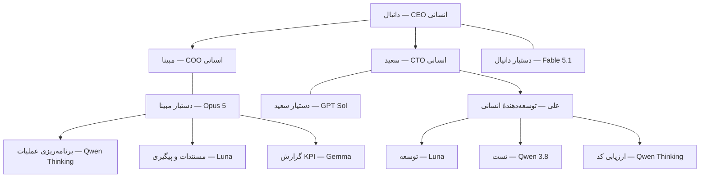
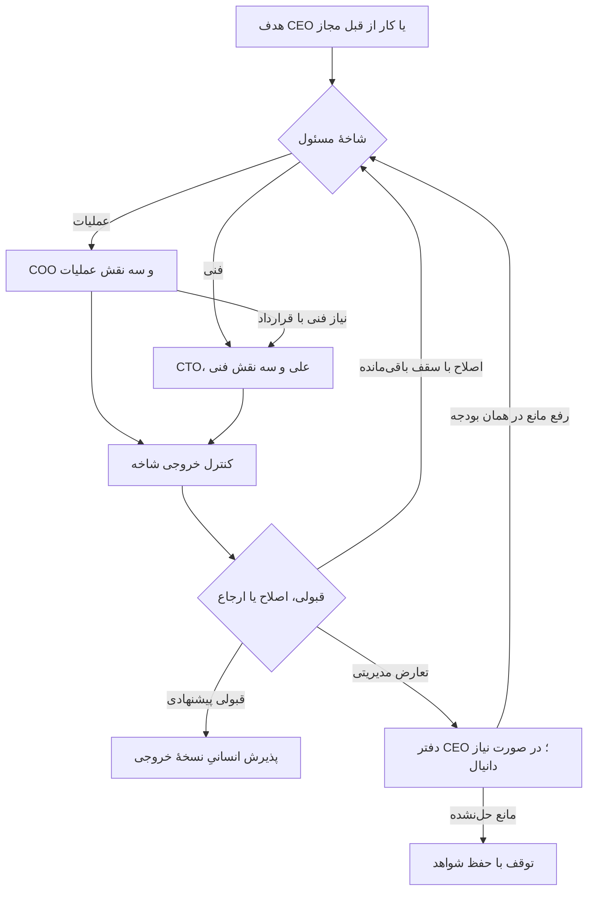

# Flux 0.3 — سازمان سلسله‌مراتبی انسان و Agent

این سند مرجع فعلی طراحی است و ساختار تخت نسخهٔ ۰٫۱ را جایگزین می‌کند. تنظیمات و ماشین‌حساب به همین نسخه به‌روز شده‌اند؛ موتور اجرایی و اتصال API هنوز ساخته نشده‌اند.

## مبنای تغییر

طبق تصحیح مستقیم کاربر، چهار عضو انسانی عبارت‌اند از: دانیال CEO، مبینا COO، سعید CTO و علی در بخش توسعه. نام مبینا و حضور انسانی هر دو مدیر مبنای فعلی طراحی است.

هر مدیر انسانی یک دستیار Agent دارد: Fable 5.1 برای دانیال، Opus 5 برای مبینا و GPT Sol برای سعید. مسئولیت مدیریتی با انسان است؛ Agent برنامه‌ریزی و اجرای واگذارشده را انجام می‌دهد. علی زیر نظر سعید و با سه Agent فنی کار می‌کند. پذیرش عملیات با مبینا و مسئولیت نهایی فنی با سعید است؛ علی می‌تواند کارهای معمول را در دامنهٔ تفویض‌شده بپذیرد.

## چارت جدید

این ساختار شامل ۹ نقش Agent است: یک دستیار CEO، دو دستیار مدیر، سه Agent عملیات و سه Agent فنی. مدل‌ها می‌توانند در چند نقش تکرار شوند؛ هر نقش دستورالعمل، حافظه و حدود دسترسی جدا دارد. حداکثر دو اجرای هم‌زمان برای کل پایلوت پیشنهاد می‌شود؛ تعداد جایگاه‌ها به معنای تعداد فراخوانی‌های هم‌زمان یا سرویس همیشه روشن نیست.

علی باید بتواند کار آماده را مستقیماً در صف فنی ثبت کند؛ لازم نیست برای هر حرکت یک بار از هر مدیر اجازه بگیرد. جایگاه انسانی او برای تصمیم فنی، رفع ابهام و پذیرش است، نه کلیک‌کردن بین هر فراخوانی مدل.

## نقش و مدل هر جایگاه

| نقش | مدل درخواستی/پیشنهادی | مسئولیت | گزارش به |
|---|---|---|---|
| Agent دفتر CEO | Fable 5.1، شناسهٔ API تأییدنشده | تبدیل اهداف دانیال به اولویت، بودجه و برنامه؛ حل تعارض میان دو شاخه | دانیال |
| دستیار COO؛ مبینا | claude-opus-5، نام فهرست کاربر | زمان‌بندی، هماهنگی، وضعیت پروژه، کیفیت خروجی عملیات | مبینا |
| دستیار CTO؛ سعید | gpt-5.6-sol، نام فهرست کاربر | معماری، قرارداد فنی، وابستگی و بررسی نهایی کد | سعید |
| برنامه‌ریز عملیات | gapgpt-qwen-3.6-thinking | تبدیل برنامه به کارهای مشخص و کشف مانع | COO |
| دستیار مستندات | gpt-5.6-luna | پیش‌نویس سند، گزارش و پیگیری داخلی | COO |
| تحلیلگر KPI | gapgpt-gemma-26b-a4b | توضیح شاخص‌ها و علامت‌گذاری تأخیر براساس دادهٔ ثبت‌شده | COO |
| توسعه‌دهنده | gpt-5.6-luna | تولید و اصلاح محدود کد | علی |
| تست‌کننده | gapgpt-qwen-3.8 | پیشنهاد/اجرای تست مجاز و تحلیل خطا | علی |
| ارزیاب فنی | gapgpt-qwen-3.6-thinking | بررسی diff در زمینهٔ مستقل و ارائهٔ ایراد مستند | علی |

سه Agent فنی عمداً سه نقش مکمل دارند؛ سه رأی مشابه از سه مدل ملاک صحت نیست. مدل ارزیاب، تست‌کننده و توسعه‌دهنده خروجی و معیار مستقل دارند. دستیار CTO بررسی فنی سطح بالاتر را انجام می‌دهد؛ سعید مسئول نهایی فنی است و پذیرش کار معمول می‌تواند به علی تفویض شود. گزارش KPI هم محاسبهٔ عددی را به کد می‌سپارد؛ مدل فقط توضیح می‌دهد و عدد یا پیشرفت اختراع نمی‌کند.

نام Fable 5.1 دقیقاً به‌عنوان انتخاب درخواستی ثبت شده است؛ API model ID آن خالی است. نرخ ۱۰ دلار ورودی و ۵۰ دلار خروجی بر یک میلیون توکن صرفاً از Fable 5 در فهرست قبلی قرض گرفته شده تا سناریو قابل محاسبه باشد؛ این نرخ تأییدشدهٔ 5.1 نیست و این دو نام معادل فرض نشده‌اند. نرخ Opus و Sol نیز همان دادهٔ کاربر است. قبل از اتصال، نام و قیمت واقعی و قابلیت‌های هر مدل بررسی می‌شوند.

## موتور زیر این چارت

موتور Flux کد معمولی است: صف پایدار، گراف کارها، کنترل دسترسی، دفتر بودجه، وضعیت‌ها و ثبت شواهد. Agentها برنامه و تصمیم پیشنهادی می‌دهند؛ موتور حدود را اجرا می‌کند. نمودار بالا رابطهٔ گزارش‌دهی را نشان می‌دهد و به معنای عبور اجباری هر توکن از تمام طبقات نیست.

قواعد تغییرکرده نسبت به ۰٫۱:

- تیم‌های اجرایی متعلق به شاخهٔ خود هستند؛ یک استخر مشترک تخت نداریم.
- مسئول مستقیم هر Agent با `reports_to` ثبت می‌شود.
- مبینا و سعید مدیران انسانی هم‌سطح‌اند و دستیارهای COO و CTO زیر اختیار آن‌ها هستند. درخواست COO به CTO یک تحویل کار با قرارداد است، نه دستور برای تغییر سیاست فنی.
- تعارض زمان، دامنه یا بودجه به دفتر CEO و در صورت نیاز به دانیال برمی‌گردد.
- عمق سازمانی بیشتر شده، اما عمق تقسیم یک task همچنان محدود است. هر root حداکثر پنج زیرکار دارد و زیرکارها به‌طور بازگشتی تیم تازه ایجاد نمی‌کنند.
- کارهای قالب‌دار مستقیماً وارد شاخهٔ مجاز می‌شوند؛ Fable فقط برای برنامه‌ریزی سطح بالا و استثناها فراخوانی می‌شود.
- گزارش‌ها با پایان کار یا رخداد واقعی تازه می‌شوند؛ refresh رابط، فراخوانی مدل نیست.

## الگوریتم جریان کار

1. دانیال هدف جدید را ثبت می‌کند. دفتر CEO خروجی، اولویت و سهم بودجه را پیشنهاد می‌دهد؛ اقدام در محدودهٔ اختیار مصوب انجام می‌شود.
2. موتور مشخص می‌کند کار عملیات، فنی یا مشترک است. کار تکراری می‌تواند از قالب قبلی و بدون فراخوانی CEO وارد شود.
3. دستیار مدیر شاخه در حدود اختیار مبینا یا سعید قرارداد کار را می‌سازد: صاحب انسانی، دامنه، معیار قبولی، وابستگی‌ها، مسیرهای مجاز و سقف هزینه.
4. کار عملیات در صف COO و کار فنی در صف CTO/علی قرار می‌گیرد. برای کار مشترک، COO نیازمندی عملیاتی را به‌صورت زیرکار وابسته به CTO تحویل می‌دهد؛ هر دو از بودجهٔ root مشترک مصرف می‌کنند.
5. موتور حداکثر هزینهٔ فراخوانی بعدی و سهم بررسی ضروری را رزرو می‌کند؛ بدون بودجه یا اختیار، اجرا شروع نمی‌شود.
6. مجری شاخه خروجی قابل مشاهده تولید می‌کند. تست‌کننده/ارزیاب مستقل شواهد را بررسی می‌کنند. نقش‌های عملیات فقط وقتی لازم‌اند اجرا می‌شوند؛ سه نقش به معنی سه فراخوانی اجباری برای هر کار نیست.
7. نتیجه یکی از ACCEPT_CANDIDATE، REVISE، ESCALATE یا REJECT است. REVISE فقط با ایراد مشخص و در شمارندهٔ باقی‌مانده مجاز است.
8. حداکثر اجرای اول و دو اصلاح داریم. شکست بدون پیشرفت به مدیر شاخه/علی ارجاع می‌شود؛ تعارض بین شاخه‌ها به CEO. ارجاع، شمارنده و بودجهٔ root را صفر نمی‌کند.
9. برای کد، دستیار CTO خروجی یکپارچه را بررسی می‌کند و سعید یا علی در دامنهٔ تفویض‌شده همان artifact را می‌پذیرد. برای عملیات، دستیار COO بررسی می‌کند و مبینا خروجی را می‌پذیرد.
10. هزینهٔ واقعی، زمان انسان، نتیجه و نسخهٔ artifact ثبت می‌شود. خلاصهٔ پایان کار برای مدیر بالاتر ذخیره می‌شود؛ فقط تصمیم جدید یا گزارش تجمیعی نیاز به فراخوانی مدیر دارد.

## قرارداد میان شاخه‌ها

پیام کار باید این فیلدها را داشته باشد: `task_id`, `root_id`, `parent_id`, `sender_role`, `recipient_role`, `human_owner`, `project_id`, `base_revision`, `objective`, `acceptance_criteria`, `dependencies`, `allowed_tools`, `allowed_paths`, `budget_remaining`, `attempts_used`, `artifact_refs` و `policy_version`.

نمونه: COO می‌گوید «برای گزارش مشتری، خروجی CSV سفارش‌ها لازم است؛ داده‌های مجاز و ستون‌ها این‌ها هستند». CTO قرارداد endpoint یا پردازش لازم را مشخص می‌کند، علی ابهام فنی را رفع می‌کند، توسعه‌دهنده پیاده‌سازی می‌کند، تست‌کننده دادهٔ نمونه و خطاها را بررسی می‌کند، ارزیاب diff را نقد می‌کند. سعید، دستیار CTO و علی نتیجه را بررسی می‌کنند و COO فقط خروجی پذیرفته‌شده را وارد گزارش می‌کند. ارسال گزارش به مشتری اقدام جدا با مجوز مربوط است.

## کیفیت، اختیار و توقف

- قبولی فنی: معیارهای ضروری، کنترل‌های لازم و نبود ایراد مسدودکنندهٔ حل‌نشده. تست اجرا‌نشده نامعلوم است و قبولی محسوب نمی‌شود.
- مدل اجازه ندارد برای عبور از بررسی، معیار یا تست مرجع را ضعیف کند.
- حداکثر دو اجرای هم‌زمان، پنج زیرکار و ۳۲ فراخوانی در یک root؛ حداکثر سه تلاش تولید هر زیرکار و یک ارتقای مدل. ارتقا فقط از مسیر تعریف‌شده و به مدیر همان شاخه با حفظ نقش و سقف است.
- محدودیت ۲۰ دقیقه اجرای فعال؛ انتظار انسان جدا ثبت می‌شود و مدل در انتظار روشن نمی‌ماند.
- اطلاعات هر شاخه و پروژه با مجوز بازیابی می‌شود؛ اشتراک مدل باعث اشتراک حافظه نمی‌شود.
- کلیدها سمت سرور؛ اجرای کد در محیط محدود؛ شاخهٔ Git به‌تنهایی sandbox نیست.
- merge، deploy و ارسال بیرونی با مجوز همان اقدام و artifact؛ مدیر Agent نمی‌تواند مجوز انسانی تازه جعل کند.
- رخداد تکراری با شناسه حذف می‌شود؛ پس از timeout، هزینهٔ نامعلوم رزروشده حفظ می‌شود. retry اثر بیرونی نیازمند idempotency یا بررسی نتیجه است.
- ثبت وضعیت، مصرف و رزروها باید تراکنشی باشد و پس از restart قابل ادامه بماند.

## بودجه و پیش‌بینی جدید

تقسیم ۵۰ دلار حفظ شده: ۵ دلار ارزیابی، ۳۵ دلار عملیات و ۱۰ دلار ذخیره. سقف کار ساده اکنون ۰٫۳۰ دلار، کدنویسی کوچک ۰٫۷۵ و پیچیده ۴ دلار است. این سقف هر root است و با زیرشاخه‌ها افزایش نمی‌یابد.

در سناریوی جدید، هزینهٔ دفتر CEO جدا حساب می‌شود: ده فراخوانی در کل پایلوت، هر بار ۴٬۰۰۰ توکن ورودی و ۸۰۰ خروجی، با ضریب ۱٫۵ برای مصرف اضافی؛ جمعاً ۱٫۲۰ دلار با نرخ موقت Fable. این سقف تعداد تماس عملیاتی نیست؛ فرض بودجه است. هر فراخوانی اضافی از همان ۳۵ دلار کم می‌شود. پس از آن ۳۳٫۸۰ دلار برای کارها می‌ماند.

| سناریو | هزینهٔ متوسط هر اجرای کار با ضریب اصلاح | نرخ قبولی فرضی | هزینهٔ هر خروجی پذیرفته‌شده با احتساب شکست‌ها، پیش از سهم ثابت CEO |
|---|---:|---:|---:|
| عملیات ساده با COO | ۰٫۱۲۲۶ دلار | ۸۵٪ | ۰٫۱۴۴۲ دلار |
| کدنویسی کوچک با CTO | ۰٫۲۶۳۲ دلار | ۷۰٪ | ۰٫۳۷۶۰ دلار |
| کار مشترک پیچیده | ۱٫۱۸۸۳ دلار | ۵۰٪ | ۲٫۳۷۶۵ دلار |

ترکیب فرضی ۲۵٪ عملیات ساده، ۶۵٪ کدنویسی کوچک و ۱۰٪ پیچیده است. هزینهٔ میانگین اجرا ۰٫۳۲۰۵ دلار و قبولی ترکیبی ۷۱٫۷۵٪ می‌شود. این نرخ‌ها همان فرض‌های قبلی‌اند و دربارهٔ کیفیت مدل‌های جدید شاهد تجربی نداریم. ارزان‌ترشدن سناریوی پیچیده ناشی از جایگزینی مجریان گران با مدل‌های اقتصادی است و به معنای حفظ کیفیت اثبات‌شده نیست.

ظرفیت صرفاً توکنی بعد از سهم CEO حدود ۱۰۵ اجرای کار، معادل امید ریاضی ۷۵ کار پذیرفته‌شده است. ظرفیت تحویل با زمان انسان محدود می‌شود:

| مشارکت انسانی در ده روز | ظرفیت اجرا با فرض ۱۵ دقیقه برای هر کار | خروجی پذیرفته‌شدهٔ موردانتظار |
|---|---:|---:|
| دانیال و علی، هرکدام روزانه ۳۰ دقیقه | ۴۰ | حدود ۲۹ |
| هر چهار عضو، مجموع روزانه ۱۲۰ دقیقه که ۶۰ دقیقهٔ آن بازبینی علی باشد | ۸۰ | حدود ۵۷ |

پیش‌فرض ماشین‌حساب صرفاً سناریوی مشارکت دو نفر در بازبینی است، نه تعداد مدیران حاضر. دانیال، مبینا، سعید و علی هر چهار نفر در سازمان ثبت شده‌اند. زمان واقعی مشارکت هنوز مشخص نشده است. برای سناریوی مشارکت هر چهار نفر، `--people 4 --technical-review-minutes-per-day 60` استفاده شود. مقدار زمان هر نفر در ماشین‌حساب میانگین کل ظرفیت است؛ در سناریوی دوم ۶۰ دقیقه از ۱۲۰ دقیقهٔ روزانه به علی و ۶۰ دقیقه به دیگران تخصیص می‌یابد. دو نفر یا چهار نفر در این محاسبه یعنی ظرفیت مشارکت انسانی، نه تعداد مدیر Agent.

به‌ازای هر کار فنی، ۱۰ دقیقه از سهم بازبینی علی فرض شده و باقی زمان تعریف/پیگیری در متوسط ۱۵ دقیقهٔ کل قرار دارد. زمان علی داخل کل زمان انسانی است و به آن اضافه نمی‌شود. چون ۷۵٪ کارهای ترکیب فنی‌اند، روزانه ۳۰ دقیقهٔ علی ظرفیت کل را به حدود ۴۰ اجرا محدود می‌کند. اضافه‌شدن افراد دیگر بدون افزایش زمان بازبینی فنی، نتیجه را از ۲۹ به ۵۷ نمی‌رساند. ماشین‌حساب این گلوگاه را جدا اعمال می‌کند.

مصرف عملیاتی سناریوی دو نفره، با سهم CEO، حدود ۱۴٫۰۲ دلار و برای چهار نفر حدود ۲۶٫۸۴ دلار است. ۵ دلار ارزیابی جداست و ذخیره خودکار خرج نمی‌شود. این عدد هزینهٔ توسعه، ابزار پولی، میزبانی یا زمان انسان را شامل نمی‌شود.

اگر ظرفیت سناریوی دوم فراهم باشد ولی هزینهٔ هر اجرای کار دو برابر فرض شود، ظرفیت توکن حدود ۵۲ اجرا و قبولی حدود ۳۷ کار می‌شود. اگر قبولی واقعی پایین‌تر باشد، نتیجه باز هم کاهش می‌یابد. اعداد سناریو هستند و ضمانت عملکرد نیستند.

## برنامهٔ اجرای نسخهٔ جدید

1. پیاده‌سازی ساختار `reports_to`، شاخه‌ها، مالک انسانی و حافظهٔ جدا در حالت mock.
2. ساخت صف، دفتر بودجه و قرارداد handoff با سقف مشترک root.
3. اتصال CEO، COO و CTO به سه انتخاب مدل و فعال‌کردن نامزدهای ارزان پس از بررسی قابلیت.
4. تکمیل یک جریان فنی تا خروجی پذیرفته‌شده و یک جریان عملیات تا گزارش داخلی.
5. آزمایش محدود با سقف ۵ دلار؛ بررسی کیفیت مدل‌های ارزان، هزینه و زمان انسان.
6. ده روز پایلوت؛ گسترش فقط پس از مشاهدهٔ کاهش زمان خالص و کیفیت قابل قبول.

برآورد ساخت ۶ تا ۱۰ روز توسعهٔ نسخهٔ قبل برای یک گردش کار بود. برای دو شاخه و handoff در این طرح، برآورد اولیه ۸ تا ۱۲ روز کاری یک توسعه‌دهنده با دسترسی آماده است؛ سپس ده روز پایلوت. این برآورد برنامه‌ریزی است و هزینهٔ نیروی انسانی در اعتبار توکن نیست.

ملاک موفقیت: تعداد rootهای پذیرفته‌شده، هزینهٔ همهٔ تلاش‌ها، زمان واقعی انسان و خطای برگشتی. تعداد روبات‌ها یا تعداد زیرکارها نشانهٔ پیشرفت نیست. برای مقایسهٔ بهره‌وری، نمونه‌های هم‌نوع روش فعلی شرکت را نیز ثبت می‌کنیم.

## وضعیت تحویل

چارت، قواعد مسیریابی، تخصیص مدل‌ها، تنظیمات و محاسبهٔ آفلاین به‌روز شده‌اند. هیچ حسابی متصل نشده و هیچ هزینهٔ API پرداخت نشده است. اسناد ۰٫۱ صرفاً سابقهٔ طراحی‌اند؛ نرخ‌ها، نقش‌ها و اعداد فعلی از این سند و `config/pilot.json` خوانده شوند.
