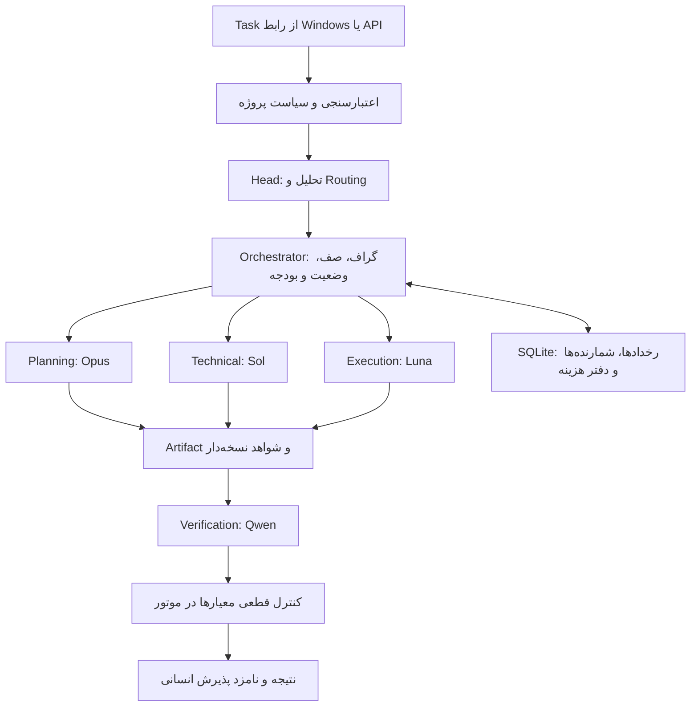

# Flux Engine MVP — طراحی هستهٔ نرم‌افزار

> دامنهٔ تحویل فعلی در [دموی شخصی پنج Agent](personal-demo.fa.md) تعریف شده است. API HTTP، runner و امکانات محصول کامل این سند پیش‌نیاز دمو نیستند؛ قواعد کنترل بودجه، قرارداد و شواهد حفظ می‌شوند.

وضعیت: طراحی آمادهٔ پیاده‌سازی؛ موتور هنوز ساخته نشده است. تاریخ: ۶ سپتامبر ۲۰۲۶.

اصلاح دامنه طبق درخواست جدید کاربر: محصول یک نرم‌افزار Windows با رابط کامل، مدیریت توکن و حافظهٔ محلی است. [طراحی محصول دسکتاپ ۰٫۵](desktop-product.fa.md) مرجع تحویل و بر این سند مقدم است. جزئیات زیر مربوط به موتور داخلی آن هستند.

## ۱. مرجع و دامنه

مبنای این مرحله [نیازمندی پیوست‌شده](mvp-requirements.fa.md) است. درخواست فعلی، بررسی و طراحی و تسک‌بندی است؛ ترتیب پیاده‌سازی داخل پیوست در بک‌لاگ ثبت شده است.

پوشهٔ فعلی شامل مستندات، تنظیمات پایلوت و ماشین‌حساب Python است؛ کد موتور، تست موتور یا پیکربندی بستهٔ نرم‌افزاری ندارد و در زمان بررسی مخزن Git نیز نبود. دو فایل `hierarchy.fa.md` در ریشه و docs محتوای یکسان دارند.

| موضوع | طرح سازمانی ۰٫۳ | قرارداد موتور MVP |
|---|---|---|
| نقش‌ها | ۹ نقش در چارت مدیریتی | Head و چهار متخصص |
| Head | Fable 5.1، شناسه نامشخص | claude-fable-5، نیازمند تأیید ارائه‌دهنده |
| فراخوانی root | ۳۲ | ۲۰ با احتساب retry |
| ورود کار عادی | امکان عبور بدون CEO | یک فراخوانی Head برای routing |
| پذیرش | انسان در چارت شرکت | پایان موتور در ACCEPT_CANDIDATE |

چارت انسانی دانیال، مبینا، سعید و علی حفظ می‌شود؛ پنج نقش نرم‌افزاری جایگاه شغلی افراد نیستند. `config/pilot.json` و گزارش بودجهٔ قبلی متعلق به سناریوی ۰٫۳ هستند و نباید تنظیمات اجرایی MVP خوانده شوند.

## ۲. نرم‌افزار را چگونه تحویل بدهیم؟

موتور به‌صورت بستهٔ Python با سرویس محلی، API مستند و CLI توسعه ساخته می‌شود؛ محصول نهایی پنجرهٔ مستقل Windows دارد و کاربر Task را از رابط ثبت می‌کند. API مسیر اتصال بعدی Alacrity OS و رابط دسکتاپ است.

فرمان‌های پیشنهادی زیر قرارداد تجربهٔ توسعه‌اند؛ در حال حاضر قابل اجرا نیستند:

```text
flux serve --host 127.0.0.1 --port 8040 --provider fake
flux runs submit examples/documentation-task.json --idempotency-key demo-001
flux runs show <run_id>
flux runs events <run_id>
flux runs usage <run_id>
flux runs cancel <run_id>
flux runs resume <run_id> --input-file clarification.json
```

CLI مشتری همان API و ابزار توسعه است؛ موتور مستقلی در CLI اجرا نمی‌شود. سرویس بدون Login فقط روی loopback با توکن نشست اجرا می‌شود و CORS عمومی ندارد. رابط و نصاب Windows، مدیریت پروژهٔ سبک و حافظه طبق سند محصول در همین تحویل ساخته می‌شوند. ارائهٔ شبکه‌ای/چندکاربره، CRM و اتصال مستقیم Alacrity OS مرحلهٔ بعدند.

## ۳. معماری کوچک

پیشنهاد: Python 3.12، FastAPI/Pydantic برای API و قراردادها، sqlite3 برای persistence، asyncio برای زمان‌بندی، OpenAI SDK فقط داخل GapGPT adapter و pytest برای تست. نسخه‌های دقیق در شروع ساخت pin شوند. FastAPI قراردادهای OpenAPI/JSON Schema و مستندات تعاملی فراهم می‌کند؛ SQLite برای ذخیرهٔ محلی مناسب است. این انتخاب معماری پیشنهاد پروژه است، نه نتیجهٔ بنچمارک Flux. منابع: [FastAPI](https://fastapi.tiangolo.com/)، [کاربردهای SQLite](https://www.sqlite.org/whentouse.html).



یک پردازش سرویس و یک scheduler پایدار داریم؛ شروع پردازش دوم برای همان دیتابیس رد می‌شود. دو slot مشترک برای تمام rootها شامل Head و Reviewer اعمال می‌شود. صف در SQLite ذخیره می‌شود؛ Background Task حافظه‌ای منبع حقیقت نیست. SQLite با foreign keys، تراکنش کوتاه و WAL روی دیسک محلی استفاده شود. هنگام تماس شبکه تراکنش باز نماند. Redis، Celery، پایگاه برداری و framework چندعاملی در MVP نیاز نیست.

ماژول‌های پیشنهادی:

```text
src/flux/
  api.py, cli.py, settings.py
  contracts/          # Task, Plan, Envelope, Review, RunResult
  engine/            # state machine, scheduler, DAG, recovery, limits
  agents/            # پنج پروفایل و prompt نسخه‌دار
  providers/         # protocol, fake, gapgpt, capabilities
  budget/            # estimator, ledger, settlement
  policy/            # project scope, data, tools, paths
  storage/           # migrations, repositories, events
  artifacts/         # context selection, hash, evidence
  tools/             # controlled file operations and isolated runner
tests/               # unit, integration, fault injection
examples/            # planning, documentation, technical
config/mvp.*         # جدا از تنظیمات تاریخی پایلوت
var/                 # DB و artifacts؛ خارج از Git
```

## ۴. تصمیم‌های لازم برای رفع ابهام پیوست

1. **اعتبارسنجی دو مرحله دارد.** فیلد ناقص، secret، پروژه ناشناخته یا دسترسی غیرمجاز قبل از هر LLM متوقف می‌شود. تشخیص معنایی ارتباط با شرکت توسط Head در PLANNING است؛ «قبل از API» برای این تشخیص ممکن نیست. Head با `unclear` به NEEDS_INPUT و با `invalid` به REJECTED می‌رود؛ هیچ متخصصی شروع نمی‌شود.
2. **دامنهٔ شرکت از config معتبر می‌آید.** برای هر project_id، شرح خدمات مجاز، مالک‌های انسانی، ریشهٔ فایل‌ها، دادهٔ مجاز و ابزارها ثبت شود. Task فقط می‌تواند این حدود را محدودتر کند؛ اجازهٔ جدید ایجاد نمی‌کند. نبود این سیاست مانع اجرای زنده است.
3. **قرارداد ثابت است.** snapshot اولیه، schema_version، contract_hash، policy_version و context_revision ثبت شوند. زیرکارها به معیارهای root نگاشت شوند. Planning می‌تواند جزئیات یا معیار پیشنهادی بدهد؛ جایگزینی خودکار معیارهای اصلی ممنوع است. تغییر دامنه/معیار نیازمند Task جدید مرتبط است.
4. **Review در Envelope قرار می‌گیرد.** شیء تصمیم Reviewer دقیقاً در `Envelope.output` و با schema اختصاصی ذخیره می‌شود. agent/model/subtask در metadata سمت موتور از درخواست تعیین و با پاسخ تطبیق داده می‌شوند.
5. **Qwen همیشه بررسی مستقل خروجی نهایی دارد.** `final_review_agent=sol|fable` بررسی اضافی برای حساسیت/تعارض است؛ Qwen حذف نمی‌شود. Head دوم schema جداگانهٔ جمع‌بندی دارد و اجازهٔ ساخت دوبارهٔ plan را ندارد. Head حداکثر دو ارسال شبکه در root دارد؛ retry نیز از همین دو سهم استفاده می‌کند.
6. **پنج زیرکار شامل کارهایی است که Head می‌سازد.** بررسی نهایی مرحلهٔ موتور است؛ child ششم یا root جدید نیست. dependency تکراری، ارجاع مجهول، self-reference، دور و ID تکراری رد شوند. وابستگی root به Task خارجی فقط با مدرک تکمیل معتبر در storage/config رفع می‌شود؛ نبود آن NEEDS_INPUT می‌دهد.
7. **تلاش با retry فرق دارد.** هر زیرکار حداکثر `min(max_attempts,3)` تلاش تولید دارد؛ شامل اجرای اول. هر درخواست شبکه حداکثر دو retry، یعنی سه ارسال کل دارد؛ فقط خطای گذرا/429/5xx، با backoff و Retry-After در deadline. خطای auth/schema retry خودکار ندارد. همهٔ ارسال‌ها سهم ۲۰ فراخوانی و بودجه می‌گیرند؛ retry داخلی SDK خاموش باشد.
8. **ارتقا حداکثر یک بار در root است.** مسیر پیشنهادی فقط Execution Luna به Sol با همان prompt/اختیار اجرایی است. نقش Technical مستقل می‌ماند. فقط برای شکست قابل اصلاح با شواهد، قابلیت تأییدشده و بودجهٔ کافی؛ هر تغییر مدل و علت audit شود.
9. **قبولی با رأی مدل تنها حاصل نمی‌شود.** هر معیار ضروری باید به check یا شاهد معتبر متصل باشد. برای Task فنی، تست لازمِ not_run مانع قبولی است؛ سند بدون تست کد، بررسی پوشش/منابع خودش را دارد. evidence باید ref واقعی با hash داشته باشد. با نبود شاهد یا ایراد مسدودکننده، موتور ACCEPT_CANDIDATE را نمی‌پذیرد.
10. **ابهام هزینه و اجرای ابزار پس از crash حفظ می‌شود.** idempotency داخلی تضمین exactly-once ارائه‌دهنده نیست؛ درخواست in-flight نامعلوم به‌صورت کور دوباره ارسال نمی‌شود.

## ۵. چرخهٔ اجرا و State Machine

ورودی معتبر → ثبت اتمی Run → Head → اعتبارسنجی plan → صف → اجرای گراف با دو slot → شواهد و بررسی مستقل → خروجی نهایی. برای سند ساده: Head، Luna، Qwen؛ Opus و Sol فقط طبق نیاز. جمع‌بندی ساده با قالب کدی انجام می‌شود.

Transitionهای پیشنهادی زیر exhaustive هستند؛ هر مسیر دیگر رد و audit شود:

| مبدأ | مقصد مجاز |
|---|---|
| NEW | VALIDATING، CANCELLED |
| VALIDATING | PLANNING، NEEDS_INPUT، REJECTED، FAILED، CANCELLED |
| PLANNING | QUEUED، NEEDS_INPUT، ESCALATED، REJECTED، PAUSED_BUDGET، FAILED، CANCELLED |
| QUEUED | RUNNING، NEEDS_INPUT، ESCALATED، PAUSED_BUDGET، FAILED، CANCELLED |
| RUNNING | VERIFYING، NEEDS_INPUT، ESCALATED، REJECTED، PAUSED_BUDGET، FAILED، CANCELLED |
| VERIFYING | ACCEPT_CANDIDATE، REVISE، NEEDS_INPUT، ESCALATED، REJECTED، PAUSED_BUDGET، FAILED، CANCELLED |
| REVISE | QUEUED، ESCALATED، PAUSED_BUDGET، FAILED، CANCELLED |
| NEEDS_INPUT | VALIDATING، CANCELLED |
| PAUSED_BUDGET | VALIDATING، CANCELLED |
| ESCALATED | VALIDATING، CANCELLED |
| ACCEPT_CANDIDATE، REJECTED، FAILED، CANCELLED | ندارد |

Resume فقط برای سه وضعیت قابل توقف است؛ رفع مانع باید توسط caller محلی ثبت شود. دوباره‌اعتبارسنجی از checkpoint ادامه می‌دهد و بدون ضرورت Head را تکرار نمی‌کند؛ مسیر فازهای عبوری بدون dispatch دوباره ثبت می‌شود. سقف شمارنده‌ها و زمان reset نمی‌شوند. افزایش سقف بودجه فقط با override صریح انسانی و event قبل/بعد مجاز است؛ Agent اختیار آن را ندارد. resume عادی صرفاً کمبود بودجه را نادیده نمی‌گیرد.

۲۰ دقیقه زمان فعال، زمان دیواری scheduler و فراخوانی/ابزار/backoff فعال است؛ جمع زمان دو Agent نیست. انتظار صف بدون کار فعال و انتظار انسان حساب جدا دارند. intervalهای فعال و deadline پایدارند؛ پس از crash بازهٔ نامعلوم محافظه‌کارانه حساب می‌شود. پایان زمان یا فراخوانی/تلاش بدون امکان ادامه به ESCALATED با reason مشخص می‌رود.

Cancel زمان‌بندی تازه را فوراً متوقف می‌کند. توقف درخواست در سمت ما الزاماً صورتحساب ارائه‌دهنده را متوقف نمی‌کند؛ پاسخ دیررس فقط برای تسویه ثبت می‌شود و وضعیت CANCELLED را برنمی‌گرداند.

## ۶. بودجه و قابلیت ارائه‌دهنده

برای هر root دفتر مشترک داریم؛ مبلغ با Decimal یا واحد صحیح زیر دلار ذخیره شود. invariant رزرو:

```text
spent_known + held_unknown + reserved_inflight + next_reservation <= budget_cap
```

رزرو بودجه و سهم فراخوانی در یک تراکنش قبل از ارسال ثبت شوند. سقف خروجی هر نقش مستقل است. سهم بررسی نهایی لازم پیش از تولید کنار گذاشته شود تا تولید همهٔ بودجه را مصرف نکند. پس از پاسخ، usage واقعی با snapshot قیمت همان call تسویه شود. actual_cost در حالت نامعلوم null است، نه صفر؛ cached_input_tokens زیرمجموعهٔ input است و دوباره جمع نمی‌شود. تخفیف cache بدون تعرفهٔ تأییدشده فرض نشود.

تخمین توکن به‌تنهایی تضمین سقف واقعی صورتحساب نیست. برای اجرای زنده باید tokenizer/کران محافظه‌کارانه، سقف همهٔ توکن‌های قابل صورتحساب از جمله reasoning، تعرفه و usage تأیید شوند. در صورت نداشتن کران معتبر، آن مدل برای اجرای با بودجهٔ سخت unavailable است. usage بیشتر از رزرو حذف نمی‌شود؛ هزینه واقعی ثبت، اجرای بعدی متوقف و خطای estimator گزارش می‌شود. برای تضمین در برابر خطای خود ارائه‌دهنده نیز سقف هزینهٔ سمت حساب، در صورت پشتیبانی، لازم است.

در timeout بعد از ارسال، رزرو unknown حفظ می‌شود؛ retry سهم بودجهٔ جدا می‌گیرد. نبود بودجه برای دو هزینهٔ احتمالی، retry را متوقف می‌کند. پس از restart تماس in-flight نامعلوم به ESCALATED برای reconciliation می‌رود. هزینهٔ رزروشدۀ بدون dispatch فقط با اثبات ارسال‌نشدن آزاد می‌شود.

### نتیجهٔ بررسی GapGPT

در بررسی ۶ سپتامبر ۲۰۲۶، ابزار وب محتوای صفحهٔ [مدیریت توکن](https://gapgpt.app/platform-v2/tokens) را دریافت نکرد. درخواست مستقیم بدون کلید به `https://api.gapgpt.app/v1/models` پاسخ HTTP 401 داد؛ این فقط نیاز به احراز هویت endpoint را نشان می‌دهد. سازگاری SDK، اعتبار کلید، دسترسی پنج مدل، JSON Schema و قیمت‌ها با این بررسی تأیید نشده‌اند. هیچ درخواست تولیدی با کلید ارسال نشده است.

Base URL و پنج شناسه و نرخ‌های پیوست، ورودی درخواستی کاربر هستند؛ در manifest با `verified=false` ثبت شوند. نام مشابه در ابزار توسعه اثبات دسترسی GapGPT نیست. جایگزینی پنهانی مدل ممنوع است.

برای هر مدل این موارد باید ثبت شوند: ID واقعی، تاریخ بررسی، endpoint، JSON/structured output، سقف context و output/reasoning، usage و cache، نرخ و واحد قیمت، timeout و خطا، وضعیت available/unverified/unavailable و علت. `/models/status` فقط آخرین نتیجهٔ ذخیره‌شده را بخواند؛ هر refresh تست پولی اجرا نکند. پاسخ معتبر JSON همیشه در کد هم validate شود.

کلید فقط از `GAPGPT_API_KEY` در محیط پردازش خوانده می‌شود. نه CLI argument، نه config، نه prompt و نه log. اجرای زنده علاوه بر کلید نیازمند `--provider gapgpt --enable-live` و سقف صریح آزمون است؛ fake پیش‌فرض باقی می‌ماند. کلید ارسال‌شده در گفتگو پیش از بهره‌برداری بهتر است تعویض شود.

## ۷. ابزار، context و شواهد

Artifact store محلی با ref نسبی داخلی، project_id، revision، hash و data_class داشته باشیم. ref به‌تنهایی مجوز خواندن نیست؛ مجوز در هر خواندن دوباره بررسی شود. context فقط قرارداد ثابت، خلاصهٔ نسخه‌دار و منابع مرتبط را می‌گیرد. Review diff و شواهد لازم را دریافت می‌کند؛ تاریخچهٔ گفتگوهای مجری ارسال نمی‌شود. hash درخواست read-only شامل پروژه، قرارداد، مدل، prompt/schema/policy version، پارامترها و hash ورودی‌هاست؛ cache هزینهٔ قبلی را دوباره حساب نمی‌کند و میان پروژه‌ها مشترک نیست.

شروع ابزارها با read مجاز، نوشتن artifact داخلی و تولید patch محدود است. برای اجرای واقعی تست/کد، runner جدا و محدود لازم است: فضای موقت، inputهای مجاز read-only، خروجی جدا، network خاموش، بدون کلید محیط، محدودیت CPU/RAM/process/time و بدون mount میزبان یا Docker socket. allowlist دستور به‌تنهایی sandbox نیست؛ تست هم می‌تواند کد دلخواه اجرا کند. اگر runtime جداسازی آماده نیست، تولید diff مجاز است ولی اجرای تست not_run و نامزد قبولی فنی مسدود می‌ماند.

حدود مسیر با canonical path و کنترل junction/symlink و traversal در Windows اعمال شوند. API مدل اجازهٔ shell عمومی ندارد؛ فراخوانی ابزار ساخت‌یافته و allowlist آرگومان دارد. حتی allowed_tools نمی‌تواند ممنوعیت deploy، merge، حذف فایل و پیام خارجی را دور بزند. محتوای فایل و خروجی مدل هرگز policy را تغییر نمی‌دهد. audit شامل metadata، hash و دلایل کوتاه است؛ secret و header احراز هویت و متن حساس کامل در log ذخیره نشود. طبقه‌بندی دستی به‌تنهایی کافی نیست؛ منابع ورودی نیز پیش از prompt از نظر secret بررسی شوند.

## ۸. ذخیره‌سازی و API

| Entity | دادهٔ ضروری |
|---|---|
| runs | run_id، task/root/project، قرارداد و hash، state/version، checkpoint، counters، زمان فعال، idempotency و payload hash |
| subtasks | plan معتبر، DAG، role، attempt، lease و نتیجه |
| agent_calls | request hash، model واقعی، prompt version، dispatch state، latency، provider request id، error |
| artifacts | ref، revision، hash، data_class، منشأ و run |
| checks | criterion، وضعیت، evidence refs و ابزار تولیدکننده |
| decisions | review، issues، artifact hash و صادرکننده |
| budget_reservations | root، call، مقدار، price snapshot، وضعیت تسویه/unknown |
| usage_records | توکن‌ها، هزینه تخمینی/واقعی nullable، attempt |
| events | sequence افزایشی، transition، reason، timestamp و metadata پاک‌سازی‌شده |

تغییر state و event متناظر اتمی هستند. فایل artifact ابتدا در فایل موقت نوشته و به‌صورت اتمی نهایی، سپس در DB ارجاع می‌شود؛ recovery فایل بدون رکورد یا ref ناقص را شناسایی کند. migration نسخه‌دار و بازیابی پشتیبان لازم است.

| Endpoint | قرارداد پیشنهادی |
|---|---|
| POST /runs | body شامل task و idempotency_key؛ 202 با run_id/state؛ همان کلید و payload نتیجهٔ قبلی، payload متفاوت 409؛ ورودی نامعتبر 422 |
| GET /runs/:id | state، reason، subtasks، نتیجه و artifact refs؛ ناشناخته 404 |
| POST /runs/:id/cancel | لغو تکراری بی‌اثر؛ وضعیت پایانی دیگر 409 |
| POST /runs/:id/resume | توضیح/رفع مانع و expected_version؛ تضاد نسخه یا وضعیت 409؛ حفظ شمارنده‌ها |
| GET /runs/:id/events | صفحه‌بندی با after_sequence و limit؛ بدون نیاز به SSE در MVP |
| GET /runs/:id/usage | spent، reserved، unknown، remaining و تفکیک call/model |
| GET /models/status | قابلیت و قیمت ثبت‌شده، verified_at و علت عدم دسترسی |

در MVP هر POST یک root Task مستقل ثبت می‌کند؛ `root_id=task_id` و Task/project تکراری با کلید تازه دوباره اجرا نمی‌شود. زیرکار فقط از scheduler ساخته می‌شود؛ retry اجرای بسته‌شده نیازمند Task جدید با ارتباط تاریخی است. توسعهٔ چند Run زیر یک root برای مرحلهٔ بعد است تا بودجه دور زده نشود.

RunResult شامل schema_version، run/task/root/project، status، summary، artifact refs و hashes، criterion/check mapping، review decision، unresolved issues، spent/reserved/unknown و `human_acceptance_required=true` است. پذیرش انسانی نهایی خارج از state machine فعلی می‌ماند.

## ۹. معیار تحویل

سه مثال قابل تکرار: سند ساده، برنامه‌ریزی و تغییر کوچک کد در runner. جریان موفق و شکست با Fake Provider اجرا شود؛ ۱۲ تست الزامی پیوست و تست‌های رقابت بودجه، cancel/restart، مسیر نامجاز و retry هزینهٔ نامعلوم پاس شوند. تست عادی هیچ شبکه‌ای باز نکند. نصب پاک، راه‌اندازی مجدد و بازیابی state نشان داده شوند. adapter واقعی فقط پس از ثبت قابلیت‌ها و smoke test محدود فعال شود.

پیش‌نیازهای باقی‌مانده برای اجرای زنده: سیاست واقعی دامنهٔ شرکت و پروژهٔ نمونه، پنج ID و تعرفهٔ قابل اثبات، کلید معتبر در محیط، runtime جداسازی و Taskهای نمونه با معیار روشن. این‌ها مانع ساخت موتور و تست جعلی نیستند.

برنامهٔ اجرایی در [بک‌لاگ MVP](mvp-tasks.fa.md) است.
