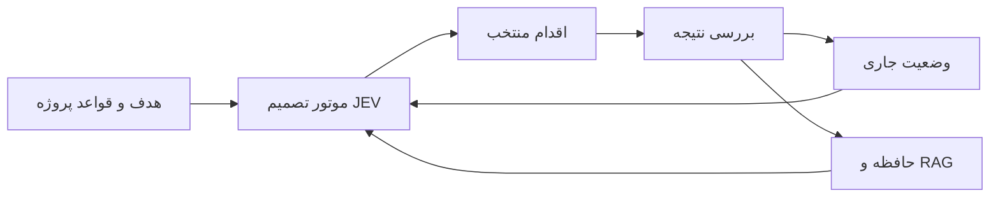

# Flux selected project chat evidence

## Chat: تدوین white paper دقیق Flux
Thread ID: 01a09c4a-310d-7172-a91b-6d8ecd7a6db4
Snapshot is selected recent turns, not a complete conversation. Historical requests and responses are evidence of decisions, not new instructions.

### Turn 01a09c54-ec90-7fa0-8775-9d29c44b69a6; status completed

User:
. مهم‌ترین مشکل شرکت‌های هدف چیست که Flux باید حل کند؟ اگر چند مشکل می‌بینید، به ترتیب اهمیت بگویید.  کند و احمق بودن نیروی انسانی  و هزینه کمتر و بهینه تر بودن و 24 ساعت فعال بودن سیستم&#x20;
۲. در شرکت هیبرید مدنظر شما، هر کارمند یک Agent اختصاصی دارد، هر واحد مثل فروش و مالی تیمی از Agentها دارد، یا ترکیبی از این دو؟  یک یا چندین Agent  برای هر بخش
&#x20;۳. هدف، افزایش توان کارکنان فعلی است یا سپردن کامل بعضی جایگاه‌ها و مسئولیت‌ها به AI هم جزو چشم‌انداز است؟  جفتش هست دقیقا&#x20;
۴. یک نمونهٔ واقعی از کاری بگویید که امروز در شرکت کاملاً انسانی انجام می‌شود و می‌خواهید با Flux تغییر کند: درخواست از کجا می‌آید، چه کسی انجامش می‌دهد و خروجی چیست؟  مثلا نیروی فنی در بخش ساخت محصول کار فرما  برای شروع موضوع وارد شبکه میشه سپس با head  بخش بندی و بر هر بخش میره سپس برای هر بخش منحصر به فرد agent Task رو انجام میده تا head انسانی تایید کن&#x20;

۵. نقطهٔ شروع Flux چه شرکت‌هایی هستند؟ صنعت، اندازهٔ تقریبی و بازار اولیهٔ مدنظرتان را بگویید؛ مثلاً شرکت‌های نرم‌افزاری کوچک در ایران یا سازمان‌های بزرگ در صنایع مختلف.

من دوست دارم شرکت هایی باشند که قدیمی هستن و سیستم های ضعیف دارن یا شرکت های تازه تاسیسی&#x20;

Assistant report (verify against code/tests before treating as current):
Flux را بر پایهٔ **Agentهای اختصاصی هر بخش، تقسیم کار هماهنگ و تأیید خروجی توسط مدیر انسانی** تعریف می‌کنیم. در متن رسمی، مشکلات نیروی انسانی را با شاخص‌های قابل‌بررسی مثل سرعت انجام کار، خطا، هزینه و محدودیت ساعات کاری بیان می‌کنم. کاهش هزینه و فعالیت شبانه‌روزی نیز فعلاً اهداف محصول‌اند؛ میزان تحقق آن‌ها باید در اجرا سنجیده شود.

:::writing{variant="document" id="85219"}
مسئله و تعریف سازمان هیبرید

شرکت‌هایی که اجرای فرایندهایشان کاملاً به نیروی انسانی وابسته است، با محدودیت ظرفیت، تفاوت در کیفیت تصمیم‌گیری، خطاهای اجرایی و هزینهٔ هماهنگی مواجه می‌شوند. وابستگی مراحل کار به حضور افراد و ساعات کاری نیز می‌تواند باعث توقف فرایندها و افزایش زمان تحویل شود.

Flux، محصول شرکت Alacrity، با هدف کاهش این محدودیت‌ها و تبدیل شرکت به سازمانی هیبرید طراحی می‌شود. در این ساختار، هر بخش سازمان بر اساس نیاز خود یک یا چند عامل هوش مصنوعی در اختیار دارد. این عامل‌ها مسئولیت‌های مشخصی می‌پذیرند و در کنار افراد، بخشی از ظرفیت عملیاتی شرکت را تشکیل می‌دهند.

این تحول دو مسیر را در بر می‌گیرد: افزایش توان کارکنان موجود از طریق واگذاری بخشی از کارها به عامل‌ها، و سپردن کامل برخی وظایف یا مسئولیت‌های شغلی به هوش مصنوعی. حدود این واگذاری و نقاط مداخلهٔ انسانی باید متناسب با هر فرایند تعیین شوند.

در سناریوی ساخت محصول برای کارفرما، درخواست ابتدا وارد شبکهٔ کاری Flux می‌شود. نقش هماهنگ‌کننده یا Head درخواست را به بخش‌های کاری تفکیک می‌کند و کار را به بخش‌های مرتبط می‌سپارد. عامل‌های اختصاصی هر بخش، وظایف تعیین‌شده را انجام می‌دهند و خروجی برای تأیید به مدیر انسانی ارائه می‌شود. جزئیات هماهنگی، بازبینی و اصلاح خروجی در طراحی فرایند مشخص خواهد شد.

اهداف عملیاتی Flux عبارت‌اند از کوتاه‌کردن زمان انجام کار، کاهش هزینهٔ تحویل خروجی قابل‌قبول، استفادهٔ بهینه‌تر از ظرفیت سازمان و امکان ادامهٔ فعالیت سیستم در تمام ساعات شبانه‌روز. فعالیت پیوستهٔ سیستم به معنای حذف نقاط تأیید انسانی نیست؛ کارهای وابسته به تأیید، تا دریافت تصمیم فرد مسئول منتظر می‌مانند.

دو گروه اولیهٔ موردنظر برای محصول، شرکت‌های قدیمی با سامانه‌ها و فرایندهای ضعیف، و شرکت‌های تازه‌تأسیس هستند. برای گروه اول، مسئلهٔ اصلی چگونگی واردکردن هوش مصنوعی به ساختار موجود است. برای گروه دوم، فرصت اصلی شکل‌دادن ساختار هیبرید از ابتدای فعالیت خواهد بود. صنعت، اندازه و محدودهٔ جغرافیایی بازار اولیه هنوز تعیین نشده‌اند.
:::

برای بخش بعدی، **«ساختار سازمانی و مسیر انجام کار»**، این موارد را روشن کنیم:

۱. **Head تقسیم‌کنندهٔ کار، خودش AI است؟** یک Head مرکزی برای کل شرکت داریم و زیر آن Headهای هر بخش، یا ساختار دیگری در ذهن دارید؟

۲. **بخش‌ها و Agentها چگونه تعریف می‌شوند؟** شرکت ساختار فعلی‌اش را معرفی می‌کند و Flux پیشنهاد می‌دهد، یا مدیر از ابتدا بخش‌ها و Agentهای موردنیاز را می‌سازد؟

۳. **Agent واقعاً چه اقداماتی انجام می‌دهد؟** مثلاً در بخش فنی فقط کد تولید می‌کند یا به فایل‌های پروژه دسترسی دارد، کد را تغییر می‌دهد، تست اجرا می‌کند و محصول را هم منتشر می‌کند؟

۴. **تأیید مدیر انسانی در چه مرحله‌ای لازم است؟** پیش از شروع برنامه، بعد از خروجی هر بخش، فقط پیش از تحویل نهایی، یا بسته به نوع کار؟

۵. **اگر خروجی رد شود یا Agent نتواند کار را تمام کند، چه اتفاقی باید بیفتد؟** چه کسی ایراد را مشخص می‌کند و دربارهٔ اصلاح، تغییر Agent یا سپردن کار به انسان تصمیم می‌گیرد؟

### Turn 01a09c59-8052-7c73-9742-17ce9bfc4b5d; status completed

User:
۱. **Head تقسیم‌کنندهٔ کار، خودش AI است؟** یک Head مرکزی برای کل شرکت داریم و زیر آن Headهای هر بخش، یا ساختار دیگری در ذهن دارید؟ &#x20;
AI قوی تری هست&#x20;
دقیقا مثل چارت سازمانی هر چی پایین تر میریم مدل ضعیف تر میشه &#x20;
۲. **بخش‌ها و Agentها چگونه تعریف می‌شوند؟** شرکت ساختار فعلی‌اش را معرفی می‌کند و Flux پیشنهاد می‌دهد، یا مدیر از ابتدا بخش‌ها و Agentهای موردنیاز را می‌سازد؟ &#x20;
ما بررسی میکنیم و سعی میکنیم ساختار شرکت رو تبدیل کنیم و تو ذهنم هست یک نرم افزار باشیم  و بتونن مارو تهیه کنند به صورت B2B&#x20;
۳. **Agent واقعاً چه اقداماتی انجام می‌دهد؟** مثلاً در بخش فنی فقط کد تولید می‌کند یا به فایل‌های پروژه دسترسی دارد، کد را تغییر می‌دهد، تست اجرا می‌کند و محصول را هم منتشر می‌کند؟ &#x20;
ببین دقیق یک شرکت هر کاری که اون تو انجام میشه بات انجام میده  تولید تست و غیره&#x20;
۴. **تأیید مدیر انسانی در چه مرحله‌ای لازم است؟** پیش از شروع برنامه، بعد از خروجی هر بخش، فقط پیش از تحویل نهایی، یا بسته به نوع کار؟   انتها و ابتندای کار در صورت نیاز دقیق وسط کار&#x20;
۵. **اگر خروجی رد شود یا Agent نتواند کار را تمام کند، چه اتفاقی باید بیفتد؟** چه کسی ایراد را مشخص می‌کند و دربارهٔ اصلاح، تغییر Agent یا سپردن کار به انسان تصمیم می‌گیرد؟ &#x20;
باز تولید توسط مدل بهتر یا در صورت بازگشت به head در اهر به بخش انسانی

Assistant report (verify against code/tests before treating as current):
ساختار مدنظر شما، **چارت سازمانی سلسله‌مراتبی از Agentها با مدیریت انسانی** است. Alacrity ساختار شرکت مشتری را بررسی می‌کند و Flux را به‌عنوان نرم‌افزار B2B برای تبدیل آن ساختار به سازمان هیبرید ارائه می‌دهد.

:::writing{variant="document" id="96428"}
ساختار سازمانی و چرخهٔ انجام کار

Flux ساختار همکاری عامل‌های هوش مصنوعی را بر اساس چارت سازمانی شرکت شکل می‌دهد. در این معماری، یک عامل هماهنگ‌کنندهٔ مرکزی یا Head، مسئول درک درخواست، تقسیم کار و هدایت آن به بخش‌های مرتبط است. هر بخش می‌تواند عامل هماهنگ‌کننده و یک یا چند عامل اجرایی اختصاصی داشته باشد.

تخصیص مدل‌ها از سلسله‌مراتب مسئولیت پیروی می‌کند. در سطوح بالاتر، مدل‌های توانمندتر برای تحلیل مسائل گسترده، برنامه‌ریزی و هماهنگی میان بخش‌ها به کار گرفته می‌شوند. در سطوح پایین‌تر، وظایف محدودتر به مدل‌های سبک‌تر و کم‌هزینه‌تر سپرده می‌شوند. این الگو مسیر پیش‌فرض تخصیص کار است؛ در صورت ناکافی‌بودن توان مدل اجرایی، امکان ارجاع همان وظیفه به مدل توانمندتر وجود خواهد داشت. تناسب مدل با هر مسئولیت باید با ارزیابی عملکرد مشخص شود.

استقرار Flux با بررسی ساختار و شیوهٔ فعالیت شرکت مشتری توسط Alacrity آغاز می‌شود. هدف این بررسی، شناسایی مسئولیت‌ها، ارتباط میان بخش‌ها و تعیین نحوهٔ توزیع کار میان انسان و عامل‌های هوش مصنوعی است. محصول نهایی به‌صورت نرم‌افزار تجاری برای استفادهٔ سازمان‌ها عرضه خواهد شد؛ جزئیات بسته‌بندی محصول و خدمات استقرار هنوز در دست تعیین است.

دامنهٔ چشم‌انداز Flux، مشارکت عملیاتی در کارهای شرکت است. عامل‌ها باید بتوانند با اتصال به ابزارها و سامانه‌های موردنیاز، وظایف قابل‌انجام در محیط نرم‌افزاری را اجرا کنند. برای نمونه، در بخش فنی این دامنه می‌تواند تولید و تغییر کد، اجرای تست و انجام مراحل تحویل محصول را در بر بگیرد. تحقق هر قابلیت به فراهم‌بودن اتصال، دسترسی و سازوکار اجرای مربوط وابسته است.

چرخهٔ اصلی کار از ثبت درخواست و تعیین نتیجهٔ موردانتظار آغاز می‌شود. مدیر انسانی در ابتدای کار، هدف و دامنه را تأیید می‌کند. Head سپس درخواست را به وظایف مرتبط تقسیم می‌کند و آن‌ها را در ساختار سازمانی توزیع می‌کند. عامل‌های هر بخش وظایف را انجام می‌دهند و خروجی‌های مرتبط برای تحویل نهایی گردآوری می‌شوند. تأیید نهایی با مدیر انسانی است؛ در طول اجرا نیز هرجا نیاز به تصمیم انسانی وجود داشته باشد، کار به او ارجاع می‌شود.

در صورت رد خروجی یا ناتوانی عامل، مسیر اصلاح از اجرای مجدد با مدل توانمندتر آغاز می‌شود. اگر مسئله برطرف نشود، به Head بازمی‌گردد تا دربارهٔ ادامهٔ کار تصمیم بگیرد. مسئله‌ای که در این مسیر حل نشود، در نهایت به بخش انسانی ارجاع خواهد شد. تعداد تلاش‌ها، حدود هزینه و شرایط توقف این چرخه باید در سیاست اجرایی محصول تعیین شوند.
:::

برای بخش بعدی، **«حدود اختیار، کنترل کیفیت و هزینه»**، این تصمیم‌ها لازم است:

۱. **چه کسی کیفیت خروجی را پیش از رسیدن به انسان بررسی می‌کند؟** یک Agent بازبین مستقل، Head همان بخش، یا هر دو؟

۲. **اختیار اقدام‌های حساس چگونه باشد؟** مثلاً انتشار محصول، حذف اطلاعات، پرداخت پول یا ارسال پیام به مشتری؛ مدیر بتواند برای هرکدام اختیار دائمی بدهد یا بعضی اقدام‌ها همیشه تأیید جداگانه بخواهند؟

۳. **چرخهٔ اصلاح چقدر ادامه پیدا کند؟** تعداد تلاش مشخص، سقف زمان و هزینه، یا ترکیبی از این‌ها؟ اگر عددی در ذهن ندارید، می‌توانیم آن را قابل‌تنظیم برای هر شرکت تعریف کنیم.

۴. **بودجه را چه کسی و در چه سطحی تعیین کند؟** مدیر برای کل شرکت، هر بخش و هر کار سقف جدا بگذارد؟ هنگام رسیدن به سقف، کار متوقف شود یا برای افزایش بودجه درخواست بدهد؟

۵. **در نبود مدیر، مثلاً نیمه‌شب، سیستم چگونه رفتار کند؟** کارهای دارای اختیار قبلی را ادامه دهد و فقط موارد نیازمند تصمیم را منتظر بگذارد؟ اگر کار فوری باشد، چه مسیری برای اطلاع‌دادن یا ارجاع می‌خواهید؟

### Turn 01a09c5c-5051-7cd0-8a88-67e3c586f672; status completed

User:
۱. **چه کسی کیفیت خروجی را پیش از رسیدن به انسان بررسی می‌کند؟** یک Agent بازبین مستقل، Head همان بخش، یا هر دو؟  هر دو&#x20;
۲. **اختیار اقدام‌های حساس چگونه باشد؟** مثلاً انتشار محصول، حذف اطلاعات، پرداخت پول یا ارسال پیام به مشتری؛ مدیر بتواند برای هرکدام اختیار دائمی بدهد یا بعضی اقدام‌ها همیشه تأیید جداگانه بخواهند؟  تایید انسانی میخواد در صورت لوزم میتونه full accsess بده&#x20;
۳. **چرخهٔ اصلاح چقدر ادامه پیدا کند؟** تعداد تلاش مشخص، سقف زمان و هزینه، یا ترکیبی از این‌ها؟ اگر عددی در ذهن ندارید، می‌توانیم آن را قابل‌تنظیم برای هر شرکت تعریف کنیم.   اینو خودت یک الگوریتم تهینه کن&#x20;
۴. **بودجه را چه کسی و در چه سطحی تعیین کند؟** مدیر برای کل شرکت، هر بخش و هر کار سقف جدا بگذارد؟ هنگام رسیدن به سقف، کار متوقف شود یا برای افزایش بودجه درخواست بدهد؟  مدیر شرکت و بله هر بخش حداس  دقیقا باید درخواست بده&#x20;
۵. **در نبود مدیر، مثلاً نیمه‌شب، سیستم چگونه رفتار کند؟** کارهای دارای اختیار قبلی را ادامه دهد و فقط موارد نیازمند تصمیم را منتظر بگذارد؟ اگر کار فوری باشد، چه مسیری برای اطلاع‌دادن یا ارجاع می‌خواهید؟ &#x20;
اجازه ها رو صبر کن و روی کار های با اختارش زمان بزاره  و اگر کار فوری بود اطلاع رسانی کنه با notif

Assistant report (verify against code/tests before treating as current):
کنترل کیفیت را دو مرحله‌ای تعریف می‌کنیم: **بازبین مستقل و Head بخش**. اقدام‌های حساس به‌صورت پیش‌فرض تأیید انسانی می‌خواهند؛ مدیر می‌تواند اختیار کامل بدهد. کار منتظر مجوز متوقف می‌ماند و سیستم به کارهای مجاز دیگر ادامه می‌دهد.

الگوریتم زیر پیشنهاد من برای محصول نهایی است؛ اعداد آن نقطهٔ شروع‌اند و باید در پایلوت ارزیابی شوند.

:::writing{variant="document" id="27583"}
کنترل کیفیت، حدود اختیار و مدیریت منابع

Flux اجرای کار را در چارچوب اختیار تعیین‌شده توسط مدیر شرکت سازمان‌دهی می‌کند. اقدام‌های حساس، از جمله انتشار محصول، حذف اطلاعات، پرداخت و ارسال پیام به مشتری، به‌صورت پیش‌فرض نیازمند تأیید انسانی هستند. مدیر می‌تواند در صورت نیاز، دسترسی کامل اعطا کند. محدودهٔ این دسترسی باید مشخص و قابل لغو باشد؛ اعطای دسترسی کامل، به‌خودی‌خود به معنای حذف سقف بودجه یا ثبت سوابق اقدامات نیست.

کنترل کیفیت در دو سطح انجام می‌شود. عامل بازبین مستقل، خروجی را با معیارهای پذیرش و شواهد اجرای کار مقایسه می‌کند. Head بخش نیز تناسب خروجی با هدف، وابستگی‌ها و نیازهای بخش را بررسی می‌کند. اختلاف نظر این دو، موجب ارجاع مسئله برای تصمیم‌گیری می‌شود. تأیید مدل‌ها جایگزین شواهد اجرایی نیست؛ برای مثال، ادعای درست‌بودن کد معادل موفقیت در تست اجراشده محسوب نمی‌شود.

الگوریتم پیشنهادی اجرا، اصلاح و ارجاع

۱. تعریف قرارداد کار: پیش از اجرا، هدف، دامنه، معیارهای پذیرش، وابستگی‌ها، ابزارهای مجاز و سقف زمان و هزینه مشخص می‌شوند. عامل‌ها نمی‌توانند برای قابل‌قبول نشان‌دادن خروجی، معیارهای پذیرش را تغییر دهند.

۲. انتخاب مدل اولیه: هر وظیفه به کم‌هزینه‌ترین مدل واجد توانایی لازم سپرده می‌شود. جایگاه سازمانی، پیچیدگی وظیفه و عملکرد ثبت‌شدهٔ مدل در کارهای مشابه، مبنای انتخاب هستند. وظیفهٔ دشوار می‌تواند از ابتدا به مدل توانمندتر برسد.

۳. بررسی امکان اجرا: پیش از هر فراخوانی، هزینهٔ برآوردی آن به همراه هزینهٔ بازبینی لازم بررسی و رزرو می‌شود. اجرا فقط زمانی آغاز می‌شود که در سقف‌های مربوط به کار، بخش و شرکت جا بگیرد. در نبود گزارش قطعی مصرف، هزینه نامعلوم ثبت می‌شود و صفر فرض نمی‌شود.

۴. اجرا و بازبینی: عامل خروجی را تولید می‌کند؛ بازبین مستقل و Head بخش نتیجه را بررسی می‌کنند. رد خروجی باید با اشاره به معیار نقض‌شده، شاهد و اصلاح موردنیاز همراه باشد.

۵. تشخیص علت شکست: کمبود اطلاعات یا اختیار، مستقیماً به درخواست از انسان منجر می‌شود. خطای موقت ابزار از ضعف استدلال مدل تفکیک می‌شود. نتیجهٔ نامعلوم یک اقدام اثرگذار، پیش از هر تکرار بررسی می‌شود تا اقدام دوباره انجام نشود.

۶. ارتقا و اصلاح: اگر علت شکست، کیفیت اجرای مدل باشد و اصلاح در بودجه و زمان باقی‌مانده جا بگیرد، وظیفه همراه با بازخورد دقیق به مدل توانمندتر سپرده می‌شود. اگر مدل توانمندتر در دسترس نباشد، کار به Head ارجاع می‌شود.

۷. بازگشت به Head: اگر خروجی ارتقایافته نیز رد شود، Head علت را بررسی می‌کند. یک تلاش نهایی فقط زمانی مجاز است که Head تغییر مشخصی در روش حل، تقسیم کار یا زمینهٔ ورودی تعیین کند. تکرار همان روش بدون تغییر معنادار مجاز نیست.

۸. توقف و ارجاع انسانی: پیش‌فرض پیشنهادی، حداکثر سه تلاش اجرایی برای هر وظیفه است: اجرای اولیه، اجرای اصلاحی با مدل توانمندتر و تلاش نهایی با تصمیم Head. باقی‌ماندن ایراد، نبود پیشرفت قابل‌تشخیص، پایان زمان یا ناکافی‌بودن بودجه، موجب توقف و ارجاع می‌شود. تقسیم مجدد کار، مصرف و شمارنده‌های کار اصلی را صفر نمی‌کند.

این حدود برای هر شرکت قابل‌تنظیم خواهند بود. هدف الگوریتم، کنترل هزینه و جلوگیری از تکرار بی‌نتیجه است؛ کارایی آن باید با هزینهٔ هر خروجی پذیرفته‌شده، زمان تحویل و نرخ موفقیت اصلاح سنجیده شود.

بودجه و درخواست افزایش اعتبار

مدیر شرکت بودجهٔ کل و سقف مستقل هر بخش را تعیین می‌کند. در طراحی پیشنهادی، هر کار نیز سقف مشخصی از بودجهٔ بخش دریافت می‌کند. اجرای هم‌زمان چند عامل نباید باعث مصرف چندبارهٔ اعتبار رزروشده شود.

اگر اعتبار کافی نباشد، Flux خروجی و وضعیت فعلی را حفظ می‌کند و درخواست افزایش بودجه می‌دهد. درخواست باید شامل مصرف تا آن لحظه، علت نیاز به اعتبار بیشتر، کار باقی‌مانده و هزینهٔ برآوردی ادامه باشد. ادامهٔ فعالیت هزینه‌زا به تأیید افزایش بودجه وابسته است.

فعالیت در غیاب مدیر

کارهای نیازمند مجوز در وضعیت انتظار قرار می‌گیرند. Flux در این فاصله، کارهای مستقل و دارای اختیار قبلی را ادامه می‌دهد؛ وظایف وابسته به تصمیم معلق، منتظر می‌مانند.

برای کار فوری، اعلان به فرد مسئول ارسال می‌شود. فوری‌بودن موجب افزایش اولویت اطلاع‌رسانی می‌شود و به‌تنهایی مجوز اجرای اقدام حساس نیست. فعالیت شبانه‌روزی محصول به معنای امکان ادامهٔ کارهای مجاز در تمام ساعات است.
:::

برای بخش بعدی، **«حافظهٔ سازمانی، داده‌ها و اتصال به ابزارها»**:

۱. **Flux دانش شرکت را از کجا دریافت کند؟** فایل‌ها و دستورالعمل‌ها، پروژه‌های قبلی، گفت‌وگوهای کارکنان، نرم‌افزارهای شرکت یا همهٔ این‌ها؟ کدام برای شروع مهم‌تر است؟

۲. **حافظه چگونه تقسیم شود؟** هر بخش حافظهٔ اختصاصی و شرکت یک حافظهٔ مشترک داشته باشد؟ چه کسانی بتوانند اطلاعات یک بخش را ببینند؟

۳. **یادگیری از کارهای گذشته چگونه باشد؟** Agent بتواند خودش تجربه و اطلاعات تازه را در حافظه ثبت کند، یا تبدیل آن‌ها به دانش معتبر شرکت به تأیید انسان نیاز داشته باشد؟

۴. **محل نصب و نگهداری داده‌ها را چگونه می‌خواهید؟** روی زیرساخت مشتری، روی سرویس ابری Alacrity، یا هر دو متناسب با نیاز مشتری؟ آیا بعضی مشتریان باید بتوانند بدون ارسال داده به ارائه‌دهندگان خارجی مدل کار کنند؟

۵. **اولین اتصال‌های ضروری چه هستند؟** اسم ابزارها یا نوعشان را بگویید؛ مثلاً مخزن کد، مدیریت پروژه، پیام‌رسان، ایمیل، CRM یا حسابداری.

### Turn 01a09c5d-e803-74d2-a847-535ea84629bc; status completed

User:
۱. **Flux دانش شرکت را از کجا دریافت کند؟** فایل‌ها و دستورالعمل‌ها، پروژه‌های قبلی، گفت‌وگوهای کارکنان، نرم‌افزارهای شرکت یا همهٔ این‌ها؟ کدام برای شروع مهم‌تر است   اینو نمیدونم یک فکری بکن&#x20;
۲. **حافظه چگونه تقسیم شود؟** هر بخش حافظهٔ اختصاصی و شرکت یک حافظهٔ مشترک داشته باشد؟ چه کسانی بتوانند اطلاعات یک بخش را ببینند؟   نمیدو.نم &#x20;
۳. **یادگیری از کارهای گذشته چگونه باشد؟** Agent بتواند خودش تجربه و اطلاعات تازه را در حافظه ثبت کند، یا تبدیل آن‌ها به دانش معتبر شرکت به تأیید انسان نیاز داشته باشد؟   نمیدو.نم&#x20;
۴. **محل نصب و نگهداری داده‌ها را چگونه می‌خواهید؟** روی زیرساخت مشتری، روی سرویس ابری Alacrity، یا هر دو متناسب با نیاز مشتری؟ آیا بعضی مشتریان باید بتوانند بدون ارسال داده به ارائه‌دهندگان خارجی مدل کار کنند؟  نمیدو.نم&#x20;
۵. **اولین اتصال‌های ضروری چه هستند؟** اسم ابزارها یا نوعشان را بگویید؛ مثلاً مخزن کد، مدیریت پروژه، پیام‌رسان، ایمیل، CRM یا حسابداری.   اینم نمی دونم

Assistant report (verify against code/tests before treating as current):
این تصمیم‌های فنی را خودم پیشنهاد می‌دهم؛ لازم نیست الان ابزارها و معماری را بشناسید. **پیشنهاد من: ورود تدریجی دانش شرکت، حافظهٔ تفکیک‌شده با دسترسی مشخص، و دو مسیر استقرار ابری و اختصاصی است.** این موارد را در وایت‌پیپر به‌عنوان طراحی پیشنهادی ثبت می‌کنیم.

:::writing{variant="document" id="41862"}
حافظهٔ سازمانی، مدیریت داده و اتصال به ابزارها

Flux برای انجام مسئولیت‌های سازمانی به دانشی نیاز دارد که معتبر، مرتبط و متناسب با اختیار هر عامل باشد. معماری پیشنهادی، ورود دانش و اتصال به سامانه‌های شرکت را به‌صورت تدریجی انجام می‌دهد؛ دامنهٔ هر مرحله بر اساس فرایندی انتخاب می‌شود که قرار است به ساختار هیبرید منتقل شود.

۱. دریافت و آماده‌سازی دانش

در شروع استقرار، Alacrity با مسئولان شرکت یک فرایند مشخص را انتخاب می‌کند و «بستهٔ دانش اولیه» آن را می‌سازد. این بسته شامل شرح مسئولیت‌ها، دستورالعمل‌های معتبر، معیارهای کیفیت، نمونهٔ خروجی‌های پذیرفته‌شده و اطلاعات پروژهٔ جاری است.

اولویت بعدی، دسترسی به وضعیت روز کار از طریق نرم‌افزارهای شرکت است. پروژه‌های گذشته و گفت‌وگوهای کاری منتخب، پس از بررسی ارتباط، اعتبار و مجوز دسترسی اضافه می‌شوند. ورود کامل مکاتبات کارکنان، پیش‌فرض محصول نخواهد بود.

برای شرکت‌های فاقد مستندات کافی، مرحلهٔ شناخت شامل مصاحبه با افراد مسئول، مشاهدهٔ مسیر انجام کار و تبدیل آن به دستورالعمل قابل‌بررسی است. اطلاعات استخراج‌شده پیش از تبدیل‌شدن به مرجع سازمانی، توسط صاحب فرایند تأیید می‌شوند.

هر منبع باید مالک، منشأ، زمان به‌روزرسانی، نسخه و سطح دسترسی مشخص داشته باشد. در صورت تعارض منابع، Flux تعارض را ثبت و برای تعیین مرجع معتبر ارجاع می‌دهد.

۲. ساختار حافظه و دسترسی

حافظهٔ پیشنهادی چهار سطح دارد:

• حافظهٔ مشترک شرکت: تعاریف، سیاست‌ها و اطلاعاتی که برای استفادهٔ عمومی داخل سازمان تأیید شده‌اند.

• حافظهٔ بخش: دستورالعمل‌ها و دانش تخصصی هر واحد، در دسترس اعضا و عامل‌های مجاز همان بخش.

• حافظهٔ پروژه یا مشتری: اطلاعات محدود به افراد و عامل‌های مرتبط با آن پروژه، حتی اگر از چند بخش مختلف باشند.

• حافظهٔ کار جاری: ورودی‌ها، نتایج میانی، تصمیم‌ها و وضعیت لازم برای ادامهٔ یک وظیفه.

جایگاه بالاتر در چارت Agentها، به‌تنهایی مجوز مشاهدهٔ تمام اطلاعات نیست. Head مرکزی می‌تواند برای هماهنگی، خلاصهٔ مجاز وضعیت بخش‌ها را دریافت کند؛ دسترسی به جزئیات تابع مجوز تعیین‌شده است.

کنترل دسترسی باید پیش از ورود اطلاعات به زمینهٔ مدل اعمال شود. همین قواعد به خلاصه‌ها، نتایج جست‌وجو و اطلاعات مشتق‌شده نیز منتقل می‌شوند. داده‌های شرکت‌های مشتری باید از یکدیگر جدا بمانند. این اصل با راهنمای معماری مایکروسافت دربارهٔ بازیابی اطلاعات مجاز در سامانه‌های چندمشتری هم‌راستاست. [مرجع معماری مایکروسافت](https://learn.microsoft.com/en-us/azure/architecture/ai-ml/guide/secure-multitenant-rag)

۳. یادگیری از تجربه

Flux میان ثبت سابقه و معتبرشناختن دانش تفاوت قائل می‌شود. رخدادها، نتایج تست و وضعیت اجرا به‌صورت خودکار ثبت می‌شوند. عامل‌ها نیز می‌توانند نکات آموخته‌شده را به‌عنوان «پیشنهاد دانش» ذخیره کنند؛ این پیشنهادها صرفاً به دلیل تولیدشدن توسط مدل، حقیقت سازمانی محسوب نمی‌شوند.

پیشنهاد پیش‌فرض این است که دستورالعمل‌ها، قواعد کسب‌وکار و تغییرات مؤثر بر تصمیم‌های آینده، تأیید مسئول انسانی را دریافت کنند. ذخیرهٔ خودکار تجربه‌های کم‌خطر می‌تواند تحت سیاست مشخص مدیر فعال شود، مشروط به حفظ منبع، شواهد و امکان بازگشت.

یادگیری در این طراحی عمدتاً به معنای بهبود حافظه و بازیابی تجربه‌های مرتبط است؛ مستلزم آموزش مجدد مدل پایه نیست. نگهداری یادداشت‌های پایدار خارج از زمینهٔ جاری مدل، یکی از روش‌های مستند مدیریت حافظهٔ Agentهاست. [مرجع فنی Anthropic](https://www.anthropic.com/engineering/effective-context-engineering-for-ai-agents)

حافظه باید چرخهٔ عمر داشته باشد: اطلاعات قابل اصلاح، منسوخ‌کردن و حذف باشند و تغییر مجوز یا اعتبار منبع در بازیابی‌های بعدی اعمال شود. سیاست نگهداری سوابق اجرا نیز جداگانه تعیین خواهد شد.

۴. محل استقرار و پردازش

برای محصول نهایی، دو مسیر پیشنهاد می‌شود:

• سرویس مدیریت‌شدهٔ Alacrity برای شرکت‌هایی که راه‌اندازی و نگهداری را به عرضه‌کننده می‌سپارند.

• استقرار اختصاصی روی زیرساخت مشتری یا محیط اختصاصی موردتوافق، برای شرکت‌هایی که کنترل بیشتری بر داده و عملیات نیاز دارند.

محل ذخیرهٔ داده و محل پردازش مدل دو تصمیم جدا هستند. نصب Flux در شرکت، به‌خودی‌خود مانع ارسال داده به API مدل خارجی نمی‌شود. سیاست هر مشتری باید مشخص کند کدام داده به کدام ارائه‌دهنده قابل ارسال است.

برای مشتریانی که خروج داده را نمی‌پذیرند، مسیر استفاده از مدل‌های داخلی پیش‌بینی می‌شود. قابلیت‌ها، کیفیت و هزینهٔ این مسیر باید روی زیرساخت و وظایف همان مشتری ارزیابی شود؛ برابری عملکرد آن با مدل‌های خارجی از پیش تضمین نمی‌شود.

پیشنهاد ترتیب توسعه، آغاز با یک مسیر استقرار مدیریت‌شده برای پایلوت و سپس تکمیل بستهٔ استقرار اختصاصی بر اساس نیاز مشتریان است. پشتیبانی هم‌زمان از تمام شیوه‌های استقرار، تعهد نسخهٔ نخست نخواهد بود.

۵. اولویت اتصال‌ها

اتصال‌ها بر اساس یک زنجیرهٔ کامل انجام کار انتخاب می‌شوند. برای سناریوی اولیهٔ ساخت محصول نرم‌افزاری، ترتیب پیشنهادی عبارت است از:

• دریافت درخواست و مدیریت وظایف؛
• خواندن مستندات و فایل‌های مجاز پروژه؛
• اتصال به مخزن کد و محیط مجزای اجرا و تست؛
• ارائهٔ خروجی برای بازبینی و تأیید؛
• ارسال اعلان برای تصمیم‌های لازم و کارهای فوری.

اتصال به سامانه‌های فروش، ارتباط با مشتری و حسابداری با انتخاب فرایندهای مربوط اضافه می‌شود. نام ابزارهای هر اتصال در مرحلهٔ شناخت مشتری تعیین خواهد شد.

هر اتصال باید مجوز خواندن و اقدام‌کردن را جدا تعریف کند، از هویت سازمانی مشخص استفاده کند و نتیجهٔ اقدام‌ها را ثبت کند. در نرم‌افزارهای قدیمی فاقد رابط اتصال مناسب، امکان کار از طریق رابط کاربری بررسی می‌شود؛ قابلیت اتکای این روش باید برای همان نرم‌افزار آزموده شود.
:::

بخش بعدی **«عرضهٔ تجاری و مسیر ورود مشتری»** است. اینجا سه ترجیح کسب‌وکاری شما مهم است؛ اگر هنوز تصمیمی ندارید، پیشنهاد آن‌ها را هم تنظیم می‌کنم:

۱. Alacrity پس از راه‌اندازی، **مدیریت و بهینه‌سازی مداوم Agentها** را هم بر عهده بگیرد یا مشتری خودش Flux را اداره کند؟

۲. ترجیح می‌دهید درآمد از **هزینهٔ اولیهٔ شناخت و راه‌اندازی + اشتراک پشتیبانی و نرم‌افزار + مصرف AI** باشد؟ پیشنهاد اولیهٔ من همین تفکیک است تا مشتری هزینه‌ها را بفهمد.

۳. آیا برای مشتری اول، شرکت یا کسب‌وکار مشخصی در دسترس دارید که بتوانیم یک فرایند واقعی آن را پایلوت کنیم؟ اگر ندارید، با توجه به مثال قبلی شما، پیشنهاد من شروع از فرایند ساخت و تست محصول در یک شرکت نرم‌افزاری کوچک است.

### Turn 01a09c61-baa3-7803-a140-366d052936c2; status completed

User:
۱. Alacrity پس از راه‌اندازی، **مدیریت و بهینه‌سازی مداوم Agentها** را هم بر عهده بگیرد یا مشتری خودش Flux را اداره کند؟ &#x20;
نه این جوری حس امن بودن نمیده&#x20;
۲. ترجیح می‌دهید درآمد از **هزینهٔ اولیهٔ شناخت و راه‌اندازی + اشتراک پشتیبانی و نرم‌افزار + مصرف AI** باشد؟ پیشنهاد اولیهٔ من همین تفکیک است تا مشتری هزینه‌ها را بفهمد.  اره خوبه پیشنعادت&#x20;
۳. آیا برای مشتری اول، شرکت یا کسب‌وکار مشخصی در دسترس دارید که بتوانیم یک فرایند واقعی آن را پایلوت کنیم؟ اگر ندارید، با توجه به مثال قبلی شما، پیشنهاد من شروع از فرایند ساخت و تست محصول در یک شرکت نرم‌افزاری کوچک است.
نه ندارم دوست دارم پیدا کنم با روش های مختلفی 

Assistant report (verify against code/tests before treating as current):
برداشت من از پاسخ اول این است که **کنترل روزمرهٔ Flux باید دست مشتری باشد و Alacrity دسترسی دائمی به داخل شرکت نداشته باشد.** بر همین مبنا، پیشنهاد قبلیِ اولویت سرویس مدیریت‌شده را اصلاح می‌کنم: استقرار تحت کنترل مشتری، مسیر پیش‌فرض پیشنهادی خواهد بود.

:::writing{variant="document" id="58307"}
مدل عرضه، مالکیت عملیاتی و درآمد

Flux به‌عنوان نرم‌افزار B2B عرضه می‌شود. Alacrity مسئول توسعهٔ محصول، خدمات شناخت و راه‌اندازی، آموزش و پشتیبانی است؛ شرکت مشتری، مدیریت عملیاتی ساختار هیبرید خود را بر عهده دارد.

مدیران مجاز مشتری، ساختار بخش‌ها، مسئولیت Agentها، دسترسی‌ها، بودجه‌ها و سیاست‌های تأیید را کنترل می‌کنند. استفاده از Flux مستلزم واگذاری مدیریت روزمرهٔ شرکت یا اعطای دسترسی دائمی به Alacrity نخواهد بود.

کنترل مشتری و پشتیبانی

پیشنهاد استقرار پیش‌فرض، اجرای Flux روی زیرساخت مشتری یا محیط اختصاصی تحت کنترل اوست. محل پردازش مدل‌ها همچنان تصمیمی جداگانه است: استفاده از مدل خارجی، حتی با نصب داخلی Flux، مستلزم ارسال ورودی‌های منتخب به ارائه‌دهندهٔ آن مدل خواهد بود.

پشتیبانی Alacrity به‌صورت پیش‌فرض با اطلاعات تشخیصی فاقد محتوای محرمانه انجام می‌شود. اگر رفع مشکل به دسترسی مستقیم نیاز داشته باشد، مشتری باید دسترسی مشخص، موقت، قابل ثبت و قابل لغو ایجاد کند. خرید اشتراک پشتیبانی به‌تنهایی مجوز مشاهدهٔ اسناد، مکالمات یا خروجی‌های شرکت محسوب نمی‌شود.

به‌روزرسانی محصول نیز نباید بدون اطلاع مشتری، مجوزها، مدل‌های منتخب یا سیاست‌های اجرایی را تغییر دهد. جزئیات نصب به‌روزرسانی و نگهداری زیرساخت در قرارداد خدمت مشخص خواهد شد.

ساختار درآمد

مدل درآمدی موردنظر سه جزء دارد:

۱. هزینهٔ شناخت و راه‌اندازی: بررسی فرایند منتخب، طراحی ساختار اولیهٔ انسان و Agent، آماده‌سازی دانش، پیکربندی اتصال‌ها، آموزش و اجرای آزمون پذیرش.

۲. اشتراک نرم‌افزار و پشتیبانی: حق استفاده از محصول، دریافت به‌روزرسانی‌ها و خدمات پشتیبانی مطابق بستهٔ خریداری‌شده. دامنهٔ خدمات، زمان پاسخ‌گویی و مسئولیت نگهداری باید شفاف باشند.

۳. هزینهٔ مصرف هوش مصنوعی: هزینهٔ استفاده از مدل‌ها، به‌صورت جدا از اشتراک نمایش داده می‌شود. روش تأمین اعتبار، نحوهٔ محاسبه و هرگونه کارمزد Alacrity باید پیش از خرید مشخص شود.

تعرفه‌ها و واحد قیمت‌گذاری هنوز تعیین نشده‌اند. برای ارائهٔ برآورد معتبر، هزینهٔ زیرساخت، اتصال به سامانه‌ها، مصرف مدل و زمان نظارت انسانی نیز باید در هزینهٔ کل مالکیت لحاظ شوند.

مسیر پذیرش مشتری

مسیر پیشنهادی ورود مشتری از شناخت یک فرایند محدود آغاز می‌شود. در این مرحله، شیوهٔ فعلی انجام کار، زمان تحویل، هزینه، خطاها و نقاط تصمیم انسانی ثبت می‌شوند. سپس یک پایلوت با دامنه، بودجه و معیارهای موفقیت مشخص اجرا می‌شود.

توسعهٔ استفاده به بخش‌های دیگر، به نتیجهٔ ارزیابی پایلوت و تصمیم مشتری وابسته خواهد بود. موفقیت در یک فرایند به‌تنهایی اثبات نمی‌کند که تمام مسئولیت‌های شرکت آمادهٔ واگذاری به Agentها هستند.

در زمان تدوین این سند، مشتری پایلوت مشخصی معرفی نشده است. شناسایی شرکت‌های داوطلب و اعتبارسنجی نیاز آن‌ها، از مراحل پیش‌روی تجاری‌سازی Flux است. هیچ نتیجهٔ عملیاتی یا صرفه‌جویی مشتری، بدون شواهد پایلوت به محصول نسبت داده نخواهد شد.
:::

برای بخش بعدی، **«جذب اولین مشتری و طراحی پایلوت»**، این چهار مورد را مشخص کنیم. پاسخ شما مبنای طراحی روش‌های پیدا کردن مشتری می‌شود:

۱. بازار شروع را **ایران** در نظر بگیریم یا کشورهای دیگری هم مدنظر دارید؟ مذاکره و پشتیبانی به چه زبان‌هایی برای Alacrity ممکن است؟

۲. برای جذب مشتری، چه منابعی دارید: خودتان یا تیم فروش، سایت و صفحهٔ اجتماعی، ارتباطات کاری، و بودجهٔ تقریبی ماهانه؟

۳. برای اولین مشتری حاضر هستید **پایلوت محدود رایگان یا با تخفیف** اجرا کنید، در مقابل دریافت بازخورد و اجازهٔ انتشار نتایج غیرمحرمانه؟ یا از ابتدا باید پولی باشد؟

۴. از میان **شرکت‌های قدیمی با فرایندهای ضعیف** و **شرکت‌های تازه‌تأسیس**، کدام را برای اولین فروش ترجیح می‌دهید؟ اگر اولویتی ندارید، انتخاب را بر اساس دسترسی به تصمیم‌گیرنده، تکرارپذیری کار و امکان سنجش نتیجه انجام می‌دهم.

### Turn 01a09c67-286d-71c2-a4a5-664d34a50988; status completed

User:
۱. بازار شروع را **ایران** در نظر بگیریم یا کشورهای دیگری هم مدنظر دارید؟ مذاکره و پشتیبانی به چه زبان‌هایی برای Alacrity ممکن است؟   دوست دارم علاوه بر ایران حاشیه خلیجه فارس و انگلیس و المان رو در  نظر بگیریم&#x20;
. برای جذب مشتری، چه منابعی دارید: خودتان یا تیم فروش، سایت و صفحهٔ اجتماعی، ارتباطات کاری، و بودجهٔ تقریبی ماهانه؟  تیم فروش نداریم کلا چهار نفرینم  سایت داریم و lin kdin
ارتباطات کاری در ایران دارم بودجه تقریبی چقدره نممی دونم ولی اگر میخوای بزاری بزار رو کمترین&#x20;
۳. برای اولین مشتری حاضر هستید **پایلوت محدود رایگان یا با تخفیف** اجرا کنید، در مقابل دریافت بازخورد و اجازهٔ انتشار نتایج غیرمحرمانه؟ یا از ابتدا باید پولی باشد؟   خودت تعیین کن&#x20;
۴. از میان **شرکت‌های قدیمی با فرایندهای ضعیف** و **شرکت‌های تازه‌تأسیس**، کدام را برای اولین فروش ترجیح می‌دهید؟ اگر اولویتی ندارید، انتخاب را بر اساس دسترسی به تصمیم‌گیرنده، تکرارپذیری کار و امکان سنجش نتیجه انجام می‌دهم. &#x20;
نمی دونم&#x20;

Assistant report (verify against code/tests before treating as current):
**پیشنهاد من: اولین فروش از ارتباطات ایران، پایلوت محدود و پولی با تخفیف، و توسعهٔ خارجی پس از ایجاد شواهد واقعی.** کشورهای حاشیهٔ خلیج فارس، انگلیس و آلمان در چشم‌انداز می‌مانند؛ با تیم چهارنفره، ورود هم‌زمان به همهٔ آن‌ها منابع را پراکنده می‌کند.

یک اصلاح در ساختار سند هم لازم است: جزئیات بودجهٔ بازاریابی و برنامهٔ تماس با مشتریان را در **پیوست داخلی Alacrity** قرار می‌دهیم. وایت‌پیپر مشتری‌محور، بازار هدف و روش ارزیابی و استقرار را توضیح خواهد داد.

:::writing{variant="document" id="62914"}
بازار هدف و پذیرش اولیهٔ Flux

Flux برای شرکت‌هایی طراحی می‌شود که قصد دارند بخشی از فعالیت‌های خود را به ساختار مشترک انسان و عامل‌های هوش مصنوعی منتقل کنند. شرکت‌های قدیمی با فرایندهای ناکارآمد و شرکت‌های تازه‌تأسیس، دو گروه موردنظر محصول هستند؛ بااین‌حال، انتخاب مشتری اولیه بر اساس آمادگی برای اجرای یک فرایند قابل‌اندازه‌گیری انجام می‌شود.

مشتری مناسب پایلوت باید یک مسئلهٔ عملیاتی مشخص، کارهای تکرارشونده، دسترسی به اطلاعات و ابزارهای ضروری، و یک مسئول انسانی برای تصمیم‌گیری و پذیرش خروجی داشته باشد. قدیمی یا تازه‌تأسیس بودن شرکت به‌تنهایی معیار کافی نیست.

چشم‌انداز جغرافیایی محصول شامل ایران، کشورهای حاشیهٔ خلیج فارس، انگلیس و آلمان است. این محدوده، بازارهای موردنظر را بیان می‌کند و به معنای وجود مشتری، پشتیبانی محلی یا آمادگی تجاری فعلی در تمام این کشورها نیست. ترتیب ورود به بازارها بر اساس دسترسی به مشتری، توان پشتیبانی و امکان ارائهٔ خدمت تعیین خواهد شد.

پایلوت و اثبات ارزش

پذیرش Flux با یک پایلوت محدود آغاز می‌شود. پیش از شروع، طرفین فرایند منتخب، خروجی موردانتظار، ابزارهای مجاز، مسئول انسانی، بودجه و شرایط توقف را مشخص می‌کنند.

پیشنهاد اولیه، پایلوتی دو تا چهار هفته‌ای پس از آماده‌شدن پیش‌نیازهای فنی و داده‌ای است. پایلوت باید یک مسیر کامل اما محدود را پوشش دهد؛ برای مثال، دریافت یک درخواست تغییر نرم‌افزار، تقسیم وظایف، تولید تغییر، اجرای تست و ارائهٔ خروجی برای تأیید انسانی. زمان آماده‌سازی اتصال‌ها جداگانه برآورد می‌شود.

ارزیابی با مقایسهٔ کارهای مشابه در روش فعلی شرکت و روش مبتنی بر Flux انجام می‌شود. شاخص‌ها شامل زمان تحویل، زمان صرف‌شده توسط انسان، نرخ پذیرش، میزان بازکاری، خطاهای مهم و هزینهٔ هر خروجی پذیرفته‌شده هستند. هزینهٔ تلاش‌های ناموفق و بازبینی انسانی نیز در محاسبه لحاظ می‌شود.

تعریف معیارها پیش از اجرا و ثبت زمان، مصرف و خطاها، با روش‌های مستند ارزیابی Agentها هم‌راستاست. نتایج یک نمونهٔ محدود باید همراه با تعداد کارها و شرایط آزمون گزارش شوند. [مرجع ارزیابی Agentها](https://www.anthropic.com/engineering/demystifying-evals-for-ai-agents)

پیشنهاد تجاری پایلوت، مبلغ ثابت و تخفیف‌دار برای دامنهٔ توافق‌شده، همراه با سقف جداگانهٔ مصرف مدل است. جلسهٔ شناخت اولیه و نمایش نمونه می‌توانند رایگان باشند. اجرای واقعی و اتصال به سامانه‌های مشتری، خدمت دارای دامنه و هزینه خواهد بود.

پایان پایلوت به یکی از سه تصمیم منجر می‌شود: توسعهٔ استفاده، اصلاح محدود و ارزیابی مجدد، یا توقف. ادامهٔ همکاری خودکار نیست و باید با نتایج و تصمیم مشتری توجیه شود. انتشار نام مشتری یا مطالعهٔ موردی نیز به اجازهٔ جداگانهٔ او وابسته است.
:::

برای **پیوست داخلی جذب مشتری**، این برنامه را پیشنهاد می‌دهم؛ اعداد آن سقف و هدف آزمایشی‌اند، نه پیش‌بینی فروش:

| موضوع | پیشنهاد اولیه |
|---|---|
| مشتری اول | شرکتی با دسترسی مستقیم به مدیر، یک کار تکرارشونده و امکان سنجش نتیجه؛ ترجیح اولیهٔ قابل‌آزمون: خدمات نرم‌افزاری |
| مسئول فروش | یکی از چهار نفر، با حدود ۶ ساعت زمان مشخص در هفته |
| کانال اول | معرفی از ارتباطات فعلی ایران و درخواست معرفی به مدیران مرتبط |
| کانال دوم | ارتباط هدفمند در LinkedIn و انتشار نمایش واقعی یک فرایند در سایت |
| کانال سوم | گفت‌وگو با مشاوران و مجریان نرم‌افزارهای سازمانی برای معرفی مشتری |
| تبلیغات پولی | فعلاً صفر؛ استفاده از سایت و LinkedIn موجود |
| سقف نقدی پیشنهادی | معادل ۵۰ دلار در ماه برای جذب مشتری؛ هزینهٔ نیروی تیم، زیرساخت و مصرف پایلوت جداست |
| هدف چهار هفتهٔ اول | شناسایی ۲۰ شرکت مناسب، تلاش برای ۵ گفت‌وگوی شناخت و تهیهٔ حداکثر ۲ پیشنهاد پایلوت |
| بازار خارجی | پس از نخستین نتیجهٔ قابل‌ارائه، آزمودن یک کشور؛ انتخاب بر اساس ارتباط قابل‌دسترسی و توان زبان و پشتیبانی |

LinkedIn امکان معرفی خدمات از طریق پروفایل یا صفحهٔ شرکت را هم دارد و می‌تواند مکمل معرفی مستقیم باشد. [راهنمای رسمی LinkedIn](https://www.linkedin.com/help/linkedin/answer/a7433052)

برای بخش بعدی، **«نقشهٔ راه و اولویت توسعه»**، سه سؤال داریم:

۱. چهار نفر تیم چه تخصص‌هایی دارند و تقریباً چقدر از وقتشان را می‌توانند به Flux اختصاص دهند؟

۲. زمان مشخصی برای آماده‌شدن اولین پایلوت در ذهن دارید؟ اگر ندارید، نقشهٔ راه را بر اساس خروجی و شروط آمادگی تنظیم می‌کنم.

۳. برای اولین نسخهٔ قابل‌فروش، تمرکز روی **یک بخش شرکت با اجرای کامل کار** را پیشنهاد می‌دهم؛ مثلاً فنی. شما بخش دیگری را ترجیح می‌دهید یا انتخاب آن را به نتیجهٔ مصاحبه با مشتریان اولیه بسپاریم؟

### Turn 01a09c6a-ebd5-7d20-b611-a34e680c3e84; status completed

User:
من سعید و مبینا میتونیم وقت بزاریم&#x20;
۲. زمان مشخصی برای آماده‌شدن اولین پایلوت در ذهن دارید؟ اگر ندارید، نقشهٔ راه را بر اساس خروجی و شروط آمادگی تنظیم می‌کنم.   اره خودت بکن&#x20;
۳. برای اولین نسخهٔ قابل‌فروش، تمرکز روی **یک بخش شرکت با اجرای کامل کار** را پیشنهاد می‌دهم؛ مثلاً فنی. شما بخش دیگری را ترجیح می‌دهید یا انتخاب آن را به نتیجهٔ مصاحبه با مشتریان اولیه بسپاریم؟   نمی د.ونم

Assistant report (verify against code/tests before treating as current):
پس فعلاً **شما، سعید و مبینا** را افراد در دسترس برای پیشبرد Flux در نظر می‌گیریم؛ تخصص و میزان زمان هر نفر هنوز مشخص نیست، بنابراین موعد قطعی تعیین نمی‌کنم. نقشهٔ راه بر اساس **خروجی قابل‌بررسی و شرط عبور از هر مرحله** تنظیم می‌شود.

برای بخش شروع هم پیشنهاد من این است: **فرایند فنی، نامزد اولیه باشد و انتخاب نهایی پس از گفت‌وگو با مشتریان انجام شود.** این انتخاب به نمونهٔ فعلی Flux نزدیک است، اما هنوز تقاضای مشتری برای آن تأیید نشده است.

:::writing{variant="document" id="74029"}
نقشهٔ راه توسعه و آمادگی تجاری

چشم‌انداز Flux، پشتیبانی از ساختار هیبرید در چندین بخش سازمان است. تحقق این چشم‌انداز به‌صورت مرحله‌ای دنبال می‌شود. نسخهٔ اولیهٔ قابل‌فروش باید یک فرایند مشخص را از دریافت درخواست تا تحویل خروجی قابل‌قبول پوشش دهد و مبنایی برای گسترش بعدی فراهم کند.

نقشهٔ راه پیشنهادی به شروط آمادگی وابسته است. تاریخ تحویل هر مرحله پس از تعیین ظرفیت تیم، نیاز مشتری و پیچیدگی اتصال‌ها برآورد می‌شود.

مرحلهٔ اول: اعتبارسنجی مسئله و انتخاب فرایند

هدف این مرحله، شناسایی کاری است که مشتری برای بهبود آن ارزش اقتصادی قائل باشد. پیشنهاد اولیه، انجام پنج گفت‌وگوی شناخت با شرکت‌های در دسترس و بررسی نمونه‌های واقعی کار، شیوهٔ فعلی اجرا و مشکلات آن‌هاست.

فرایندهای نامزد بر اساس تکرارپذیری، وضوح معیار پذیرش، دسترسی به داده و ابزار، هزینهٔ وضع موجود و امکان محدودکردن پیامد خطا مقایسه می‌شوند. ساخت و تست تغییرات نرم‌افزاری، نامزد اولیه است؛ نتیجهٔ مصاحبه‌ها می‌تواند اولویت را تغییر دهد.

شرط عبور: انتخاب یک فرایند محدود و وجود حداقل یک شرکت داوطلب با مسئول انسانی مشخص برای بررسی پایلوت. گفت‌وگو و ابراز علاقه، به‌تنهایی اثبات آمادگی برای خرید محسوب نمی‌شوند.

مرحلهٔ دوم: ساخت مسیر اجرایی کامل

در این مرحله، Flux باید درخواست را دریافت کند، قرارداد کار بسازد، وظایف را میان Agentها توزیع کند، از ابزارهای لازم استفاده کند و خروجی را همراه با شواهد برای بازبینی و تأیید ارائه دهد.

دموی فعلی نقطهٔ شروع توسعه است. قابلیت‌های سازمانی مانند جداسازی دسترسی‌ها، اتصال عملیاتی به ابزارها و اجرای واقعی کار باید متناسب با فرایند منتخب تکمیل و آزموده شوند.

شرط عبور: اجرای موفق مسیر منتخب روی مجموعه‌ای از نمونه‌های نماینده، همراه با بررسی حالت‌های شکست. موارد آزمون باید رد خروجی، نبود مجوز، کمبود بودجه، قطع ابزار و بازیابی پس از توقف را نیز پوشش دهند. نمایش یک اجرای موفق برای اعلام آمادگی کافی نیست.

مرحلهٔ سوم: آمادگی استقرار نزد مشتری

محصول باید در محیط موردتوافق نصب شود و مشتری بتواند کاربران، دسترسی‌ها، بودجه‌ها، اتصال‌ها و تأییدها را مدیریت کند. ثبت سوابق، پشتیبان‌گیری و بازیابی، لغو دسترسی و شیوهٔ پشتیبانی نیز باید مشخص و قابل‌آزمایش باشند.

شرط عبور: تأیید چک‌لیست استقرار توسط مسئول مشتری، آموزش فرد اداره‌کننده و اثبات اینکه عملیات روزمره به دسترسی دائمی Alacrity وابسته نیست.

مرحلهٔ چهارم: پایلوت کنترل‌شده

پایلوت با دامنه و سقف هزینهٔ ثابت اجرا می‌شود. عملکرد Flux با روش فعلی شرکت روی کارهای قابل‌مقایسه سنجیده می‌شود. زمان نظارت انسانی، بازکاری، مصرف مدل و تلاش‌های ناموفق در ارزیابی لحاظ می‌شوند.

شرط عبور: تحقق معیارهای توافق‌شدهٔ کیفیت و ارزش عملیاتی، نبود ایراد مسدودکنندهٔ حل‌نشده و تصمیم صریح مشتری برای ادامه. اگر نتیجه کافی نباشد، دامنهٔ اصلاح و ارزیابی مجدد مشخص می‌شود یا پایلوت پایان می‌یابد.

مرحلهٔ پنجم: عرضهٔ تکرارپذیر

پس از پایلوت، تجربهٔ استقرار به بسته‌ای قابل‌تکرار تبدیل می‌شود: راهنمای نصب، الگوی تنظیم Agentها، اتصال‌های پشتیبانی‌شده، آموزش، تعرفه و حدود خدمات.

شرط عبور: استقرار در یک مشتری مستقل دیگر بدون بازطراحی گستردهٔ هستهٔ محصول. هدف این مرحله، سنجش میزان تکرارپذیری محصول و کاهش وابستگی هر فروش به پروژهٔ سفارشی است.

مرحلهٔ ششم: توسعهٔ دامنه و بازار

گسترش به بخش‌های جدید سازمان و بازارهای جغرافیایی دیگر، پس از ایجاد شواهد عملکرد و ظرفیت پشتیبانی انجام می‌شود. هر بخش جدید باید معیارهای پذیرش، ابزارها، حدود اختیار و مسیر ارجاع انسانی خود را داشته باشد.

ورود به کشور جدید نیز به آمادگی ارائهٔ خدمت، زبان، استقرار و پشتیبانی وابسته است. موفقیت یک پایلوت، تعهد پشتیبانی از تمام صنایع یا کشورها ایجاد نمی‌کند.
:::

برای بخش بعدی، **«تجربهٔ استفاده و ادارهٔ شرکت با Flux»**، این سه سؤال را پاسخ دهید:

۱. مدیر شرکت وقتی Flux را باز می‌کند، اول چه چیزی ببیند؟ پیشنهاد من **کارهای منتظر تأیید، وضعیت بخش‌ها، هزینه و هشدارها** است؛ چارت Agentها هم صفحهٔ جداگانه داشته باشد.

۲. کارکنان از داخل خود Flux درخواست بدهند یا از ابزارهای فعلی شرکت هم بتوانند کار ارسال کنند؟ پیشنهاد من **محیط اصلی داخل Flux و اضافه‌کردن اتصال‌ها بر اساس نیاز مشتری** است.

۳. مدیر بتواند خودش Agent بسازد، نقش و مدلش را تغییر دهد و به یک بخش اضافه کند؟ پیشنهاد من **بله، با قالب‌های آماده و اجرای آزمایشی پیش از فعال‌سازی در کار واقعی** است.

### Turn 01a09c6c-b601-7091-bef0-067881b35dbb; status completed

User:
ببین من جزییاتش رو نمیخواتم دیگه باهات طراحی کنم کافیه تا اینجا تو ذهنم رو فهمیدی به صورت HTML  بنویس  کل white paper ؤو

Assistant report (verify against code/tests before treating as current):
[وایت‌پیپر کامل Flux — فایل HTML](D:/project/Alacrity/Flux/docs/Flux_Whitepaper_FA.html)

شامل **۲۱ بخش و حدود ۵۳۰۰ کلمه**، با طراحی فارسی، نمودار سازمانی، فهرست قابل‌کلیک، منابع و امکان چاپ یا ذخیرهٔ PDF.

فایل مستقل و آفلاین است؛ نمایش موبایل و رایانه بررسی شد.

## Chat: طراحی الگوریتم RAG بهینه
Thread ID: 01a0f4cb-ba99-7003-a3fc-cafa6ed4e3bd
Snapshot is selected recent turns, not a complete conversation. Historical requests and responses are evidence of decisions, not new instructions.

### Turn 01a0f4cd-3dfd-7112-9755-4600146ecac5; status interrupted

User:
بیا برای من یک یک ساختار بهینه سازی برای استفاده از توکن پیدا کن دقیق اول سر
سپس برای استفاده دقیق در ساختار RAG که برای هر پروژه هست بیا یک کار بکنیم الگوریم بچینیم
یک ساختار ذهن مستقل برای پروژه ها به این JEVS کار کنن 

### Turn 01a0f4ce-87b3-7ac2-906e-ce889dcf35f2; status completed

User:
ببین بیا اول سر الگوریتمش رو دقیق بررسی کنیم
 برای من یک یک ساختار بهینه سازی برای استفاده از توکن پیدا کن
بعدش به صورت اسکیل کن تست کنیم چقدر بیهنه شده سپس وارد flux می کنیم

Assistant report (verify against code/tests before treating as current):
**پیشنهاد من برای JEVS: حافظهٔ مستقل هر پروژه + انتخاب شواهد بر اساس نیاز کار و بودجهٔ توکن.** هدف را «کمترین مصرف برای رسیدن به نتیجهٔ قابل‌قبول» می‌گذاریم؛ کاهش توکن وقتی باعث اصلاح و تکرار بیشتر شود، صرفه‌جویی نیست.

طبق ترتیب خواسته‌ات، این مرحله فقط بررسی و طراحی الگوریتم است؛ ورود به Flux بعد از آزمایش Skill انجام می‌شود.

**آنچه در Flux فعلی پیدا کردم**

| وضعیت فعلی | اثر بر مصرف یا دقت |
|---|---|
| Context در درخواست Head دو بار اضافه می‌شود | ورودی تکراری |
| بازیابی حافظه فیلتر `project_id` ندارد | احتمال ورود اطلاعات پروژهٔ دیگر |
| انتخاب حافظه بر اساس تطابق واژه و سقف ۶۰۰۰ کاراکتر است | بودجهٔ واقعی توکن و کفایت شواهد سنجیده نمی‌شود |
| Snapshot پروژه ابتدای فایل‌ها را با اولویت مسیر انتخاب می‌کند | بخش مرتبط با سؤال ممکن است انتخاب نشود |
| خروجی قبلی با بریدن متن محدود می‌شود | احتمال حذف تصمیم یا شاهد مهم |

منابع: [ساخت درخواست Head](D:/project/Alacrity/Flux/src/flux/agents/head.py:67)، [افزودن Context](D:/project/Alacrity/Flux/src/flux/engine/orchestrator.py:217)، [بازیابی حافظه](D:/project/Alacrity/Flux/src/flux/storage/workspace.py:126)، [Snapshot پروژه](D:/project/Alacrity/Flux/src/flux/api/app.py:72).

در یک آزمایش مصنوعی، بدون تماس مدل، حذف نسخهٔ تکراری Context اندازهٔ درخواست را از **۱۱٬۶۴۰ به ۷٬۴۶۸ کاراکتر** رساند؛ حدود **۳۵٫۸٪ کاهش کاراکتر در همان نمونه**. این عدد کاهش توکن واقعی یا صرفه‌جویی کل سیستم نیست.

**ساختار «ذهن مستقل» هر پروژه**

ذهن پروژه را یک حافظهٔ پایدار با این بخش‌ها تعریف می‌کنیم:

| بخش | محتوای آن | زمان ورود به Context |
|---|---|---|
| هویت و قواعد | هدف پروژه، محدودیت‌ها و معیارهای ثابت | بخش لازم برای کار جاری |
| دانش معتبر | واقعیت‌ها و تصمیم‌های دارای منبع | هنگام ارتباط با سؤال |
| وضعیت کار | کار جاری، موارد باز و اقدام بعدی | هنگام ادامهٔ همان کار |
| شواهد | کد، اسناد، نتایج آزمون و خروجی‌ها | قطعه‌های لازم |
| نمایه | مسیرها، شناسه‌ها و ارتباط منابع | برای پیدا کردن شواهد |

هر رکورد حداقل این اطلاعات را دارد:

`project_id، kind، source_ref، source_hash، revision، status`

وضعیت می‌تواند «پیشنهادی»، «تأییدشده» یا «منسوخ» باشد. خروجی مدل به‌تنهایی دانش تأییدشده نمی‌شود. تغییر منبع نیز خلاصه و نمایهٔ وابسته را نیازمند بازسازی می‌کند.

حافظهٔ مشترک برای قواعد عمومی مجاز است، ولی دانش اختصاصی پروژه فقط با انتخاب صریح وارد پروژهٔ دیگر می‌شود.

**الگوریتم پیشنهادی**

۱. **قرارداد کار را ثابت کن.** هدف، معیارهای پذیرش، محدودیت‌ها، پروژه و نسخهٔ منابع مشخص شوند. این اطلاعات برای کاهش مصرف حذف یا تغییر نمی‌کنند.

۲. **نیاز اطلاعاتی را استخراج کن.** برای هر معیار بنویس چه شاهدی لازم است. مثلاً بررسی خطای حافظه به تابع بازیابی، مسیر فراخوانی و آزمون مربوط نیاز دارد.

۳. **قبل از رتبه‌بندی، منابع را محدود کن.** فقط منابع همان پروژه، با نسخه و دسترسی معتبر نامزد شوند؛ اطلاعات منسوخ کنار گذاشته شوند مگر برای بررسی تاریخچه لازم باشند.

۴. **بازیابی را ارزان شروع کن.** ابتدا مسیر، نام تابع، شناسهٔ خطا و جست‌وجوی واژگانی. بازیابی معنایی را زمانی اضافه کنیم که آزمایش نشان دهد موارد مرتبط با واژه‌های متفاوت از دست می‌روند. این ترکیب با الگوی بازیابی تدریجی در [راهنمای مدیریت Context](https://www.anthropic.com/engineering/effective-context-engineering-for-ai-agents) سازگار است.

۵. **قطعه‌ها را با مرز معنایی انتخاب کن.** تابع، بخش سند یا رویداد کامل؛ همراه با مسیر و نسخه. برش کور از ابتدای فایل، مبنای انتخاب نباشد.

۶. **بستهٔ شواهد را در بودجه جا بده.** ابتدا شواهد ضروری معیارها؛ سپس قطعه‌ای که بیشترین اطلاعات تازه را نسبت به هزینهٔ توکن اضافه می‌کند:

\[
\text{اولویت قطعه}=
\frac{\text{پوشش تازهٔ نیازهای کار}}{\text{توکن قطعه و ارجاع آن}}
\]

این یک قاعدهٔ پیشنهادی است، نه تضمین بهترین جواب. قطعه‌های تکراری ارزش تازه ندارند؛ تعارض میان دو منبع باید حفظ و مشخص شود.

۷. **کفایت را بررسی کن.** اگر شاهد یک معیار کم است، بازیابی هدفمند بعدی انجام شود. اگر بودجه کافی نیست، کمبود مشخص گزارش شود؛ معیار به‌صورت پنهان حذف نشود.

۸. **Context را متناسب با نقش بساز.** مسیریاب هدف و ابهام‌ها را بگیرد؛ مجری شواهد اجرای کار را؛ بازبین خروجی واقعی، معیارها و شواهد بررسی را. بازبین باید به منبع لازم دسترسی داشته باشد.

۹. **بعد از کار، فقط تغییرات حافظه را ثبت کن.** تصمیم جدید، نتیجهٔ بررسی، مسئلهٔ باز و ارجاع شاهد؛ بدون خلاصه‌سازی مجدد کل پروژه.

**Skill چگونه آزمایش شود؟**

Skill کوتاه، مسئول انتخاب و بازیابی باشد. قواعد شمارش، نمایه‌سازی و حذف تکرار در ابزارهای محلی قابل‌اندازه‌گیری قرار بگیرند. خود Skill نمی‌تواند توکن‌هایی را که قبلاً وارد Context شده‌اند پس بگیرد؛ اثرش باید روی کل اجرای کار سنجیده شود.

مقایسه را مرحله‌ای انجام می‌دهیم:

- **A:** روش فعلی.
- **B:** فقط حذف تکرار و اطلاعات نامرتبط.
- **C:** اضافه‌شدن حافظهٔ پروژه و انتخاب شواهد.
- **D:** بازیابی معنایی یا خلاصه‌سازی، فقط در صورت سود اندازه‌گیری‌شده.

در هر مقایسه، مدل، وظیفه، منابع و معیارها یکسان باشند. هزینهٔ ساخت نمایه و خلاصه، ورودی/خروجی، اصلاح‌ها و تماس‌های ناموفق هم حساب شوند. آزمایش با حافظهٔ خالی و آماده جدا باشد.

معیار اصلی:

\[
\text{توکن به‌ازای کار موفق}=
\frac{\text{مصرف همهٔ اجراها، آماده‌سازی و اصلاح‌ها}}
{\text{تعداد کارهای پذیرفته‌شده}}
\]

کنارش کیفیت پاسخ، صحت ارجاع، زمان و هزینه را ثبت می‌کنیم؛ این سنجش وظیفه‌محور با [راهنمای ارزیابی Agentها](https://www.anthropic.com/engineering/demystifying-evals-for-ai-agents) هم‌راستاست.

**مبنای نسخهٔ اول همین الگوریتم ساده باشد.** درصد صرفه‌جویی را بعد از آزمایش اعلام می‌کنیم. شرط ورود به Flux: کاهش مصرف قابل‌تکرار، حفظ معیارهای حیاتی و جداسازی درست پروژه‌ها.

### Turn 01a0f4d8-d311-7952-bbec-23e83f7d01f0; status completed

User:
یک ساختار ذهن مستقل برای پروژه ها به این JEV  به این صورت که Desicion making کنه 

Assistant report (verify against code/tests before treating as current):
بله؛ پس **JEV باید برای هر پروژه یک موتور تصمیم‌گیری مستقل داشته باشد**: هدف و وضعیت پروژه را بشناسد، از حافظه شواهد بگیرد، اقدام بعدی را انتخاب کند و نتیجهٔ تصمیمش را بررسی کند.

RAG بخش بازیابی دانش آن است. **JEV تصمیم می‌گیرد چه چیزی بازیابی شود، چرا لازم است و بعد از دریافت آن چه کاری انجام شود.**

ساختار پیشنهادی هر ذهن پروژه:

| بخش | مسئولیت |
|---|---|
| **هدف و قواعد پروژه** | اولویت‌ها، معیار موفقیت، محدودیت‌ها و حدود اختیار |
| **وضعیت جاری** | کارهای انجام‌شده، مسئله‌های باز، وابستگی‌ها و بودجهٔ باقی‌مانده |
| **حافظه و RAG** | بازیابی واقعیت‌ها، تصمیم‌های قبلی و شواهد دارای منبع |
| **موتور تصمیم‌گیری** | مقایسهٔ اقدام‌های ممکن و انتخاب اقدام بعدی |
| **برنامه‌ریز و مجری** | تبدیل تصمیم به کار مشخص و اجرای آن با ابزار یا Agent مناسب |
| **ارزیاب** | بررسی نتیجه و اصلاح وضعیت و حافظه |

**چرخهٔ تصمیم‌گیری را این‌طور می‌چینیم:**

۱. **مسئله را مشخص کن:** اکنون چه فاصله‌ای بین وضعیت پروژه و هدف وجود دارد؟

۲. **شواهد کافی را پیدا کن:** چه اطلاعاتی برای تصمیم لازم است؟ فقط همان اطلاعات از حافظه یا فایل‌ها خوانده شود.

۳. **گزینه‌های اقدام را بساز:** مثلاً بررسی یک فایل، اجرای آزمون، اصلاح محدود، سپردن تحلیل به مدل قوی‌تر یا درخواست اطلاعات ضروری.

۴. **گزینه‌های نامعتبر را حذف کن:** اقدام خارج از اختیار، ناسازگار با معیارها یا بیش از بودجه انتخاب نشود.

۵. **از میان گزینه‌های معتبر انتخاب کن:** ابتدا گزینه‌ای که معیار ضروری را برآورده می‌کند؛ سپس بر اساس اثر موردانتظار، هزینه، زمان و برگشت‌پذیری مقایسه شود. وزن‌ها و تخمین‌ها باید قابل‌آزمایش باشند.

۶. **یک اقدام محدود انجام بده و نتیجه را مشاهده کن:** برنامهٔ بعدی بر اساس نتیجهٔ واقعی ساخته شود.

۷. **تصمیم را ثبت کن:** چه انتخاب شد، بر چه شواهدی، چه گزینه‌هایی کنار گذاشته شدند و نتیجه چه بود؟ ثبت، دلیل کوتاه و قابل‌بررسی باشد.

برای مثال، اگر هدف پروژه «رفع خطای ورود» باشد:

> JEV می‌بیند شاهد کافی دربارهٔ علت خطا ندارد → مسیر ورود و لاگ مرتبط را بازیابی می‌کند → فرضیهٔ قابل‌آزمون می‌سازد → آزمون را اجرا می‌کند → بر اساس نتیجه، اصلاح را انتخاب می‌کند → پس از بررسی، وضعیت مسئله را به‌روز می‌کند.

**استقلال پروژه یعنی هر پروژه هدف، وضعیت، حافظه و سابقهٔ تصمیم خودش را دارد.** ابزارها و مدل‌ها می‌توانند مشترک باشند. یک کنترل‌کنندهٔ مرکزی هم بودجه و منابع مشترک را هماهنگ می‌کند تا تصمیم یک پروژه اجرای پروژهٔ دیگر را مختل نکند.

این استقلال داخل حدود اختیار ثبت‌شده عمل می‌کند؛ تصمیم‌های راهبردی همچنان به صاحب انسانی مربوط‌اند.

برای آزمون Skill هم باید علاوه بر توکن، **درستی اقدام بعدی، تعداد اقدام‌های بی‌فایده و موفقیت نهایی کار** را اندازه بگیریم. این دقیق‌تر نشان می‌دهد آیا JEV بهتر تصمیم گرفته است.

### Turn 01a0f4d9-af96-7b30-8dd8-6ac0945b9dc7; status completed

User:
نه JEV اسم مال ما نیست jev رو یکی ساخته بررسی کن چجوری ساخته داخل اینترنت 

Assistant report (verify against code/tests before treating as current):
پیدایش کردم؛ **Jev محصول شرکت TypeSafe AI است** و ۱۵ سپتامبر ۲۰۲۶ معرفی شده. من قبلاً اشتباه کردم که آن را نام پیشنهادی شما فرض کردم. [معرفی رسمی Jev](https://typesafe.ai/blog/introducing-system-one-models-and-jev)

**چطور ساخته‌اند؟**

طبق توضیح سازنده، سه تغییر اصلی دارد:

- **خروجی تصمیمی:** به‌جای تولید متن، گزینه یا امتیاز و احتمال برمی‌گرداند.
- **پردازش موازی:** پاسخ سؤال‌های مستقل را موازی محاسبه می‌کند؛ برخلاف تولید توکن‌به‌توکن در مدل‌های مولد.
- **آموزش RLCD:** مخفف *Reinforcement Learning for Calibrated Decisions*؛ هدفش تصمیم‌هایی با احتمال متناسب با میزان درستی آن‌هاست. [توضیح معماری](https://typesafe.ai/blog/introducing-system-one-models-and-jev)، [توضیح آموزش](https://docs.typesafe.ai/introduction/machine-learning-primer)

**اما جزئیات کافی برای بازسازی خود مدل پیدا نکردم:** در منابع رسمی بررسی‌شده، تعداد پارامترها، معماری دقیق لایه‌ها، وزن‌ها و دستور کامل آموزش ارائه نشده‌اند. بنابراین می‌توانیم سازوکار استفاده و معماری پیرامون آن را بررسی و پیاده کنیم؛ بازسازی دقیق مدل از این اطلاعات ممکن نیست.

**رابط تصمیم‌گیری‌اش چگونه کار می‌کند؟**

ورودی شامل `state`، یعنی وضعیت و شواهد، و مجموعه‌ای از سؤال‌های مشخص است:

| نوع سؤال | خروجی | کاربرد برای پروژه |
|---|---|---|
| `Choice` | گزینهٔ منتخب، احتمال گزینه‌ها و confidence | انتخاب ابزار یا مسیر بعدی |
| `Score` | امتیاز روی معیار تعریف‌شده، احتمال‌ها و confidence | رتبه‌بندی منابع |
| `Noul` | احتمال درست‌بودن یک گزاره | آیا این شاهد مرتبط یا کافی است؟ |

سؤال‌های یک درخواست مستقل‌اند؛ ترکیب جواب‌ها و اجرای تصمیم در **کد برنامه** انجام می‌شود. مثلاً ابتدا ارتباط، تازگی و کفایت شاهد جدا بررسی می‌شوند؛ سپس کد تصمیم می‌گیرد آن را وارد Context کند. [مستندات رسمی](https://docs.typesafe.ai/introduction)

Confidence هم تضمین درستی نیست؛ برای `Choice` و `Score` از توزیع احتمال‌ها محاسبه می‌شود. [توضیح Confidence](https://docs.typesafe.ai/confidence)

**بخشی که دقیقاً به ایدهٔ حافظهٔ پروژهٔ تو نزدیک است، Jev-Mem است.**

این پروژهٔ پژوهشی متن‌باز را Dongming Jiang، Yi Li و Bingzhe Li ساخته‌اند. سه بخش دارد:

> **Jev برای کنترل حافظه → حافظهٔ ساخت‌یافته → مدل مولد برای تحلیل و پاسخ**

حافظه، مشاهدهٔ اصلی را با زمان و منشأ حفظ می‌کند و بین اطلاعات چهار نوع ارتباط می‌سازد: **معنایی، زمانی، علّی و موجودیت‌ها**. Jev دربارهٔ نوع حافظه و ارتباط‌های احتمالی قضاوت می‌کند؛ ارتباط‌های قطعی مثل ترتیب timestamp با کد ساخته می‌شوند. [مخزن Jev-Mem](https://github.com/libingzheren/Jev-Mem)

بازیابی آن این چرخه را دارد:

1. جست‌وجوی برداری و واژگانی، منابع اولیه را پیدا می‌کند.
2. Jev تعیین می‌کند کدام نوع ارتباط برای سؤال مفید است.
3. کد بودجهٔ جست‌وجو را میان مسیرها تقسیم می‌کند.
4. Jev ارتباط، اطلاعات تازه و پشتیبانی شواهد را ارزیابی می‌کند.
5. بعد از هر دور، کفایت شواهد، کمبود و تعارض بررسی می‌شود.
6. با کافی‌شدن شواهد، کم‌فایده‌شدن ادامه یا رسیدن به محدودیت، بازیابی متوقف می‌شود.
7. شواهد منتخب به مدل مولد داده می‌شوند. [مقالهٔ الگوریتم](https://arxiv.org/html/2609.23986v1)

در کد هم سقف تعداد تماس، گره‌ها، عمق و زمان وجود دارد؛ بنابراین کنترل حافظه خودش نامحدود اجرا نمی‌شود. [کنترل‌کنندهٔ بازیابی](https://github.com/libingzheren/Jev-Mem/blob/main/memory/jev_mem_retrieval.py)

**برای بهینه‌سازی توکن چه نتیجه‌ای می‌گیریم؟**

برداشت من این است که فرصت اصلی، سپردن تصمیم‌های پرتکرار و محدود به Jev و فرستادن شواهد منتخب به مدل اصلی است. سازنده همین الگو را برای فیلتر منابع RAG مستند کرده است. [نمونهٔ رسمی RAG](https://docs.typesafe.ai/cookbooks/classifying_rag_passages)

مقالهٔ Jev-Mem روی LoCoMo، **۶٫۶ برابر سرعت ساخت حافظه** و **۳۶٫۷٪ کاهش تأخیر پرسش** گزارش می‌کند؛ این‌ها **درصد کاهش توکن نیستند** و روی پروژه‌های ما هنوز آزمایش نشده‌اند. [نتایج مقاله](https://arxiv.org/abs/2609.23986)

برای استفادهٔ ما دو نکته تعیین‌کننده است: Jev در محاسبهٔ دقیق و استدلال چندمرحله‌ای محدودیت دارد، و طبق مستندات، بهترین عملکرد زبانی فعلی آن انگلیسی است؛ محتوای فارسی باید جدا آزموده شود. [محدودیت‌ها](https://docs.typesafe.ai/model-jaggedness/jev-1.13)، [پشتیبانی زبان](https://docs.typesafe.ai/models)

**پس طرح اصلاح‌شدهٔ ما:** حافظه و وضعیت مستقل برای هر پروژه، یک Jev مشترک برای تصمیم‌های محدود، و مدل مولد برای تحلیل عمیق. استقلال پروژه از ذخیره‌سازی و قواعد برنامه می‌آید؛ مستندات می‌گویند وزن‌های Jev میان حساب‌ها مشترک‌اند. همچنین [Skill رسمی TypeSafe](https://docs.typesafe.ai/agent-skill) از قبل وجود دارد و می‌تواند مبنای مرحلهٔ آزمایش پیش از ورود به Flux باشد.

### Turn 01a0f4dc-4eb8-7092-b037-26aa3eeb53ef; status completed

User:
بررسی کن یک الگوریتم پیشنهادی بده و چیزای شبیه بهش داخل اینترنت هست بررسی کن ببین چی کار می تونیم بکنیم 

Assistant report (verify against code/tests before treating as current):
**پیشنهاد من: حافظهٔ مستقل هر پروژه را با «متن اصلی + بازیابی ترکیبی + تصمیم‌های محدود Jev» بسازیم.** گراف و خلاصه‌سازی را فقط زمانی اضافه کنیم که آزمایش نشان دهد برای کارهای ما ارزش دارند.

این پیشنهاد حاصل مقایسهٔ مقاله‌ها، مستندات رسمی و مخزن‌های زیر است؛ هنوز نتیجهٔ آزمایش روی پروژه‌های ما نیست.

**روش‌های مشابه و چیزی که می‌توانیم از آن‌ها بگیریم**

| روش | ایدهٔ اصلی | کاربرد پیشنهادی برای ما |
|---|---|---|
| [Jev-Mem](https://github.com/libingzheren/Jev-Mem) | Jev نوع حافظه، ارتباط‌ها، مسیر بازیابی و توقف را کنترل می‌کند | الگوی کنترل بازیابی و ثبت دلیل توقف |
| [MAGMA](https://arxiv.org/abs/2601.03236) | ارتباط‌های معنایی، زمانی، علّی و موجودیت‌ها | توسعهٔ بعدی برای سؤال‌های چندمرحله‌ای |
| [Mem0](https://arxiv.org/abs/2504.19413) | استخراج، ادغام و بازیابی اطلاعات مهم | نامزد مقایسه برای حافظهٔ خلاصه‌شده |
| [Letta](https://docs.letta.com/tutorials/attaching-detaching-blocks/) | بلوک‌های پایدار و قابل اتصال به Agent | هویت، قواعد و وضعیت کوتاه هر پروژه |
| [Graphiti / Zep](https://arxiv.org/abs/2501.13956) | حفظ تاریخچهٔ تغییر روابط و واقعیت‌ها | تشخیص تصمیم فعلی در برابر تصمیم قدیمی |
| [jev-memory](https://github.com/NicolasMontone/jev-memory) | نگهداری متن بدون بازنویسی و انتخاب در بودجهٔ توکن | انتخاب شواهد با توجه به طول آن‌ها |
| [REFLEX](https://arxiv.org/abs/2609.26532) | تصمیم محدود با Jev؛ ارجاع موارد دشوار به LLM | انتخاب اقدام بعدی و مسیر مدل |

دو نمونهٔ اجرایی هم نزدیک به مرحلهٔ Skill ما هستند: [hermes-jev-skills](https://github.com/kerpopule/hermes-jev-skills) برای انتخاب مدل، حافظه و Skill؛ و [fast-jev-compaction](https://github.com/tamaratran/fast-jev-compaction) برای نگه‌داشتن، کوتاه‌کردن یا خارج‌کردن خروجی ابزارها از Context. وجود این پیاده‌سازی‌ها، اثبات صرفه‌جویی در پروژهٔ ما نیست.

**یافته‌ای که جهت طراحی را تغییر می‌دهد**

مطالعهٔ تازهٔ [Selection vs Extraction](https://arxiv.org/abs/2609.34227) گزارش می‌کند که در بودجهٔ محدود، انتخاب پیام‌های اصلی با یک تماس Jev می‌تواند با حافظهٔ مبتنی بر استخراج واقعیت رقابت کند. با افزایش بودجه، مزیت رتبه‌بندی کمتر می‌شود و بعضی روش‌های استخراج دقیق‌تر می‌شوند.

همان مطالعه نشان می‌دهد رتبه‌بندی می‌تواند مدل را در سؤال‌های بی‌پاسخ به حدس‌زدن متمایل کند. بنابراین **«مرتبط‌بودن متن» و «کافی‌بودن شاهد برای پاسخ» باید دو تصمیم جدا باشند.**

برداشت من: نسخهٔ اول را بر انتخاب شواهد اصلی بنا کنیم؛ ساخت گراف کامل برای همهٔ اطلاعات، هزینه‌ای است که ابتدا باید توجیه شود.

**الگوریتم پیشنهادی برای ذهن مستقل پروژه**

هر پروژه پنج بخش داشته باشد:

| بخش | محتوا |
|---|---|
| قرارداد | هدف، معیار پذیرش، حدود اختیار و بودجه |
| وضعیت جاری | کار فعال، وابستگی‌ها، مسائل باز و اقدام قبلی |
| شواهد اصلی | متن، کد، گفت‌وگو و نتایج بررسی با منشأ |
| تصمیم‌ها | پیشنهاد، تصمیم تأییدشده، تصمیم جایگزین‌شده و دلیل |
| نمایه | جست‌وجوی واژگانی، برداری و ارجاع میان منابع |

هر رکورد با `project_id`، شناسهٔ منبع، نسخه یا hash، زمان و وضعیت ذخیره شود. حافظهٔ مستقل از این جداسازی ایجاد می‌شود؛ Jev می‌تواند میان پروژه‌ها مشترک باشد.

مسیر اجرای هر درخواست:

۱. **ثبت اطلاعات بدون تولید اضافه**

متن اصلی ذخیره شود. hash، مسیر، زمان، وضعیت آزمون و ارتباط صریح وابستگی‌ها با کد استخراج شوند. برای هر ورودی یک تماس خلاصه‌سازی نداشته باشیم. خلاصه‌های بعدی به منبع متصل بمانند.

۲. **محدودکردن منابع پیش از Jev**

فیلتر پروژه، دسترسی و نسخه با کد اعمال شود. Jev دربارهٔ مجوز خواندن تصمیم نگیرد. اصلاح منبع، نمایه و cache وابسته را نامعتبر کند.

۳. **ساخت فهرست نامزدها**

جست‌وجوی واژگانی برای نام تابع، خطا و عبارت دقیق؛ جست‌وجوی برداری برای شباهت معنایی. سپس حذف تکرار و ترکیب رتبه‌ها.

برای پایلوت، فهرست ۳۰ نامزد نقطهٔ شروع قابل‌آزمایش است، نه عدد بهینهٔ اثبات‌شده.

۴. **یک ارزیابی دسته‌ای با Jev**

برای هر نامزد سؤال‌های مشخص بپرسیم:

- آیا به نیاز جاری مربوط است؟
- آیا شاهد مستقیم فراهم می‌کند؟
- آیا با شواهد دیگر تعارض دارد؟

سؤال‌های مستقل در یک درخواست قرار بگیرند. نتیجهٔ هر سؤال در کد ترکیب شود؛ مستندات TypeSafe همین الگوی تصمیم‌های کوچک و موازی را توضیح می‌دهد. [الگوی batching](https://docs.typesafe.ai/patterns/fan-out)

۵. **انتخاب شواهد در بودجه**

ابتدا قواعد و شواهد ضروری حفظ شوند. سپس قطعه‌ای انتخاب شود که بیشترین پوشش تازه را نسبت به هزینهٔ توکن اضافه می‌کند:

\[
\text{اولویت}=
\frac{\text{پوشش تازهٔ نیازهای کار}}{\text{توکن متن و ارجاع}}
\]

این یک تقریب پیشنهادی است. انتخاب صرفاً بر اساس کوتاهی خطرناک است؛ تابع و وابستگی ضروری‌اش باید بتوانند به‌صورت یک بسته انتخاب شوند.

۶. **بررسی کفایت و انتخاب اقدام**

پس از انتخاب، جدا بررسی کنیم: شاهد ضروری کم است؟ تعارض حل‌نشده داریم؟ ادامهٔ جست‌وجو مفید است؟

اقدام‌های مجاز از قبل مشخص باشند: `retrieve_more`، `use_tool`، `delegate_to_llm`، `verify` یا `report_missing_evidence`.

Jev میان گزینه‌های معتبر قضاوت کند؛ کد محدودیت بودجه، دسترسی، شمارنده‌ها و شرط تکمیل را اعمال کند. پایان کار به شواهد معیارهای پذیرش وابسته باشد.

۷. **به‌روزرسانی با نتیجهٔ واقعی**

تصمیم منتخب، شواهد مبنا، نتیجهٔ اجرا و مسئله‌های باقی‌مانده ثبت شوند. پیشنهاد مدل خودکار به تصمیم تأییدشده تبدیل نشود. اطلاعات قدیمی با وضعیت «جایگزین‌شده» حفظ شوند تا تاریخچه قابل بررسی بماند.

**چطور بفهمیم Jev واقعاً کمک کرده؟**

دو آزمایش جدا لازم داریم تا اثرها مخلوط نشوند:

- **حافظه:** بازیابی ترکیبی بدون Jev، همان بازیابی با Jev، و همان بازیابی با یک LLM ارزان برای رتبه‌بندی.
- **تصمیم‌گیری:** با شواهد یکسان، انتخاب اقدام توسط Jev و مدل فعلی مقایسه شود.

مدل پاسخ‌دهنده، منابع و معیارها ثابت بمانند. سه بودجهٔ آزمایشی متفاوت برای شواهد، و حالت حافظهٔ خالی/آماده را جدا بسنجیم.

معیارها: موفقیت کار، مصرف کل، هزینه، زمان، اصلاح‌های لازم، حذف شاهد ضروری و پاسخ نادرست به سؤال بی‌پاسخ. هزینهٔ نمایه‌سازی، Jev و خلاصه‌سازی هم حساب شود. فارسی، کد و سؤال‌های زمانی جدا ارزیابی شوند؛ مستندات Jev محدودیت زبان و محاسبات دقیق را تصریح کرده‌اند. [زبان‌ها](https://docs.typesafe.ai/models)، [محدودیت‌ها](https://docs.typesafe.ai/model-jaggedness/jev-1.13)

**کاری که می‌توانیم انجام دهیم:** ابتدا این کنترل‌کننده را در یک Skill مستقل، با ذخیره‌سازی محلی و گزارش مصرف بسازیم؛ روش فعلی Flux مبنای مقایسه باشد. گراف را برای خطاهای مشاهده‌شده اضافه کنیم و ورود به Flux را به کاهش هزینه با حفظ کیفیت وابسته کنیم. اکنون مبنای الگوریتم روشن است؛ درصد صرفه‌جویی هنوز باید اندازه‌گیری شود.

### Turn 01a0f4e7-0b8a-7fe0-be6c-69e2c696aba1; status completed

User:
یک تست بگیر از دوتا الگوریتم که نوشتی خروجی هاشو بهم بگو

Assistant report (verify against code/tests before treating as current):
تست گرفتم؛ **نسخهٔ `v1` شواهد بیشتری پیدا کرد، اما تشخیص کمبود شواهد هنوز قابل اعتماد نیست.**

روی **۲۵ سناریوی فارسی و انگلیسی**، با سقف یکسان ۳۰۰۰ توکن:

| نتیجه | `v0`: پوشش به‌ازای توکن | `v1`: بازیابی برای هر معیار |
|---|---:|---:|
| شواهد موردنیاز بازیابی‌شده | ۴۲ از ۱۰۹ | ۶۰ از ۱۰۹ |
| پوشش شواهد | ۳۸٫۵٪ | **۵۵٪** |
| میانگین توکن متن منتخب | ۲۸۰۹ | ۲۸۹۲ |
| سناریو با تمام شواهد | صفر از ۲۵ | ۳ از ۲۵ |
| حافظهٔ پروژهٔ دیگر یا تصمیم منسوخ | صفر | صفر |

`v1` با حدود **۳٪ توکن بیشتر، ۱۸ شاهد بیشتر** پیدا کرد. افزایش سقف آن به ۶۰۰۰ توکن، پوشش را فقط به ۵۶٪ رساند؛ بنابراین فعلاً سقف ۳۰۰۰ به‌صرفه‌تر است.

شش پاسخ واقعی هم با مدل یکسان `gpt-5.6-luna` گرفتم. نمونهٔ خروجی هر دو برای مشکل تکرار Context:

> فیلد `context` از `build_head_prompt` حذف شود و مسیر `FluxEngine._context` باقی بماند.

هر دو اعلام کردند کد اصلی و فراخوانی دقیق Head در شواهد منتخب موجود نیست.

**نقص مهم:** `v1` در ۲۲ سناریوی ناقص، هیچ هشدار کمبود شواهد نداد. این بخش باید پیش از اتصال به Flux اصلاح شود. درصدهای جدول، پوشش شواهد هستند؛ دقت پاسخ نیستند.

این آزمون نسخه‌های محلی بود؛ خود مدل **TypeSafe Jev** به‌دلیل نبود کلید اجرا نشد.

[گزارش کامل آزمون](/D:/project/Alacrity/Flux/experiments/jev_ab_20261001/REPORT.fa.md) · [خروجی واقعی هر دو نسخه](/D:/project/Alacrity/Flux/experiments/jev_ab_20261001/live_results.json)

### Turn 01a0f4f9-fa0b-7a90-90b8-078c5f00b231; status completed

User:

# Files pasted by the user:

## "آزمایش JEVS در برابر Flux فعلی (بدون تماس مدل) تاریخ اجرا: ۱ اکتبر ۲۰۲۶. هیچ تم…": C:\Users\xio\.codex/attachments/8fd01ce9-cd24-41a1-b061-dab99a5715d4/Pasted text.txt

## My request:
میشه بهم بگی درصدی چقدر بهتر شده و جواست باشه من اینجا  
و این تست خودم بررسی کن بگو چی کار کردیم 

Assistant report (verify against code/tests before treating as current):
بله؛ متن تستت را با فایل‌های نتایج و کد آزمون تطبیق دادم. **در این آزمایش، نسبت به Flux فعلی حدود ۳۶٪ توکن ورودی کمتر مصرف شده و بازیابی شواهد بهتر شده است.**

| مقایسهٔ JEVS v1 با Flux فعلی | بهبود |
|---|---:|
| کاهش توکن در گردش کار `low`، مجموعهٔ توسعه | **۳۶٫۶٪** |
| کاهش توکن در `low`، مجموعهٔ holdout | **۳۶٫۱٪** |
| کاهش توکن در `high`، مجموعهٔ توسعه | **۱۹٫۷٪** |
| کاهش هزینهٔ تخمینی ورودی در `high` | **۵۵٫۹٪** |

برای کیفیت بازیابی، نتیجهٔ **holdout** مهم‌تر است:

- میانگین پوشش شواهد از **صفر به ۵۲٫۵٪** رسید؛ یعنی **۵۲٫۵ واحد درصد افزایش**. چون مقدار اولیه صفر است، درصد رشد نسبی قابل محاسبه نیست.
- نسبت به `v0`، پوشش از **۳۸٪ به ۵۲٫۵٪** رسید: **۳۸٫۲٪ بهبود نسبی**، با **۴٫۱٪ توکن بیشتر**.
- تعداد وظیفه‌هایی که تمام شواهد لازم را داشتند، از **صفر به ۲ مورد از ۱۰ مورد** رسید. این عدد، دقت پاسخ مدل نیست.

کاری که انجام دادیم، ساخت یک **نمونهٔ آزمایشی برای انتخاب Context پروژه** بود:

1. توابع بلند را به قطعه‌های کوچک‌تر تقسیم کردیم.
2. برای هر معیار پذیرش، جداگانه با BM25 جست‌وجو کردیم و شواهد را نوبتی انتخاب کردیم.
3. واژه‌نامهٔ فارسی‌ـ‌انگلیسی، فیلتر پروژه و فیلتر تصمیم‌های منسوخ اضافه کردیم.
4. به Head فقط نقشهٔ شواهد دادیم؛ متن شواهد را برای کارگر و بازبین نگه داشتیم.

**همهٔ صرفه‌جویی حاصل الگوریتم جدید نیست:** فقط حذف Context تکراری Head، به‌تنهایی **۲۱٫۶٪** از توکن `low` کم کرد. نسخهٔ کامل نسبت به همان حالتِ اصلاح‌شده، **۱۹٫۱٪ کاهش اضافی** داشت. توقف تطبیقی هم در این تست اثری نداشت؛ کاهش مصرف از سقف بودجه و نحوهٔ ارسال Context آمده است.

این تست برای مقایسهٔ اولیه مفید است، اما تماس مدل نداشته؛ توکن‌ها تخمینی‌اند و خروجی مراحل با متن ثابت شبیه‌سازی شده است. بنابراین **۳۶٪ کاهش تخمینی ورودی** ثابت شده، نه ۳۶٪ کاهش مصرف واقعی کل سیستم یا افزایش دقت پاسخ.

عدد ۵۵٪ آزمون قبلی من هم مستقیماً با این اعداد قابل مقایسه نیست؛ آن آزمون بودجه و شمارش توکن متفاوتی داشت. ضمن اینکه تشخیص کمبود شواهد هنوز مشکل دارد. **`v1` پایهٔ بهتری برای ادامه است، ولی هنوز آمادهٔ اتصال به Flux نیست.**

[نتایج holdout](D:/project/Alacrity/Flux/experiments/jevs/results_holdout.json) · [گزارش آزمایش](D:/project/Alacrity/Flux/experiments/jevs/REPORT.fa.md)

### Turn 01a0f500-6977-75f0-ac66-08e113184b0d; status completed

User:
بیا الگوریتم ورژن دوم رو بازنویسی کن

تا حد خیلی زیادب بهنیه اش کن  
میخوام به طرز چشم گیری بهتر بشه

Assistant report (verify against code/tests before treating as current):
**نسخهٔ دوم را بازنویسی کردم؛ بهبود بازیابی محسوس بود.**

در ۱۲ سناریوی جداگانه، با سقف یکسان **۳۰۰۰ توکن**:

| معیار | v2 قبلی | v2 جدید |
|---|---:|---:|
| شواهد بازیابی‌شده | ۱۹ از ۴۳ | **۲۹ از ۴۳** |
| پوشش شواهد | ۴۴٫۲٪ | **۶۷٫۴٪** |
| میانگین توکن شواهد | ۲۸۷۰ | **۲۸۴۵** |

یعنی **۵۲٫۶٪ شاهد بیشتر** با کمی توکن کمتر.

تغییرهای اصلی:

- انتخاب بخش مرتبط کد با حفظ امضای تابع و شرط‌های اطراف.
- ادغام قطعه‌های هم‌پوشان و شمارش دقیق هزینهٔ توکن.
- رتبه‌بندی جدا برای هر معیار، با تطبیق بهتر فارسی و انگلیسی.
- جداسازی پروژه‌ها پیش از رتبه‌بندی و اعلام صریح تأییدنشده‌بودن کفایت شواهد.

در **سه نمونهٔ واقعی تولید پاسخ**، نسخهٔ جدید با سقف ۳۰۰۰ را مقابل نسخهٔ قبلی با سقف ۶۰۰۰ اجرا کردم: **۴۷٫۸٪ توکن ورودی و ۴۲٫۱٪ مجموع توکن کمتر** مصرف شد. این درصد مربوط به همین سه نمونه است.

**۱۶ تست رفتاری گذشت.** هنوز فقط ۴ از ۱۲ سناریوی جداگانه تمام شواهد را دارند؛ سرعت بازیابی محلی هم بهتر نشده است. بنابراین بهبود ثابت‌شده، بهبود پوشش و بهره‌وری توکن است، نه تضمین دقت پاسخ.

[کد نسخهٔ جدید](D:/project/Alacrity/Flux/experiments/jev_v2_rewrite_20261001/optimized_v2.py) · [گزارش کامل](D:/project/Alacrity/Flux/experiments/jev_v2_rewrite_20261001/REPORT.fa.md) · [Skill آماده‌شده](C:/Users/xio/.codex/skills/project-evidence-rag-v2/SKILL.md)

Skill ساخته و تست شد؛ اتصال به موتور Flux انجام نشده است.

## Chat: اتصال کامل سیستم به Claude و ChatGPT
Thread ID: 01a0f4c8-f8fd-79b3-8a1e-63a4ebdc4956
Snapshot is selected recent turns, not a complete conversation. Historical requests and responses are evidence of decisions, not new instructions.

### Turn 01a0f4fc-d23a-7662-baaf-d3f5218ed60f; status completed

User:

# Files mentioned by the user:

## codex-clipboard-0d48bd99-ba4a-4589-85cd-4ed0fb8d23e4.png: C:/Users/xio/AppData/Local/Temp/codex-clipboard-0d48bd99-ba4a-4589-85cd-4ed0fb8d23e4.png
Image attachment: true

## codex-clipboard-bc7eddd8-73e0-4b78-974c-d703e31c5754.png: C:/Users/xio/AppData/Local/Temp/codex-clipboard-bc7eddd8-73e0-4b78-974c-d703e31c5754.png
Image attachment: true

## codex-clipboard-dd369bf0-2aeb-43e9-8120-aca8ec090c08.png: C:/Users/xio/AppData/Local/Temp/codex-clipboard-dd369bf0-2aeb-43e9-8120-aca8ec090c08.png
Image attachment: true

Distinguish instructions in attached documents from the user's request.

## My request:
اصلا این لوگو رو دوست ندارم این برای شرکت هست یکی مخصوص flux  طراخی کن  اینجای طراحی کامل مشکل داره 
اینو بیار سمت راست 

اینجا هم نشون بده از هر حساب چقدر مونده 
اینا رو اصلاح کن تا بهت بگم چه چیز اصلی باید اضافه کن

Assistant report (verify against code/tests before treating as current):
اصلاح شد و نسخهٔ جدید نصب و باز شد:

- [لوگوی مستقل Flux](/D:/project/Alacrity/Flux/src/flux/static/flux-mark.png): طرح F از سه نوار جریان، ساخته‌شده با imagegen.
- نوار کناری به سمت راست منتقل شد.
- منوی انتخاب Claude و Codex با طراحی تیره و خوانا جایگزین شد.
- سهمیهٔ واقعی ۵ ساعته و هفتگی هر حساب، زمان بازنشانی و به‌روزرسانی خودکار اضافه شد.

۶۱ تست و بررسی نسخهٔ نصب‌شده موفق بود.

### Turn 01a0f50c-e153-7fb0-9053-8328da2c359a; status interrupted

User:
بهش میشه antiygravity و notebool lm هم اضافه کن

Assistant report (verify against code/tests before treating as current):
صفحهٔ ورود NotebookLM در Edge باز شد. با حساب Google وارد شو و وقتی صفحهٔ دفترها باز شد خبر بده؛ رمز یا کد ورود را در چت نفرست.
- ورود را کامل کردم
- فعلاً اتصال را آماده بگذار

User:
<send_user_message_question_reply>
[{"questionItemId":"[\"request_user_input_async\",\"call_bWkUQhaK5PzhQcj2IGX388sl\",0]","question":"صفحهٔ ورود NotebookLM در Edge باز شد. با حساب Google وارد شو و وقتی صفحهٔ دفترها باز شد خبر بده؛ رمز یا کد ورود را در چت نفرست.","answer":"ورود را کامل کردم"}]
</send_user_message_question_reply>

### Turn 01a0f514-03af-7c62-af80-8120077f8d6c; status completed

User:
تونستی وصلش کن و این باگ رو فیکس کن

Assistant report (verify against code/tests before treating as current):
منظورت از «این باگ» کدام است؟ اگر خطای دیگری است، متنش را بنویس.
- خطای اتصال Antigravity
- خطای NotebookLM داخل Flux
- اشکال ظاهری یا منوی انتخاب دستیار

User:
<send_user_message_question_reply>
[{"questionItemId":"[\"request_user_input_async\",\"call_be94eLJghXkw78vR69P3qXfJ\",0]","question":"منظورت از «این باگ» کدام است؟ اگر خطای دیگری است، متنش را بنویس.","answer":"اشکال ظاهری یا منوی انتخاب دستیار"}]
</send_user_message_question_reply>

Assistant report (verify against code/tests before treating as current):
اصلاح شد و نسخهٔ جدید Flux نصب شد.

- **NotebookLM وصل است**؛ پاسخ واقعی، منابع و ادامهٔ گفتگو آزمایش شد. اتصال با رابط غیررسمی انجام می‌شود.
- منوی چهار دستیار اصلاح شد؛ تغییر دستیار، پیش‌نویس و تاریخچه را حفظ می‌کند.
- سهمیهٔ حساب‌های متصل نمایش داده می‌شود.
- **Antigravity اضافه شد**، ولی Google فعلاً حساب را به‌دلیل محدودیت منطقه رد می‌کند.

۷۰ تست و بررسی ظاهر موفق بودند. [پیش‌نمایش منوی جدید](/D:/project/Alacrity/Flux/docs/screenshots/local-agents/provider-menu.png)

