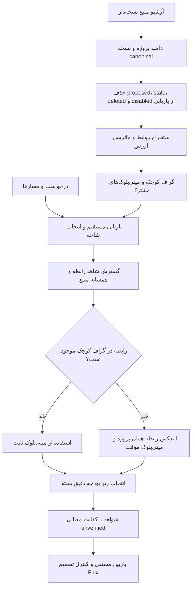

# اصلاح گراف حافظهٔ Flux: ارزش‌گذاری و مینی‌بلوک مشترک

تاریخ: ۱ اکتبر ۲۰۲۶. همهٔ تغییرها در همین پوشهٔ آزمایش هستند؛ سورس، پایگاه داده و فایل اجرایی Flux تغییر داده نشده‌اند. مقایسهٔ واقعی بر snapshot قبلی انجام شده، نه سورس متغیر امروز.

## نتیجهٔ اصلی

اشتراکِ شاهدِ رابطه و یادآوری از آرشیو پیاده شد. نقصِ فراموش‌شدن رابطه در گراف کوچک برطرف شد: در مجموعهٔ کنترل‌شدهٔ قدیمی، کامل‌بودن شواهد از ۱۱۲/۱۳۶ بدون fallback به ۱۳۶/۱۳۶ رسید. در مجموعهٔ یک‌میلیون‌توکنی تازه، این عدد از ۱۱۷/۱۳۶ به ۱۳۶/۱۳۶ رسید. این یک بهبود بازیابی نسبت به نسخهٔ مینی‌بلوکِ ناقص است؛ نسخهٔ قبلی با آرشیو هم ۱۳۶/۱۳۶ می‌گرفت.

وزن‌دهی دلخواه هنوز نتیجهٔ بهتر روی Flux واقعی نداده است: گراف وزن‌دار ۱۵/۲۰ سؤال و ۳۹/۴۷ شاهد؛ گراف قبلی ۱۶/۲۰ و ۴۲/۴۷. افت ۵ واحد درصد در سؤال کامل و ۶٫۴ واحد درصد در شاهد؛ نمونه کوچک است و اثبات افت عمومی نیست. گراف جدید بدون وزن‌دهیِ زمان query به ۱۶/۲۰ و ۴۱/۴۷ رسید. انتخاب فعلی: ساختارِ اشتراک و fallback قابل نگه‌داشتن است، وزن‌های query آزمایشی بمانند.

## برداشت دقیق از ایده

کل گراف فعال حداکثر ۱۰۰هزار توکن است، نه ۱۰۰هزار گره. «بزرگ‌کردن» یعنی قبل از انتخاب، شاهد مستقیم، رابطهٔ موجود و همسایهٔ منبع را جمع کنیم. سپس مجموعه را زیر بودجه انتخاب کنیم. هیچ جمله یا رابطهٔ بی‌منبع به عنوان واقعیت ساخته نمی‌شود.

اشتراک اینجا بین بلوک‌های همان پروژه است. یک متن canonical داریم؛ چند بلوک و چند یال با reference از آن استفاده می‌کنند. گراف مشترک میان دو پروژه یا مالک، مجوزِ خواندن را ایجاد نمی‌کند. پیاده‌سازی محلی این آزمایش احراز هویت سازمانی ندارد.

## الگوریتم اجراشده



۱. scope پیش از IDF و ایندکس اعمال می‌شود. جدیدترین نسخهٔ غیر proposed پیش از eligibility تعیین می‌شود؛ tombstone نسخهٔ جدید، نسخهٔ قدیمی را زنده نمی‌کند. اختلاف محتوا در revision برابر خطاست.

۲. گراف از آرشیو معتبر بازسازی می‌شود. گراف ۳۰هزار یا ۱۰هزار توکنی از خروجی ناقصِ گراف قبلی ساخته نمی‌شود. کوچک‌کردن، انتخاب یک view است؛ افزایش دوبارهٔ اندازه به آرشیو نیاز دارد.

۳. رابطه‌ها فعلاً دو نوع دارند: `depends_on` از فیلد صریحِ دادهٔ کنترل‌شده و `symbol_reference` از نام تعریف‌شده و اشارهٔ متنی به آن در فایل دیگر. تعریف‌های مبهم رد می‌شوند. اشارهٔ یک سند به نام تابع، اثبات call graph یا رفتار اجرایی نیست. این نسخه AST یا استخراج معنایی با LLM ندارد.

۴. هر یال فعال بین دو شاخه، یک مینی‌بلوک دارد: دو node، نوع رابطه، کلید، reference شاهد دو طرف و ارزش. حداکثر دو رابطه در یک مینی‌بلوکِ ثابت قرار می‌گیرد. محدودیت چهار یال برای هر node و ذخیرهٔ ۱۸٪ سقف گراف، رشد hubها را محدود می‌کند؛ تمام روابط منبع در ایندکس بیرونی می‌مانند.

۵. query ابتدا ۳۲ seed مستقیم می‌گیرد و حداکثر سه شاخه را می‌خواند. گسترش به حداکثر ۲۴ reference رابطه محدود است؛ همسایهٔ چپ/راستِ قطعهٔ همان منبع نیز کاندید می‌شود. حافظهٔ کوچک به تنهایی source fallback پنهان ندارد؛ حالت graph-only صریح است.

۶. اگر رابطهٔ مرتبط در مینی‌بلوک ثابت نیست، query یک view موقت می‌سازد. رابطه از ایندکسِ همان snapshot می‌آید؛ گراف سراسری در هنگام query تغییر نمی‌کند. روایت رابطه و شواهد آن داخل JSON نهایی و سقف بسته شمرده می‌شوند. اگر شاهدِ رابطه در بودجه جا نشود، bundle صریحاً حذف می‌شود؛ متن نیمه نمی‌شود.

۷. پوشش واژگانی معیار، ترتیب انتخاب را تغییر می‌دهد و باعث توقف زودرس یا PASS نمی‌شود. این نقصِ نسخهٔ قبل هم حذف شده است. hash پروژه، revision و متن باید با view گراف مطابق باشد؛ در غیر این صورت بازیابی رد می‌شود و rebuild لازم است.

## ماتریس ارزش‌گذاری

| ستون | تعریف این پیاده‌سازی | محدودیت |
|---|---|---|
| A: prior نقش منبع | src برابر ۰٫۹، tests برابر ۰٫۸، سایر منابع ۰٫۶ | heuristic برای بازیابی، نه اختیار یا کیفیت معنایی |
| U: کمیابی | میانگین IDF نرمال‌شدهٔ واژه‌های قطعه | شناسهٔ نادر ممکن است مهم نباشد |
| C: نشانهٔ قید | نشانه‌هایی مثل approval، scope، forbidden، budget، revision | تطبیق واژه به تنهایی فهم قید نیست |
| B: ارزش اتصال | درجهٔ رابطه با اشباع لگاریتمی | hub بودن با اهمیت یکسان نیست |
| F: تازگی | gate صفر/یک پس از انتخاب canonical | decay زمانی یا حافظهٔ رفتاری آموزش‌دیده نیست |
| T: هزینه | شمارش o200k روی رکورد کاملِ reference و متن | صورت‌حساب provider و کل RAM را اندازه نمی‌گیرد |

این ماتریس برای **انتخاب حافظه** است. کیفیت پاسخ، authority سیاست، یا اجازهٔ اجرای تصمیم از آن استنتاج نمی‌شود. ماتریس کامل کنار ایندکس ذخیره می‌شود؛ فقط ردیف‌های حافظهٔ حفظ‌شده داخل سقف گراف فعال حساب می‌شوند. منبع و ایندکس بیرونی نیز فضا می‌گیرند.

ارزش نگه‌داری ثابت:

`V_store = (0.20 A + 0.30 U + 0.30 C + 0.20 B) / T^0.35`

ارزش حاشیه‌ای هنگام query:

`V_query = (0.62 R + 0.14 G + 0.10 C + 0.08 U + 0.06 A - 0.12 D) / T^0.35`

R امتیاز BM25 نرمال‌شده است؛ G پوشش واژگانیِ معیارِ هنوز پوشش‌نیافته و D بیشترین Jaccard با شاهد انتخاب‌شده. همهٔ وزن‌ها پیش از اجرای همان مرحله ثبت شدند؛ با نتیجهٔ آزمون تنظیم نشده‌اند. حدس‌هایی مانند اهمیت قید هنوز می‌توانند دادهٔ نادر یا شاهد بلند را کنار بزنند؛ این از دلایل نامناسب‌بودن وزن‌های فعلی برای انتشار است.

## ارتباط با مدیریت توکن و تصمیم‌گیری

یک گراف و یک ماتریس مشترک داریم، با سه مسئولیت مجزا: حافظه شاهد می‌آورد؛ مدیریت توکن مجموعهٔ شاهد را زیر سقف انتخاب می‌کند؛ تصمیم‌گیرِ قطعی قرارداد، freshness، نوع شاهد، سقف بودجه و اختیار را بررسی می‌کند. ادغام این‌ها در یک امتیاز به معنی اینکه «چیزی مهم است پس انجام بده» قابل قبول نیست. این آزمایش تصمیم‌گیر production را عوض نمی‌کند.

این روش آموزش پارامتری مدل یا diffusion مولد نیست. افزودن مینی‌بلوک، اتصال حافظهٔ خارجی را تکمیل می‌کند. در این نسخه وزن‌ها از بازخورد یاد نمی‌گیرند و موفقیت بازیابی به‌طور خودکار به verified memory تبدیل نمی‌شود.

## روش بررسی

- مرحلهٔ اصلی: ۵۲۵۶ اجرای بازیابی؛ دو مجموعهٔ کنترل‌شدهٔ یک‌میلیون‌توکنی، snapshot واقعی ۲۵۰۷۵۲ توکنی، سقف query برابر ۱۵۰۰/۳۰۰۰ و گراف ۱۰۰هزار/۳۰هزار/۱۰هزار.
- پس از یافتن نقصِ رابطه: ۲۶۲۸ اجرای دیگر در سقف ۳۰۰۰؛ seed تأییدی تازهٔ 483917 فقط بعد از freeze اصلاح تولید شد. مجموعه‌های قبلی در این مرحله diagnostic هستند.
- جمع: ۷۸۸۴ اجرای بازیابی، صفر فراخوانی مدل. سه corpus کنترل‌شدهٔ یک‌میلیون‌توکنی در مراحل مختلف، نه یک corpus واقعی سه‌میلیون‌توکنی.
- کنترل‌ها: روش مستقیم، گراف قبلی با همان extraction، گراف بدون مینی‌بلوک، بدون fallback، بدون وزن‌های query، و گراف‌های کوچک‌تر. مقایسه‌ها هم‌بودجه‌اند، نه الزاماً هم‌حجم خروجی.
- ۲۰ سؤال واقعی شامل ۱۲ سؤال شناخته‌شده و ۸ سؤالِ نوشته‌شده پیش از اجراست؛ blind holdout مستقل نیست. ۴۷ anchor متنی، کیفیت جواب یا دقت تصمیم نیستند. جست‌وجوی شاهد در فایل تست، اجرای تست نیست.
- metadata مینی‌بلوک در نسخهٔ تکمیل‌شده داخل سقف query است. graph-only در آزمایش اولیهٔ گراف ارزش‌دار، صفر سؤال کامل از ۱۳۶ گرفت؛ حذف آرشیو قابل دفاع نیست.
- latency محلیِ روش‌های آماده متفاوت است؛ این نتایج زمان end-to-end Flux، هزینهٔ API یا RAM کل برنامه را ثابت نمی‌کنند.

## نتایج سقف بستهٔ ۳۰۰۰

### synthetic_1m

| روش | سؤال با تمام شواهد | شاهد پیدا شده | میانگین توکن بسته |
|---|---:|---:|---:|
| `flat_v1_full` | 136/136 | 216/216 | 2305.0 |
| `graph_v1_full` | 136/136 | 216/216 | 1563.6 |
| `flat_completed_values` | 136/136 | 216/216 | 1144.8 |
| `graph_completed_no_shared` | 104/136 | 184/216 | 1932.1 |
| `graph_completed_no_fallback` | 112/136 | 192/216 | 1937.5 |
| `graph_completed_values` | 136/136 | 216/216 | 1953.7 |
| `graph_completed_uniform` | 136/136 | 216/216 | 1956.1 |
### flux_real

| روش | سؤال با تمام شواهد | شاهد پیدا شده | میانگین توکن بسته |
|---|---:|---:|---:|
| `flat_v1_full` | 16/20 | 41/47 | 2983.7 |
| `graph_v1_full` | 16/20 | 42/47 | 2982.8 |
| `flat_completed_values` | 15/20 | 39/47 | 2952.8 |
| `graph_completed_no_shared` | 16/20 | 40/47 | 2968.1 |
| `graph_completed_no_fallback` | 16/20 | 40/47 | 2962.8 |
| `graph_completed_values` | 15/20 | 39/47 | 2946.7 |
| `graph_completed_uniform` | 16/20 | 41/47 | 2934.6 |
### synthetic_confirm_1m

| روش | سؤال با تمام شواهد | شاهد پیدا شده | میانگین توکن بسته |
|---|---:|---:|---:|
| `flat_v1_full` | 136/136 | 216/216 | 2305.2 |
| `graph_v1_full` | 136/136 | 216/216 | 1564.6 |
| `flat_completed_values` | 136/136 | 216/216 | 1144.7 |
| `graph_completed_no_shared` | 104/136 | 184/216 | 2061.4 |
| `graph_completed_no_fallback` | 117/136 | 197/216 | 2070.2 |
| `graph_completed_values` | 136/136 | 216/216 | 2083.0 |
| `graph_completed_uniform` | 136/136 | 216/216 | 2085.3 |

## چه چیزی بهتر شد و چه چیزی نشد؟

- مینی‌بلوکِ منبع‌دار و fallback، نسبت به نسخهٔ فاقد آن، شکست‌های یادآوریِ چندمرحله‌ای در دادهٔ کنترل‌شده را رفع کردند. دادهٔ حذف‌شده از گراف به وسیلهٔ آرشیو بازخوانی شد؛ از هیچ ساخته نشد.
- صرفِ ترکیب وزن‌ها برتری نشان نداد. دادهٔ واقعی با query weightها افت کرد؛ نسخهٔ بدون این وزن‌ها به تعداد سؤال کاملِ گراف قبلی رسید، با کمی anchor کمتر. این داده هنوز مزیت رقابتیِ کیفیت را اثبات نمی‌کند.
- روی دادهٔ کنترل‌شده، روش مستقیمِ جدید حدود ۵۰٪ بستهٔ کوچک‌تری از روش مستقیمِ قدیمیِ fixed-budget ساخت و همان شواهد را داشت. این ترکیب seed محدود، expansion و انتخاب ارزش است؛ گراف به‌تنهایی صاحب این کاهش نیست. روش adaptive قدیمی روی همان schema از این هم کوچک‌تر بود، اما روی سورس واقعی شکست داشت.
- گراف تکمیل‌شده روی seed تازه نسبت به گراف قدیمی بستهٔ بزرگ‌تری داشت (حدود ۲۰۸۳ در برابر ۱۵۶۵ توکن). برای ادعای صرفه‌جویی توکن گراف دلیل نداریم.
- ۱۰۰هزار توکن فقط **view فعال** را محدود می‌کند. متن خام، ماتریس کامل، ایندکس BM25 و ایندکس رابطه خارج آن هستند؛ کاهش ۹۰٪ ذخیره‌سازی یا RAM کل ادعا نشده است.

## تصمیم پس از بررسی

ساختار مشترک را می‌توان برای مرحلهٔ بعد حفظ کرد: canonical source → ایندکس مستقیم و relation index → گراف کوچک با mini reference → expansion محدود → بستهٔ دقیق و بازبین مستقل. برای query وزن‌ها فعلاً experimental هستند؛ `values=False` کنترل سالم‌تر این نمونه است، نه تضمین کیفیت. تعیین وزن بهتر باید روی workload واقعاً جدید، معیارهای نوع‌دار، پوشش قیدهای حیاتی و loss budget جدا برای هر نوع حافظه انجام شود؛ tuning همین ۲۰ سؤال نتیجهٔ قابل تعمیم نمی‌دهد.

به Flux اصلی متصل نشده است. version فعلی یک prototype اجراییِ قابل بررسی است؛ برای محصول همچنان AST/دامنهٔ کامل شواهد، authority نوع‌دار، تازه‌سازی پیوسته و آزمون معنایی مستقل لازم است.

## ارتباط با پژوهش

- [HippoRAG 2، مقالهٔ ICML 2025](https://arxiv.org/abs/2502.14802) پیوند retrieval و حافظهٔ غیرپارامتری را بررسی می‌کند؛ روش آن PPR و استفاده از LLM دارد. این prototype بازتولید یا اندازه‌گیری نتیجهٔ آن مقاله نیست.
- [MMR، Goldstein و Carbonell، 1998](https://aclanthology.org/X98-1025/) انتخاب مرتبط همراه با تنوع را مطرح می‌کند. penalty هم‌پوشانی این نسخه از همین ایده الهام می‌گیرد؛ وزن‌های محلی ما از مقاله استخراج یا در Flux معتبر نشده‌اند.

## فایل‌ها و بازتولید

- `graph_memory.py`: نسخهٔ primary منجمدشده، ماتریس و graph builder.
- `completed_graph.py`: hash نسخه/پروژه، مینی‌بلوک موقت و metadata زیر بودجه.
- `benchmark.py` و `completed_benchmark.py`: benchmark و کنترل‌ها؛ gold فقط در evaluator.
- `frozen-plan.json` و `completed-plan.json`: تنظیمات و hash کد پیش از همان مرحله.
- `graph-explorer.html`: مثال واقعی بلوک مشترک و آزمایش دستیِ ترکیب ارزش؛ تغییر slider فقط نمایش را تغییر می‌دهد، benchmark را تغییر نمی‌دهد.
- `verification.json`: جمع اجراها، سقف‌ها، hashها و تست‌ها.

```powershell
python -X utf8 -m pytest -q experiments/diffusion_memory_v2_20261001/test_graph_memory.py experiments/diffusion_memory_v2_20261001/test_completed_graph.py
python -X utf8 experiments/diffusion_memory_v2_20261001/benchmark.py
python -X utf8 experiments/diffusion_memory_v2_20261001/completed_benchmark.py
python -X utf8 experiments/diffusion_memory_v2_20261001/deliver.py
```

اجرای مجدد benchmark خروجی‌های همین پوشهٔ آزمایش را بازنویسی می‌کند؛ production را نمی‌نویسد. اسنپ‌شات primary از آزمایش قبلی خوانده می‌شود و باید در دسترس بماند.
