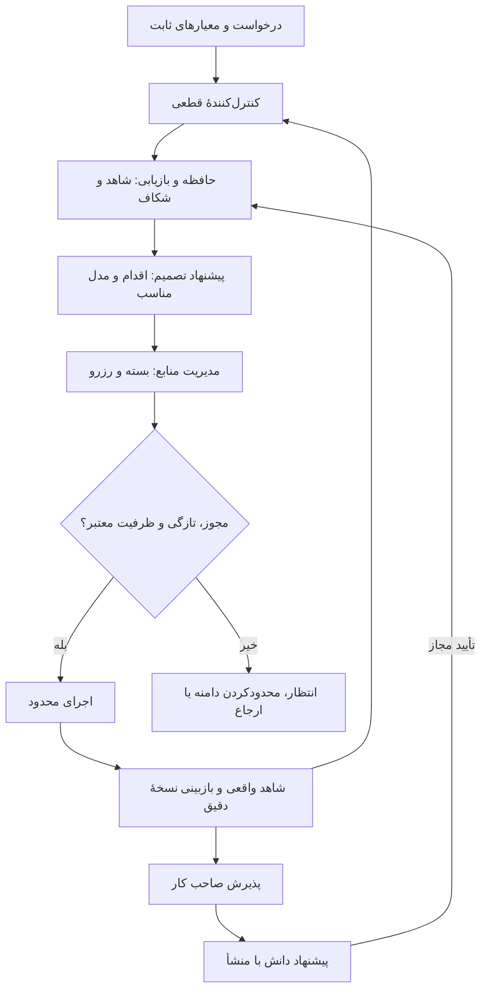

# پژوهش سه الگوریتم Flux و انتخاب معماری

تاریخ: ۱ اکتبر ۲۰۲۶. مبنای مقایسه: سورس **۰٫۵٫۱** همین پوشه؛ نصب فعلی یا نسخهٔ قبلی ۰٫۴ مبنای این گزارش نیست. منظور کاربر از Edge، **مزیت رقابتی** است.

این تحویل مرحلهٔ پژوهش است: بررسی سورس، منابع اولیه، انتخاب معماری و طراحی آزمایش. الگوریتم اجرایی جدید، اتصال به محصول، تغییر دیتابیس کاربر یا انتشار انجام نشده است. پیشنهادها در این پوشهٔ مستقل نگهداری می‌شوند. هش اولیهٔ منابع و آزمون نخست در [baseline-manifest.json](baseline-manifest.json) و snapshot نهایی در [final-source-manifest.json](final-source-manifest.json) آمده است.

## نتیجهٔ تصمیم

**سه ماژول قابل تعویض، یک کنترل‌کنندهٔ قطعی و یک هدف مشترک.** مدیریت منابع، پیشنهاد تصمیم و حافظه مسئولیت‌های جدا دارند؛ کنترل‌کننده اجرای مجاز و ثبت اثر را هماهنگ می‌کند. هدف مشترک: بیشترین خروجی پذیرفته‌شده با کیفیت لازم در محدودیت هزینه، زمان و اختیار. بهینه‌سازی کمترین توکن به تنهایی هدف محصول نیست.

سه ماژول را یک مدل بزرگ نکنیم. در مقابل، سه سیستم بی‌خبر از هم نیز نسازیم: کیفیت شواهد بر مدل مناسب اثر دارد، مدل بر ظرفیت Context اثر دارد و بودجه بر ادامهٔ جست‌وجو و اصلاح اثر می‌گذارد. یک snapshot مشترک و قراردادهای مشخص این حلقه را برقرار می‌کنند.

پیکان بازگشت به کنترل‌کننده محدود به سقف تماس، زمان و روش تازه است. هیچ پیکانی اجازهٔ افزایش خودکار اختیار یا بودجه نمی‌دهد. در اولین آزمایش، این ساختار یک فرایند محلی است؛ به microservice یا تیم چندعامل نیاز ندارد.

## ۱. بررسی ساختار امروز

سه مسیر را باید جدا بشناسیم: گفتگوی حساب‌ها با `LocalRuntime`، چرخهٔ کنترل‌شدهٔ `/head` با `CoreService`، و موتور سازگاری legacy با `FluxEngine`. ریشهٔ رابط اکنون به نمونهٔ طراحی سازمانی می‌رود؛ وجود صفحهٔ طراحی، اتصال تمام عملیات آن به هسته را ثابت نمی‌کند. این تفکیک در `docs/design-v2/README.fa.md` و `tests/test_design_v2.py` دیده می‌شود.

| بخش | شاهد در سورس | پایهٔ ساخته‌شده | شکاف نسبت به هدف پژوهش |
|---|---|---|---|
| قرارداد | `src/flux/core/contracts.py` | معیار شناسه‌دار، قرارداد frozen، نوع شاهد، حدود اجرا | tenant و مالک ثابت محلی؛ احراز هویت و RBAC سازمانی نیست |
| کنترل اجرا | `src/flux/core/service.py:183` | تصمیم قطعی از وضعیت، وابستگی، تازگی و سقف ریشه | سیاست آموخته‌شدهٔ انتخاب اقدام/مدل و سنجش ارزش جست‌وجوی بیشتر ندارد |
| بودجه | `src/flux/core/budget.py:46` | رزرو اتمی روی زنجیرهٔ والد، micro-USD صحیح، نگهداری هزینهٔ نامعلوم، سهم بازبینی | تخصیص بهینهٔ منابع بین کارها و مدل‌ها نیست؛ وجود ledger اثبات مصرف مالی زنده نیست |
| Context | `src/flux/core/context.py:5` | admission متن نهایی؛ ورودی ۱۶۰۰۰، خروجی ذخیره ۴۰۰۰، فرض پنجره ۲۴۰۰۰ | پنجره و tokenizer ویژهٔ provider، history پنهان CLI و سقف واقعی خروجی CLI کنترل کامل نشده‌اند |
| بستهٔ شاهد | `src/flux/knowledge/retrieval.py:46` | شمارش payload واقعی، حذف revision کهنه، اولویت معیار پوشش‌نیافته | overlap واژه‌ای شاهد معنایی نیست؛ انتخاب بر اساس ارزش به ازای توکن و retrieval ترکیبی ندارد |
| منابع | `src/flux/knowledge/sources.py:26` | allowlist فایل، ریشهٔ پروژه، hash، stale شدن منبع تغییرکرده | chunkهای حدود ۴۰۰۰ کاراکتر مرز تابع/بخش را نمی‌شناسند؛ جست‌وجوی معنایی و روابط چندمنبعی ندارد |
| حافظه | `src/flux/storage/workspace.py:117` | project scope، revision، پیشنهاد، تأیید، حذف و invalidation نشست | طبقه‌بندی غنی دانش، اعتبار زمانی، تعارض معنایی و retrieval سازمانی چندنقشی لازم است |
| پذیرش | `src/flux/core/service.py:379` | artifact hash، review revision و شاهد دقیق؛ پذیرش انسانی | اقتصاد خروجی پذیرفته‌شده و ارزیابی کیفیت در طول زمان هنوز نیازمند benchmark واقعی است |

نکتهٔ نسخه‌ای: برخی MDهای ۰۲ تا ۰۴ هنوز متن تاریخی ۰٫۴ را دارند و به گزارش ۰٫۵ ارجاع می‌دهند. از جمله «حافظه global است» را نباید به سورس فعلی تعمیم داد. امروز `Workspace.evidence_pack` پروژه را فیلتر می‌کند و حافظهٔ `*` را مشترک می‌بیند؛ این یک scope محلی است، نه تضمین ACL چندمستاجری. همچنین همهٔ یادداشت‌های این مسیر با نوع `approved_decision` وارد بسته می‌شوند؛ این برای دانش متنوع سازمانی طبقه‌بندی کافی نیست.

GapGPT API از اتصال عمومی محصول حذف شده، ولی کد و fixture مسیر `execute-api` و ledger قیمت‌گذاری‌شده در هسته باقی است. پس آزمون آن، اثبات اتصال API عملیاتی برای کاربر امروز نیست. برای پژوهش کنترل هزینهٔ واقعی باید یک adapter آزمایشی مستقل با usage قابل اتکا انتخاب شود؛ در مسیر اشتراک، سهمیه، توکن مشاهده‌شده و مبلغ صورتحساب سه چیز جدا هستند.

ساختار کلی با وایت‌پیپر هم‌راستاست: نقش از مدل جدا، اختیار در موتور، پذیرش در دست صاحب کار، و هزینه شامل تلاش‌های ناموفق. نقطهٔ رشد بعدی «هوشمندترکردن تخصیص و انتخاب» است؛ بازسازی تمام زیرساخت پایه توجیه ندارد. هم‌پوشانی `engine/` و `core/` و ترکیب مسئولیت‌های متعدد در `CoreService`، در مرحلهٔ اتصال باید با adapter و مالکیت روشن مدیریت شوند؛ بازنویسی فوری legacy شرط این پژوهش نیست.

## ۲. پژوهش منابع اولیه و نتیجهٔ قابل انتقال

این بررسی، مرور هدفمند مقالات و مستندات سازندگان است؛ ادعای مرور نظام‌مند تمام ادبیات ندارد. نتیجهٔ هر مقاله متعلق به benchmark و مدل‌های خود آن است. اعداد آن‌ها پیش‌بینی بهبود Flux نیستند.

| منبع اولیه | یافتهٔ مرتبط | تصمیم برای Flux و محدودیت |
|---|---|---|
| [Effective Context Engineering، Anthropic](https://www.anthropic.com/engineering/effective-context-engineering-for-ai-agents) | Context باید اطلاعات لازم و مفید را نگه دارد؛ compaction و یادداشت ساخت‌یافته ابزار تداوم هستند | پاک‌کردن تکرار و tool log کم‌ارزش را زودتر آزمایش کنیم؛ معیار، مجوز و تصمیم پابرجا از خلاصه حذف نشوند |
| [Lost in the Middle](https://arxiv.org/abs/2307.03172) | کارایی برخی مدل‌های long-context به محل شاهد حساس است | ترتیب شواهد و طول بسته دو متغیر آزمایش‌اند؛ پنجرهٔ بزرگ‌تر خودکار کیفیت بیشتر نیست |
| [LLMLingua-2، ACL 2024](https://aclanthology.org/2024.findings-acl.57/) | فشرده‌سازی extractive با طبقه‌بندی توکن و مدل کوچک بررسی شده است | نامزد آزمایشی برای متن توضیحی؛ کد حساس، شناسه، نفی، مقدار، تاریخ و شرط مجوز محافظت شوند؛ فارسی و کد Flux جدا ارزیابی شوند |
| [RouteLLM](https://arxiv.org/html/2406.18665v4) | routing با ترجیح و کیفیت/هزینه قابل یادگیری است؛ انتقال دامنه مسئله است | router با دادهٔ واقعی Flux کالیبره شود. «ترجیح پاسخ» معادل پاس‌کردن معیار کار سازمانی نیست؛ router عمومی از پیش بهترین گزینه فرض نشود |
| [Self-RAG](https://arxiv.org/abs/2310.11511) | retrieval بنا به نیاز و نقد شاهد/پاسخ به جای افزودن ثابت اسناد | اصل retrieval تطبیقی را بگیریم؛ tokenهای reflection مدل آموزش‌دیدهٔ مقاله با افزودن prompt به CLI دلخواه ساخته نمی‌شوند |
| [MemGPT](https://arxiv.org/abs/2310.08560) | جداکردن حافظهٔ خارج از Context و مدیریت جابه‌جایی اطلاعات | حافظهٔ کار جاری، دانش پروژه و Context هر تماس جدا شوند؛ الگوریتم مدیریت حافظه جای ACL یا ثبت اثر را نمی‌گیرد |
| [Mem0](https://arxiv.org/html/2504.19413v1) | استخراج، مقایسه و عملیات ADD/UPDATE/DELETE/NOOP؛ نسخهٔ graph نیز مطرح است | استخراج گزاره و proposal یادداشت را آزمایش کنیم؛ مدل به تنهایی اجازهٔ DELETE/تغییر سیاست سازمانی ندارد؛ benchmark گفتگو اثبات کیفیت کد نیست |
| [ACE](https://arxiv.org/html/2510.04618v1) | به‌روزرسانی افزایشی playbook و جداکردن reflection از curation؛ خطر context collapse | درس از شکست‌ها با patch کوچک و منشأ ثبت شود؛ هر بار کل حافظه بازنویسی نشود؛ دانش تولیدی پیش از ترویج اعتبارسنجی شود |
| [BEIR](https://arxiv.org/abs/2104.08663) | BM25 پایهٔ محکم است؛ reranking قوی‌تر می‌تواند پرهزینه باشد | lexical baseline را حفظ کنیم؛ dense و reranker با هزینه و تأخیر سنجیده شوند؛ embedding تضمین برتری نیست |
| [RRF، مستندات Elastic](https://www.elastic.co/docs/reference/elasticsearch/rest-apis/reciprocal-rank-fusion) | ادغام رتبهٔ چند retriever بدون هم‌مقیاس‌کردن مستقیم score | RRF گزینهٔ شروع ترکیب BM25 و dense است؛ score آن احتمال صحت پاسخ نیست؛ نصب Elasticsearch برای این prototype ضروری نیست |
| [تحلیل توابع Fusion](https://arxiv.org/abs/2210.11934) | در ارزیابی نویسندگان، ترکیب خطی تنظیم‌شده از RRF بهتر بوده و RRF به پارامتر حساس بوده است | RRF انتخاب نهایی فرض نشود؛ در validation با ترکیب خطی مقایسه شود |
| [Cannot Self-Correct Reasoning Yet](https://arxiv.org/abs/2310.01798) | در مدل‌ها و وظایف بررسی‌شده، اصلاح بدون بازخورد بیرونی محدودیت دارد | «مدل گفت درست است» دروازهٔ پذیرش نباشد؛ اجرای آزمون و شاهد بیرونی پایه بمانند؛ این مقاله حکم عمومی دربارهٔ تمام مدل‌های امروز نیست |
| [Demystifying Evals، Anthropic](https://www.anthropic.com/engineering/demystifying-evals-for-ai-agents) | ارزیابی کدی، مدلی و انسانی مکمل‌اند؛ trial با task متفاوت است | سنجش retrieval، تصمیم و خروجی نهایی جدا؛ judge با انسان کالیبره و چند اجرای مدل در هر task بررسی شود |

## ۳. یک الگوریتم یا سه الگوریتم؟

| معماری | مزیت | مسئله | رأی |
|---|---|---|---|
| یک مدل/الگوریتم همه‌کاره | شروع ظاهراً ساده؛ همهٔ ورودی‌ها یکجا | حافظه، اختیار، هزینه و کیفیت در یک مسیر غیرشفاف؛ ablation دشوار | رد برای کنترل اصلی؛ مدل می‌تواند پیشنهاد کلی بدهد |
| سه سیستم مستقل بدون هماهنگی | تست و تعویض ساده | retrieval از بودجه بی‌خبر، routing از کفایت شاهد بی‌خبر؛ بهینه‌سازی محلی ناسازگار | کافی نیست |
| سه ماژول + کنترل‌کنندهٔ قطعی | تست مستقل، هماهنگی از snapshot مشترک، قابلیت تعویض | قرارداد و telemetry دقیق لازم دارد | پیشنهاد اصلی |
| سه microservice یا گروه عامل از ابتدا | امکان جداسازی عملیاتی | پیچیدگی و تماس اضافی بدون شاهد نیاز مقیاس | برای مرحلهٔ اول لازم نیست |

یکپارچگی در **هدف، شناسه‌ها، snapshot و بازخورد** باشد؛ استقلال در **مسئولیت، تست و اختیار mutation**. هزینهٔ ناشناخته را decision module پاک نمی‌کند؛ محتوای پیشنهادی حافظه خودکار policy نمی‌شود؛ token module معیار کیفیت را کاهش نمی‌دهد.

## ۴. مسیر پیشنهادی هر الگوریتم

### مدیریت توکن و منابع

از token counter به تخصیص‌دهندهٔ Context حرکت کنیم. ابتدا اجزای اجباری را اندازه بگیرد؛ سپس برای شواهد اختیاری، خلاصهٔ کار و خروجی، متناسب با نوع کار و مدل بودجه دهد. انتخاب شاهد باید به «ارزش افزوده نسبت به توکن» و پوشش معیار توجه کند. توکن ورودی، سقف خروجی، سهمیه، هزینهٔ مالی، زمان و مصرف نامعلوم جدا ثبت شوند.

اول پاک‌کردن تکرار، انتخاب ساختاری شاهد و checkpoint؛ بعد فشرده‌سازی مدلی. cache با hash منبع، سیاست، مجوز و نسخهٔ ابزار معتبر باشد. cache محلی retrieval با prompt cache ارائه‌دهنده یکی نیست. سود خالص باید هزینهٔ tokenizer، compression، embedding و بازبینی را نیز حساب کند.

### تصمیم‌گیری

کنترل وضعیت فعلی حفظ شود؛ روی آن policy پیشنهاد اضافه شود: «جست‌وجو، تولید، اجرای check مجاز، اصلاح با روش تازه، مدل قوی‌تر، تقسیم کار یا ارجاع». انتخاب مدل فقط میان نامزدهای مجاز و سازگار با ابزار، زبان و schema باشد. مرحلهٔ اول قواعد روشن و تجربهٔ ثبت‌شده؛ مرحلهٔ بعد routing آموخته‌شده با برچسب واقعی موفقیت Flux.

احتمال موفقیت با جملهٔ confidence مدل ساخته نشود. بدون دادهٔ کافی، مقدار unknown و fallback شفاف داشته باشیم. exploration روی کار واقعی حساس انجام نشود. routing روی ترجیح ظاهری پاسخ ممکن است پاسخ خوش‌خوان ولی غلط انتخاب کند؛ معیار، شاهد و کیفیت پذیرش بر label ترجیح دارند.

### حافظه و RAG

از یادداشت کلی به گزارهٔ نسخه‌دار با منشأ و دامنه برسیم: تصمیم تأییدشده، واقعیت مستند، رخداد اجرا، روش آزموده‌شده، preference و checkpoint. منابع ابتدا در دامنهٔ مجاز و revision صحیح قرار بگیرند. بعد lexical و dense، ادغام، rerank محدود، تنوع و بسته‌بندی دقیق اجرا شوند. نیاز به GraphRAG فقط وقتی توجیه دارد که benchmark روابط چندمرحله‌ای ضعف بازیابی عادی را نشان دهد.

معیار lexical candidate، کفایت معنایی شاهد و PASS خروجی سه وضعیت متفاوت باشند. تغییر فایل، مجوز یا حذف، cache و نشست مصرف‌کننده را باطل کند. جمع‌آوری همهٔ گفتگوهای پروژه به صورت یک حافظهٔ بلند، مسئله را حل نمی‌کند. طرح استخراج proposal و بررسی تضاد در سند الگوریتم‌ها آمده است.

## ۵. امروز چه مقدار بهبود ثابت شده است؟

آزمون نخست امروز **۱۲۳ تست در ۲۰٫۴۴ ثانیه** و آزمون نهایی **۱۲۴ تست در ۲۴٫۰۸ ثانیه** موفق بودند: `python -B -m pytest -q -p no:cacheprovider`. بین دو بررسی، `runtime.py` و `test_design_v2.py` خارج از اقدامات این پژوهش تغییر کردند؛ در سورس نهایی قابلیت rename/archive/delete گفتگو و آزمون آن دیده می‌شود. snapshot اولیه حفظ و snapshot نهایی جدا ثبت شده است. این تفاوت شمار تست، بهبود الگوریتم‌های پژوهشی نیست و مقایسهٔ دو زمان، benchmark سرعت نیست.

این suite اجرای الگوریتم جدید نیست. API و CLI ساختگی/محیط موقت در بخشی از تست‌ها استفاده می‌شوند؛ از نتیجهٔ آن، اتصال زنده، کیفیت معنایی، نرخ پذیرش انسانی یا مبلغ صرفه‌جویی استنتاج نمی‌شود.

گزارش تاریخی JEVS دوباره از JSON محلی خوانده شد؛ benchmark آن در این نوبت بازاجرا نشد. آن prototype مستقل و retriever فعلی ۰٫۵٫۱ یکی نیستند؛ Jev بیرونی نیز در این نوبت اجرا نشد.

| شاخص تاریخی، سقف یکسان ۳۰۰۰ توکن | prior_v2 | rewrite | برداشت درست |
|---|---:|---:|---|
| شواهد ۱۲ سناریوی اضافی | ۱۹/۴۳، ۴۴٫۲٪ | ۲۹/۴۳، ۶۷٫۴٪ | ۲۳٫۳ واحد درصد پوشش بیشتر؛ ۵۲٫۶٪ افزایش نسبی تعداد شاهد |
| سناریوی دارای همهٔ شواهد همان ۱۲ مورد | ۴/۱۲ | ۴/۱۲ | تعداد کامل بهتر نشده |
| median زمان انتخاب همان ۱۲ مورد | ۱۹٫۶ ms | ۴۹٫۰ ms | انتخاب حدود ۲٫۵ برابر کندتر |
| شواهد کل ۳۷ سناریو | ۷۹/۱۵۲ | ۱۱۲/۱۵۲ | حدود ۲۱٫۷ واحد درصد پوشش بیشتر |
| سناریوی کامل کل ۳۷ مورد | ۹/۳۷ | ۱۶/۳۷ | پوشش کامل بیشتر در همین مجموعه |
| median زمان انتخاب کل ۳۷ مورد | ۲۰٫۲ ms | ۵۴٫۷ ms | کاهش latency اثبات نشده |

۳۳۳ اجرای invariant تاریخی بدون عبور از بودجه و انتخاب foreign/obsolete گزارش شده‌اند. این یک شاهد محدود برای prototype است، نه تضمین نشت صفر در محصول سازمانی. هیچ‌کدام از اعداد بالا درصد بهبود Flux امروز نیستند.

**درصد واقعی بهترشدن نسبت به ۰٫۵٫۱ فعلاً نامعلوم است.** هنوز آزمون paired روی taskهای مشترک، مدل‌های ثابت و معیار خروجی نهایی انجام نشده است. جمع‌زدن درصد صرفه‌جویی سه بخش یا انتقال اعداد مقاله به Flux اشتباه است.

برای تصمیم مهندسی، آستانه‌های پیشنهادی پیش از آزمون: حداقل ۲۰٪ کاهش توکن قابل مشاهده به ازای خروجی پذیرفته‌شده؛ در مسیر API اندازه‌گیری‌پذیر حداقل ۱۵٪ کاهش هزینهٔ کل به ازای خروجی پذیرفته‌شده؛ و عدم افت نرخ قبولی بیش از ۲ واحد درصد. این‌ها **معیار go/no-go پیشنهادی‌اند، نه پیش‌بینی نتیجه یا تضمین**. اندازهٔ نمونه و فاصلهٔ اطمینان باید بتوانند چنین حکم‌هایی را پشتیبانی کنند؛ اگر نتوانند، نتیجه «نامشخص» است.

## ۶. چه مزیت رقابتی‌ای می‌تواند ایجاد کند؟

| پیامد محصول | چرا این سه بخش کمک می‌کنند؟ | شاهد لازم پیش از ادعا |
|---|---|---|
| خروجی با کیفیت لازم و هزینهٔ کمتر | شواهد بهتر، مدل متناسب، Context انتخاب‌شده و اصلاح محدود | هزینه/توکن کل بر خروجی پذیرفته‌شده در آزمون paired |
| دانش سازمانی با تداوم و منشأ | تصمیم و تجربهٔ تأییدشده از اجرای قبلی به کار بعدی می‌رسد | حل بهتر کارهای بعدی، تعارض کمتر و حذف معتبر |
| پاسخ‌گویی دربارهٔ تصمیم | action، گزینه‌های حذف‌شده، شاهد و بودجه ثبت می‌شوند | replay تصمیم با snapshot ثابت؛ reason روشن برای توقف |
| کنترل مشتری بر داده و اختیار | کنترل‌کننده policy را اعمال می‌کند و حافظه scoped است | آزمون tenant/role واقعی؛ ستون tenant محلی کافی نیست |
| استقلال از یک مدل | policy و knowledge از provider جدا می‌مانند | برابری قرارداد adapter و benchmark با دست‌کم دو backend |
| کاهش بار مدیر | کار مستقل مجاز ادامه دارد و فقط تصمیم لازم ارجاع می‌شود | زمان انسانی و نرخ ارجاع مناسب در پایلوت |

این الگوریتم‌ها به تنهایی moat تضمین نمی‌کنند؛ بسیاری از اصول آن‌ها عمومی‌اند. مزیت ماندگار محتمل از **چرخهٔ کار واقعی → شاهد → پذیرش → دانش نسخه‌دار → بهبود تصمیم بعدی**، دادهٔ ارزیابی اختصاصی مشتری، و ابزارهای کاری قابل اتکا می‌آید. دادهٔ مشتری تحت اختیار خودش می‌ماند؛ مزیت محصول باید از روش و کیفیت کنترل حاصل شود، نه دسترسی دائمی Alacrity به دادهٔ مشتری.

## ۷. ترتیب کار بعد از این پژوهش

۱. baseline ۰٫۵٫۱ و benchmark مستقل را منجمد کنیم؛ معیار و gold بیرون corpus بمانند.

۲. ابتدا حافظه/RAG و انتخاب بستهٔ توکن را جدا آزمایش کنیم؛ این دو، ورودی قابل اتکای تصمیم‌گیر را می‌سازند. مسیر lexical امروز baseline باقی بماند.

۳. policy تصمیم‌گیری قاعده‌ای را روی خروجی همان آزمایش و اقدام‌های محدود بسنجیم. router آموخته‌شده فقط پس از ایجاد label کافی اضافه شود.

۴. سه ماژول را در harness مستقل به هم متصل کنیم و با ablation بسنجیم؛ هیچ تغییر runtime اصلی در این مرحله لازم نیست.

۵. بعد از نتیجهٔ قابل دفاع، برنامهٔ اتصال محدود و feature flag بررسی شود. اتصال به نسخهٔ اصلی و rollout مرحله‌ای، تصمیمی جدا پس از دیدن گزارش آزمون هستند.

جزئیات قرارداد و الگوریتم در [ALGORITHM-DESIGN.fa.md](ALGORITHM-DESIGN.fa.md)، معیار آزمون در [EVALUATION-PLAN.fa.md](EVALUATION-PLAN.fa.md) است.
