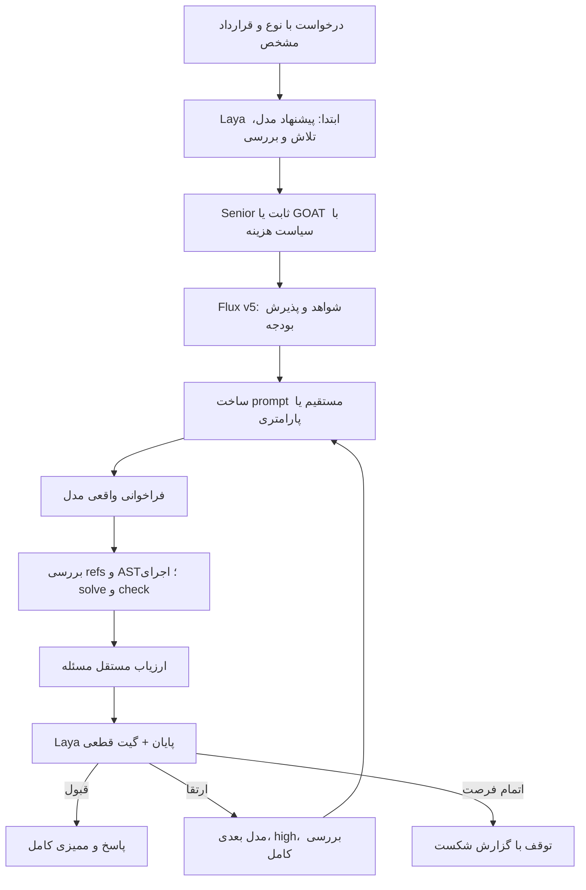

# الگوریتم Flux + Laya v2: مسیریابی هزینه و اجرای برنامهٔ پارامتری

نسخهٔ آزمایشی مستقل، تاریخ ۲۰۲۶-۱۰-۰۶. این سند رفتار کد اجراشده را توضیح می‌دهد. فایل‌های آزمایش قبلی و سرویس اصلی Flux تغییر نکرده‌اند.

<!-- RESULTS_START -->
## نتیجهٔ آزمون تازه و ممیزی‌شده

54 اجرای نهایی دوباره بررسی شد و 290 hash رسید تطبیق دارد. نتیجهٔ اصلی روی ۱۲ تسک تازه است؛ نتیجهٔ فرعی روی شش تسک ازپیش‌تعیین‌شده گزارش می‌شود.

| مسیر | درست | توکن ورودی | کش ورودی | خروجی شامل استدلال | مجموع توکن معلوم | دلار معادل معلوم | ارتقا | usage نامعلوم | میانهٔ زمان تسک |
|---|---:|---:|---:|---:|---:|---:|---:|---:|---:|
|senior_v1|9/12|154,215|134,912|3,133|157,348|$0.004846|6|9|15.74s|
|senior_v2|7/12|63,592|28,160|1,626|65,218|$0.004638|10|15|13.15s|
|goat_v1|8/12|159,240|114,304|5,121|164,361|$0.453902|9|12|14.78s|
|goat_v2|8/12|72,716|36,864|2,046|74,762|$0.004977|8|12|12.88s|
|senior_compact_default|6/6|120,175|104,192|2,347|122,522|$0.024834|1|0|8.93s|

اگر usage نامعلوم وجود داشته باشد، دلار/توکن معلوم فقط حد پایین است. costs معادل نرخ ثابت API و کش مشاهده‌شده‌اند؛ صورت‌حساب واقعی حساب ChatGPT نیستند.

| مقایسهٔ اصلی v1 → v2 | کیفیت برابر روی همهٔ ۱۲ | کاهش توکن | کاهش هزینه | کاهش خروجی | نسبت سرعت میانه |
|---|---|---:|---:|---:|---:|
|senior|False|نامعلوم/مقایسه نامعتبر٪|نامعلوم/مقایسه نامعتبر٪|نامعلوم/مقایسه نامعتبر٪|نامعلوم/مقایسه نامعتبر|
|goat|False|نامعلوم/مقایسه نامعتبر٪|نامعلوم/مقایسه نامعتبر٪|نامعلوم/مقایسه نامعتبر٪|نامعلوم/مقایسه نامعتبر|

اعداد منفی در کاهش هزینه یا خروجی، افزایش را نشان می‌دهند. صفر false_accept شرط لازم برای ادعای حفظ کیفیت بوده است.

### آزمون تفکیک قالب و مسیر اجرا

| مقایسه روی H01..H06 | درست | مجموع توکن معلوم | خروجی | دلار معادل معلوم | ارتقا |
|---|---:|---:|---:|---:|---:|
|senior_v1|6/6|105,371|2,466|$0.003736|0|
|senior_compact_default|6/6|122,522|2,347|$0.024834|1|
|senior_v2|6/6|56,050|1,611|$0.004061|0|

اثر قالب با مسیر اجرای پیش‌فرض: کاهش توکن -16.28٪، کاهش خروجی 4.83٪، کاهش هزینه -564.72٪. این مقایسه شش‌تسکی و با یک نمونه است؛ تفاوت پاسخ stochastic، ارتقا و کش هم اثر می‌گذارند.

اثر مسیر اجرا با قالب پارامتری: کاهش توکن 54.25٪، کاهش خروجی 31.36٪، کاهش هزینه 83.65٪. این مقایسه شش‌تسکی و با یک نمونه است؛ تفاوت پاسخ stochastic، ارتقا و کش هم اثر می‌گذارند.

### زمان و مصرف محلی Laya

| مسیر | تصمیم‌های واقعی Laya | مجموع زمان تصمیم‌ها | ورودی encoder | موفقیت برنامه/تلاش برنامه | توزیع فراخوانی مدل |
|---|---:|---:|---:|---:|---|
|senior_v1|30|4.186s|17,431|4/10|{'gpt-6-luna': 12, 'gpt-6.1-sol': 3, 'gpt-6-astra': 3}|
|goat_v1|33|3.752s|19,396|4/11|{'gpt-6-luna': 2, 'gpt-6.1-sol': 7, 'gpt-6-astra': 12}|
|senior_v2|34|4.513s|18,464|3/12|{'gpt-6-luna': 12, 'gpt-6.1-sol': 5, 'gpt-6-astra': 5}|
|goat_v2|32|4.829s|17,746|4/10|{'gpt-6-luna': 12, 'gpt-6.1-sol': 4, 'gpt-6-astra': 4}|
|senior_compact_default|13|2.023s|9,255|3/4|{'gpt-6-luna': 6, 'gpt-6.1-sol': 1, 'gpt-6-astra': 0}|

بارگذاری Laya: 5.56s؛ بیشترین حافظهٔ اختصاص‌یافتهٔ CUDA: 1.512 GiB. ورودی/پرسش Laya حذف نشده و خروجی تولیدی آن صفر توکن است. مصرف محلی Laya در توکن ارائه‌دهنده جمع نشده؛ هزینهٔ سخت‌افزار/برق قیمت‌گذاری نشده است.

### حساسیت به کش

| مسیر | دلار فرضی بدون تخفیف کش |
|---|---:|
|senior_v1|نامعلوم/مقایسه نامعتبر|
|goat_v1|نامعلوم/مقایسه نامعتبر|
|senior_v2|نامعلوم/مقایسه نامعتبر|
|goat_v2|نامعلوم/مقایسه نامعتبر|
|senior_compact_default|0.056916|

این جدول محاسبهٔ فرضی با همان مصرف است، نه اجرای دوم یا صورتحساب بدون کش.

### شکست‌های تلاش اولیه و ارتقا

- H02__goat_v1، تلاش 0: Program: unexpected indent (<unknown>, line 3)
- H06__senior_compact_default، تلاش 0: Program: Mandatory facts reference mismatch
- H08__senior_v2، تلاش 0: Program: Provider incomplete or tools used
- H08__senior_v2، تلاش 1: Program: Provider incomplete or tools used
- H08__senior_v2، تلاش 2: Program: Provider incomplete or tools used
- H09__goat_v1، تلاش 0: ValueError: Provider incomplete or tools used
- H09__goat_v1، تلاش 1: ValueError: Provider incomplete or tools used
- H09__goat_v1، تلاش 2: ValueError: Provider incomplete or tools used
- H09__goat_v2، تلاش 0: ValueError: Provider incomplete or tools used
- H09__goat_v2، تلاش 1: ValueError: Provider incomplete or tools used
- H09__goat_v2، تلاش 2: ValueError: Provider incomplete or tools used
- H09__senior_v2، تلاش 0: ValueError: Provider incomplete or tools used
- H09__senior_v2، تلاش 1: ValueError: Provider incomplete or tools used
- H09__senior_v2، تلاش 2: ValueError: Provider incomplete or tools used
- H10__goat_v1، تلاش 0: ValueError: Provider incomplete or tools used
- H10__goat_v1، تلاش 1: ValueError: Provider incomplete or tools used
- H10__goat_v1، تلاش 2: ValueError: Provider incomplete or tools used
- H10__goat_v2، تلاش 0: ValueError: Provider incomplete or tools used
- H10__goat_v2، تلاش 1: ValueError: Provider incomplete or tools used
- H10__goat_v2، تلاش 2: ValueError: Provider incomplete or tools used
- H10__senior_v1، تلاش 0: ValueError: Provider incomplete or tools used
- H10__senior_v1، تلاش 1: ValueError: Provider incomplete or tools used
- H10__senior_v1، تلاش 2: ValueError: Provider incomplete or tools used
- H10__senior_v2، تلاش 0: ValueError: Provider incomplete or tools used
- H10__senior_v2، تلاش 1: ValueError: Provider incomplete or tools used
- H10__senior_v2، تلاش 2: ValueError: Provider incomplete or tools used
- H11__goat_v1، تلاش 0: Program: Provider incomplete or tools used
- H11__goat_v1، تلاش 1: Program: Provider incomplete or tools used
- H11__goat_v1، تلاش 2: Program: Provider incomplete or tools used
- H11__goat_v2، تلاش 0: Program: Provider incomplete or tools used
- H11__goat_v2، تلاش 1: Program: Provider incomplete or tools used
- H11__goat_v2، تلاش 2: Program: Provider incomplete or tools used
- H11__senior_v1، تلاش 0: Program: Provider incomplete or tools used
- H11__senior_v1، تلاش 1: Program: Provider incomplete or tools used
- H11__senior_v1، تلاش 2: Program: Provider incomplete or tools used
- H11__senior_v2، تلاش 0: Program: Provider incomplete or tools used
- H11__senior_v2، تلاش 1: Program: Provider incomplete or tools used
- H11__senior_v2، تلاش 2: Program: Provider incomplete or tools used
- H12__goat_v1، تلاش 0: Program: Provider incomplete or tools used
- H12__goat_v1، تلاش 1: Program: Provider incomplete or tools used
- H12__goat_v1، تلاش 2: Program: Provider incomplete or tools used
- H12__goat_v2، تلاش 0: Program: Provider incomplete or tools used
- H12__goat_v2، تلاش 1: Program: Provider incomplete or tools used
- H12__goat_v2، تلاش 2: Program: Provider incomplete or tools used
- H12__senior_v1، تلاش 0: Program: Provider incomplete or tools used
- H12__senior_v1، تلاش 1: Program: Provider incomplete or tools used
- H12__senior_v1، تلاش 2: Program: Provider incomplete or tools used
- H12__senior_v2، تلاش 0: Program: Provider incomplete or tools used
- H12__senior_v2، تلاش 1: Program: Provider incomplete or tools used
- H12__senior_v2، تلاش 2: Program: Provider incomplete or tools used

سیاست هزینه در 10 درخواست، انتخاب خام مدل Laya را تغییر داده است. این تغییرها در audit-results.json ثبت شده‌اند.

شش probe مقدماتی جدا از holdout، مجموعاً $0.065672 معادل هزینه داشتند. کل هزینهٔ معادلِ معلوم آزمایش با احتساب تمام مسیرها، ارتقاها و probeها: $0.558869. این مجموع، هزینهٔ اجرای benchmark است و با هزینهٔ یک سیاست در جدول اصلی تفاوت دارد.

### تفسیر

مزیت اقتصادی باید از جمع واقعی مصرف و تعرفهٔ مدل خوانده شود؛ کاهش prompt یا خروجی به‌تنهایی کافی نیست. مقدار کاهش هزینهٔ GOAT، ظرفیت اصلاح انتخاب مدل را می‌سنجد؛ نتیجهٔ Senior نشان می‌دهد ترکیب کوتاه‌کردن برنامه و تغییر کانتکست اجرا چه اثری داشته است. نرخ موفقیت یا بهینه‌بودن عمومی از ۱۲ مسئله نتیجه نمی‌شود. این آزمایش RAG، آموزش وزن Laya یا عملکرد production را تأیید نمی‌کند.
<!-- RESULTS_END -->

## ۱. هدف و محدوده

هدف، کاهش مصرف مدل با حفظ صحت پاسخ در دو سیاست Senior و GOAT است. سه تغییر هم‌زمان آزموده می‌شوند: انتخاب مدل با برآورد هزینهٔ مسیر، حذف گراف متنیِ تولیدشده توسط مدل برای مسائل با قرارداد مشخص، و کاهش کانتکست اضافی در فراخوانی Codex.

Laya واقعی قبل از تلاش اول و بعد از **هر تلاش** اجرا می‌شود. مدل تصمیم‌گیری محلی است؛ مدل حل مسئله از حساب متصل Codex فراخوانی می‌شود. وزن‌های Laya در این نسخه آموزش داده نشده‌اند. تنظیم سیاست مسیریابی با آموزش شبکه یا کالیبراسیون احتمال موفقیت یکسان نیست.

ورودی این نسخه یک درخواست با **نوع و قرارداد مشخص** است. انتخاب قالب محلی برای یک متن طبیعیِ نامشخص هنوز حل عمومی نشده است. آزمون شامل استخراج، فاکتور، ادغام بازه‌ها، دفتر حساب، شمارش SAT و زمان‌بندی است. داده‌ها و متن‌های آزمون تازه‌اند، اما خانواده‌های مسئله همان خانواده‌های آزمایش توسعه هستند.

## ۲. جریان اجرا



## ۳. قرارداد درخواست

هر تسک شامل id، family، risk_floor، prompt، data و در مسائل محاسباتی compact_instruction است. eval_seed فقط متعلق به ارزیاب محلی است و به مدل یا Laya فرستاده نمی‌شود. compact_instruction دادهٔ ضروری یا شرط مسئله را حذف نمی‌کند؛ ثابت‌های ورودی را با ارجاع به facts بیان می‌کند.

نمونهٔ دادهٔ فاکتور:

```json
{
  "lines": [{"qty": 3, "unit_cents": 1299, "discount_percent": 17}],
  "shipping": 475,
  "tax_percent": 8.25
}
```

قرارداد محاسبه: گردکردن HALF UP برای هر سطر پیش از جمع؛ مالیات بر subtotal و HALF UP؛ حمل بدون مالیات؛ total = subtotal + tax + shipping. نام این قواعد در گراف محلی ثبت می‌شود. مقدار پاسخ مرجع یا کد ارزیاب وارد prompt نمی‌شود.

## ۴. Laya در ابتدا

Laya متن کامل درخواست، خانواده و کف ریسک را می‌بیند. همان سه سؤال نسخهٔ قبلی پرسیده می‌شوند:

| سؤال | گزینه‌ها |
|---|---|
| model | luna، sol، astra |
| effort | low، medium، high |
| verify | light، medium، full |

پاسخ شامل choice، probabilities و answer_confidence است. **probabilities توزیع انتخاب گزینهٔ Laya است و معادل P(صحت پاسخ GPT) نیست.** برای پیش‌بینی موفقیت مدل‌ها از آن استفاده نشده است. گزینهٔ خام و هر override در رسیدها و route ثبت می‌شود.

کف بررسی ثابت است: ریسک low حداقل light؛ medium حداقل medium؛ high همیشه full. Laya اجازه ندارد این کف را کم کند. حالت light عمدتاً شکل و سازگاری پاسخ را بررسی می‌کند؛ صحت معنایی تمام پاسخ‌های نهایی جداگانه با full audit سنجیده می‌شود.

## ۵. تفاوت Senior و GOAT

**Senior v2** همیشه از gpt-6-luna با low شروع می‌کند. پیشنهاد مدل/تلاش Laya در رسید حفظ می‌شود، اما به‌دلیل تعریف سیاست روی انتخاب اولیه اعمال نمی‌شود. پیشنهاد عمق بررسی، با کف ریسک، اعمال می‌شود.

**GOAT v2** مدل اولیه را با کمینه‌کردن برآورد هزینهٔ مسیر انتخاب می‌کند. عمق بررسی از Laya می‌آید. تلاش اولیه یک قاعدهٔ صریح دارد: low، مگر برای زمان‌بندی با فضای جایگشت حداقل ۴۰٬۳۲۰ و پیشنهاد high از Laya که medium انتخاب می‌شود. این قاعدهٔ تلاش، heuristic است؛ برآورد جداگانهٔ دقت/توکن برای هر effort آموزش داده نشده است.

در نسخهٔ مقایسه v1، GOAT انتخاب خام مدل و effort از Laya را اعمال می‌کند؛ Senior همچنان Luna low است.

## ۶. برآورد هزینهٔ مسیریاب

آمار توسعه فقط از آزمایش شش‌تسک قبلی گرفته شده‌اند. نمونه‌های یکسان task/model/effort حذف شده‌اند. ۱۱ مشاهده باقی مانده است:

| مدل | نمونهٔ توسعه | موفق | میانگین هموارشده Beta(1,1) |
|---|---:|---:|---:|
| Luna | 6 | 6 | 0.875 |
| Sol | 3 | 3 | 0.800 |
| Astra | 2 | 2 | 0.750 |

هموارسازی:

```text
p_m = (تعداد موفق + 1) / (تعداد نمونه + 2)
```

این اعداد کوچک و ناهمگون‌اند: موفقیتِ بیشترِ میانگین Luna نسبت به Astra، اثبات قوی‌تر بودن Luna نیست. خانواده‌ها، تلاش‌ها و مسئله‌ها متفاوت‌اند و بعضی مشاهده‌ها هم‌بسته‌اند. این‌ها **آمار مقدماتی توسعه، نه احتمال‌های کالیبره‌شده و نه تضمین صحت** هستند. دادهٔ holdout پس از مشاهده برای تغییر این آمار استفاده نمی‌شود.

برای اندازهٔ ورودی، شش probe پیش از قفل آزمایش اجرا شد: دو Luna با مسیر پیش‌فرض، دو Luna با مسیر سبک، یک Sol سبک و یک Astra سبک. سربار تخمینی هر مدل از input_tokens ثبت‌شده منهای شمارش محلی prompt به دست می‌آید. در probeهای سبک این اختلاف ۸٬۸۱۰ توکن بود.

خروجی تخمینی هر خانواده میانهٔ خروجی مشاهده‌های توسعه است. برای قالب پارامتری ضریب **۰٫۵** به‌عنوان فرض اولیهٔ طراحی اعمال می‌شود؛ این ضریب اندازه‌گیری‌شده یا آموخته‌شده نیست. نتیجهٔ واقعی کوتاه‌شدن خروجی در آزمون جدا گزارش می‌شود.

با نرخ ورودی و خروجیِ ثابت‌شده در plan.json:

```text
estimated_input = local_prompt_tokens + development_probe_offset[model]
estimated_output = development_family_median × format_scale
C_m = (estimated_input × input_price_m
       + estimated_output × output_price_m) / 1,000,000

E_Astra = C_Astra
E_Sol   = C_Sol  + (1 - p_Sol)  × E_Astra
E_Luna  = C_Luna + (1 - p_Luna) × E_Sol

initial_model = argmin(E_Luna, E_Sol, E_Astra)
```

مدل هزینه، کش را صفر فرض می‌کند تا به گرم‌بودن تصادفی کش متکی نباشد. هزینهٔ واقعی گزارش‌شده با کش مشاهده‌شده محاسبه می‌شود.

این یک **proxy برای مسیر با یک تلاش در هر مدل متمایز** است. اجرای واقعی حداکثر سه تلاش دارد؛ اگر ابتدا Sol یا Astra انتخاب شود، تلاش آخر می‌تواند تکرار Astra باشد و آن تکرار اضافه در proxy بالا مدل نشده است. همچنین احتمال‌های وابسته به شکست مدل قبلی، زمان، هزینهٔ محلی، خطای verifier و شکست نهایی در تابع هزینه مدل نشده‌اند. از این مدل، ادعای بهینه‌بودن ریاضی یا کیفیت تضمین‌شده نمی‌شود.

## ۷. حافظه و بودجهٔ Flux

کد واقعی request_memory_v5_20261002 برای Snapshot، Request و retrieve و کد واقعی src/flux/core/context.py برای admit_context استفاده می‌شود. Snapshot یک بار ساخته می‌شود. در این benchmark همهٔ درخواست‌ها صراحتاً self_contained و snapshot خالی هستند، پس هیچ واحد آرشیو انتخاب نمی‌شود.

این آزمون کاهش مصرف RAG را اندازه نمی‌گیرد. قابلیت انتخاب شواهد متصل است، اما صفر واحد حافظه وارد prompt شده است. ادعاهای کاهش بزرگِ بستهٔ شواهدِ آزمایش‌های قدیمی به این نتیجه منتقل نمی‌شوند.

بودجهٔ محلی ورودی ۸٬۰۰۰، رزرو خروجی ۴٬۰۰۰ و فرض پنجره ۲۴٬۰۰۰ توکن است. متن نهایی با tokenizer محلی شمارش می‌شود. عبور از بودجه به خطا منجر می‌شود؛ معیار یا دادهٔ اجباری بی‌صدا حذف نمی‌شود. این بودجهٔ محلی، ورودی پنهان ارائه‌دهنده را تضمین یا اندازه‌گیری نمی‌کند.

## ۸. قالب مستقیم و قالب پارامتری

استخراج و تولید تابع Python از مسیر مستقیم استفاده می‌کنند. برای فاکتور، شمارش SAT و زمان‌بندی، v2 از قالب پارامتری استفاده می‌کند.

v1 از مدل nodes، edges و code می‌گیرد؛ عددها در متن گراف حفظ می‌شوند و گراف، solve() و check(answer) بررسی می‌شوند.

v2 داده را یک بار در FACTS به مدل نشان می‌دهد و همان شیء بدون تولید مجدد توسط مدل به worker می‌دهد:

```json
{
  "refs": ["lines", "shipping", "tax_percent"],
  "code": "def solve(facts): ...\ndef check(answer, facts): ..."
}
```

گراف محلی از قرارداد نوع مسئله ساخته می‌شود، نه از متن تولیدی مدل:

| خانواده | قیود محلی |
|---|---|
| arithmetic | line_half_up، subtotal_sum، tax_half_up، shipping_untaxed، total_sum |
| logic_count | literal_polarity، clause_or، clauses_and، exact_cardinality، count_all |
| scheduling | every_job_once، one_machine، no_idle، weighted_tardiness، global_minimum |

درخواست‌های ناشناخته یا دارای استثناهای خارج از این قرارداد، به parser و بررسی جدا نیاز دارند. صرف نام‌گذاری family برای اثبات پوشش تمام قیدهای متن کافی نیست.

## ۹. بررسی refs، AST و اجرای محلی

refs باید فهرست رشته‌های بدون تکرار باشد و دقیقاً با کلیدهای facts برابر باشد. این بررسی، وجود ارجاع‌ها را ثابت می‌کند؛ استفادهٔ معنایی صحیح از داده را ثابت نمی‌کند.

AST باید solve(facts) و check(answer,facts) با همان امضا داشته باشد. solve باید facts را بخواند؛ check باید answer و facts را بخواند. checker نمی‌تواند مستقیماً solve را فراخوانی کند یا فقط یک ثابت برگرداند. این بررسی استقلال معنایی را اثبات نمی‌کند؛ دو تابع می‌توانند خطای مشترک یا helper مشترک داشته باشند.

worker یک subprocess جدا با -I -S است. واردکردن ماژول‌ها به فهرست محدود شده؛ IO، eval/exec داخل کد مدل، introspection، نام‌های خصوصی، کلاس و builtin type رد می‌شوند. نوع عددی با isinstance بررسی می‌شود. math، fractions، itertools، functools، collections، heapq، bisect، decimal و چند ماژول محاسباتی دیگر در allowlist worker هستند. prompt فقط مجموعهٔ محدود موردنیاز را معرفی می‌کند.

worker تابع solve را با facts اجرا می‌کند، سپس check را با answer و facts اجرا می‌کند. check باید bool و True برگرداند. خروجی با encoding عددی دقیق/دیکشنری از worker عبور می‌کند و به JSON تبدیل می‌شود؛ پاسخ این تسک‌ها به مقادیر صحیح نیاز دارد. زمان subprocess حداکثر پنج ثانیه است؛ قرارداد تولید، چهار ثانیه برای مجموع solve و check می‌خواهد.

این worker، sandbox سیستم‌عامل با محدودیت سخت حافظه نیست. کاربرد فعلی آن آزمون مصنوعی با ورودی کنترل‌شده است؛ برای اجرای عمومی کد کاربران کافی نیست.

## ۱۰. بررسی مستقل و Laya در پایان

پس از اجرای برنامه یا دریافت پاسخ مستقیم، verifier مستقل تسک اجرا می‌شود:

- استخراج: نوع و ترتیب/یکتایی IDها؛ در full شرط انتخاب هم بررسی می‌شود.
- فاکتور: محاسبهٔ مستقل Decimal با HALF UP.
- بازه‌ها: مرجع مبتنی بر مؤلفه‌های هم‌پوشانی؛ آزمون عدم تغییر ورودی.
- دفتر حساب: مرجع مستقلِ اولین رخداد جهانی؛ نگه‌داشتن صفرها و عدم تغییر ورودی.
- SAT: شمارش مستقل همهٔ ۲۵۶ انتساب و قید تعداد true.
- زمان‌بندی: بررسی ترتیب و هزینهٔ آن، سپس کمینهٔ مستقل تمام ۴۰٬۳۲۰ ترتیب.

تست‌های full کد برای هر تسک ۷۰ ورودی تصادفی تازه با seed ثابت، به‌علاوهٔ موارد لبهٔ ثابت دارند. seed خصوصی ارزیابی در prompt ارسال نمی‌شود.

Laya پایان، درخواست، candidate، تکمیل ارائه‌دهنده، نتیجهٔ بررسی و تعداد فرصت‌های باقی‌مانده را می‌بیند؛ پاسخ مرجع و کد oracle ارسال نمی‌شوند. تصمیم accept/escalate/stop با قواعد زیر اعمال می‌شود:

```text
if local_check_failed:
    escalate if attempts_remain else stop
else if Laya_requests_escalation and attempts_remain:
    escalate
else:
    accept
```

هر نتیجهٔ نهایی، حتی نتیجهٔ پذیرفته‌شده پس از بررسی light، با full audit یکسان ارزیابی می‌شود. false_accept یعنی سیاست قبول کرده ولی full audit رد کرده است. این شاخص جدا از تعداد پاسخ درست ثبت می‌شود.

حداکثر دو ارتقا و سه تلاش: Luna → Sol → Astra؛ در سقف مدل ممکن است Astra تکرار شود. پس از ارتقا effort=high و بررسی full است. فقط خطای کوتاه منتقل می‌شود؛ کد یا گراف قبلی دوباره در prompt تکرار نمی‌شود. Laya در انتهای تلاش ناموفق هم واقعاً اجرا می‌شود؛ احتمال accept آن نمی‌تواند شکستِ محلی را دور بزند.

## ۱۱. کاهش سربار Codex

هر فراخوانی جلسهٔ ephemeral مستقل، --ignore-user-config و sandbox read-only دارد. در v2، فقط برای همان process، این overrideها افزوده می‌شوند:

```toml
model_instructions_file = ".../instructions.txt"
personality = "none"
project_doc_max_bytes = 0
web_search = "disabled"
features.shell_tool = false
features.apps = false
features.memories = false
features.multi_agent = false
features.skill_search = false
features.skip_host_skill_discovery = true
```

instructions.txt قرارداد کوتاهِ حل مسئله و JSON است. هیچ تنظیم حساب یا config عمومی تغییر نکرده است. کاهش کانتکست مربوط به درخواست‌های مستقل و بدون ابزار این آزمایش است؛ این تنظیمات برای عامل عمومیِ کار روی repository همان قابلیت‌ها را حفظ نمی‌کنند. در هر دو مسیر، استفادهٔ مشاهده‌شده از ابزار باعث رد پاسخ می‌شود.

دو probe پیش‌فرض ورودی ۱۶٬۸۰۴ و دو probe سبک ورودی ۸٬۸۲۶ توکن داشتند، با خروجی یکسان ۹ توکن. بنابراین کاهش ورودی probe حدود ۴۷٫۵٪ بود. این عدد، حذف کل سربار یا کاهش متناسب هزینه را ثابت نمی‌کند؛ نسبت کش متفاوت است.

تعریف model_instructions_file، project_doc_max_bytes، personality و features.shell_tool در [مستندات رسمی OpenAI](https://learn.chatgpt.com/docs/config-file/config-reference) بررسی شد؛ پذیرفته‌شدن تنظیمات نصب محلی با probe و رویداد مصرف واقعی سنجیده شد.

## ۱۲. طرح آزمون و کنترل نشت

۱۲ تسک تازه، دو نمونه برای هر خانواده، با seed=611262026 ساخته شده‌اند. فاکتورها چهار سطر و نرخ‌ها/حمل تازه دارند؛ SAT تعداد true برابر ۳ و ۵ و clauses تازه دارد؛ زمان‌بندی jobهای تازه دارد؛ استخراج IDهای Z1..Z16 با ترتیب نامرتب و مقایسهٔ lexicographic دارد؛ تست‌های کد و دو صورت‌بندی هر تابع تازه‌اند.

چهار مسیر اصلی روی همهٔ ۱۲ تسک پاسخ تازه می‌گیرند: senior_v1، goat_v1، senior_v2 و goat_v2. ترتیب مسیرها برای هر تسک با seed ثابت shuffle شده؛ دو تسک هم‌زمان اجرا می‌شوند. هیچ پاسخ بین مسیرها replay نمی‌شود.

مسیر فرعی senior_compact_default از قبل برای H01..H06 تعیین شده است. این مسیر قالب پارامتری v2 را با تنظیمات اجرای پیش‌فرض v1 اجرا می‌کند. مقایسهٔ آن با senior_v1 در همان شش تسک اثر قالب را، و با senior_v2 اثر مسیر اجرا را می‌سنجد. این زیرمجموعه بعد از دیدن نتیجه انتخاب نشده است. هر اجرا همچنان stochastic و کش کنترل‌نشده دارد؛ تفکیک کامل علی ادعا نمی‌شود.

شش probe توسعه در نتیجهٔ holdout جمع نمی‌شوند و هزینه‌شان جدا در ممیزی ثبت می‌شود. دادهٔ پاسخ یا oracle وارد routing-statistics نمی‌شود. پس از freeze، source_hashes کد، داده، checkpoint، priors و probeها را کنترل می‌کند. نمونه‌های قدیمی فقط برای ساخت سیاست توسعه استفاده شده‌اند و نتیجهٔ تازه محسوب نمی‌شوند.

## ۱۳. اندازه‌گیری مصرف و هزینه

موفقیت ارائه‌دهنده نیازمند رویداد واقعی turn.completed و exit_code=0 است. stdout JSONL خام، prompt دقیق، خروجی، model/effort درخواستی، زمان و استفاده از ابزار در receipts ذخیره می‌شوند. model/effort ثبت‌شده درخواست سمت client است، نه گواهی مستقل مدل اجراشده در server.

توکن کل = input_tokens + output_tokens. cached_input_tokens زیرمجموعهٔ input است؛ reasoning_output_tokens در output قرار دارد و دوباره جمع نمی‌شود. مقدار usage ناموجود، نامعلوم است و هرگز صفر فرض نمی‌شود.

```text
cost = ((input - cached - cache_write) × input_rate
        + cached × cached_rate
        + cache_write × cache_write_rate
        + output × output_rate) / 1,000,000
```

نرخ‌های ثابت آزمایش به دلار برای یک میلیون توکن:

| مدل | ورودی | ورودی کش | نوشتن کش | خروجی |
|---|---:|---:|---:|---:|
| gpt-6-luna | 0.10 | 0.01 | 0.125 | 0.50 |
| gpt-6.1-sol | 2.00 | 0.10 | 2.50 | 10.00 |
| gpt-6-astra | 10.00 | 1.00 | 12.50 | 50.00 |

این نرخ‌ها از آزمایش قبلی ثابت نگه داشته شده‌اند؛ [منبع تعرفه](https://developers.openai.com/api/docs/pricing). هزینه، **ارزش‌گذاری معادل API برای مصرف حساب Codex** است و صورتحساب واقعی ChatGPT نیست. actual_billing_usd=null باقی می‌ماند.

توکن‌های encoder، زمان و حافظهٔ CUDA متعلق به Laya جدا ثبت می‌شوند. خروجی تولیدی Laya صفر است، اما ورودی محلی و مصرف سخت‌افزار صفر نیست. هزینهٔ برق/سخت‌افزار قیمت‌گذاری نشده است. بارگذاری اولیهٔ مشترک Laya از زمان هر درخواست جدا گزارش می‌شود.

کاهش اصلی فقط وقتی با حفظ کیفیت اعلام می‌شود که هر دو مسیر تمام ۱۲ پاسخ درست، صفر false_accept و usage کامل داشته باشند. در غیر این صورت دقت و مصرف مشاهده‌شده گزارش می‌شوند، اما ادعای کاهش با حفظ کیفیت معتبر نیست.

## ۱۴. بازتولید و ساختار فایل‌ها

از ریشهٔ Flux، با محیط نصب‌شدهٔ آزمایش اول:

```powershell
$py = 'experiments/flux_laya_policy_20261006/.venv/Scripts/python.exe'
& $py -X utf8 experiments/flux_laya_v2_20261006/benchmark_v2.py selfcheck
& $py -X utf8 experiments/flux_laya_v2_20261006/benchmark_v2.py live
& $py -X utf8 experiments/flux_laya_v2_20261006/benchmark_v2.py analyze
& $py -X utf8 experiments/flux_laya_v2_20261006/audit_v2.py
& $py -X utf8 experiments/flux_laya_v2_20261006/report.py
```

live رسید یک درخواست کاملاً یکسان را فقط برای ادامهٔ اجرای قطع‌شده بازیابی می‌کند؛ نمونهٔ آماری جدید با پوشهٔ جدید و رسیدهای جدید ساخته می‌شود. freeze و probes مربوط به ساخت اولیه‌اند و نباید روی آزمایش قفل‌شده دوباره داده/سیاست را جایگزین کرد.

| فایل | نقش |
|---|---|
| benchmark_v2.py | مسیرها، ارتقا، قفل، اندازه‌گیری و مقایسه |
| suite.py | تولید دادهٔ تازه و ارزیاب مستقل |
| optimizer.py | prompt پارامتری، گراف محلی، refs و AST |
| compact_worker.py | اجرای محدود solve/check |
| cost_router.py | آمار توسعه و سیاست هزینه |
| local_decisions.py | Laya واقعی ابتدا/پایان |
| provider_v2.py | اتصال حساب Codex و دو تنظیم اجرا |
| instructions.txt | قرارداد کوتاهِ اجرای سبک |
| plan.json | سیاست و hashهای پیش از آزمون |
| routing-statistics.json | priors ثابت و provenance توسعه |
| tasks.json | ورودی‌های ثابت آزمون |
| results.json | مصرف، کیفیت و مقایسهٔ دقیق |
| audit-results.json | ممیزی مجدد و hash رسیدها |
| receipts، laya_receipts، trials | درخواست/پاسخ/رویدادهای واقعی |

نسخهٔ Laya=0.3.28، transformers=4.57.6 و torch=2.6.0+cu124 از محیط قبلی استفاده می‌شود. checkpoint چندزبانه با revision=7b928d828b7b0e022f929d9bd2e44165aa270148 مشترک است؛ وزن رسمی SHA256=9d628fd971b700382ac6f65920a86f149777b2e748e0c955fb3b19695aa8f204 دارد و به نسخهٔ جدید کپی نشده است. نسخهٔ قدیمی بعد از آزمایش نیز با hash کنترل می‌شود.

## ۱۵. محدودیت‌های باقی‌مانده

این آزمون یک نمونه برای هر مسیر/تسک، در شش خانواده و بدون ابزار است؛ ادعای عملکرد عمومی Flux، عامل برنامه‌نویسی یا ترافیک production از آن نتیجه نمی‌شود. Laya تخصصی آموزش ندیده؛ priors کوچک‌اند؛ proxy هزینه موفقیت/تلاش شرطی را مدل نمی‌کند. گراف محلی به قرارداد شناخته‌شده متکی است. تفاوت cache و شبکه می‌تواند هزینه و زمان را تغییر دهد. worker محدودیت سخت RAM و sandbox کامل ندارد. RAG و برنامهٔ memoized در این آزمون سنجیده نشده‌اند.

کوتاه‌کردن خروجی نباید شرط مسئله یا بررسی مستقل را حذف کند. جایگزین‌کردن گراف مدل با schema محلی فقط در محدودهٔ قراردادهای این سند مجاز است. توسعهٔ بعدی نیازمند دادهٔ متنوع‌تر، نگهداری holdout جدا، تخمین موفقیت وابسته به family/effort و آزمون درخواست‌های حافظه‌محور است.
