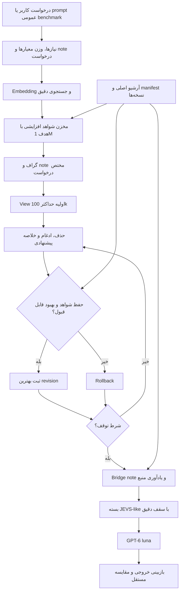

# الگوریتم پیشنهادی: حافظهٔ شخصی‌شده برای درخواست، با بهینه‌سازی برگشت‌پذیر

تاریخ: ۱ اکتبر ۲۰۲۶. وضعیت: **طراحی برای تأیید کاربر**. این سند الگوریتم و طرح آزمایش را تعریف می‌کند؛ هیچ پیاده‌سازیِ v3، embedding، ساخت مخزن جدید یا اجرای مدل در این مرحله انجام نشده است. آزمایش‌های v1/v2 و Flux اصلی تغییر نمی‌کنند. تغییر ساختار reasoning داخلی مدل به مرحلهٔ بعد موکول است.

## ۱. فرضیه و مرز نتیجه

هدف کاربر: GPT-6 luna با حافظه/RAG متناسب با درخواست، به کیفیت GPT-6.1 sol بدون RAG نزدیک شود. این هدف قابل آزمایش است؛ نتیجهٔ اثبات‌شده نیست. حافظه می‌تواند دانش و شواهد مناسب را به ورودی مدل اضافه کند؛ از این کار برابریِ توانایی عمومیِ دو مدل نتیجه نمی‌شود.

هدف کیفیت پیشنهادی: در workload تازه و منجمد، کیفیت خروجی luna با سامانهٔ کامل، نسبت به sol بدون RAG بیش از ۲ واحد درصد افت نکند. روش سنجش، خانوادهٔ task، فاصلهٔ اطمینان و خطاهای حیاتی قبل از اجرا ثبت شوند. این مقدار پیشنهاد طراحی است و تضمین نتیجه نیست؛ non-inferiority باید با حد پایین فاصلهٔ اطمینان بررسی شود، نه فقط میانگین.

اگر کیفیت حفظ شد، هدف دوم کاهش هزینهٔ اندازه‌گیری‌شده و زمانِ هر خروجی پذیرفته‌شده است. تمام هزینهٔ ساخت notes، embedding، retrieval، graph، نقد، probe و rollback حساب می‌شود. نام دو مدل به عنوان شناسهٔ منطقیِ آزمایش استفاده می‌شود؛ قابلیت، tokenizer، نسخه، reasoning effort و امکان فراخوانی واقعی باید هنگام پیاده‌سازی از provider تأیید شوند. از نام مدل، اندازهٔ context یا قیمت حدس نمی‌زنیم.

## ۲. معماری: یک حافظهٔ مشترک با سه مسئولیت

| بخش | مسئولیت | خروجی |
|---|---|---|
| تصمیم‌گیری | تبدیل درخواست به نیاز و قید؛ وزن معیارها؛ انتخاب عمل بعدی | RequestSpec و action پیشنهادی |
| حافظه/RAG | ساخت مخزن شواهد، embedding، یادداشت‌ها، گراف شخصی‌شده و یادآوری | candidateهای منبع‌دار، تعارض، شکاف، view گراف |
| مدیریت توکن | اندازهٔ واقعیِ بسته؛ انتخاب زیر سقف؛ رزرو خروجی و بازبین | بستهٔ دقیق، hash و admission |
| کنترل‌کننده | اعمال قرارداد، scope، freshness، سقف ریشه و شرط توقف | اجازه یا رد عملیات؛ ثبت trace |

همه از یک RequestSpec و snapshot استفاده می‌کنند، ولی یک نمرهٔ اهمیت نمی‌تواند freshness، نوع شاهد یا اختیار را دور بزند. تصمیم‌گیر پیشنهاد می‌دهد؛ کنترل‌کننده تنها مالک اجرای مجاز است.

## ۳. الگوریتم از درخواست تا حافظه

### مرحلهٔ A: ثبت درخواست و noteهای نیاز

درخواست یا prompt عمومی benchmark به RequestSpec تبدیل شود:

- هدف، خروجی مورد انتظار، زبان، قالب و محدودیت‌ها؛
- معیارهای لازم، نوع شاهد لازم و اولویت صریح کاربر؛
- entityها، پیش‌نیازها، قیدهای حیاتی، اطلاعات نامعلوم و سؤال‌های قابل بازیابی؛
- project/user/request scope، نسخهٔ منابع، سیاست حافظه و سقف هزینه/زمان.

برای هر معیار یک **need note** ساخته شود. need note درخواست اطلاعات است، نه ادعای پاسخ. تبدیل آن به fact صرفاً به خاطر تولید توسط مدل ممنوع است. پرسش استنباط‌شده با برچسب inferred از درخواست صریح جدا بماند.

سه لایهٔ personalization:

۱. ترجیح صریح و مجاز کاربر، مثل زبان و قالب؛ ۲. قرارداد و اصطلاحات پروژه؛ ۳. نیازهای همین request. لایهٔ سوم موقت است؛ پایان task آن را خودکار به حافظهٔ پایدار یا ترجیح کاربر تبدیل نمی‌کند. نتیجهٔ پذیرفته‌شده بعداً به صورت proposal نسخه‌دار می‌تواند ماندگار شود.

### مرحلهٔ B: embedding درخواست و نیازها

هر need note جداگانه و درخواست کلی نیز embedding شوند. یک بردار میانگینِ کلی جای entity، عدد، نفی یا شرط را نگیرد. queryهای واژگانی نیز نگه داشته شوند؛ embedding و جست‌وجوی دقیق مکمل‌اند.

embedding باید زبان‌های مورد نیاز را پوشش دهد و نسخهٔ مدلش منجمد باشد. index برای scope مجاز ساخته شود؛ ابتدا ACL/project/revision/status و سپس embedding/IDF. بردارهای قدیمی با encoder جدید یا ابعاد متفاوت مخلوط نشوند.

جست‌وجوی ترکیبیِ اولیه: رتبه‌های embedding و lexical با RRF ادغام شوند؛ similarity احتمال درستیِ شاهد نیست. وزن معیارها از قرارداد و calibration روی development set می‌آید. وزن‌های دلخواه v2، بدون ارزیابی دوباره، منتقل نمی‌شوند.

### مرحلهٔ C: ساخت RAG افزایشی با هدف یک‌میلیون توکن

RAG اینجا یک مخزن indexشدهٔ شواهد است. کل مخزن به هر فراخوانی مدل فرستاده نمی‌شود. دو کمیت جدا گزارش شوند: توکن متن یکتای منابع و توکنِ serialization کامل مخزن با note/metadata. tokenizer مرجع و نسخهٔ آن ثبت شود.

در هر دور:

۱. نیازهای بدون شاهد، وابستگی‌های رابطه‌ای، استثناها و تعارض‌ها تعیین شوند؛
۲. از منابع مجاز، candidateهای جدید با embedding + lexical و گسترش محدودِ رابطه بازیابی شوند؛
۳. duplicateها بر اساس محتوا و نسخه حذف شوند؛ متن مشابه و متناقض duplicate نیست؛
۴. منبع اصلی، revision/hash، حدود قطعه و نوع شاهد ثبت شوند؛
۵. fact note یا relation note از candidate ساخته و به اصل وصل شود؛
۶. موارد بی‌منبع، ambiguous، stale یا مدل‌ساختهٔ تأییدنشده از لایهٔ fact تأییدشده جدا بمانند؛
۷. حجم مخزن و افزایش پوشش نیاز محاسبه شوند.

**دو سیاست آزمایش می‌شوند:**

- `fixed-1M`: سیاست اصلی برای آزمودن ایدهٔ کاربر؛ هدف مخزن دقیقاً ۱۰۰۰۰۰۰ توکنِ مرجع است. فقط شواهد مجاز و دارای منشأ وارد شوند. برای نزدیک‌شدن به هدف می‌توان قطعهٔ ساختاری/پاراگراف کامل کوچک‌تر انتخاب کرد؛ قید و شاهد نصف نمی‌شود.
- `adaptive`: کنترل پژوهشی؛ وقتی افزودن شاهدِ مرتبط، پیشرفت تأییدشده ندارد، پیش از یک‌میلیون توقف می‌کند.

اگر شواهد مرتبط کافی وجود ندارد، یا واحدهای سالم با شمارش دقیق به هدف نمی‌رسند، وضعیت `target_unreachable` همراه با مقدار واقعی ثبت شود. تکرار متن، padding و ساخت «واقعیت» برای تکمیل عدد مجاز نیست. نمونهٔ fixed-1M فقط در صورتی واجد این نام است که حجم هدف واقعاً تأیید شود. مخزنِ زیرِ هدف به عنوان زیرِ هدف گزارش شود؛ پرکردن مصنوعی، فرضیهٔ کاربر را به‌درستی نمی‌سنجد.

برای کارهای ساده ساخت مخزن بزرگ ممکن است هزینهٔ بیشتری از خود پاسخ داشته باشد؛ به همین دلیل سیاست fixed و adaptive جدا مقایسه می‌شوند. این یک فرضِ تجربیِ حل‌نشده است، نه دلیلی برای تغییر بی‌خبر خواستهٔ کاربر.

### مرحلهٔ D: note + memory + graph، مختص به request

مخزن ابتدا به حدود ۱۰۰ گروهِ ۱۰هزار‌توکنی تقسیم شود؛ boundary سالم و اندازهٔ واقعی ثبت شود. در صورت عبور یک واحد ضروری از boundary، آن واحد با ارجاع مشترک نگه داشته شود و اندازهٔ واقعی گروه گزارش شود. تقسیم گروه، quota نرم است؛ سقف serialization مخزن قطعی است.

دو نمایش مرتبط داشته باشیم:

- **گراف پایهٔ پروژه:** روابط و شواهد نسخه‌دارِ قابل بازاستفاده، با ارجاع به archive؛
- **گراف کاریِ درخواست:** زیرگراف و noteهایی که وزن و انتخابشان به RequestSpec، نیازهای باز و ترجیح صریح مربوط است.

نوع nodeها: need، claim، entity، evidence، exception، contradiction و decision-note. نوع edgeها: supports، contradicts، depends_on، same_entity و provenance. متن یا occurrence یک symbol، به خودی خود supports یا call edge قطعی نیست؛ رابطهٔ حدسی candidate می‌ماند.

noteها فقط خلاصهٔ prose نباشند؛ یک قالب ساختاری لازم دارند:

`note_id, kind, statement, request_id, criterion_refs, project_scope, source_refs, source_revisions, source_hashes, status, uncertainty, exceptions, parent_notes, superseded_by`

خلاصه به چند شاهد متصل می‌شود؛ شاهدهای دقیق، عدد، نفی، محدودیت، counterexample و تعارض در آرشیو و manifest حفظ می‌شوند. یادداشت راهنمای پاسخ باید از یادداشت واقعیت جدا باشد.

### مرحلهٔ E: ماتریس ارزشِ وابسته به درخواست

| بُعد | نقش |
|---|---|
| R | ارتباط با درخواست و embedding هر need؛ همراه تطبیق دقیق واژگانی |
| E | پشتیبانیِ بررسی‌شده از criterion، با نوع شاهد درست؛ UNKNOWN جدا |
| C | ضرورت قید/استثنا طبق قرارداد، با تقدم قطعی برای موارد حیاتی |
| B | ارزش رابطه برای کامل‌کردن مسیر شواهد؛ نه صرفاً درجهٔ node |
| N | اطلاعات جدید نسبت به مجموعهٔ انتخاب‌شده |
| P | تطابق با نیاز همین request و ترجیح صریح مجاز |
| D | تکرار اطلاعات؛ تعارض حذف‌پذیر به عنوان تکرار نیست |
| T | افزایشِ توکنِ serialization دقیق بعد از افزودن واحد |

دامنه، freshness، منشأ و نوع شاهد **gate** هستند و وزن نرم ندارند. critical item حذف نمی‌شود تا نمرهٔ تعداد بیشتری candidate معمولی افزایش یابد.

هدف پیشنهادی برای یک view گراف G:

`J(G,q) = verified_criterion_coverage + relation_completeness + relevant_novelty - redundancy - token_penalty - latency_penalty - evaluation_cost`

ضرایب فقط روی development tasks تنظیم و سپس freeze می‌شوند. پوشش UNKNOWN نباید مثل پوشش verified نمره بگیرد. score معناییِ لفظی مدل نمی‌تواند تنها منبع verified_coverage باشد. پیش از calibration، objective چندمعیاره و قیدهای قطعی استفاده شود؛ یک عدد confidence ساختگی تولید نشود.

### مرحلهٔ F: «خودتخریبی» به عنوان pruning، merge و rollback

نسخهٔ ابتداییِ view فعال برای هدف ۱۰۰هزار توکن ساخته شود. سقف ۱۰۰هزار شامل node، edge، note، reference، metadata و جدول ارزشِ داخلِ view است؛ embedding index، archive و ایندکس‌های بیرونی جدا گزارش شوند. ۱۰۰هزار توکن کل ظرفیت context فرض نمی‌شود.

optimizer در هر دور یکی از این patchها را پیشنهاد کند:

- حذف note تکراری یا بی‌ربط از view؛
- ادغام noteهای سازگار با حفظ provenance؛
- خلاصه‌کردن یک گروه با حفظ شاهدهای محافظت‌شده؛
- تبدیل تکرار بین شاخه‌ها به مینی‌بلوک reference مشترک؛
- جایگزینی متن کم‌ارزش با مسیر یادآوری به archive؛
- افزودن استثنا یا شاهدی که در pruning گم شده است.

**اصل archive تخریب نمی‌شود.** برای هر patch یک graph revision و manifest تغییر ثبت شود. معکوس patch یا snapshot قبلی موجود باشد. معیار انتخاب patch اثر حاشیه‌ای روی شواهد لازم است؛ صرف کوچک‌شدن هدف کافی نیست.

پیشنهاددهنده و ارزیاب graph با contextها/خروجی‌های جدا کار کنند؛ هر دو می‌توانند luna باشند، ولی جدایی نشست تضمین استقلال خطا نیست. ارزیاب از منشأ، آزمون‌های اجرایی، assertionهای دقیق و نیازهای RequestSpec استفاده کند. امتیاز self-judge به تنهایی مجوز commit patch نیست.

آزمون‌های هر patch:

۱. حفظ قیود حیاتی، عدد/نفی/واحد و exceptionهای شناخته‌شده؛
۲. عدم تغییر source/claim بدون شاهد؛
۳. مسیر قابل بازیابی برای شاهدهایی که از view حذف شده‌اند؛
۴. امکان یادآوری relationهای میان بلوک‌ها و شواهد هر دو طرف؛
۵. عدم مخفی‌کردن تضاد یا معیار UNKNOWN؛
۶. سقف دقیق توکن و سقف هزینه/زمان optimizer.

probeهای داخلی از نیازهای request و منابع مجاز تولید می‌شوند؛ پاسخ مرجعِ probe باید به همان منبع وصل باشد. این probeها validation نهایی نیستند و answers پنهانِ benchmark به optimizer داده نمی‌شود. حفظ probes به معنی حفظ همهٔ دانش یا کیفیت عمومی نیست.

اگر قید حیاتی شکست خورد، rollback. اگر coverage کمتر شد یا UNKNOWN جدید ایجاد شد، patch به عنوان بهبود commit نشود. اگر coverage حفظ شد و هزینهٔ مناسب کمتر شد، نسخهٔ جدید پذیرفته شود. در باقی حالت‌ها هزینه/کیفیت به صورت Pareto ثبت و با loss budget از پیش تعیین‌شده تصمیم گرفته شود. سقف اجرای optimizer همواره بر حلقه مقدم است.

توقف هنگام: نبود patch پذیرفتنی، رسیدن به بودجهٔ کوچک‌ترِ کافی برای task، بهبود کمتر از epsilon از پیش منجمد، یا پایان سقف تعداد دور/زمان/هزینه. «بهینه‌ترین» در این طراحی یعنی **بهترین نسخهٔ پذیرفته‌شده در جست‌وجوی محدود**؛ بهینهٔ جهانی تضمین نمی‌شود. بهترین نسخه نگه داشته می‌شود، نه الزاماً کوچک‌ترین یا آخرین نسخه.

### مرحلهٔ G: noteهای بین گراف‌ها و بلوک‌ها

برای هر رابطهٔ مشترکِ مرتبط یک bridge note ساخته شود:

`bridge_id, graph_a_revision, graph_b_revision, edge_type, shared_entity, evidence_a_refs, evidence_b_refs, source_stamps, request_relevance, caveats`

bridge note باید دلیل اتصال و شواهد دو طرف را نگه دارد. شباهت embedding به تنهایی نباید رابطهٔ واقعیت تولید کند. نیازی به اتصال همهٔ جفت‌گراف‌ها نیست؛ روابط معتبر و مرتبط انتخاب می‌شوند، و نبود رابطه صریحاً باقی می‌ماند.

اگر bridge در view کوچک موجود نبود، retrieval یک bridge موقت از relation index همان پروژه/نسخه بسازد. متن شاهد، note موقت و referenceهایش داخل سقف بسته شمرده شوند. سهمیهٔ bridgeها و سهمیهٔ fact/exception جدا باشد تا نقش اتصال، همهٔ ظرفیت را مصرف نکند.

memorize در این مرحله یعنی external memory با index و source trace؛ آموزش وزن مدل نیست. bridge مربوط به همان درخواست موقت است؛ انتقال به حافظهٔ پروژه نیازمند proposal و قواعدِ تأیید فعلی است.

### مرحلهٔ H: بستهٔ JEVS-like و اجرای مدل

از ساختار محلی JEVS الهام بگیریم: انتخاب بر اساس criterion، قطعهٔ کامل، ادغام overlap، شمارش serialization، revision/status/project filtering، و برچسب candidate/missing. این طراحی بازتولید native Jev نیست و score retrieval پاسخ تولید نمی‌کند.

بودجهٔ اختیاری:

`B_optional = min(local_input_cap, verified_context_window - output_reserve - margin) - tokens(mandatory_frame)`

mandatory_frame شامل درخواست کامل، قیود، معیارها، schema ابزارهای واقعاً ارسال‌شده، وضعیت ضروری و برای review خروجی مورد بررسی است. اگر جا نشود، task تقسیم یا admission رد می‌شود؛ قید silently compact نمی‌شود. اگر context/tokenizer provider نامعلوم باشد، اندازهٔ مرجع با برچسب assumption گزارش شود؛ تاریخچهٔ مخفی CLI اندازه‌گیری‌شده تلقی نشود.

JEVS-like pack شامل: متن اجباری، noteهای مرتبطِ قابل ردیابی، شواهد دقیق، bridgeهای لازم، تعارض‌ها و gaps باشد. همهٔ آن‌ها یک بار render و با tokenizer مرجع و در صورت وجود tokenizer واقعی provider شمارش شوند. embedding token، توکن مخزن و prompt token با هم اشتباه نشوند.

luna پاسخ/کد را از این بسته تولید کند. بازبین خروجی را با criterion و شاهد مناسب ارزیابی کند. اگر شکاف قابل بازیابی وجود داشت، یک دور محدود expansion/repair انجام شود؛ اگر مشکل از تولید یا استدلال بود، pruning بیشتر خودکار نسخهٔ غلط را «درست» نمی‌کند.

در آزمایش luna، fallback به sol مجاز نیست؛ در غیر این صورت ادعای luna + RAG مخدوش می‌شود. در محصول، escalation می‌تواند policy جدا داشته باشد و نتایجش به عنوان کیفیتِ مخلوط گزارش شود.

## ۴. شبه‌الگوریتم غیر اجرایی

```text
ورودی: درخواست عمومی q، scope مجاز، قرارداد، سقف منابع
ثبت snapshot، معیارها و نیازهای درخواست
ساخت need noteها و embedding مجزا + queryهای دقیق
توسعهٔ افزایشی مخزن از منابع مجاز، با trace و هدف fixed-1M
اگر هدف قابل دستیابی نیست: ثبت حجم واقعی و علت؛ توقف طبق سقف
ساخت گراف پایه، گراف کاریِ شخصی‌شده و noteهای منبع‌دار
ساخت view اولیهٔ حداکثر 100k با سهمیهٔ قید، fact و bridge
تا سقف optimizer:
    پیشنهاد patch حذف/ادغام/خلاصه/bridge
    شمارش دقیق و آزمون شواهدِ نسخهٔ پیشنهادی
    در صورت شکست قید یا حفظ شواهد: rollback
    در صورت بهبود پذیرفتنی: commit یک revision جدید
    نگه‌داری بهترین نسخه؛ توقف هنگام نبود بهبود یا پایان سقف
ساخت/یادآوری bridge noteهای لازم
ساخت pack JEVS-like، شمارش کل payload و admission
تولید خروجی با luna، بازبینی مستقل و repair محدود
ثبت خروجی، trace، هزینهٔ کل، نسخه‌ها و gaps
پیشنهاد حافظهٔ پایدار فقط برای دانش/ترجیح مجازِ تأییدشده
```

## ۵. نمودار جریان طراحی



## ۶. طرح مقایسه بعد از تأیید و کدنویسی

همهٔ arms روی taskهای یکسان، prompt عمومی، خروجی/زمان/ابزار یکسان و snapshot یکسان اجرا شوند. notes، exemplarها و memory موفقِ taskهای قبلی از answerهای evaluation ساخته نشوند. تغییر encoder، وزن، سقف، graph policy و judge پس از دیدن evaluation نیازمند مجموعهٔ ارزیابی تازه است.

| arm | هدف |
|---|---|
| luna بدون RAG | اندازهٔ بهبود نسبت به مدل پایه |
| sol بدون RAG | هدف مستقیم کاربر |
| luna + RAG ساده با همان منابع | اثر بهینه‌سازی نسبت به افزودن صرف دانش |
| luna + گراف اولیهٔ v1 | مقایسهٔ نسخهٔ اولیهٔ آزمایش |
| luna + گراف v2 تکمیل‌شده | مقایسه با آخرین prototype؛ encoder/منابع یکسان کنترل شوند |
| luna + v3 fixed-1M | فرضیهٔ اصلیِ توسعه و pruning شخصی‌شده |
| luna + v3 adaptive | آیا یک‌میلیون لازم است؟ |
| sol + همان RAG | تفکیکِ برتری اطلاعات از تفاوت توانایی مدل |

کنترل‌های جدا: بدون personalization، بدون embedding، بدون pruning، بدون bridge note و بدون verifier بیرونی. در مرحلهٔ هزینه، دو سناریو سنجیده شوند: بودجهٔ کل یکسان و کیفیت حداقلی یکسان. هیچ درصد ساختگی برای نتیجهٔ آینده رسم نشود.

منظور از «نسخهٔ اولیه» برای الگوریتم گراف، v1 پوشهٔ `diffusion_memory_20261001` است. selector فعلی Flux نیز control جداگانه خواهد بود؛ از مقایسهٔ selector، کیفیت end-to-end محصول نتیجه نمی‌گیریم. baseline سورس باید قبل از اجرا منجمد شود، چون workspace هم‌زمان تغییر می‌کند.

workload شامل: پرسش دانش خصوصی/پروژه‌ای، بازیابی چندمرحله‌ای، کدنویسی با تست اجرایی، استثنا/تضاد/قیود نادر، فارسی و انگلیسی، و کارهای استدلالی که پاسخشان در RAG موجود نیست. در task دانش خصوصی، برتریِ مدل دارای اطلاعات بر مدل فاقد اطلاعات به معنی برتری reasoning نیست. معیارهای reasoning و evidence-retrieval جدا گزارش شوند.

quality با آزمون واقعی، reference مستقل یا داوری blind و کالیبره سنجیده شود. self-judgeِ builder تنها judge آزمایش نیست. یک نمونهٔ کوچک با review انسانیِ blind برای وارسی bias judge و اختلال citation لازم است. judge مستقل اگر مدل قوی استفاده کرد، answer/reference آن در اختیار builder/generator قرار نمی‌گیرد؛ هزینهٔ آن جدا و صریح ثبت می‌شود.

ثبت نتیجه: کیفیتِ task پذیرفته‌شده، خطای حیاتی، unsupported claim، حفظ قید، citation معتبر، anchor recall، حجم مخزن، اندازهٔ graph، prompt/input/output tokens، تمام model callها، هزینهٔ معلوم/نامعلوم، latency سرد/گرم، rollback و میزان source fallback. private hidden CLI tokens مجهول می‌مانند. build/embedding cache فقط وقتی key کامل و freshness درست است بازاستفاده شود؛ هزینهٔ سرد و amortized با تعداد reuse واقعی جدا گزارش شوند.

تصویرسازی پایان آزمایش:

۱. کیفیت هر arm با فاصلهٔ اطمینان؛ ۲. نمودار کیفیت در برابر هزینهٔ کل و latency؛ ۳. منحنی اندازهٔ graph در برابر حفظ قیود و کیفیت خروجی؛ ۴. مسیر revisionها با نقاط rollback؛ ۵. سهم personalization، embedding، pruning و bridge در ablation. عدد یک‌میلیون برچسب target است؛ مقدار واقعی همیشه نمایش داده شود.

این مرحله هیچ benchmark خروجیِ مدل ندارد. شواهد قبلی فقط ۷۸۸۴ بازیابی offline و ۱۲ تست ساختاری بود؛ embedding یا مقایسهٔ luna/sol در آن انجام نشده است.

## ۷. پژوهش مرتبط و اختلاف با این پیشنهاد

- [Self-RAG](https://arxiv.org/abs/2310.11511): retrieval و critique تطبیقی را بررسی می‌کند و برای reflection tokenها مدل آموزش می‌دهد. این طراحی از ایدهٔ تصمیم retrieval/critique الهام می‌گیرد؛ افزودن prompt خودسنجی به luna بازتولید آن روش یا اثبات نتیجهٔ آن نیست.
- [Large Language Models Cannot Self-Correct Reasoning Yet](https://arxiv.org/abs/2310.01798): محدودیت self-correction بدون feedback بیرونی را در setupهای آن پژوهش نشان می‌دهد. نتیجهٔ طراحی ما: پیشنهاد self-judge با شاهد و verifier بیرونی آزموده شود؛ صرف تکرار نقد تضمین پیشرفت نیست.
- [RAPTOR](https://arxiv.org/abs/2401.18059): ساختار سلسله‌مراتبی با embedding، clustering و summary را بررسی می‌کند. اینجا graph کاری به request شخصی می‌شود و exception/bridge/rollback صریح دارد؛ پیاده‌سازی یکسان یا نتیجهٔ منتقل‌شده ادعا نمی‌شود.
- [LLMLingua-2](https://arxiv.org/abs/2403.12968): compression آموزش‌دیده و extractive را بررسی می‌کند. می‌تواند بعداً control یا compressor آزمایشی باشد؛ این طراحی فعلاً هیچ آموزش وزن و هیچ ادعای حفظ بی‌نقص معنا ندارد.

## ۸. تصمیمی که برای تأیید ارائه می‌شود

پیشنهاد: این pipeline با فرضیهٔ fixed-1M و کنترل adaptive، personalization سه‌لایه، view حداکثر ۱۰۰هزار توکن، pruning برگشت‌پذیرِ قابل آزمون، bridge noteهای منبع‌دار و pack JEVS-like در محیط مستقل پیاده شود. ارزیابی luna + v3 در برابر sol بدون RAG بعد از این پیاده‌سازی، روی خروجی واقعی و با هزینهٔ کل انجام شود.

تأیید این سند، مجوز پیاده‌سازی مستقلِ همین طراحی است؛ اتصال به Flux اصلی، استفاده از حافظهٔ خصوصیِ خارجِ scope، fine-tuning مدل، و تغییر ساختار reasoning داخلی جزو این مرحله نیست. این توقف برای تأیید مطابق درخواست صریح کاربر است: «اول الگوریتمش رو بزن بعدش تایید کردم کدش کن».
