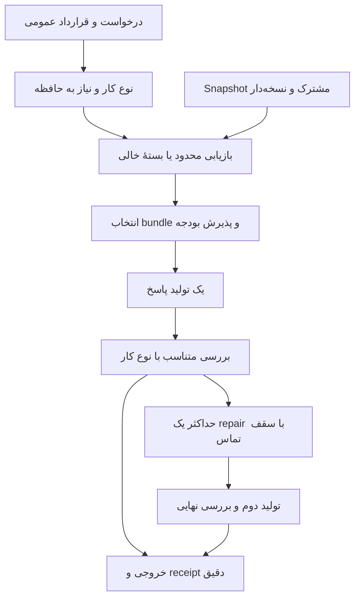

# طراحی v5: حافظهٔ سریع، شاهد متصل به ادعا، و تصمیم‌گیری با حدود روشن

تاریخ: ۲ اکتبر ۲۰۲۶. وضعیت: **طراحی پیشنهادی؛ پیاده‌سازی و benchmark نشده است.** این سند بر پایهٔ بررسی مستقل v4 تهیه شده؛ درصد بهبود کیفیت یا زمان کل برای v5 هنوز نداریم. در این مرحله کد اجرایی، دیتابیس و runtime Flux تغییر نمی‌کنند.

## ۱. تصمیم اصلی معماری

سه الگوریتم را در یک قرارداد مشترک هماهنگ می‌کنیم و مسئولیتشان را جدا نگه می‌داریم:

| بخش | مسئولیت | خروجی |
|---|---|---|
| حافظه و RAG | snapshot، واحدهای منبع، رابطه‌ها، بازیابی و وضعیت تازگی | EvidenceCandidates |
| مدیریت توکن | انتخاب بستهٔ کامل، بودجهٔ محلی، شمارش دقیق و پذیرش prompt | EvidencePack یا BudgetFailure |
| تصمیم‌گیری | نیاز به حافظه، نوع بررسی، انتخاب مدل و تصمیم repair/توقف | DecisionReceipt |

یک Controller ترتیب اجرا و سقف تماس‌ها را کنترل می‌کند. رتبهٔ بالا اجازهٔ دور زدن scope، تازگی، بودجه یا معیار پذیرش را نمی‌دهد. پاس شدن verifier نیز جای پذیرش کار توسط انسان در HEAD فعلی را نمی‌گیرد.

مزیت موردانتظار v5 نسبت به v4، کمتر شدن تأیید اشتباه و پاسخ فاقد پشتوانه، همراه با حفظ آماده‌سازی سریع است. تضمین هم‌سطح شدن Luna با Sol یا کاهش ۹۵٪ زمان کل نداریم.

## ۲. چه چیزهایی از v4 حفظ یا عوض می‌شوند؟

**حفظ می‌شوند:** ساخت ایندکس یک‌باره، lexical به‌عنوان مسیر پیش‌فرض، زیرواژه‌های شناسه، بازیابی بر اساس معیار، قطعات کامل منبع، همسایهٔ محدود، رابطهٔ محدود و شمارش پیشاپیش هزینهٔ واحدها.

**عوض می‌شوند:** router دوحالته، scope مبتنی بر regex برای Python، verifier زیررشته‌ای، تشخیص مبهم «شواهد کامل»، و renderer که می‌تواند با بودجهٔ شکسته برگردد.

**اضافه می‌شوند:** قرارداد typed برای نیاز و ادعا، scope بر اساس ساختار معتبر منبع، سیاست اعتبار منبع وابسته به نوع سؤال، وضعیت uncertain، اتصال ادعا به شاهد دقیق، snapshot خالی معتبر، و هماهنگ‌کننده‌ای که واقعاً حداکثر یک repair را enforce می‌کند.

RAG برای هر درخواست تا یک میلیون توکن بزرگ نمی‌شود. آرشیو اصلی می‌تواند یک میلیون توکن یا بیشتر داشته باشد؛ حجم آن تابع منابع واقعی است. نمای درخواست فقط از قطعات مرتبط و لازم ساخته می‌شود. صد هزار توکن اگر در آزمایش مقیاس استفاده شود، سقف نمای گراف است؛ هدفی برای پر کردن با اطلاعات اضافی نیست.

## ۳. قرارداد دادهٔ مشترک

### Snapshot و واحد منبع

هر Snapshot شامل این‌هاست:

- project، epoch، revision و hash متن منابع؛
- نسخهٔ parser، tokenizer، پیکربندی رتبه‌بندی و aliasهای تأییدشده؛
- واحدهای منبع و رابطه‌ها با hash و محدودهٔ دقیق؛
- ایندکس lexical، هزینهٔ واحدها و در صورت فعال بودن، نسخهٔ embedding.

`EvidenceUnit` شامل `unit_id`, `source_ref`, `source_hash`, `span`, `project`, `revision`, `status`, `source_role`, `evidence_kind`, `entity_ref`, `field_ref`, `text`, `local_token_cost` است. فیلدهای typed فقط وقتی پر می‌شوند که استخراج معتبر آن‌ها ممکن باشد؛ نبودنشان با حدس جبران نمی‌شود.

برای مثال، شاهد مقدار مجاز یک فیلد قرارداد از مسیر `module.Contract.field` استخراج می‌شود، با نوعی مثل `LiteralSet`. مقدار یک fixture تست، مقدار مجاز قرارداد نیست. شاهد تعریف تست نیز نوع `test_execution` نمی‌گیرد؛ آن نوع فقط برای receipt اجرای واقعی است.

### RequestSpec

```text
request_id, project, epoch
query_original, language
task_kind = factual | code | math | mixed | unknown
memory_need = project_grounded | self_contained | uncertain
needs[] = {
  need_id, entity_candidates, field_candidates,
  evidence_kind_required, value_type,
  required, public_constraints, resolution_status
}
preferences, allowed_models, allowed_tools
evidence_budget, prompt_budget, max_calls, deadline
```

نوع کار و نیاز به حافظه دو محور مستقل‌اند. «کدنویسی برای این repository» می‌تواند `code + project_grounded` باشد؛ «تابع مستقل با قرارداد کامل در سؤال» می‌تواند `code + self_contained` باشد.

`needs` از هدف و قرارداد عمومی کار ساخته می‌شوند، نه gold benchmark. اگر caller معیار structured ندهد، استخراج قطعیِ محدود از متن، نام‌های ایندکس و aliasهای تأییدشده استفاده می‌شود. وقتی entity یا field یکتا قابل‌حل نباشد، `unresolved` ثبت می‌شود؛ معیار ساختگی یا معیار صرفاً مناسب benchmark ساخته نمی‌شود. aliasهای عمومی مثل تفاوت نام متغیر و عبارت فارسی باید در manifest باشند و فقط روی dev تنظیم شوند.

### ادعا و نتیجهٔ بررسی

```text
Claim = {
  need_id, entity_ref, field_ref,
  value, value_type, evidence_refs[], proof_kind
}
VerificationReceipt = {
  request_hash, output_hash, snapshot_hash,
  status = verified | partial | abstained | contradicted | unverified | invalid,
  per_need_results[], problems[], method
}
```

`verified` به روش مشخص بررسی و ادعاهای مشخص محدود است. بررسی citation به‌تنهایی، verified معنایی نمی‌سازد. نبود فیلد required، پاسخ خالی و مقدار unknown نمی‌توانند موفقیت کامل بسازند. `null` می‌تواند امتناع درست باشد، ولی باید به‌عنوان abstained/partial گزارش شود.

## ۴. الگوریتم آماده‌سازی snapshot

این مرحله خارج از مسیر هر درخواست انجام می‌شود:

1. revisionهای canonical را تعیین کن و scope، status، tombstone و epoch را **پیش از ایندکس** اعمال کن. پیشنهاد مدل و یادداشت تأییدنشده eligible نیستند.
2. متن خام و manifest را نگه دار. واحدها باید با منبع و span اصلی قابل‌بازیابی باشند.
3. برای Python معتبر، AST مبنای تعیین module، class، function، decorator، signature، annotation، guard و literal باشد. یک واحد بزرگ به قطعات کوچک‌تر با اتصال ساختاری تقسیم شود؛ همهٔ بدنهٔ یک class به هر سؤال افزوده نشود.
4. JSON/config و رکوردهای نیمه‌ساختاریافته parser جدا دارند. grammar عمومیِ ثبت‌شده، مثل `entity property: value`، بدون نام‌بردن از شناسه یا فیلد خاص dataset، subject/field/value را متصل می‌کند. source_role و schema تعیین می‌کنند این خروجی حقیقت canonical است یا فقط متن مشاهده‌شده؛ عدد و واحد بدون schema حدس زده نمی‌شوند. وقتی parse شکست می‌خورد یا فرمت پشتیبانی نمی‌شود، قطعات متنی با برچسب `text_excerpt` بساز؛ ساختار یا رابطهٔ قطعی ادعا نکن.
5. رابطه‌ها را با نوع و روش استخراج ثبت کن: containment، تعریف/ارجاعِ حل‌شده، وابستگیِ explicitly recorded، و همسایگی. ذکر یک نام بدون حل namespace، رابطهٔ قطعی نیست؛ `candidate_relation` باقی می‌ماند.
6. ایندکس lexical، زیرواژه‌ها، entity/field lookup، scope lookup و هزینهٔ هر واحد را بساز.
7. embedding در حالت پیش‌فرض بارگذاری نمی‌شود. اگر سیاست fallback آن را فعال کرد، ایندکس pinned آن یک بار ساخته و جداگانه cache شود. متن بلند با پنجره‌های پوشش‌دهنده پردازش شود؛ truncation پنهان مجاز نیست.
8. snapshot کامل را اتمی منتشر کن. تغییر منبع، epoch یا policy، cacheهای وابسته را invalid کند. به‌روزرسانی فایل فقط واحدها و رابطه‌های متاثر را بازسازی کند؛ برای نسخهٔ اول این مسیر می‌تواند full rebuild درست و قابل‌ردیابی باشد.

snapshot خالی معتبر است: ایندکس sparse با صفر واحد و وضعیت `no_evidence`. لغو آخرین یادداشت یا حذف همهٔ منابع نباید خطای vocabulary ایجاد کند.

## ۵. تصمیم‌گیری پیش از بازیابی

router سه حالت دارد:

| حالت | شرط تصمیم | اقدام |
|---|---|---|
| project_grounded | وابستگی صریح به پروژه/منبع یا نیاز به حقیقت موجود در snapshot | بازیابی |
| self_contained | قرارداد و ورودی‌های لازم در درخواست‌اند و وابستگی پروژه‌ای دیده نمی‌شود | بستهٔ شاهد خالیِ معتبر |
| uncertain | شواهد کافی برای دو حالت بالا وجود ندارد | یک جست‌وجوی کوچک؛ حفظ عدم‌قطعیت |

نبود anchor یا کم بودن واژهٔ rare، دلیل self_contained نیست. اشارهٔ عمومی «در این پروژه»، «مالک انسانی پروژه» یا «محدودیت هم‌زمانی» باید بتواند مسیر project_grounded را فعال کند، حتی بدون نام کلاس.

برای عبارت ریاضی ساده، parser محدود فقط وقتی self_contained می‌دهد که متغیرهای لازم bound باشند. مسائل زبان طبیعی پیچیده می‌توانند uncertain باشند. اگر نتیجهٔ probe ارتباط معناداری نشان نداد، `no_evidence` ثبت می‌شود؛ این نتیجه به معنی اثبات خودبسنده بودن سؤال نیست.

ابهام هویتی حفظ می‌شود. دو class هم‌نام در دو module به‌طور خودکار یک entity نمی‌شوند. اگر این ابهام پاسخ را تغییر می‌دهد و از context قابل‌رفع نیست، خروجی clarification/ambiguous است؛ مدل قوی‌تر جای انتخاب منبع نامعلوم را نمی‌گیرد.

## ۶. ماتریس ارزش‌گذاری و بازیابی محدود

ماتریس `M[need, unit]` نمای مشترک موردنظر برای نیاز، اهمیت و حافظه است. این ماتریس لازم نیست در ابعاد کل corpus ذخیرهٔ dense شود؛ ویژگی‌ها فقط برای نامزدهای sparse و محدود محاسبه می‌شوند.

ابتدا gateهای قطعی:

- project/epoch/revision معتبر؛
- شاهد مجاز و منبع تازه؛
- entity سازگار، وقتی entity شناخته‌شده است؛
- نوع شاهد مناسب معیار؛
- namespace حل‌شده برای نسبت دادن فیلد و مقدار.

واحد متعلق به سرویس دیگر، حتی با score lexical بالاتر، شاهد owner سرویس مورد سؤال نیست. واحد نامرتبط ممکن است context باشد، ولی نیاز را پوشش نمی‌دهد.

برای نامزدهای باقی‌مانده، ویژگی‌های پیشنهادی عبارت‌اند از: lexical، semantic اختیاری، تطابق entity و field، پوشش چند نیاز، نوع و اعتبار منبع، هزینهٔ توکن و افزایش پوشش نسبت به واحدهای منتخب. وزن‌ها روی dev انتخاب و freeze می‌شوند؛ این طراحی وزن جادویی یا درصد بهبود ازپیش‌تعیین‌شده ارائه نمی‌کند.

اعتبار منبع وابسته به سؤال است. برای «مقادیر مجاز قرارداد»، تعریف نوع قرارداد بر fixture مقدم است. برای «آنچه در آخرین اجرا رخ داد»، receipt اجرای همان نسخه منبع مناسب است. اختلاف دو منبع canonical به‌صورت conflict نگه داشته می‌شود و با میانگین‌گیری score حذف نمی‌شود.

روند بازیابی:

1. lexical معیارها را batch محاسبه کن؛ نامزدها را با gateها و ماتریس ارزش رتبه‌بندی کن.
2. برای هر نیاز، bundle حداقلیِ کامل انتخاب کن: مثلاً تعریف field همراه annotation یا هر دو سر رابطهٔ وابستگی. bundle، واحد تخصیص بودجه است.
3. اگر تطابق مستقیم ناکافی است، scope مربوط به entity را جست‌وجو کن؛ scope یک کلاس کامل و نامرتبط اضافه نشود.
4. برای نیاز رابطه‌ای، یک hop پیش‌فرض داشته باش. سقف پیشنهادی نسخهٔ آزمایشی دو hop، ۳۲ نامزد رابطه‌ای برای هر نیاز و depth ثبت‌شده است. تعدادها پارامتر طراحی‌اند و باید روی dev ثابت شوند.
5. اگر نیاز هنوز unresolved است و fallback semantic مجاز و ایندکس آن آماده است، **یک** بازیابی embedding روی نامزدهای همان دامنه انجام بده. تغییر به semantic نباید gate هویت و تازگی را دور بزند.
6. نتیجهٔ هر نیاز را یکی از `typed_supported`, `candidate`, `missing`, `ambiguous`, `conflicted` قرار بده. وجود همهٔ واژه‌ها، typed_supported نمی‌سازد.

داشتن یک میلیون توکن منبع به معنی اسکن و serialization یک میلیون توکن در هر درخواست نیست. عملیات دقیقاً O(1) هم ادعا نمی‌شود؛ هزینه با تعداد واحدها، واژه‌ها، معیارها و نامزدها تغییر می‌کند.

## ۷. بلوک‌ها و نوت‌های مشترک

حافظهٔ مشترک دو لایه دارد:

- **لایهٔ پایدار:** منابع، واحدها، روابط معتبر، یادداشت‌های انسانی تأییدشده و ترجیحات تأییدشدهٔ همان پروژه؛
- **نمای موقت درخواست:** نیازها، نامزدها، انتخاب bundleها، gapها و نوت‌های رابطه‌ای مربوط به همین درخواست.

یک نوت مشترک مثل رابطهٔ Contract و یک field، به شناسه و hash دو واحد متصل است؛ متن منبع را بین هر دو بلوک تکرار نمی‌کند. متن bridge اگر برای فهم پاسخ لازم باشد در بودجه حساب می‌شود. رابطه‌ای که یکی از دو سرش در بسته نیست، داخل بسته باقی نمی‌ماند.

نوت نیاز «به owner نیاز داریم» حقیقت نیست. خلاصهٔ مدل، cache نتیجه و پذیرش یک پاسخ نیز به‌طور خودکار حقیقت پایدار نیستند. مطابق قرارداد فعلی Flux، پیشنهاد حافظه پس از پذیرش artifact در outbox قرار می‌گیرد و ارتقا به حافظهٔ معتبر جداگانه انجام می‌شود. منبع stale، تمام cacheهای استنتاج‌شده از آن را stale می‌کند.

personalization فقط ترتیب و شکل ارائهٔ مجاز را تغییر می‌دهد؛ خواست کاربر نمی‌تواند مقدار قرارداد یا شاهد واقعی را عوض کند. cache پاسخ شامل project، epoch، snapshot، نیازها، policy، ترجیحات موثر و schema است؛ cache بین پروژه‌ها مشترک نمی‌شود.

## ۸. مدیریت توکن بدون حلقهٔ optimizer

بودجهٔ پیشنهادی آزمایش: بستهٔ شواهد حداکثر ۳۰۰۰ توکن محلی؛ سقف prompt کامل و ذخیرهٔ خروجی جداگانه‌اند. tokenizer و نسخهٔ شمارش در receipt ثبت می‌شوند. مصرف native provider نیز جدا خوانده می‌شود؛ سقف شواهد، سقف scaffolding پنهان CLI نیست.

روش انتخاب:

1. bundleهای required را تعیین و قطعات مشترک را deduplicate کن.
2. از هزینهٔ ازپیش‌شمرده برای انتخاب تقریبی required و optional استفاده کن. جمع هزینهٔ واحدها **شمارش دقیق payload نهایی نیست**.
3. metadata و citationها و روابطِ هر دو سرِ موجود را serialize و کل payload را دقیق بشمار.
4. اگر بیش‌ازبودجه بود، optional bundleها را به‌صورت یک batch و بر اساس کمترین افزایش پوشش به هزینه حذف کن؛ payload و رابطه‌ها را یک بار دیگر serialize و دقیق بشمار.
5. اگر هنوز بیش‌ازبودجه است، به‌جای حذف required یا بریدن متن، `budget_infeasible` برگردان. برنامهٔ تقسیم درخواست می‌تواند پیشنهاد شود، ولی فراخوانی جدید خودکار اضافه نمی‌شود.

در این طراحی حداکثر دو شمارش نهایی payload داریم؛ ادعای «فقط یک شمارش در همهٔ حالت‌ها» نداریم. پیام کنترل خطا به مدل فرستاده نمی‌شود؛ بنابراین وقتی حتی header زیر بودجه جا نمی‌شود، هیچ evidence pack موفقی صادر نمی‌شود.

invariantهای موفقیت:

```text
local_tokens(rendered_pack) <= evidence_budget
required_bundle_refs are preserved
every relation endpoint exists in pack
every citation resolves to eligible source_hash + span
no stale/deleted/proposed/cross-project source enters pack
```

prompt نهایی شامل قرارداد، سؤال، schema خروجی و بسته نیز قبل از تماس پذیرش می‌شود. بزرگ بودن قسمت اجباری prompt با کوچک کردن بی‌صدای معیار حل نمی‌شود.

## ۹. تولید و verifier بر اساس نوع کار

مسیر عادی یک فراخوانی تولید دارد. مدل پیش‌فرض آزمایش Luna است؛ مدل باید پاسخ structured شامل need_id، مقدار و citation ارائه کند. خروجی نمایشیِ حقایق تأییدشده از همین ساختار ساخته شود؛ توضیح آزاد جدا و با وضعیت semantic unverified باقی بماند.

| نوع نتیجه | بررسی قابل‌اجرا | مرز تأیید |
|---|---|---|
| حقیقت typed از منبع | اتصال entity/field، مقدار typed، شاهد دقیق و تازگی | همان ادعا و همان منبع |
| مجموعهٔ مقادیر مجاز | تطابق مجموعهٔ کامل literalها؛ عضویت فقط اگر سؤال عضویت می‌پرسد | همان constraint |
| نقل‌قول | exact span و citation | درستی نقل‌قول، نه درستی استنتاج |
| ریاضی ساختاریافته | محاسبه/بررسی محدود مستقل از پاسخ مدل، بر اساس ورودی عمومی | فقط checker پشتیبانی‌شده |
| کد | schema/compile و اجرای واقعی تست عمومیِ مجاز | حالت‌های اجراشده؛ نه کل رفتار ممکن |
| متن آزاد یا استدلال بدون checker معتبر | citation و ساختار؛ ثبت محدودیت | semantic unverified |

عدد ۲۵ با ۲۵۰ برابر نیست؛ integer، decimal، واحد و مجموعه نوع جدا دارند. نرمال‌سازی مجاز باید پیشاپیش در schema تعریف شود؛ از تبدیل عمومی به str برای برابری استفاده نشود. اسم یک field یا test fixture جای proof_kind مناسب را نمی‌گیرد.

برای پاسخ grounded، وجود citation متصل به ادعا الزامی است؛ fallback بی‌صدا به همهٔ متن‌های بسته نداریم. برای پاسخ self-contained، خالی بودن evidence خطا نیست. اگر checker ریاضی یا تست معتبر نداریم، خروجی unverified است؛ صرف نبود RAG دلیل reject نیست.

verifier اجازه ندارد gold benchmark را ببیند. verifier محصول از source و public contract یا تست عمومی استفاده می‌کند؛ gold و تست‌های نهاییِ نگه‌داشته‌شده فقط در evaluator مستقل‌اند. خروجی checker نامعتبر یا ناقص، PASS نیست.

## ۱۰. کنترل repair و انتخاب مدل

Controller برای هر request یک ledger با `physical_calls`, `repair_used`, `retrieval_repair_used`, `deadline`, `output_hash`, `snapshot_hash` دارد. سقف پیشنهادی: **یک تولید اولیه + حداکثر یک تولید اصلاحی؛ مجموع دو تماس فیزیکی**. retry پنهان، planner مدل‌محور و critic جداگانه در مسیر پیش‌فرض وجود ندارند.

انتخاب اقدام بعد از بررسی:

| مشکل | اقدام |
|---|---|
| source گم‌شده، stale یا entity مبهم | رفع محلی منبع/ابهام یا خروجی missing؛ مدل قوی‌تر منبع ناموجود نمی‌سازد |
| schema خروجی خراب | یک اصلاح با همان مدل، اگر سقف باقی است |
| استناد به فیلد یا موجودیت اشتباه و شاهد canonical موجود است | بسته را به شاهد مرتبط محدود کن و یک اصلاح انجام بده |
| شکست کد یا ریاضی با checker معتبر | یک اصلاح با diagnostics عمومی؛ Sol فقط اگر policy و بودجه اجازه بدهد |
| متن آزاد unverified و بدون شکست مشخص | چرخهٔ self-judging جدید نساز؛ وضعیت را حفظ کن |
| دومین شکست یا پایان بودجه/زمان | توقف با invalid/partial/unverified و دلیل دقیق |

یک repair محلی بازیابی نیز فقط یک بار انجام می‌شود. اگر هیچ شاهد جدید یا تغییر معنادار در بسته/روش نداریم، همان prompt دوباره ارسال نمی‌شود. اگر Sol در پاسخ نهایی استفاده شد، receipt آن را روشن ثبت می‌کند؛ بهبود سیستم ترکیبی نباید «Luna به‌تنهایی قوی‌تر شد» معرفی شود.

برای انتخاب Sol از ابتدا، فقط policy قابل‌اندازه‌گیری و dev-calibrated اجازه داده می‌شود؛ برچسب «سخت» یا confidence خوداظهاری مدل کافی نیست. نسخهٔ اول می‌تواند Luna-first باشد و escalation را فقط بر شکست معتبر تکیه دهد. هیچ آستانهٔ عددیِ کالیبره‌شده‌ای در این طراحی ادعا نشده است.

اگر receipt provider ناقص یا اثر تماس نامعلوم است، ledger آن را ثبت می‌کند و تماس خودکارِ پنهان تکرار نمی‌شود. این رسید مستقل از هزینهٔ محلی RAG است. نتیجهٔ model generation، receipt بررسی و پذیرش انسانی سه وضعیت جدا هستند.

## ۱۱. شبه‌الگوریتم

این شبه‌کد برای توضیح طراحی است؛ فایل اجرایی نیست.



```text
PROCESS(request, snapshot, policy):
    spec = normalize_public_contract(request, snapshot.aliases)
    route = decide_memory_need(spec, snapshot)
    candidates = retrieve_bounded(snapshot, spec, route)
    gaps = classify_needs(candidates, spec)

    if blocking_identity_ambiguity(gaps):
        return AMBIGUOUS with candidates and reason

    pack = allocate_complete_bundles(candidates, spec, policy)
    if not pack.success:
        return BUDGET_INFEASIBLE without provider call

    if required_evidence_absent(gaps) and no_partial_answer_allowed(spec):
        return MISSING without inventing a fact

    admission = count_and_admit_full_prompt(spec, pack, policy)
    if not admission.success:
        return PROMPT_TOO_LARGE

    ledger = new_request_ledger(max_physical_calls=2, max_repairs=1)
    output = generate(selected_initial_model(spec, policy), spec, pack, ledger)
    receipt = verify_by_task_kind(output, spec, pack, public_checkers)

    if receipt.has_no_blocking_failure_and_honest_status:
        return output + receipt + provenance

    action = decide_single_repair(receipt, gaps, ledger, policy)
    if action == STOP:
        return output + receipt + reason

    ledger.consume_repair_once()
    repaired_pack = repair_evidence_at_most_once_if_needed(pack, action)
    admit_again_without_expanding_required_contract()
    output2 = generate(action.model, spec, repaired_pack, ledger)
    receipt2 = verify_by_task_kind(output2, spec, repaired_pack, public_checkers)
    return output2 + receipt2 + provenance   # no third generation
```

در mixed task، نتیجهٔ موفق فقط وقتی است که تمام needs required با verifier مناسبشان تکمیل شوند. «حداکثر یک repair» به معنی موفقیت اجباری نیست؛ پس از سقف، وضعیت شکست یا عدم‌قطعیت باید حفظ شود.

## ۱۲. طراحی آزمون و baselineهای دقیق

### مرحلهٔ A — regression و property checks

موارد دیده‌شدهٔ v4، regression محسوب می‌شوند؛ دیگر holdout نیستند. موارد ضروری:

- wrong entity، wrong field، ۲۵ در برابر ۲۵۰، unit mismatch و literal-set ناقص؛
- پاسخ خالی، فیلد گم‌شده، null/abstain، citation ناموجود و citation stale؛
- سؤال فارسی/انگلیسی بدون شناسه و با alias؛ درخواست کد وابسته به پروژه در برابر کد مستقل؛
- namespace collision، تضاد fixture و قرارداد، tombstone و حافظهٔ خالی؛
- بودجه کمتر از header، bundle ضروری بزرگ، رابطه با سر حذف‌شده؛
- سقف دو تماس، سقف یک repair و timeout/receipt ناقص؛
- حفظ بدنهٔ معنایی source unit و hash پس از تغییر epoch.

### مرحلهٔ B — dev و holdout واقعاً تازه

طرح اولیه: حداقل ۲۴۰ درخواست، در شش خانوادهٔ ۴۰تایی: حقیقت/constraint دقیق، پرسش طبیعی بدون شناسه، رابطه/ابهام هویتی، تازگی/تعارض، ریاضی خودبسنده، کد مستقل و وابسته به repository. سهم واقعی هر خانواده باید در manifest مشخص باشد؛ فقط seed جدید از generator قدیمی کافی نیست.

snapshot و سوال‌ها پیش از اجرای نسخهٔ نهایی freeze شوند. dev و holdout علاوه بر entity باید بر schema، template و بخشی از منابع تفکیک شوند. فایل‌های دیده‌شدهٔ قبلی صرفاً regression‌اند. معیارهای public از gold جدا باشند و بخش extraction بدون criteria دست‌ساز نیز آزمایش شود.

freeze شامل کد، تمام imported dependencyهای محلی، snapshot، task public/gold، tokenizer/encoder، config، baseline و پروتکل اندازه‌گیری باشد. شروع holdout با ایجاد اتمی lock انجام شود؛ وجود result یا run مصرف‌شده مانع overwrite است. شکست اجرا ثبت می‌شود؛ resume فقط همان run و همان hash را ادامه می‌دهد. اجرای تشخیصی مجدد برچسب جدا دارد و برای تنظیم نسخه استفاده نمی‌شود.

### مرحلهٔ C — خروجی واقعی مدل

بعد از پیاده‌سازی و آزمون offline، pilot پیشنهادی ۴۸ درخواست stratified از مجموعهٔ تازه، با دو پاسخ مستقل در هر arm است. مسیرها:

1. Luna بدون RAG؛
2. Luna + بازیابی v4 منجمد، یک تولید و بدون helper تأیید اشتباه؛
3. Luna + بازیابی v5، یک تولید و بدون repair؛
4. سیستم کامل v5 با Luna-first و حداکثر یک repair ثبت‌شده؛
5. Sol بدون RAG؛
6. Sol + همان بستهٔ v5، یک تولید.

این طرح ۵۷۶ تولید اولیه دارد؛ در بدترین حالت ۹۶ تولید اصلاحی برای arm کامل اضافه می‌شود، یعنی حداکثر ۶۷۲ تماس تولید. این **برآورد طرح آزمون است، نه مجوز یا گزارش اجرای تماس‌ها**. بار حساب، زمان و سهمیه قبل از اجرا باید معلوم باشند؛ مدل و حالت reasoning و نوع اتصال در manifest ثبت شوند.

مقایسهٔ arm 2 و 3 اثر بازیابی را نشان می‌دهد؛ arm 3 و 6 با بسته و تعداد تماس یکسان، مقایسهٔ مدل را ممکن می‌کنند. arm 4 سیستم با بودجهٔ تماس بیشتر است؛ نتیجه‌اش باید همراه تعداد تماس و هزینه/usage گزارش شود، نه به‌عنوان افزایش توان ذاتی Luna. ابزارها و feedback عمومی مجاز برای هر مسیر ثابت و آشکارند؛ خروجی معیار پنهان به repair داده نمی‌شود.

کیفیت نهایی را evaluator مستقل می‌سنجد، نه verifier خود سیستم. معیارها: پاسخ کامل، پاسخ جزئی، امتناع درست، ادعای unsupported، انتساب اشتباه منبع، خطای محاسباتی، تست اجرایی کد، و درصد خروجی unverified. افت کیفیت نباید با افزایش امتناع پنهان شود.

زمان سرد، ساخت snapshot، آماده‌سازی lexical، fallback semantic، تولید، verification، repair و زمان کل جدا گزارش شوند. ترتیب armها در بلوک‌های درخواست جابه‌جا شود. cache و مصرف provider ثبت شوند. دلار نامعلوم، صفر فرض نشود. bootstrap باید در سطح request گروه‌بندی شود؛ دو پاسخ از یک سؤال، دو مسئلهٔ مستقل نیستند. CI نامطمئن، نتیجهٔ نامطمئن است و ادعای noninferiority نمی‌سازد.

## ۱۳. معیارهای پذیرش پیشنهادی

این‌ها هدف و gate طراحی‌اند، نه نتیجهٔ v5:

| معیار | شرط پذیرش پیشنهادی |
|---|---|
| خطاهای قطعیِ انتساب و برابری typed | همهٔ regressionهای entity/field/value باید بدون false verified بگذرند |
| بودجه و scope | صفر invariant violation در آزمون‌های مرزی و property checks |
| router | درخواست grounded بدون شناسه نباید صرفاً به علت نبود anchor self_contained شود |
| حدود اجرا | حداکثر دو تماس فیزیکی و یک repair، قابل‌اثبات در ledger |
| سرعت مسیر lexical گرم | هدف p95 حداکثر ۱۰ms روی حدود ۱۱هزار واحد و سخت‌افزار ثبت‌شده؛ باید اندازه‌گیری شود |
| کیفیت پاسخ | ارزیابی مستقل نسبت به v4 و Sol؛ بدون target ساختگی «۹۵٪ بهتر» |
| نرخ abstain و unverified | همراه کیفیت گزارش شود؛ افزایش آن‌ها نباید PASS مصنوعی بسازد |
| انجماد آزمون | تمام ورودی‌ها و baseline hash شوند؛ overwrite holdout رد شود |

اگر حفظ بودجه باعث حذف شاهد ضروری می‌شود، راه درست split/missing است. اگر حالت uncertain کیفیت را بالا می‌برد اما زمان بیشتری می‌گیرد، آن مسیر جدا گزارش شود؛ عدد ۱٫۲ms v4 هدف تضمین‌شدهٔ همهٔ مسیرهای v5 نیست.

## ۱۴. ترتیب ساخت پس از پذیرش طراحی

1. قراردادهای data و snapshot خالی؛ فیلتر scope/revision و manifest کامل.
2. استخراج structural/typed و aliasها؛ تست هویت، literal و اقتدار منبع.
3. router سه‌حالته و ماتریس ارزش؛ مسیر lexical و fallback محدود.
4. bundle allocator، budget invariant و receipt دقیق.
5. verifierهای مستقلِ typed/code/math و وضعیت unverified.
6. Controller با ledger دو تماس و یک repair؛ اتصال مدل فقط در آزمایش مستقل.
7. dev، freeze، holdout تازه، و مقایسهٔ خروجی واقعی طبق پروتکل.

کد در پوشهٔ جدید ساخته می‌شود؛ v3 و v4 baseline منجمد می‌مانند. ادغام با runtime Flux مرحلهٔ جدا پس از شواهد آزمون و بررسی سازگاری HEAD است. نتیجهٔ موردانتظار این طراحی، **بازیابی سریع‌تر از مسیر سنگین v3 و قابل‌اعتمادتر از تصمیم و verifier فعلی v4** است؛ اندازهٔ این بهبود هنوز باید سنجیده شود.

## منابع داخلی طراحی

- `../request_memory_v4_review_20261002/REVIEW.fa.md` و `review-results.json`: خطاهای بازتولیدشده.
- `../request_memory_v4_20261002/engine_v4.py`, `frozen-plan.json`, `holdout-results.json`: baseline v4.
- `../request_memory_v3_20261002/results.json` و `artifacts/`: بسته‌ها و خروجی واقعی v3.
- `../../docs/algorithms/05-implementation-v0.5.fa.md`: مرز HEAD، scope حافظه، شاهد و پذیرش انسانی فعلی.
