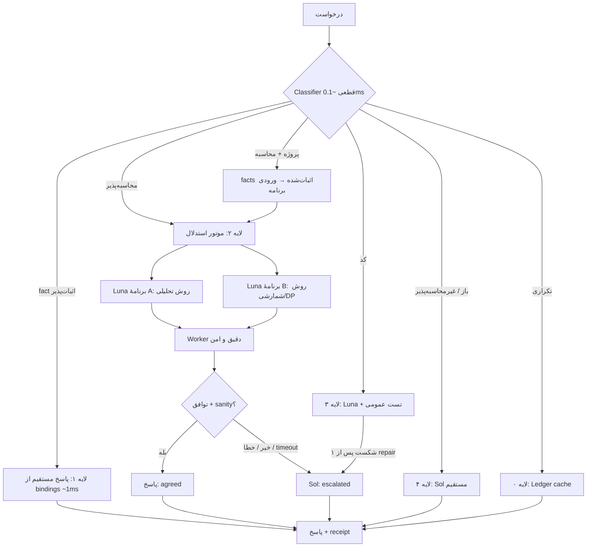

# معماری v6: استدلالِ محاسبه‌پذیر، آبشار مدل و مسیر سریع

تاریخ: ۲ اکتبر ۲۰۲۶. وضعیت: **طراحی برای تأیید**. در این مرحله کدی نوشته نشده و هیچ مدلی فراخوانی نشده است. v5 و Flux اصلی تغییر نمی‌کنند.

## ۱. تصمیم اصلی در یک جمله

**از Luna استدلال نخواه؛ از او برنامه بخواه.** محاسبه را کامپیوتر انجام می‌دهد. دو برنامه با دو روش مستقل یکدیگر را کنترل می‌کنند. هر جا توافق نشد، فقط همان‌جا Sol وارد می‌شود. سؤال‌هایی که حافظه جواب اثبات‌شده‌شان را دارد اصلاً به مدل نمی‌رسند.

## ۲. شواهد اندازه‌گیری‌شده‌ای که طراحی روی آن بنا شده

| سنجه | Luna | Sol | منبع |
|---|---|---|---|
| استدلال بسته، پاسخ مستقیم | **۱۳/۳۲ (۴۱٪)** | **۳۲/۳۲ (۱۰۰٪)** | پایلوت مسیریاب، ۲ نمونه |
| زمان استدلال (میانه / p95) | ۵٫۳ / ۱۰٫۴ s | ۱۰٫۴ / ۲۱٫۰ s | همان |
| میانگین توکن خروجی در استدلال | **۱۴** | ۹۹ | همان |
| تولید کد با تست (بدون C04) | ۱۲/۱۴ (۸۶٪) | ۱۴/۱۴ | همان |
| کد C00 تا C03 در سه اجرای مستقل | همه درست | همه درست | v3، v5 live، مسیریاب |
| سربار یک فراخوانی Codex CLI | پاسخ ۷ توکنی در ۵٫۱ تا ۹٫۹ s با حدود ۱۶٫۸ هزار توکن scaffold | — | probeها |
| سؤال واقعیتی، پاسخ مستقیم از bindings در v5 | — | — | ۱۰/۱۰ درست، میانهٔ ۰٫۶۴ ms، بدون مدل |

برداشت‌ها:
1. Luna در استدلال تقریباً بدون محاسبه جواب می‌دهد (میانگین ۱۴ توکن خروجی). خطاهایش از نوع «حساب‌نکردن» است: CRT، امید ریاضی الگوی تاس، احتمال شرطی، کوتاه‌ترین مسیر. همهٔ این مسئله‌ها با برنامه دقیقاً قابل حل‌اند.
2. Luna در نوشتن برنامه قوی است، پس فرضیهٔ اصلی این است که **استدلال را به تولید کد تبدیل کنیم**. این فرض هنوز آزموده نشده است.
3. حدود ۵ ثانیه از هر فراخوانی، سربار انتقال است، نه تفکر مدل. در مسیرهایی که مدل لازم دارند، بزرگ‌ترین اهرم سرعت همین سربار است.
4. v5 نمی‌تواند استدلال را escalate کند: verifier برای مسئلهٔ متنی `unverified` برمی‌گرداند و escalation فقط با `contradicted` فعال می‌شود.

## ۳. اصول

1. **ارزان‌ترین لایه‌ای که بتواند درستی را نشان دهد.** ترتیب لایه‌ها: کش، سپس پاسخ اثبات‌شده بدون مدل، سپس محاسبه با Luna، و در آخر Sol.
2. **محاسبه به‌جای حدس.** هر سؤالی که داده‌اش در خود سؤال است و پاسخ عددی یا ساختاری دارد، به برنامه تبدیل می‌شود.
3. **بررسی بدون gold.** درستی با یکی از این‌ها سنجیده می‌شود: اثبات منبع، تست عمومی، حساب دقیق، یا توافق دو روش مستقل. self-critique بدون بازخورد بیرونی، مجوز پذیرش نیست.
4. **موازی به‌جای پشت‌سرهم.** کارهای مستقل همزمان اجرا می‌شوند و به محض رسیدن به جواب پذیرفتنی، اجرا متوقف می‌شود.
5. **سقف قطعی.** حداکثر ۳ فراخوانی برای هر درخواست استدلالی، و deadline مشخص. بعد از سقف، مسیر پنهانی وجود ندارد.

## ۴. نمای کلی



| لایه | چه چیزی را جواب می‌دهد | فراخوانی مدل | زمان هدف | وضعیت درستی |
|---|---|---|---|---|
| ۰ Ledger | همان درخواست، همان snapshot و همان policy | ۰ | < ۵ ms | همان وضعیت قبلی |
| ۱ مستقیم | fact، literal-set، quantity و relation یک‌hop با proof | ۰ | < ۵ ms (اندازه‌گیری‌شده: ۰٫۶۴ ms) | `proven` |
| ۲ استدلال | ریاضی، شمارش، احتمال، گراف، DP و امید ریاضی با دادهٔ درون سؤال | ۲ موازی، و +۱ فقط در صورت عدم توافق | p50 ≤ Sol مستقیم | `agreed` یا `escalated` |
| ۳ کد | تولید کد با تست عمومی | ۱، و ۱ repair یا escalation در صورت نیاز | ≈ Luna کد | `tested` |
| ۴ باز | استدلال متنی، داوری، توضیح بدون checker | ۱ (Sol) | ≈ Sol | `unverified` |

## ۵. Classifier (قطعی، بدون مدل)

ورودی: درخواست، snapshot پروژه و policy. خروجی: `kind` و `answer_spec`.

| kind | نشانه‌ها | مسیر |
|---|---|---|
| `fact` | نیاز typed که با v5 `resolve` حل شده و ابهام ندارد | لایه ۱ |
| `computable` | دست‌کم دو عدد یا یک ساختار داده (فهرست یال، مجموعه، توزیع) در متن، به‌اضافهٔ فعل محاسبه (how many، probability، minimum، expected، shortest، mod، rounded؛ و در فارسی چند، احتمال، حداقل، امید ریاضی، کوتاه‌ترین، باقیمانده)، بدون anchor پروژه | لایه ۲ |
| `project_computable` | anchor پروژه یا fact، همراه با فعل محاسبه | facts از لایه ۱ به ورودی برنامه، سپس لایه ۲ |
| `code` | write/implement + function یا class، یا وجود public_tests | لایه ۳ |
| `open` | هیچ‌کدام از موارد بالا، یا درخواست توضیح، مقایسه یا داوری | لایه ۴ |
| `uncertain` | نشانه‌های متعارض | لایه ۲ با escalation زودتر |

`answer_spec` به‌صورت قطعی از متن سؤال استخراج می‌شود:
- `integer` برای «how many» یا «smallest integer»؛
- `decimal(n)` برای «rounded to n decimals»؛
- `probability` برای مقدار در بازهٔ [0, 1]؛
- و همچنین `fraction`، `set` و `string`.

این مشخصه برای نرمال‌سازی جواب، مقایسهٔ دو برنامه و sanity check استفاده می‌شود.

## ۶. موتور استدلال (لایه ۲)

### ۶.۱ صورت‌بندی به برنامه (Program-of-Thought)

قرارداد خروجی Luna کوتاه و فقط کد است، بدون توضیح، تا زمان تولید کم بماند:

```text
Return only JSON: {"code": "def solve():\n    ..."}
- solve() takes no input and returns the final answer (int, Fraction, or str for sets).
- Exact arithmetic: int and fractions.Fraction. No floats until the final rounding the question asks for.
- No randomness, no simulation, no I/O.
- Allowed imports: math, fractions, itertools, functools, collections, heapq, bisect.
```

دو برنامه **همزمان** و با دو راهنمای روش متفاوت ساخته می‌شوند تا خطاهایشان کمتر هم‌بسته باشد:

| برنامه | راهنما | نمونه |
|---|---|---|
| A: تحلیلی | فرمول، قضیه یا الگوریتم استاندارد | CRT با روش ساختی؛ بیز با فرمول |
| B: شمارشی | شمارش مستقیم، DP یا حل دستگاه حالت روی خود نمونه | جست‌وجوی x تا حاصل‌ضرب پیمانه‌ها؛ زنجیرهٔ مارکوف با Fraction |

### ۶.۲ Worker دقیق و امن

worker فعلی برای استدلال کافی نیست؛ همین محدودیت بود که C04 را به‌اشتباه رد کرد. تغییرات لازم:
- اجازهٔ `nonlocal`، و ماژول‌های `fractions`، `pow`، `divmod` و `round`؛
- اجازهٔ تعریف تابع تودرتو و `functools.lru_cache`.

و همچنان ممنوع:
- `eval` و `exec`، فایل، شبکه، و attributeهای خصوصی؛
- import خارج از فهرست مجاز.

سقف‌ها: ۲ ثانیه CPU، ۲۵۶ MB حافظه (با Job Object در ویندوز)، عمق recursion ۲۰۰۰، و طول خروجی محدود.

خروجی worker یک `exec_receipt` است با این اطلاعات: وضعیت (`ok`، `error`، `timeout`)، مقدار نرمال‌شده، زمان اجرا و hash کد.

### ۶.۳ بررسی بدون gold: توافق و sanity

```text
normalize(value, answer_spec):
  integer     → int (Fraction با مخرج ۱ هم قبول است)
  decimal(n)  → round(Fraction, n), مقایسه پس از گرد کردن
  probability → Fraction در [0,1]
  set/string  → canonical JSON مرتب

accept if:
  both exec ok
  and normalize(A) == normalize(B)
  and sanity(answer_spec) passes     # بازه، نوع، صحیح بودن، گرد شدن خواسته‌شده
status = "agreed"
```

- **توافق، اثبات نیست.** اگر هر دو برنامه سؤال را یکسان بد فهمیده باشند، خطا پنهان می‌ماند. نرخ این «توافق غلط» سنجهٔ اصلی ایمنی است و جداگانه گزارش می‌شود (بخش ۱۳).
- اگر فقط یکی از دو برنامه اجرا شود، یا فقط یکی از sanity عبور کند، **پذیرفته نمی‌شود** و escalation انجام می‌شود.

### ۶.۴ آبشار به Sol

escalation در این حالت‌ها اتفاق می‌افتد:
- عدم توافق؛
- خطا یا timeout در یکی از دو برنامه؛
- شکست sanity؛
- `kind=uncertain` همراه با هر نشانهٔ ضعف.

Sol مستقل حل می‌کند و برنامه‌های Luna را نمی‌بیند تا تحت تأثیر قرار نگیرد. قرارداد خروجی Sol هم PoT است، با fallback به پاسخ مستقیم.
- اگر جواب Sol با یکی از دو برنامه برابر باشد، وضعیت `escalated_agreed` است.
- در غیر این صورت، جواب Sol با وضعیت `escalated_single` گزارش می‌شود.

مزیت این طرح از v5: escalation دیگر به `contradicted` وابسته نیست، پس برای استدلال واقعاً کار می‌کند.

### ۶.۵ استدلال وابسته به پروژه: fact به‌عنوان ورودی برنامه

برای سؤالی مثل «اگر retry_limit و timeout این سرویس را در نظر بگیریم، حداکثر زمان انتظار چقدر است؟»:
1. لایه ۱ مقدارهای typed و اثبات‌شده را پیدا می‌کند.
2. برنامه فقط از طریق `facts["need_id"]` به آن مقدارها دسترسی دارد. controller مقدارها را تزریق می‌کند و Luna عدد را در کد نمی‌نویسد.
3. receipt هر عدد ورودی را به `unit_id` منبعش وصل می‌کند.

نتیجه این است که مدل نمی‌تواند عدد پروژه را حدس بزند. حافظه و استدلال از این طریق با هم ترکیب می‌شوند.

### ۶.۶ استدلال باز

برای درخواست‌هایی که checker معتبری ندارند (توضیح، مقایسهٔ طراحی، داوری)، مستقیم Sol استفاده می‌شود و پاسخ با وضعیت `unverified` برمی‌گردد. v6 دربارهٔ درستی معنایی این پاسخ‌ها ادعایی نمی‌کند.

## ۷. معماری سرعت

### ۷.۱ زمان هر لایه کجا خرج می‌شود؟

| مرحله | زمان فعلی | مالک |
|---|---|---|
| Classifier، retrieve و bindings | < ۱ ms (اندازه‌گیری‌شده) | محلی |
| اجرای برنامه در worker | حدود ۵۰ تا ۲۰۰ ms، شامل راه‌اندازی پردازه (تخمین) | محلی |
| سربار هر فراخوانی CLI | حدود ۵ s (اندازه‌گیری‌شده با پاسخ ۷ توکنی) | انتقال |
| تولید کد ۱۵۰ تا ۲۰۰ توکنی توسط Luna | حدود ۳ تا ۴ s بالای سربار (p50 کد ۸٫۸ s) | مدل |
| Sol | p50 ۱۰٫۴ s، p95 ۲۱ s | مدل |

نتیجه: در مسیرهایی که مدل لازم دارند، بیش از نیمی از زمان، سربار انتقال است.

### ۷.۲ Gateway: حذف سربار هر فراخوانی

یک ماژول `gateway` جایگزین اجرای `codex exec` جدید برای هر سؤال می‌شود. سه گزینه به ترتیب ترجیح:
1. **نشست ماندگار** (یک پردازهٔ طولانی‌عمر یا حالت server/session، اگر provider پشتیبانی کند): راه‌اندازی، احراز هویت و scaffold یک بار هزینه می‌شوند.
2. **API مستقیم**: scaffold حدود ۱۶٫۸ هزار توکنی حذف می‌شود. این گزینه اعتبار API لازم دارد که فعلاً نیست.
3. **CLI فعلی** به‌عنوان fallback.

پیش از تصمیم، یک probe بدون هزینهٔ قابل‌توجه زمان پاسخ ۷ توکنی را در هر گزینه می‌سنجد. هدف کمتر از ۱ ثانیه است. این هدف یک فرض است و ممکن است provider اجازه ندهد.

### ۷.۳ موازی‌سازی و hedging

- دو برنامهٔ A و B همزمان فرستاده می‌شوند، پس زمان برابر بیشینهٔ آن دو است، نه مجموعشان.
- **Hedged escalation:** اگر توافق تا زمان `T_hedge` (پیش‌فرض: p75 اندازه‌گیری‌شدهٔ Luna PoT) حاصل نشد، Sol همان لحظه شروع می‌شود و منتظر تمام‌شدن هر دو برنامه نمی‌ماند. این کار دم توزیع زمان را کوتاه می‌کند، بدون این‌که برای همهٔ درخواست‌ها Sol پرداخت شود.
- دو حالت policy:
  - `economy`: escalation پشت‌سرهم؛
  - `fast`: hedging فعال، که سهم Sol کمی بیشتر می‌شود.

### ۷.۴ کش‌ها

| کش | کلید | اثر |
|---|---|---|
| Ledger (موجود در v5) | hash درخواست + snapshot + policy | تکرار درخواست بدون هیچ فراخوانی |
| کش برنامه | hash متن نرمال‌شدهٔ سؤال + answer_spec | سؤال تکراری بدون مدل؛ فقط اجرای worker |
| حافظهٔ روال (procedural memory) | امضای مسئله (نوع + ساختار پارامترها) | فاز بعد: solverهای تأییدشدهٔ پارامتری برای سؤال‌های پرتکرار پروژه، مثل محاسبهٔ بودجه و timeout. ورود به حافظه فقط از طریق proposal و تأیید انسانی |

### ۷.۵ قواعد کوتاه‌نگه‌داشتن هر فراخوانی

- خروجی فقط کد یا JSON، بدون توضیح.
- prefix ثابت در ابتدای prompt برای cache؛ بخش متغیر در انتها.
- بستهٔ شواهد فقط در لایه‌های ۳ و `project_computable`. استدلال بسته هیچ بسته‌ای ندارد.

## ۸. قرارداد و وضعیت‌ها

```text
RequestSpec(v5) + {kind, answer_spec, latency_mode: economy|fast}
Attempt = {model, role: A|B|sol|code|repair, prompt_hash, receipt, exec_receipt?}
Result.status ∈ {
  proven            # لایه ۱: proof منبع
  tested            # لایه ۳: تست عمومی پاس
  agreed            # لایه ۲: دو روش مستقل برابر + sanity
  escalated_agreed  # Sol با یکی از دو برنامه برابر
  escalated_single  # فقط Sol
  unverified        # لایه ۴ یا بدون checker
  failed / budget_exceeded / deadline
}
```

`proven` و `tested` اثبات‌اند. `agreed` و `escalated_agreed` شواهد قوی‌اند، نه اثبات. این تفاوت در UI و در گزارش‌ها حفظ می‌شود.

## ۹. شبه‌الگوریتم

```text
def answer(request, snapshot, policy):
    if hit := ledger.get(fingerprint(request, snapshot, policy)): return hit
    kind, spec = classify(request, snapshot)                      # ~0.1 ms

    if kind == "fact":
        pack = retrieve(snapshot, request)                         # v5
        if all_required_resolved(pack): return proven(direct_claims(pack))
        kind = "open"                                              # بدون proof → مدل

    if kind in ("computable", "project_computable", "uncertain"):
        facts = typed_inputs(snapshot, request) if kind == "project_computable" else {}
        if hit := program_cache.get(key(request, spec)): return run_cached(hit, facts)
        a, b = parallel(luna_program(request, spec, facts, method="analytic"),
                        luna_program(request, spec, facts, method="exhaustive"),
                        hedge_after=policy.T_hedge if policy.fast else None)
        ra, rb = worker(a, facts), worker(b, facts)
        if agree(ra, rb, spec) and sanity(ra, spec): return agreed(ra)
        s = sol_solve(request, spec, facts)                        # یا نتیجهٔ hedge
        return escalated(s, matches=[ra, rb])

    if kind == "code":
        c = luna_code(request); t = public_tests(c)
        if t.pass: return tested(c)
        c2 = luna_repair(request, t.diagnostics); t2 = public_tests(c2)
        return tested(c2) if t2.pass else escalated(sol_code(request))

    return unverified(sol_answer(request))                         # open
```

حداکثر فراخوانی برای هر نوع:

| نوع | حداکثر فراخوانی |
|---|---|
| fact | ۰ |
| computable | ۳ (۲ Luna + ۱ Sol) |
| code | ۳ |
| open | ۱ |

## ۱۰. تغییرات نسبت به v5

| v5 | v6 |
|---|---|
| fact با مدل کپی و سپس verify می‌شد | fact مستقیم از bindings، بدون مدل |
| escalation فقط با `contradicted` | escalation با عدم توافق، خطا، sanity یا uncertain |
| ریاضی متنی `unverified` باقی می‌ماند | ریاضی به دو برنامه تبدیل و با توافق بررسی می‌شود |
| worker بدون `nonlocal` و `fractions` | worker دقیق، با سقف CPU و حافظه |
| هر فراخوانی یک `codex exec` تازه | gateway با نشست ماندگار یا API، با fallback به CLI |
| فراخوانی‌ها پشت‌سرهم | A و B موازی، hedging اختیاری |
| حداکثر ۲ فراخوانی | سقف بر اساس نوع درخواست (۰ تا ۳) |

حافظه، snapshot، typed extraction، بودجهٔ توکن و ledger از v5 بدون تغییر استفاده می‌شوند.

## ۱۱. ریسک‌ها و حالت‌های شکست

| ریسک | اثر | کنترل |
|---|---|---|
| هر دو برنامه سؤال را یکسان بد بفهمند | توافق غلط | راهنمای دو روش متفاوت؛ سنجش نرخ توافق غلط؛ اگر بالاتر از سقف بود، سومین روش از Sol |
| Luna برنامهٔ کند بنویسد | timeout و escalation | سقف ۲ ثانیه؛ پرامپت روش شمارشی با DP به‌جای brute force |
| classifier سؤال باز را محاسبه‌پذیر بداند | دو فراخوانی هدر می‌رود | خروجی غیرعددی یا بدون sanity → escalation؛ سنجش دقت classifier |
| گرد کردن یا فرمت | رد نادرست | نرمال‌سازی با answer_spec؛ مقایسه با Fraction |
| کد مخرب | امنیت | worker محدود؛ بدون فایل و شبکه؛ برای production، sandbox سیستم‌عامل لازم است |
| gateway در دسترس نباشد | سرعت فقط از موازی‌سازی | fallback به CLI؛ هدف سرعت جدا گزارش می‌شود |
| هزینه | دو فراخوانی Luna برای هر سؤال | مقایسه با یک Sol؛ نسبت قیمت واقعی gpt-6 باید از provider گرفته شود |

## ۱۲. طرح آزمون

**فاز ۰، offline (بدون مدل):**
- worker جدید با تست واحد، شامل `nonlocal`، Fraction، timeout، و رد import یا فایل.
- دقت classifier روی ۷۶ سؤال برچسب‌دار.
- نرمال‌سازی و sanity با جواب‌های مرجع.
- مجموعهٔ تازهٔ ۶۰ مسئلهٔ محاسبه‌پذیر با gold محاسبه‌شده توسط برنامهٔ مرجع، در هشت خانواده: احتمال، نظریهٔ اعداد، ترکیبیات، DP و بهینه‌سازی، گراف، امید ریاضی و مارکوف، دنباله، و مسئلهٔ متنی فارسی.
- علاوه بر این، ۱۶ سؤال قدیمی R00 تا R15 به‌عنوان regression.

**فاز ۱، اجرای واقعی (نیاز به تأیید سهمیه):** بازوها روی همان ۷۶ سؤال، با ۲ نمونه:

| بازو | فراخوانی برای هر سؤال |
|---|---|
| Luna مستقیم (baseline) | ۱ |
| Luna PoT تکی | ۱ |
| Luna PoT جفت با توافق | ۲ |
| آبشار کامل v6 | ۲ + escalation |
| Sol مستقیم (مرجع) | ۱ |

جواب Sol در بازوی آبشار با همان prompt مرجع ساخته می‌شود و قابل بازاستفاده است. تخمین کل: حدود ۴۵۰ تا ۵۰۰ فراخوانی. نسخهٔ کوچک‌تر با ۴۰ سؤال و یک نمونه حدود ۱۶۰ فراخوانی است.

**فاز ۲، gateway:** probe زمان پاسخ کوتاه در هر روش انتقال. فقط اگر provider پشتیبانی کند.

## ۱۳. معیارهای پذیرش

تعریف «۹۵٪» قبل از اجرا ثابت می‌شود:

| معیار | هدف | مبنا |
|---|---|---|
| **قوی‌تر:** کاهش خطای استدلال نسبت به Luna مستقیم | ≥ ۹۵٪، یعنی خطا از حدود ۵۹٪ به ≤ ۳٪ | پایلوت مسیریاب |
| کیفیت در برابر Sol مستقیم | افت ≤ ۲ واحد درصد، با حد پایین بازهٔ اطمینان | همان |
| نرخ توافق غلط (agreed ولی غلط) | ≤ ۲٪ از پذیرفته‌ها | جدید |
| سهم Sol در استدلال | ≤ ۳۵٪ | جدید |
| **سریع‌تر:** لایهٔ fact | ≥ ۹۵٪ کاهش زمان (اندازه‌گیری‌شده: ۹۹٫۹۹٪) | v5 live |
| زمان استدلال با CLI | p50 ≤ p50 Sol مستقیم (۱۰٫۴ s) | پایلوت مسیریاب |
| زمان استدلال با gateway | p50 ≤ ۳ s (فرض؛ مشروط به provider) | فاز ۲ |
| دقت classifier | ≥ ۹۵٪ و صفر مورد fact اشتباه | فاز ۰ |

**مرز صادقانه:** با CLI فعلی، «۹۵٪ سریع‌تر» فقط برای fact و کش ممکن است. برای استدلال، هدف واقعی رسیدن به کیفیت Sol با هزینهٔ کمتر و latency برابر یا کمتر است. ۹۵٪ سرعت در استدلال تنها با gateway قابل بررسی است.

## ۱۴. ترتیب ساخت پس از تأیید

1. `worker_v6.py` و تست‌هایش (offline).
2. `classifier_v6.py` و `answer_spec` همراه با مجموعهٔ برچسب‌دار (offline).
3. `reasoning_v6.py`: PoT، توافق، sanity و آبشار، روی provider ساختگی (offline).
4. لایهٔ fact مستقیم در `controller_v6.py` روی snapshot نسخهٔ v5 (offline؛ قبلاً ۱۰/۱۰ اندازه‌گیری شده).
5. ساخت مجموعهٔ ۶۰ مسئلهٔ تازه و freeze با hash.
6. توقف برای تأیید اجرای واقعی فاز ۱.
7. `gateway_v6.py` و probe فاز ۲.

## منابع

داخلی:
- `experiments/router_pilot_20261002/results.json`
- `experiments/luna_v4_v5_live_20261002/results.json`
- `experiments/request_memory_v5_20261002/` (`engine_v5.py`، `verifier_v5.py`، `controller_v5.py`)
- `docs/memory-research-20261002/Flux_Memory_Research_FA.pdf`

پژوهش، به‌عنوان الهام طراحی و نه نتیجهٔ منتقل‌شده:
- [PAL: Program-aided Language Models](https://arxiv.org/abs/2211.10435)
- [Program of Thoughts Prompting](https://arxiv.org/abs/2211.12588)
- [Self-Consistency](https://arxiv.org/abs/2203.11171)
- [FrugalGPT (آبشار مدل‌ها)](https://arxiv.org/abs/2305.05176)
- [RouteLLM](https://arxiv.org/abs/2406.18665)
- [LLMs Cannot Self-Correct Reasoning Yet](https://arxiv.org/abs/2310.01798)
- The Tail at Scale (Dean & Barroso, CACM 2013) برای hedged requests
